# SepTrustLevelCheck

- RVA: `0x003ED7E0`–`0x003EDA2C` (길이 `588` bytes)
- VA: `0x00000001403ED7E0`
- 실행 섹션: `.text`
- PDB 이름 있음: `예`; PDB Function 태그: `아니요`
- unwind 정보 RVA: `0x0009694C`
- 디코드: `159`개 명령, `588/588` bytes 표시
- 미해석 바이트: `0` (있으면 어셈블리에 `.byte`로 보존)

> 이 문서는 커널 이미지의 기계어와 PDB 기호를 분석해 생성했습니다. 4번과 5번은 함수 원형과 자료형을 바이너리 사용 방식에서 추정한 C 해석이며 원본 소스 복구 결과는 아닙니다.

## 1. Dependencies

- 직접 호출 지점: **9**; 고유 호출 대상: **6**
- 직접 호출자로 확인된 함수: **4**
- RIP 상대 이미지 참조: **0**

### Outgoing calls
- `0x003ED8E0` → [RtlIsValidProcessTrustLabelSid](RtlIsValidProcessTrustLabelSid_function_003EE070.md) (function, `0x003EE070`)
- `0x003ED92D` → [ExReleaseResourceLite](../25/ExReleaseResourceLite_function_0025FA10.md) (function, `0x0025FA10`)
- `0x003ED93B` → [KeLeaveCriticalRegionThread](../25/KeLeaveCriticalRegionThread_function_0025EFF0.md) (function, `0x0025EFF0`)
- `0x003ED95B` → [RtlIsValidProcessTrustLabelSid](RtlIsValidProcessTrustLabelSid_function_003EE070.md) (function, `0x003EE070`)
- `0x003ED972` → [RtlIsValidProcessTrustLabelSid](RtlIsValidProcessTrustLabelSid_function_003EE070.md) (function, `0x003EE070`)
- `0x003ED99E` → [RtlIsValidProcessTrustLabelSid](RtlIsValidProcessTrustLabelSid_function_003EE070.md) (function, `0x003EE070`)
- `0x003ED9F4` → [ExAcquireResourceSharedLite](../21/ExAcquireResourceSharedLite_function_00211BC0.md) (function, `0x00211BC0`)
- `0x003EDA0E` → [SeUnlockSubjectContext](../../page/8C/SeUnlockSubjectContext_function_008C6520.md) (function, `0x008C6520`)
- `0x003EDA1B` → [SeLockSubjectContext](../../page/8C/SeLockSubjectContext_function_008C64C0.md) (function, `0x008C64C0`)

### Direct callers
- [SeAccessCheckWithHint](../3A/SeAccessCheckWithHint_function_003A6C30.md) at `0x003A6DA7`
- [SeAccessCheckByType](../44/SeAccessCheckByType_function_00440BC8.md) at `0x00441277`
- [SepCommonAccessCheckEx](../47/SepCommonAccessCheckEx_function_0047602C.md) at `0x004762D8`
- [SepAccessCheckAndAuditAlarm](../../page/A1/SepAccessCheckAndAuditAlarm_function_00A1AF4C.md) at `0x00A1B83A`

### Static image references
- 디코드된 RIP-relative 메모리 참조가 없습니다.

## 2. Other-region calls and transfers

- 다른 실행 섹션으로 향하는 call: **2**
  - `0x003EDA0E` → [SeUnlockSubjectContext](../../page/8C/SeUnlockSubjectContext_function_008C6520.md) (`.text` → `PAGE`)
  - `0x003EDA1B` → [SeLockSubjectContext](../../page/8C/SeLockSubjectContext_function_008C64C0.md) (`.text` → `PAGE`)
- 별도 외부 분기/꼬리 이동을 확인하지 못했습니다.

## 3. Assembly (complete function range)

```asm
003ED7E0  48 89 5C 24 08                  mov qword ptr [rsp + 8], rbx
003ED7E5  48 89 6C 24 10                  mov qword ptr [rsp + 0x10], rbp
003ED7EA  48 89 74 24 18                  mov qword ptr [rsp + 0x18], rsi
003ED7EF  57                              push rdi
003ED7F0  41 56                           push r14
003ED7F2  41 57                           push r15
003ED7F4  48 83 EC 20                     sub rsp, 0x20
003ED7F8  0F B7 7A 02                     movzx edi, word ptr [rdx + 2]
003ED7FC  33 DB                           xor ebx, ebx
003ED7FE  45 32 FF                        xor r15b, r15b
003ED801  49 8B E9                        mov rbp, r9
003ED804  4D 8B F0                        mov r14, r8
003ED807  4C 8B DA                        mov r11, rdx
003ED80A  44 8B D3                        mov r10d, ebx
003ED80D  40 F6 C7 10                     test dil, 0x10
003ED811  74 58                           je 0x1403ed86b
003ED813  66 85 FF                        test di, di
003ED816  0F 89 29 01 00 00               jns 0x1403ed945
003ED81C  41 8B 43 0C                     mov eax, dword ptr [r11 + 0xc]
003ED820  85 C0                           test eax, eax
003ED822  74 47                           je 0x1403ed86b
003ED824  49 03 C3                        add rax, r11
003ED827  48 85 C0                        test rax, rax
003ED82A  74 3F                           je 0x1403ed86b
003ED82C  44 0F B7 40 04                  movzx r8d, word ptr [rax + 4]
003ED831  48 8D 48 08                     lea rcx, [rax + 8]
003ED835  8B D3                           mov edx, ebx
003ED837  41 3B D0                        cmp edx, r8d
003ED83A  73 2F                           jae 0x1403ed86b
003ED83C  41 3B D2                        cmp edx, r10d
003ED83F  72 05                           jb 0x1403ed846
003ED841  80 39 14                        cmp byte ptr [rcx], 0x14
003ED844  74 4C                           je 0x1403ed892
003ED846  0F B7 41 02                     movzx eax, word ptr [rcx + 2]
003ED84A  FF C2                           inc edx
003ED84C  48 03 C8                        add rcx, rax
003ED84F  EB E6                           jmp 0x1403ed837
003ED851  44 8D 52 01                     lea r10d, [rdx + 1]
003ED855  48 85 C9                        test rcx, rcx
003ED858  75 B9                           jne 0x1403ed813
003ED85A  48 85 C9                        test rcx, rcx
003ED85D  74 0C                           je 0x1403ed86b
003ED85F  8B 71 04                        mov esi, dword ptr [rcx + 4]
003ED862  48 8D 79 08                     lea rdi, [rcx + 8]
003ED866  48 85 FF                        test rdi, rdi
003ED869  75 2F                           jne 0x1403ed89a
003ED86B  48 8B 44 24 70                  mov rax, qword ptr [rsp + 0x70]
003ED870  C7 00 FF FF FF FF               mov dword ptr [rax], 0xffffffff
003ED876  48 8B 6C 24 48                  mov rbp, qword ptr [rsp + 0x48]
003ED87B  8B C3                           mov eax, ebx
003ED87D  48 8B 5C 24 40                  mov rbx, qword ptr [rsp + 0x40]
003ED882  48 8B 74 24 50                  mov rsi, qword ptr [rsp + 0x50]
003ED887  48 83 C4 20                     add rsp, 0x20
003ED88B  41 5F                           pop r15
003ED88D  41 5E                           pop r14
003ED88F  5F                              pop rdi
003ED890  C3                              ret
003ED891  CC                              int3
003ED892  F6 41 01 08                     test byte ptr [rcx + 1], 8
003ED896  74 C2                           je 0x1403ed85a
003ED898  EB B7                           jmp 0x1403ed851
003ED89A  38 5C 24 68                     cmp byte ptr [rsp + 0x68], bl
003ED89E  0F 85 34 01 00 00               jne 0x1403ed9d8
003ED8A4  48 85 ED                        test rbp, rbp
003ED8A7  0F 85 A1 00 00 00               jne 0x1403ed94e
003ED8AD  4D 8B 06                        mov r8, qword ptr [r14]
003ED8B0  4D 85 C0                        test r8, r8
003ED8B3  0F 84 0F 01 00 00               je 0x1403ed9c8
003ED8B9  49 8B 46 10                     mov rax, qword ptr [r14 + 0x10]
003ED8BD  4D 8B 80 50 04 00 00            mov r8, qword ptr [r8 + 0x450]
003ED8C4  4C 8B 88 50 04 00 00            mov r9, qword ptr [rax + 0x450]
003ED8CB  4D 85 C9                        test r9, r9
003ED8CE  0F 85 9B 00 00 00               jne 0x1403ed96f
003ED8D4  4D 85 C0                        test r8, r8
003ED8D7  0F 85 BE 00 00 00               jne 0x1403ed99b
003ED8DD  48 8B CF                        mov rcx, rdi
003ED8E0  E8 8B 07 00 00                  call 0x1403ee070
003ED8E5  84 C0                           test al, al
003ED8E7  0F 84 14 01 00 00               je 0x1403eda01
003ED8ED  4D 85 C0                        test r8, r8
003ED8F0  0F 84 90 00 00 00               je 0x1403ed986
003ED8F6  8B 47 08                        mov eax, dword ptr [rdi + 8]
003ED8F9  41 39 40 08                     cmp dword ptr [r8 + 8], eax
003ED8FD  0F 82 88 00 00 00               jb 0x1403ed98b
003ED903  8B 47 0C                        mov eax, dword ptr [rdi + 0xc]
003ED906  41 39 40 0C                     cmp dword ptr [r8 + 0xc], eax
003ED90A  72 7F                           jb 0x1403ed98b
003ED90C  48 8B 44 24 70                  mov rax, qword ptr [rsp + 0x70]
003ED911  C7 00 FF FF FF FF               mov dword ptr [rax], 0xffffffff
003ED917  45 84 FF                        test r15b, r15b
003ED91A  0F 84 56 FF FF FF               je 0x1403ed876
003ED920  48 85 ED                        test rbp, rbp
003ED923  0F 84 E2 00 00 00               je 0x1403eda0b
003ED929  48 8B 4D 30                     mov rcx, qword ptr [rbp + 0x30]
003ED92D  E8 DE 20 E7 FF                  call 0x14025fa10
003ED932  65 48 8B 0C 25 88 01 00 00      mov rcx, qword ptr gs:[0x188]
003ED93B  E8 B0 16 E7 FF                  call 0x14025eff0
003ED940  E9 31 FF FF FF                  jmp 0x1403ed876
003ED945  49 8B 43 18                     mov rax, qword ptr [r11 + 0x18]
003ED949  E9 D9 FE FF FF                  jmp 0x1403ed827
003ED94E  4C 8B 44 24 60                  mov r8, qword ptr [rsp + 0x60]
003ED953  4D 85 C0                        test r8, r8
003ED956  74 85                           je 0x1403ed8dd
003ED958  49 8B C8                        mov rcx, r8
003ED95B  E8 10 07 00 00                  call 0x1403ee070
003ED960  84 C0                           test al, al
003ED962  0F 85 75 FF FF FF               jne 0x1403ed8dd
003ED968  BB 0D 00 00 C0                  mov ebx, 0xc000000d
003ED96D  EB A8                           jmp 0x1403ed917
003ED96F  49 8B C9                        mov rcx, r9
003ED972  E8 F9 06 00 00                  call 0x1403ee070
003ED977  84 C0                           test al, al
003ED979  0F 85 55 FF FF FF               jne 0x1403ed8d4
003ED97F  BB 0D 00 00 C0                  mov ebx, 0xc000000d
003ED984  EB 91                           jmp 0x1403ed917
003ED986  39 5F 08                        cmp dword ptr [rdi + 8], ebx
003ED989  76 81                           jbe 0x1403ed90c
003ED98B  48 8B 4C 24 70                  mov rcx, qword ptr [rsp + 0x70]
003ED990  0F BA EE 18                     bts esi, 0x18
003ED994  89 31                           mov dword ptr [rcx], esi
003ED996  E9 7C FF FF FF                  jmp 0x1403ed917
003ED99B  49 8B C8                        mov rcx, r8
003ED99E  E8 CD 06 00 00                  call 0x1403ee070
003ED9A3  84 C0                           test al, al
003ED9A5  74 7B                           je 0x1403eda22
003ED9A7  4D 85 C9                        test r9, r9
003ED9AA  74 16                           je 0x1403ed9c2
003ED9AC  41 8B 40 08                     mov eax, dword ptr [r8 + 8]
003ED9B0  41 39 41 08                     cmp dword ptr [r9 + 8], eax
003ED9B4  72 12                           jb 0x1403ed9c8
003ED9B6  41 8B 40 0C                     mov eax, dword ptr [r8 + 0xc]
003ED9BA  41 39 41 0C                     cmp dword ptr [r9 + 0xc], eax
003ED9BE  73 93                           jae 0x1403ed953
003ED9C0  EB 06                           jmp 0x1403ed9c8
003ED9C2  41 39 58 08                     cmp dword ptr [r8 + 8], ebx
003ED9C6  76 8B                           jbe 0x1403ed953
003ED9C8  49 8B 46 10                     mov rax, qword ptr [r14 + 0x10]
003ED9CC  4C 8B 80 50 04 00 00            mov r8, qword ptr [rax + 0x450]
003ED9D3  E9 7B FF FF FF                  jmp 0x1403ed953
003ED9D8  48 85 ED                        test rbp, rbp
003ED9DB  74 3B                           je 0x1403eda18
003ED9DD  65 48 8B 04 25 88 01 00 00      mov rax, qword ptr gs:[0x188]
003ED9E6  B2 01                           mov dl, 1
003ED9E8  66 FF 88 E4 01 00 00            dec word ptr [rax + 0x1e4]
003ED9EF  90                              nop
003ED9F0  49 8B 49 30                     mov rcx, qword ptr [r9 + 0x30]
003ED9F4  E8 C7 41 E2 FF                  call 0x140211bc0
003ED9F9  41 B7 01                        mov r15b, 1
003ED9FC  E9 A3 FE FF FF                  jmp 0x1403ed8a4
003EDA01  BB 0D 00 00 C0                  mov ebx, 0xc000000d
003EDA06  E9 0C FF FF FF                  jmp 0x1403ed917
003EDA0B  49 8B CE                        mov rcx, r14
003EDA0E  E8 0D 8B 4D 00                  call 0x1408c6520
003EDA13  E9 5E FE FF FF                  jmp 0x1403ed876
003EDA18  49 8B CE                        mov rcx, r14
003EDA1B  E8 A0 8A 4D 00                  call 0x1408c64c0
003EDA20  EB D7                           jmp 0x1403ed9f9
003EDA22  BB 0D 00 00 C0                  mov ebx, 0xc000000d
003EDA27  E9 EB FE FF FF                  jmp 0x1403ed917
```

## 4. C-style interpretation (structured pseudocode)

```c
__int64 __fastcall SepTrustLevelCheck(__int64 a1, __int64 a2, __int64 a3, __int64 a4, __int64 a5, unsigned __int8 a6, __int64 a7)
{
    __int64 result;
    __int64 v_r15;
    __int64 v_rbx;
    __int64 v_rsp;
    unsigned __int64 v_stack_p10;
    unsigned __int64 v_stack_p18;
    unsigned __int64 v_stack_p8;

    v_stack_p8 = v_rbx;
    v_stack_p10 = v_rbp;
    v_stack_p18 = v_rsi;
    v_rsp = (v_rsp) - (32);
    v_rbx = 0;
    v_r15 = 0;
    if ((((unsigned __int8)(*(unsigned __int16 *)(a2 + 2))) & (16)) == 0) goto loc_003ED86B;
loc_003ED813:
    if (!sign_flag) goto loc_003ED945;
    if ((unsigned int)((unsigned int)(*(unsigned int *)(a2 + 12))) == 0) goto loc_003ED86B;
    result = ((unsigned int)(*(unsigned int *)(a2 + 12))) + (a2);
loc_003ED827:
    if (result == 0) goto loc_003ED86B;
loc_003ED837:
    if (0 >= ((unsigned int)(*(unsigned __int16 *)(result + 4)))) goto loc_003ED86B;
    if (0 < 0) goto loc_003ED846;
    if ((*(unsigned __int8 *)(result + 8)) == 20) goto loc_003ED892;
loc_003ED846:
    a2 = (unsigned int)((0) + 1);
    a1 = (result + 8) + (*(unsigned __int16 *)(result + 8 + 2));
    goto loc_003ED837;
loc_003ED851:
    if (a1 != 0) goto loc_003ED813;
loc_003ED85A:
    if (a1 == 0) goto loc_003ED86B;
    if (a1 + 8 != 0) goto loc_003ED89A;
loc_003ED86B:
    *(unsigned int *)(a7) = 0xFFFFFFFFULL;
loc_003ED876:
    v_rsp = (v_rsp) + (32);
    return 0;
loc_003ED892:
    if (((*(unsigned __int8 *)(a1 + 1)) & (8)) == 0) goto loc_003ED85A;
    goto loc_003ED851;
loc_003ED89A:
    if (a6 != ((unsigned __int8)(v_stack_p8))) goto loc_003ED9D8;
loc_003ED8A4:
    if (v_stack_p10 != 0) goto loc_003ED94E;
    if (*(unsigned __int64 *)(a3) == 0) goto loc_003ED9C8;
    if (*(unsigned __int64 *)(*(unsigned __int64 *)(a3 + 16) + 1104) != 0) goto loc_003ED96F;
loc_003ED8D4:
    if (*(unsigned __int64 *)(*(unsigned __int64 *)(a3) + 1104) != 0) goto loc_003ED99B;
loc_003ED8DD:
    result = RtlIsValidProcessTrustLabelSid(a1 + 8, a2, *(unsigned __int64 *)(*(unsigned __int64 *)(a3) + 1104), *(unsigned __int64 *)(*(unsigned __int64 *)(a3 + 16) + 1104));
    if ((unsigned __int8)(result) == 0) goto loc_003EDA01;
    if (*(unsigned __int64 *)(*(unsigned __int64 *)(a3) + 1104) == 0) goto loc_003ED986;
    if ((*(unsigned int *)(*(unsigned __int64 *)(*(unsigned __int64 *)(a3) + 1104) + 8)) < ((unsigned int)((unsigned int)(*(unsigned int *)(a1 + 8 + 8))))) goto loc_003ED98B;
    if ((*(unsigned int *)(*(unsigned __int64 *)(*(unsigned __int64 *)(a3) + 1104) + 12)) < ((unsigned int)((unsigned int)(*(unsigned int *)(a1 + 8 + 12))))) goto loc_003ED98B;
loc_003ED90C:
    *(unsigned int *)(a7) = 0xFFFFFFFFULL;
loc_003ED917:
    if (0 == 0) goto loc_003ED876;
    if (v_stack_p10 == 0) goto loc_003EDA0B;
    result = ExReleaseResourceLite(*(unsigned __int64 *)(v_stack_p10 + 48), a2, *(unsigned __int64 *)(*(unsigned __int64 *)(a3) + 1104), *(unsigned __int64 *)(*(unsigned __int64 *)(a3 + 16) + 1104));
    result = KeLeaveCriticalRegionThread(*(unsigned __int64 *)(gs_base + (0 + 392)), a2, *(unsigned __int64 *)(*(unsigned __int64 *)(a3) + 1104), *(unsigned __int64 *)(*(unsigned __int64 *)(a3 + 16) + 1104));
    goto loc_003ED876;
loc_003ED945:
    goto loc_003ED827;
loc_003ED94E:
loc_003ED953:
    if (a5 == 0) goto loc_003ED8DD;
    result = RtlIsValidProcessTrustLabelSid(a5, a2, a5, *(unsigned __int64 *)(*(unsigned __int64 *)(a3 + 16) + 1104));
    if ((unsigned __int8)(result) != 0) goto loc_003ED8DD;
    goto loc_003ED917;
loc_003ED96F:
    result = RtlIsValidProcessTrustLabelSid(*(unsigned __int64 *)(*(unsigned __int64 *)(a3 + 16) + 1104), a2, a5, *(unsigned __int64 *)(*(unsigned __int64 *)(a3 + 16) + 1104));
    if ((unsigned __int8)(result) != 0) goto loc_003ED8D4;
    goto loc_003ED917;
loc_003ED986:
    if ((*(unsigned int *)(a1 + 8 + 8)) <= ((unsigned int)((unsigned int)(0xC000000DULL)))) goto loc_003ED90C;
loc_003ED98B:
    *(unsigned int *)(a7) = (unsigned int)(v_stack_p18);
    goto loc_003ED917;
loc_003ED99B:
    result = RtlIsValidProcessTrustLabelSid(a5, a2, a5, *(unsigned __int64 *)(*(unsigned __int64 *)(a3 + 16) + 1104));
    if ((unsigned __int8)(result) == 0) goto loc_003EDA22;
    if (*(unsigned __int64 *)(*(unsigned __int64 *)(a3 + 16) + 1104) == 0) goto loc_003ED9C2;
    if ((*(unsigned int *)(*(unsigned __int64 *)(*(unsigned __int64 *)(a3 + 16) + 1104) + 8)) < ((unsigned int)((unsigned int)(*(unsigned int *)(a5 + 8))))) goto loc_003ED9C8;
    if ((*(unsigned int *)(*(unsigned __int64 *)(*(unsigned __int64 *)(a3 + 16) + 1104) + 12)) >= ((unsigned int)((unsigned int)(*(unsigned int *)(a5 + 12))))) goto loc_003ED953;
    goto loc_003ED9C8;
loc_003ED9C2:
    if ((*(unsigned int *)(a5 + 8)) <= ((unsigned int)((unsigned int)(0xC000000DULL)))) goto loc_003ED953;
loc_003ED9C8:
    goto loc_003ED953;
loc_003ED9D8:
    if (v_stack_p10 == 0) goto loc_003EDA18;
    result = ExAcquireResourceSharedLite(*(unsigned __int64 *)(*(unsigned __int64 *)(*(unsigned __int64 *)(a3 + 16) + 1104) + 48), 1, *(unsigned __int64 *)(*(unsigned __int64 *)(a3 + 16) + 1104), *(unsigned __int64 *)(*(unsigned __int64 *)(a3 + 16) + 1104));
loc_003ED9F9:
    goto loc_003ED8A4;
loc_003EDA01:
    goto loc_003ED917;
loc_003EDA0B:
    result = SeUnlockSubjectContext(a3, 1, *(unsigned __int64 *)(*(unsigned __int64 *)(a3 + 16) + 1104), *(unsigned __int64 *)(*(unsigned __int64 *)(a3 + 16) + 1104));
    goto loc_003ED876;
loc_003EDA18:
    result = SeLockSubjectContext(a3, 1, *(unsigned __int64 *)(*(unsigned __int64 *)(a3 + 16) + 1104), *(unsigned __int64 *)(*(unsigned __int64 *)(a3 + 16) + 1104));
    goto loc_003ED9F9;
loc_003EDA22:
    goto loc_003ED917;
}
```

## 5. (Beta) C Style

```c
int64_t SepTrustLevelCheck(int64_t Arg1, void *Arg2, void *Arg3, void *Arg4, int64_t Arg5, uint8_t Arg6, void *Arg7)
{
    uint8_t *arg2 = (uint8_t *)Arg2;
    uint8_t *arg3 = (uint8_t *)Arg3;
    uint8_t *arg4 = (uint8_t *)Arg4;
    uint8_t *arg7 = (uint8_t *)Arg7;

    int64_t result;
    int64_t local_r15;
    int64_t local_rbx;
    int64_t local_rsp;
    uint64_t v_stack_p10;
    uint64_t v_stack_p18;
    uint64_t v_stack_p8;

    v_stack_p8 = local_rbx;
    v_stack_p10 = local_rbp;
    v_stack_p18 = local_rsi;
    local_rsp = (local_rsp) - (32);
    local_rbx = 0;
    local_r15 = 0;
    if ((((uint8_t)(*(uint16_t *)(arg2 + 0x2))) & (16)) == 0) goto loc_003ED86B;
loc_003ED813:
    if (!sign_flag) goto loc_003ED945;
    if ((uint32_t)((uint32_t)(*(uint32_t *)(arg2 + 0xC))) == 0) goto loc_003ED86B;
    result = ((uint32_t)(*(uint32_t *)(arg2 + 0xC))) + (Arg2);
loc_003ED827:
    if (result == 0) goto loc_003ED86B;
loc_003ED837:
    if (0 >= ((uint32_t)(*(uint16_t *)(result + 0x4)))) goto loc_003ED86B;
    if (0 < 0) goto loc_003ED846;
    if ((*(uint8_t *)(result + 0x8)) == 20) goto loc_003ED892;
loc_003ED846:
    Arg2 = (uint32_t)((0) + 1);
    Arg1 = (result + 8) + (*(uint16_t *)(result + 0x8 + 0x2));
    goto loc_003ED837;
loc_003ED851:
    if (Arg1 != 0) goto loc_003ED813;
loc_003ED85A:
    if (Arg1 == 0) goto loc_003ED86B;
    if (Arg1 + 8 != 0) goto loc_003ED89A;
loc_003ED86B:
    *(uint32_t *)(arg7) = 0xFFFFFFFFULL;
loc_003ED876:
    local_rsp = (local_rsp) + (32);
    return 0;
loc_003ED892:
    if (((*(uint8_t *)(Arg1 + 0x1)) & (8)) == 0) goto loc_003ED85A;
    goto loc_003ED851;
loc_003ED89A:
    if (Arg6 != ((uint8_t)(v_stack_p8))) goto loc_003ED9D8;
loc_003ED8A4:
    if (v_stack_p10 != 0) goto loc_003ED94E;
    if (*(uint64_t *)(arg3) == 0) goto loc_003ED9C8;
    if (*(uint64_t *)(*(uint64_t *)(arg3 + 0x10) + 0x450) != 0) goto loc_003ED96F;
loc_003ED8D4:
    if (*(uint64_t *)(*(uint64_t *)(arg3) + 0x450) != 0) goto loc_003ED99B;
loc_003ED8DD:
    result = RtlIsValidProcessTrustLabelSid(Arg1 + 8, Arg2, *(uint64_t *)(*(uint64_t *)(arg3) + 0x450), *(uint64_t *)(*(uint64_t *)(arg3 + 0x10) + 0x450));
    if ((uint8_t)(result) == 0) goto loc_003EDA01;
    if (*(uint64_t *)(*(uint64_t *)(arg3) + 0x450) == 0) goto loc_003ED986;
    if ((*(uint32_t *)(*(uint64_t *)(*(uint64_t *)(arg3) + 0x450) + 0x8)) < ((uint32_t)((uint32_t)(*(uint32_t *)(Arg1 + 0x8 + 0x8))))) goto loc_003ED98B;
    if ((*(uint32_t *)(*(uint64_t *)(*(uint64_t *)(arg3) + 0x450) + 0xC)) < ((uint32_t)((uint32_t)(*(uint32_t *)(Arg1 + 0x8 + 0xC))))) goto loc_003ED98B;
loc_003ED90C:
    *(uint32_t *)(arg7) = 0xFFFFFFFFULL;
loc_003ED917:
    if (0 == 0) goto loc_003ED876;
    if (v_stack_p10 == 0) goto loc_003EDA0B;
    result = ExReleaseResourceLite(*(uint64_t *)(v_stack_p10 + 0x30), Arg2, *(uint64_t *)(*(uint64_t *)(arg3) + 0x450), *(uint64_t *)(*(uint64_t *)(arg3 + 0x10) + 0x450));
    result = KeLeaveCriticalRegionThread(*(uint64_t *)(gs_base + (0 + 0x188)), Arg2, *(uint64_t *)(*(uint64_t *)(arg3) + 0x450), *(uint64_t *)(*(uint64_t *)(arg3 + 0x10) + 0x450));
    goto loc_003ED876;
loc_003ED945:
    goto loc_003ED827;
loc_003ED94E:
loc_003ED953:
    if (Arg5 == 0) goto loc_003ED8DD;
    result = RtlIsValidProcessTrustLabelSid(Arg5, Arg2, Arg5, *(uint64_t *)(*(uint64_t *)(arg3 + 0x10) + 0x450));
    if ((uint8_t)(result) != 0) goto loc_003ED8DD;
    goto loc_003ED917;
loc_003ED96F:
    result = RtlIsValidProcessTrustLabelSid(*(uint64_t *)(*(uint64_t *)(arg3 + 0x10) + 0x450), Arg2, Arg5, *(uint64_t *)(*(uint64_t *)(arg3 + 0x10) + 0x450));
    if ((uint8_t)(result) != 0) goto loc_003ED8D4;
    goto loc_003ED917;
loc_003ED986:
    if ((*(uint32_t *)(Arg1 + 0x8 + 0x8)) <= ((uint32_t)((uint32_t)(0xC000000DULL)))) goto loc_003ED90C;
loc_003ED98B:
    *(uint32_t *)(arg7) = (uint32_t)(v_stack_p18);
    goto loc_003ED917;
loc_003ED99B:
    result = RtlIsValidProcessTrustLabelSid(Arg5, Arg2, Arg5, *(uint64_t *)(*(uint64_t *)(arg3 + 0x10) + 0x450));
    if ((uint8_t)(result) == 0) goto loc_003EDA22;
    if (*(uint64_t *)(*(uint64_t *)(arg3 + 0x10) + 0x450) == 0) goto loc_003ED9C2;
    if ((*(uint32_t *)(*(uint64_t *)(*(uint64_t *)(arg3 + 0x10) + 0x450) + 0x8)) < ((uint32_t)((uint32_t)(*(uint32_t *)(Arg5 + 0x8))))) goto loc_003ED9C8;
    if ((*(uint32_t *)(*(uint64_t *)(*(uint64_t *)(arg3 + 0x10) + 0x450) + 0xC)) >= ((uint32_t)((uint32_t)(*(uint32_t *)(Arg5 + 0xC))))) goto loc_003ED953;
    goto loc_003ED9C8;
loc_003ED9C2:
    if ((*(uint32_t *)(Arg5 + 0x8)) <= ((uint32_t)((uint32_t)(0xC000000DULL)))) goto loc_003ED953;
loc_003ED9C8:
    goto loc_003ED953;
loc_003ED9D8:
    if (v_stack_p10 == 0) goto loc_003EDA18;
    result = ExAcquireResourceSharedLite(*(uint64_t *)(*(uint64_t *)(*(uint64_t *)(arg3 + 0x10) + 0x450) + 0x30), 1, *(uint64_t *)(*(uint64_t *)(arg3 + 0x10) + 0x450), *(uint64_t *)(*(uint64_t *)(arg3 + 0x10) + 0x450));
loc_003ED9F9:
    goto loc_003ED8A4;
loc_003EDA01:
    goto loc_003ED917;
loc_003EDA0B:
    result = SeUnlockSubjectContext(Arg3, 1, *(uint64_t *)(*(uint64_t *)(arg3 + 0x10) + 0x450), *(uint64_t *)(*(uint64_t *)(arg3 + 0x10) + 0x450));
    goto loc_003ED876;
loc_003EDA18:
    result = SeLockSubjectContext(Arg3, 1, *(uint64_t *)(*(uint64_t *)(arg3 + 0x10) + 0x450), *(uint64_t *)(*(uint64_t *)(arg3 + 0x10) + 0x450));
    goto loc_003ED9F9;
loc_003EDA22:
    goto loc_003ED917;
}
```

### 관측된 메모리 오프셋

구조체 형식이 확인되지 않은 접근은 인자 기준의 오프셋으로만 기록했습니다.

| 기준 인자 | 오프셋 표현 | 폭 (bit) | 접근 |
|---|---:|---:|---|
| `Arg2` | `+ 0x2` | `16` | `R` |
| `Arg2` | `+ 0xC` | `32` | `R` |
| `Arg2` | `+ 0x18` | `64` | `R` |
| `Arg3` | `+ 0x0` | `64` | `R` |
| `Arg3` | `+ 0x10` | `64` | `R` |
| `Arg4` | `+ 0x30` | `64` | `R` |
| `Arg7` | `+ 0x0` | `32` | `W` |

## 6. Execution-region graph

[열기: 2D/3D 그래프와 함수 탐색 컨트롤 패널](../../../control-panel.html?section=text&rva=0x003ED7E0&view=graph)

- 2D 그래프는 위에서 아래로 흐르고, 3D 그래프는 빈 공간을 드래그해 회전합니다. Shift+드래그는 이동, 휠은 확대·축소, 함수 노드 선택은 대상 보고서 이동입니다.

### Static fallback

```mermaid
flowchart TD
  bb_003ED7E0[BB_003ED7E0]
  bb_003ED813[BB_003ED813]
  bb_003ED81C[BB_003ED81C]
  bb_003ED824[BB_003ED824]
  bb_003ED827[BB_003ED827]
  bb_003ED82C[BB_003ED82C]
  bb_003ED837[BB_003ED837]
  bb_003ED83C[BB_003ED83C]
  bb_003ED841[BB_003ED841]
  bb_003ED846[BB_003ED846]
  bb_003ED851[BB_003ED851]
  bb_003ED85A[BB_003ED85A]
  bb_003ED85F[BB_003ED85F]
  bb_003ED86B[BB_003ED86B]
  bb_003ED876[BB_003ED876]
  bb_003ED891[BB_003ED891]
  bb_003ED892[BB_003ED892]
  bb_003ED898[BB_003ED898]
  bb_003ED89A[BB_003ED89A]
  bb_003ED8A4[BB_003ED8A4]
  bb_003ED8AD[BB_003ED8AD]
  bb_003ED8B9[BB_003ED8B9]
  bb_003ED8D4[BB_003ED8D4]
  bb_003ED8DD[BB_003ED8DD]
  bb_003ED8ED[BB_003ED8ED]
  bb_003ED8F6[BB_003ED8F6]
  bb_003ED903[BB_003ED903]
  bb_003ED90C[BB_003ED90C]
  bb_003ED917[BB_003ED917]
  bb_003ED920[BB_003ED920]
  bb_003ED929[BB_003ED929]
  bb_003ED945[BB_003ED945]
  bb_003ED94E[BB_003ED94E]
  bb_003ED953[BB_003ED953]
  bb_003ED958[BB_003ED958]
  bb_003ED968[BB_003ED968]
  bb_003ED96F[BB_003ED96F]
  bb_003ED97F[BB_003ED97F]
  bb_003ED986[BB_003ED986]
  bb_003ED98B[BB_003ED98B]
  bb_003ED99B[BB_003ED99B]
  bb_003ED9A7[BB_003ED9A7]
  bb_003ED9AC[BB_003ED9AC]
  bb_003ED9B6[BB_003ED9B6]
  bb_003ED9C0[BB_003ED9C0]
  bb_003ED9C2[BB_003ED9C2]
  bb_003ED9C8[BB_003ED9C8]
  bb_003ED9D8[BB_003ED9D8]
  bb_003ED9DD[BB_003ED9DD]
  bb_003ED9F9[BB_003ED9F9]
  bb_003EDA01[BB_003EDA01]
  bb_003EDA0B[BB_003EDA0B]
  bb_003EDA18[BB_003EDA18]
  bb_003EDA22[BB_003EDA22]
  bb_003ED7E0 -->|branch| bb_003ED86B
  bb_003ED7E0 -->|fallthrough| bb_003ED813
  bb_003ED813 -->|branch| bb_003ED945
  bb_003ED813 -->|fallthrough| bb_003ED81C
  bb_003ED81C -->|branch| bb_003ED86B
  bb_003ED81C -->|fallthrough| bb_003ED824
  bb_003ED824 -->|flow| bb_003ED827
  bb_003ED827 -->|branch| bb_003ED86B
  bb_003ED827 -->|fallthrough| bb_003ED82C
  bb_003ED82C -->|flow| bb_003ED837
  bb_003ED837 -->|branch| bb_003ED86B
  bb_003ED837 -->|fallthrough| bb_003ED83C
  bb_003ED83C -->|branch| bb_003ED846
  bb_003ED83C -->|fallthrough| bb_003ED841
  bb_003ED841 -->|branch| bb_003ED892
  bb_003ED841 -->|fallthrough| bb_003ED846
  bb_003ED846 -->|branch| bb_003ED837
  bb_003ED851 -->|branch| bb_003ED813
  bb_003ED851 -->|fallthrough| bb_003ED85A
  bb_003ED85A -->|branch| bb_003ED86B
  bb_003ED85A -->|fallthrough| bb_003ED85F
  bb_003ED85F -->|branch| bb_003ED89A
  bb_003ED85F -->|fallthrough| bb_003ED86B
  bb_003ED86B -->|flow| bb_003ED876
  bb_003ED891 -->|flow| bb_003ED892
  bb_003ED892 -->|branch| bb_003ED85A
  bb_003ED892 -->|fallthrough| bb_003ED898
  bb_003ED898 -->|branch| bb_003ED851
  bb_003ED89A -->|branch| bb_003ED9D8
  bb_003ED89A -->|fallthrough| bb_003ED8A4
  bb_003ED8A4 -->|branch| bb_003ED94E
  bb_003ED8A4 -->|fallthrough| bb_003ED8AD
  bb_003ED8AD -->|branch| bb_003ED9C8
  bb_003ED8AD -->|fallthrough| bb_003ED8B9
  bb_003ED8B9 -->|branch| bb_003ED96F
  bb_003ED8B9 -->|fallthrough| bb_003ED8D4
  bb_003ED8D4 -->|branch| bb_003ED99B
  bb_003ED8D4 -->|fallthrough| bb_003ED8DD
  bb_003ED8DD -->|branch| bb_003EDA01
  bb_003ED8DD -->|fallthrough| bb_003ED8ED
  bb_003ED8ED -->|branch| bb_003ED986
  bb_003ED8ED -->|fallthrough| bb_003ED8F6
  bb_003ED8F6 -->|branch| bb_003ED98B
  bb_003ED8F6 -->|fallthrough| bb_003ED903
  bb_003ED903 -->|branch| bb_003ED98B
  bb_003ED903 -->|fallthrough| bb_003ED90C
  bb_003ED90C -->|flow| bb_003ED917
  bb_003ED917 -->|branch| bb_003ED876
  bb_003ED917 -->|fallthrough| bb_003ED920
  bb_003ED920 -->|branch| bb_003EDA0B
  bb_003ED920 -->|fallthrough| bb_003ED929
  bb_003ED929 -->|branch| bb_003ED876
  bb_003ED945 -->|branch| bb_003ED827
  bb_003ED94E -->|flow| bb_003ED953
  bb_003ED953 -->|branch| bb_003ED8DD
  bb_003ED953 -->|fallthrough| bb_003ED958
  bb_003ED958 -->|branch| bb_003ED8DD
  bb_003ED958 -->|fallthrough| bb_003ED968
  bb_003ED968 -->|branch| bb_003ED917
  bb_003ED96F -->|branch| bb_003ED8D4
  bb_003ED96F -->|fallthrough| bb_003ED97F
  bb_003ED97F -->|branch| bb_003ED917
  bb_003ED986 -->|branch| bb_003ED90C
  bb_003ED986 -->|fallthrough| bb_003ED98B
  bb_003ED98B -->|branch| bb_003ED917
  bb_003ED99B -->|branch| bb_003EDA22
  bb_003ED99B -->|fallthrough| bb_003ED9A7
  bb_003ED9A7 -->|branch| bb_003ED9C2
  bb_003ED9A7 -->|fallthrough| bb_003ED9AC
  bb_003ED9AC -->|branch| bb_003ED9C8
  bb_003ED9AC -->|fallthrough| bb_003ED9B6
  bb_003ED9B6 -->|branch| bb_003ED953
  bb_003ED9B6 -->|fallthrough| bb_003ED9C0
  bb_003ED9C0 -->|branch| bb_003ED9C8
  bb_003ED9C2 -->|branch| bb_003ED953
  bb_003ED9C2 -->|fallthrough| bb_003ED9C8
  bb_003ED9C8 -->|branch| bb_003ED953
  bb_003ED9D8 -->|branch| bb_003EDA18
  bb_003ED9D8 -->|fallthrough| bb_003ED9DD
  bb_003ED9DD -->|flow| bb_003ED9F9
  bb_003ED9F9 -->|branch| bb_003ED8A4
  bb_003EDA01 -->|branch| bb_003ED917
  bb_003EDA0B -->|branch| bb_003ED876
  bb_003EDA18 -->|branch| bb_003ED9F9
  bb_003EDA22 -->|branch| bb_003ED917
```


