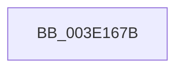

# sub_003E167B

- RVA: `0x003E167B`–`0x003E16A1` (길이 `38` bytes)
- VA: `0x00000001403E167B`
- 실행 섹션: `.text`
- PDB 이름 있음: `아니요`; PDB Function 태그: `아니요`
- unwind 정보 RVA: `0x00094A4C`
- 디코드: `10`개 명령, `38/38` bytes 표시
- 미해석 바이트: `0` (있으면 어셈블리에 `.byte`로 보존)

> 이 문서는 커널 이미지의 기계어와 PDB 기호를 분석해 생성했습니다. 4번과 5번은 함수 원형과 자료형을 바이너리 사용 방식에서 추정한 C 해석이며 원본 소스 복구 결과는 아닙니다.

## 1. Dependencies

- 직접 호출 지점: **1**; 고유 호출 대상: **1**
- 직접 호출자로 확인된 함수: **0**
- RIP 상대 이미지 참조: **0**

### Outgoing calls
- `0x003E1691` → [memset](../6C/memset_function_006C6C40.md) (function, `0x006C6C40`)

### Direct callers
- 이 함수 시작 RVA로 연결되는 직접 call은 확인되지 않았습니다. 간접 호출은 완전히 역산할 수 없습니다.

### Static image references
- 디코드된 RIP-relative 메모리 참조가 없습니다.

## 2. Other-region calls and transfers

- 다른 실행 섹션으로 향하는 call: **0**
- 별도 외부 분기/꼬리 이동을 확인하지 못했습니다.

## 3. Assembly (complete function range)

```asm
003E167B  48 89 7C 24 40                  mov qword ptr [rsp + 0x40], rdi
003E1680  BA FF 00 00 00                  mov edx, 0xff
003E1685  8B FE                           mov edi, esi
003E1687  48 8B CB                        mov rcx, rbx
003E168A  48 C1 EF 03                     shr rdi, 3
003E168E  4C 8B C7                        mov r8, rdi
003E1691  E8 AA 55 2E 00                  call 0x1406c6c40
003E1696  48 03 DF                        add rbx, rdi
003E1699  48 8B 7C 24 40                  mov rdi, qword ptr [rsp + 0x40]
003E169E  83 E6 07                        and esi, 7
```

## 4. C-style interpretation (structured pseudocode)

```c
__int64 __fastcall sub_003E167B(__int64 a1, __int64 a2, __int64 a3, __int64 a4, __int64 a5, __int64 a6, __int64 a7, __int64 a8)
{
    __int64 result;
    __int64 v_rbx;
    __int64 v_rdi;
    __int64 v_rsi;
    unsigned __int64 v_stack_p40;

    v_stack_p40 = v_rdi;
    v_rdi = ((unsigned int)((unsigned int)(v_rsi))) >> (3);
    result = memset(v_rbx, 255, v_rdi, a4);
    v_rbx = (v_rbx) + (v_rdi);
    v_rsi = (unsigned int)((v_rsi) & (7));
    return result;
}
```

## 5. (Beta) C Style

```c
int64_t sub_003E167B(int64_t Arg1, int64_t Arg2, int64_t Arg3, int64_t Arg4, uint64_t Arg5, uint64_t Arg6, uint64_t Arg7, int64_t Arg8)
{
    int64_t result;
    int64_t local_rbx;
    int64_t local_rdi;
    int64_t local_rsi;
    uint64_t v_stack_p40;

    v_stack_p40 = local_rdi;
    local_rdi = ((uint32_t)((uint32_t)(local_rsi))) >> (3);
    result = memset(local_rbx, 255, local_rdi, Arg4);
    local_rbx = (local_rbx) + (local_rdi);
    local_rsi = (uint32_t)((local_rsi) & (7));
    return result;
}
```

## 6. Execution-region graph

[열기: 2D/3D 그래프와 함수 탐색 컨트롤 패널](../../../control-panel.html?section=text&rva=0x003E167B&view=graph)

- 2D 그래프는 위에서 아래로 흐르고, 3D 그래프는 빈 공간을 드래그해 회전합니다. Shift+드래그는 이동, 휠은 확대·축소, 함수 노드 선택은 대상 보고서 이동입니다.

### Static fallback


