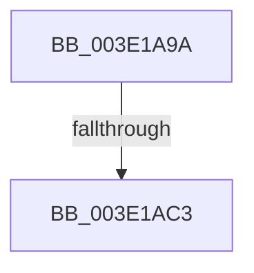

# sub_003E1A9A

- RVA: `0x003E1A9A`–`0x003E1AE3` (길이 `73` bytes)
- VA: `0x00000001403E1A9A`
- 실행 섹션: `.text`
- PDB 이름 있음: `아니요`; PDB Function 태그: `아니요`
- unwind 정보 RVA: `0x00094AAC`
- 디코드: `21`개 명령, `73/73` bytes 표시
- 미해석 바이트: `0` (있으면 어셈블리에 `.byte`로 보존)

> 이 문서는 커널 이미지의 기계어와 PDB 기호를 분석해 생성했습니다. 4번과 5번은 함수 원형과 자료형을 바이너리 사용 방식에서 추정한 C 해석이며 원본 소스 복구 결과는 아닙니다.

## 1. Dependencies

- 직접 호출 지점: **0**; 고유 호출 대상: **0**
- 직접 호출자로 확인된 함수: **0**
- RIP 상대 이미지 참조: **1**

### Outgoing calls
- 직접 디코드된 call 명령이 없습니다.

### Direct callers
- 이 함수 시작 RVA로 연결되는 직접 call은 확인되지 않았습니다. 간접 호출은 완전히 역산할 수 없습니다.

### Static image references
- `0x003E1AB4` → RVA `0x00000000` (`image boundary/outside`; read)

## 2. Other-region calls and transfers

- 다른 실행 섹션으로 향하는 call: **0**
- call이 아닌 외부 분기/꼬리 이동: **1**
  - `0x003E1AC1` → [sub_003E1AE4](Unknown_function_003E1AE4.md) (`tail-transfer`)

## 3. Assembly (complete function range)

```asm
003E1A9A  48 89 5C 24 30                  mov qword ptr [rsp + 0x30], rbx
003E1A9F  8B DA                           mov ebx, edx
003E1AA1  83 E2 07                        and edx, 7
003E1AA4  48 C1 EB 03                     shr rbx, 3
003E1AA8  48 03 59 08                     add rbx, qword ptr [rcx + 8]
003E1AAC  41 8B F0                        mov esi, r8d
003E1AAF  48 89 6C 24 38                  mov qword ptr [rsp + 0x38], rbp
003E1AB4  48 8D 2D 45 E5 C1 FF            lea rbp, [rip - 0x3e1abb]
003E1ABB  8D 0C 32                        lea ecx, [rdx + rsi]
003E1ABE  83 F9 08                        cmp ecx, 8
003E1AC1  77 21                           ja 0x1403e1ae4
003E1AC3  0F B6 84 2E 90 C8 02 00         movzx eax, byte ptr [rsi + rbp + 0x2c890]
003E1ACB  8B CA                           mov ecx, edx
003E1ACD  D2 E0                           shl al, cl
003E1ACF  F6 D0                           not al
003E1AD1  20 03                           and byte ptr [rbx], al
003E1AD3  48 8B 6C 24 38                  mov rbp, qword ptr [rsp + 0x38]
003E1AD8  48 8B 5C 24 30                  mov rbx, qword ptr [rsp + 0x30]
003E1ADD  48 83 C4 20                     add rsp, 0x20
003E1AE1  5E                              pop rsi
003E1AE2  C3                              ret
```

## 4. C-style interpretation (structured pseudocode)

```c
__int64 __fastcall sub_003E1A9A(__int64 a1, int a2, int a3, __int64 a4, __int64 a5, __int64 a6, __int64 a7)
{
    __int64 result;
    __int64 v_rbx;
    __int64 v_rsp;
    unsigned __int64 v_stack_p30;
    unsigned __int64 v_stack_p38;

    v_stack_p30 = v_rbx;
    a2 = (unsigned int)((a2) & (7));
    v_rbx = ((unsigned int)(a2)) >> (3);
    v_rbx = (v_rbx) + (*(unsigned __int64 *)(a1 + 8));
    v_stack_p38 = v_rbp;
    result = (unsigned __int8)((*(unsigned __int8 *)((unsigned int)(a3) + v_rip - 4070075 * 1 + 182416)) << ((unsigned __int8)((unsigned int)(a2))));
    result = (unsigned __int8)(~(result));
    v_rsp = (v_rsp) + (32);
    return result;
}
```

## 5. (Beta) C Style

```c
int64_t sub_003E1A9A(void *Arg1, void *Arg2, void *Arg3, int64_t Arg4, uint64_t Arg5, int64_t Arg6, int64_t Arg7)
{
    uint8_t *arg1 = (uint8_t *)Arg1;
    uint8_t *arg2 = (uint8_t *)Arg2;
    uint8_t *arg3 = (uint8_t *)Arg3;

    int64_t result;
    int64_t local_rbx;
    int64_t local_rsp;
    uint64_t v_stack_p30;
    uint64_t v_stack_p38;

    v_stack_p30 = local_rbx;
    Arg2 = (uint32_t)((Arg2) & (7));
    local_rbx = ((uint32_t)(Arg2)) >> (3);
    local_rbx = (local_rbx) + (*(uint64_t *)(arg1 + 0x8));
    v_stack_p38 = local_rbp;
    result = (uint8_t)((*(uint8_t *)((uint32_t)(arg3) + v_rip - 0x3E1ABB * 1 + 0x2C890)) << ((uint8_t)((uint32_t)(Arg2))));
    result = (uint8_t)(~(result));
    local_rsp = (local_rsp) + (32);
    return result;
}
```

### 관측된 메모리 오프셋

구조체 형식이 확인되지 않은 접근은 인자 기준의 오프셋으로만 기록했습니다.

| 기준 인자 | 오프셋 표현 | 폭 (bit) | 접근 |
|---|---:|---:|---|
| `Arg1` | `+ 0x8` | `64` | `R` |
| `Arg2` | `+ 0x0 + rsi*1` | `32` | `R` |
| `Arg3` | `+ 0x2C890 + rbp*1` | `8` | `R` |

## 6. Execution-region graph

[열기: 2D/3D 그래프와 함수 탐색 컨트롤 패널](../../../control-panel.html?section=text&rva=0x003E1A9A&view=graph)

- 2D 그래프는 위에서 아래로 흐르고, 3D 그래프는 빈 공간을 드래그해 회전합니다. Shift+드래그는 이동, 휠은 확대·축소, 함수 노드 선택은 대상 보고서 이동입니다.

### Static fallback


