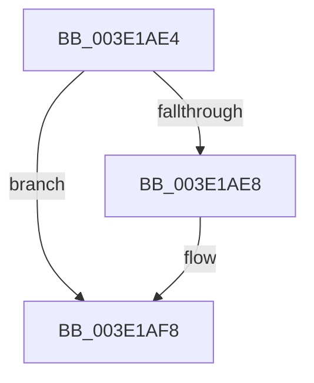

# sub_003E1AE4

- RVA: `0x003E1AE4`–`0x003E1AFD` (길이 `25` bytes)
- VA: `0x00000001403E1AE4`
- 실행 섹션: `.text`
- PDB 이름 있음: `아니요`; PDB Function 태그: `아니요`
- unwind 정보 RVA: `0x00094AD8`
- 디코드: `8`개 명령, `25/25` bytes 표시
- 미해석 바이트: `0` (있으면 어셈블리에 `.byte`로 보존)

> 이 문서는 커널 이미지의 기계어와 PDB 기호를 분석해 생성했습니다. 4번과 5번은 함수 원형과 자료형을 바이너리 사용 방식에서 추정한 C 해석이며 원본 소스 복구 결과는 아닙니다.

## 1. Dependencies

- 직접 호출 지점: **0**; 고유 호출 대상: **0**
- 직접 호출자로 확인된 함수: **0**
- RIP 상대 이미지 참조: **0**

### Outgoing calls
- 직접 디코드된 call 명령이 없습니다.

### Direct callers
- 이 함수 시작 RVA로 연결되는 직접 call은 확인되지 않았습니다. 간접 호출은 완전히 역산할 수 없습니다.

### Static image references
- 디코드된 RIP-relative 메모리 참조가 없습니다.

## 2. Other-region calls and transfers

- 다른 실행 섹션으로 향하는 call: **0**
- call이 아닌 외부 분기/꼬리 이동: **1**
  - `0x003E1AFB` → [sub_003E1B20](Unknown_function_003E1B20.md) (`tail-transfer`)

## 3. Assembly (complete function range)

```asm
003E1AE4  85 D2                           test edx, edx
003E1AE6  74 10                           je 0x1403e1af8
003E1AE8  0F B6 84 2A 90 C8 02 00         movzx eax, byte ptr [rdx + rbp + 0x2c890]
003E1AF0  8D 71 F8                        lea esi, [rcx - 8]
003E1AF3  20 03                           and byte ptr [rbx], al
003E1AF5  48 FF C3                        inc rbx
003E1AF8  83 FE 08                        cmp esi, 8
003E1AFB  76 23                           jbe 0x1403e1b20
```

## 4. C-style interpretation (structured pseudocode)

```c
__int64 __fastcall sub_003E1AE4(__int64 a1, __int64 a2)
{
    __int64 result;
    __int64 v_rbx;
    __int64 v_rsi;

    if ((unsigned int)(a2) != 0) {
        result = *(unsigned __int8 *)(a2 + v_rbp * 1 + 182416);
        v_rsi = a1 - 8;
        v_rbx = (v_rbx) + 1;
    }
}
```

## 5. (Beta) C Style

```c
int64_t sub_003E1AE4(void *Arg1, int64_t Arg2)
{
    uint8_t *arg1 = (uint8_t *)Arg1;

    int64_t result;
    int64_t local_rbx;
    int64_t local_rsi;

    if ((uint32_t)(Arg2) != 0) {
        result = *(uint8_t *)(Arg2 + local_rbp * 1 + 0x2C890);
        local_rsi = Arg1 - 8;
        local_rbx = (local_rbx) + 1;
    }
}
```

### 관측된 메모리 오프셋

구조체 형식이 확인되지 않은 접근은 인자 기준의 오프셋으로만 기록했습니다.

| 기준 인자 | 오프셋 표현 | 폭 (bit) | 접근 |
|---|---:|---:|---|
| `Arg1` | `- 0x8` | `32` | `R` |

## 6. Execution-region graph

[열기: 2D/3D 그래프와 함수 탐색 컨트롤 패널](../../../control-panel.html?section=text&rva=0x003E1AE4&view=graph)

- 2D 그래프는 위에서 아래로 흐르고, 3D 그래프는 빈 공간을 드래그해 회전합니다. Shift+드래그는 이동, 휠은 확대·축소, 함수 노드 선택은 대상 보고서 이동입니다.

### Static fallback


