# sub_003E455D

- RVA: `0x003E455D`–`0x003E47A6` (길이 `585` bytes)
- VA: `0x00000001403E455D`
- 실행 섹션: `.text`
- PDB 이름 있음: `아니요`; PDB Function 태그: `아니요`
- unwind 정보 RVA: `0x00094D8C`
- 디코드: `165`개 명령, `585/585` bytes 표시
- 미해석 바이트: `0` (있으면 어셈블리에 `.byte`로 보존)

> 이 문서는 커널 이미지의 기계어와 PDB 기호를 분석해 생성했습니다. 4번과 5번은 함수 원형과 자료형을 바이너리 사용 방식에서 추정한 C 해석이며 원본 소스 복구 결과는 아닙니다.

## 1. Dependencies

- 직접 호출 지점: **1**; 고유 호출 대상: **1**
- 직접 호출자로 확인된 함수: **0**
- RIP 상대 이미지 참조: **0**

### Outgoing calls
- `0x003E46C9` → [RtlRbRemoveNode](../2E/RtlRbRemoveNode_function_002E4C10.md) (function, `0x002E4C10`)

### Direct callers
- 이 함수 시작 RVA로 연결되는 직접 call은 확인되지 않았습니다. 간접 호출은 완전히 역산할 수 없습니다.

### Static image references
- 디코드된 RIP-relative 메모리 참조가 없습니다.

## 2. Other-region calls and transfers

- 다른 실행 섹션으로 향하는 call: **0**
- call이 아닌 외부 분기/꼬리 이동: **14**
  - `0x003E45C0` → [sub_003E47AF + 0x239](Unknown_function_003E47AF.md) (`tail-transfer`)
  - `0x003E45D8` → [sub_003E47AF + 0x34F](Unknown_function_003E47AF.md) (`tail-transfer`)
  - `0x003E45EB` → [sub_003E47AF + 0x31D](Unknown_function_003E47AF.md) (`tail-transfer`)
  - `0x003E460B` → [sub_003E47AF + 0x24A](Unknown_function_003E47AF.md) (`tail-transfer`)
  - `0x003E4656` → [sub_003E47AF](Unknown_function_003E47AF.md) (`tail-transfer`)
  - `0x003E4669` → [sub_003E47AF + 0x62](Unknown_function_003E47AF.md) (`tail-transfer`)
  - `0x003E46D8` → [sub_003E47AF + 0x309](Unknown_function_003E47AF.md) (`tail-transfer`)
  - `0x003E46EB` → [sub_003E47AF + 0x4E](Unknown_function_003E47AF.md) (`tail-transfer`)
  - `0x003E46F7` → [sub_003E47AF + 0x36](Unknown_function_003E47AF.md) (`tail-transfer`)
  - `0x003E4705` → [sub_003E47AF + 0x36](Unknown_function_003E47AF.md) (`tail-transfer`)
  - `0x003E4716` → [sub_003E47AF + 0x30E](Unknown_function_003E47AF.md) (`tail-transfer`)
  - `0x003E4722` → [sub_003E47AF + 0x30E](Unknown_function_003E47AF.md) (`tail-transfer`)
  - `0x003E475B` → [sub_003E47AF + 0x16F](Unknown_function_003E47AF.md) (`tail-transfer`)
  - `0x003E4772` → [sub_003E47AF + 0x183](Unknown_function_003E47AF.md) (`tail-transfer`)

## 3. Assembly (complete function range)

```asm
003E455D  48 89 58 10                     mov qword ptr [rax + 0x10], rbx
003E4561  85 D2                           test edx, edx
003E4563  48 89 68 E8                     mov qword ptr [rax - 0x18], rbp
003E4567  41 B8 08 00 00 00               mov r8d, 8
003E456D  48 89 70 E0                     mov qword ptr [rax - 0x20], rsi
003E4571  41 B9 18 00 00 00               mov r9d, 0x18
003E4577  4C 89 60 D8                     mov qword ptr [rax - 0x28], r12
003E457B  4C 89 70 D0                     mov qword ptr [rax - 0x30], r14
003E457F  4C 89 78 C8                     mov qword ptr [rax - 0x38], r15
003E4583  48 8B 41 50                     mov rax, qword ptr [rcx + 0x50]
003E4587  41 8B C8                        mov ecx, r8d
003E458A  41 0F 44 C9                     cmove ecx, r9d
003E458E  48 03 C8                        add rcx, rax
003E4591  85 D2                           test edx, edx
003E4593  48 89 8C 24 98 00 00 00         mov qword ptr [rsp + 0x98], rcx
003E459B  49 8D 8D 80 00 00 00            lea rcx, [r13 + 0x80]
003E45A2  48 8B 19                        mov rbx, qword ptr [rcx]
003E45A5  45 0F 44 C8                     cmove r9d, r8d
003E45A9  4C 03 C8                        add r9, rax
003E45AC  45 33 FF                        xor r15d, r15d
003E45AF  48 8B 41 08                     mov rax, qword ptr [rcx + 8]
003E45B3  41 8B EF                        mov ebp, r15d
003E45B6  4C 89 8C 24 80 00 00 00         mov qword ptr [rsp + 0x80], r9
003E45BE  A8 01                           test al, 1
003E45C0  0F 85 22 04 00 00               jne 0x1403e49e8
003E45C6  0F B6 C8                        movzx ecx, al
003E45C9  49 8B D7                        mov rdx, r15
003E45CC  83 E1 01                        and ecx, 1
003E45CF  90                              nop
003E45D0  48 85 DB                        test rbx, rbx
003E45D3  74 21                           je 0x1403e45f6
003E45D5  3B 7B 18                        cmp edi, dword ptr [rbx + 0x18]
003E45D8  0F 82 20 05 00 00               jb 0x1403e4afe
003E45DE  76 19                           jbe 0x1403e45f9
003E45E0  48 8B 43 08                     mov rax, qword ptr [rbx + 8]
003E45E4  85 C9                           test ecx, ecx
003E45E6  74 09                           je 0x1403e45f1
003E45E8  48 85 C0                        test rax, rax
003E45EB  0F 85 DB 04 00 00               jne 0x1403e4acc
003E45F1  48 8B D8                        mov rbx, rax
003E45F4  EB DA                           jmp 0x1403e45d0
003E45F6  48 8B DA                        mov rbx, rdx
003E45F9  8B 73 18                        mov esi, dword ptr [rbx + 0x18]
003E45FC  4C 8D 73 E8                     lea r14, [rbx - 0x18]
003E4600  8D 47 01                        lea eax, [rdi + 1]
003E4603  41 BA FF FF FF FF               mov r10d, 0xffffffff
003E4609  3B F0                           cmp esi, eax
003E460B  0F 84 E8 03 00 00               je 0x1403e49f9
003E4611  48 8B 0B                        mov rcx, qword ptr [rbx]
003E4614  45 8B E7                        mov r12d, r15d
003E4617  48 8B D3                        mov rdx, rbx
003E461A  48 85 C9                        test rcx, rcx
003E461D  74 15                           je 0x1403e4634
003E461F  4C 39 61 08                     cmp qword ptr [rcx + 8], r12
003E4623  74 2E                           je 0x1403e4653
003E4625  48 8B 41 08                     mov rax, qword ptr [rcx + 8]
003E4629  48 8B C8                        mov rcx, rax
003E462C  4C 39 60 08                     cmp qword ptr [rax + 8], r12
003E4630  75 F3                           jne 0x1403e4625
003E4632  EB 1F                           jmp 0x1403e4653
003E4634  48 8B 4B 10                     mov rcx, qword ptr [rbx + 0x10]
003E4638  48 83 E1 FC                     and rcx, 0xfffffffffffffffc
003E463C  74 15                           je 0x1403e4653
003E463E  66 90                           nop
003E4640  48 39 51 08                     cmp qword ptr [rcx + 8], rdx
003E4644  74 0D                           je 0x1403e4653
003E4646  48 8B D1                        mov rdx, rcx
003E4649  48 8B 49 10                     mov rcx, qword ptr [rcx + 0x10]
003E464D  48 83 E1 FC                     and rcx, 0xfffffffffffffffc
003E4651  75 ED                           jne 0x1403e4640
003E4653  48 85 C9                        test rcx, rcx
003E4656  0F 85 53 01 00 00               jne 0x1403e47af
003E465C  48 85 ED                        test rbp, rbp
003E465F  0F 84 C8 00 00 00               je 0x1403e472d
003E4665  40 F6 C5 01                     test bpl, 1
003E4669  0F 84 A2 01 00 00               je 0x1403e4811
003E466F  48 83 E5 FE                     and rbp, 0xfffffffffffffffe
003E4673  48 8B 4D 08                     mov rcx, qword ptr [rbp + 8]
003E4677  48 8B D5                        mov rdx, rbp
003E467A  48 85 C9                        test rcx, rcx
003E467D  74 18                           je 0x1403e4697
003E467F  48 8B 11                        mov rdx, qword ptr [rcx]
003E4682  48 85 D2                        test rdx, rdx
003E4685  74 2C                           je 0x1403e46b3
003E4687  48 8B 02                        mov rax, qword ptr [rdx]
003E468A  48 8B CA                        mov rcx, rdx
003E468D  48 8B D0                        mov rdx, rax
003E4690  48 85 C0                        test rax, rax
003E4693  75 F2                           jne 0x1403e4687
003E4695  EB 1C                           jmp 0x1403e46b3
003E4697  48 8B 4D 10                     mov rcx, qword ptr [rbp + 0x10]
003E469B  48 83 E1 FC                     and rcx, 0xfffffffffffffffc
003E469F  74 12                           je 0x1403e46b3
003E46A1  48 39 11                        cmp qword ptr [rcx], rdx
003E46A4  74 0D                           je 0x1403e46b3
003E46A6  48 8B D1                        mov rdx, rcx
003E46A9  48 8B 49 10                     mov rcx, qword ptr [rcx + 0x10]
003E46AD  48 83 E1 FC                     and rcx, 0xfffffffffffffffc
003E46B1  75 EE                           jne 0x1403e46a1
003E46B3  8B 45 34                        mov eax, dword ptr [rbp + 0x34]
003E46B6  39 41 34                        cmp dword ptr [rcx + 0x34], eax
003E46B9  0F 87 C6 00 00 00               ja 0x1403e4785
003E46BF  49 83 C5 70                     add r13, 0x70
003E46C3  48 8B D5                        mov rdx, rbp
003E46C6  49 8B CD                        mov rcx, r13
003E46C9  E8 42 05 F0 FF                  call 0x1402e4c10
003E46CE  49 8B 45 08                     mov rax, qword ptr [r13 + 8]
003E46D2  49 8B 55 00                     mov rdx, qword ptr [r13]
003E46D6  A8 01                           test al, 1
003E46D8  0F 85 DA 03 00 00               jne 0x1403e4ab8
003E46DE  44 0F B6 C0                     movzx r8d, al
003E46E2  32 C0                           xor al, al
003E46E4  41 83 E0 01                     and r8d, 1
003E46E8  48 85 D2                        test rdx, rdx
003E46EB  0F 84 0C 01 00 00               je 0x1403e47fd
003E46F1  8B 4D 34                        mov ecx, dword ptr [rbp + 0x34]
003E46F4  3B 4A 34                        cmp ecx, dword ptr [rdx + 0x34]
003E46F7  0F 87 E8 00 00 00               ja 0x1403e47e5
003E46FD  72 0C                           jb 0x1403e470b
003E46FF  8B 42 30                        mov eax, dword ptr [rdx + 0x30]
003E4702  39 45 30                        cmp dword ptr [rbp + 0x30], eax
003E4705  0F 83 DA 00 00 00               jae 0x1403e47e5
003E470B  48 8B 02                        mov rax, qword ptr [rdx]
003E470E  45 85 C0                        test r8d, r8d
003E4711  74 0C                           je 0x1403e471f
003E4713  48 85 C0                        test rax, rax
003E4716  0F 84 A1 03 00 00               je 0x1403e4abd
003E471C  48 33 C2                        xor rax, rdx
003E471F  48 85 C0                        test rax, rax
003E4722  0F 84 95 03 00 00               je 0x1403e4abd
003E4728  48 8B D0                        mov rdx, rax
003E472B  EB C7                           jmp 0x1403e46f4
003E472D  41 3B F2                        cmp esi, r10d
003E4730  41 8B C7                        mov eax, r15d
003E4733  8B DF                           mov ebx, edi
003E4735  0F 95 C0                        setne al
003E4738  FF C0                           inc eax
003E473A  2B F0                           sub esi, eax
003E473C  41 8B C7                        mov eax, r15d
003E473F  2B F7                           sub esi, edi
003E4741  45 85 E4                        test r12d, r12d
003E4744  0F 95 C0                        setne al
003E4747  FF C0                           inc eax
003E4749  2B D8                           sub ebx, eax
003E474B  49 8D 85 90 00 00 00            lea rax, [r13 + 0x90]
003E4752  48 8B 08                        mov rcx, qword ptr [rax]
003E4755  41 2B DC                        sub ebx, r12d
003E4758  48 3B C8                        cmp rcx, rax
003E475B  0F 84 BD 01 00 00               je 0x1403e491e
003E4761  4C 8B F9                        mov r15, rcx
003E4764  8D 4E 01                        lea ecx, [rsi + 1]
003E4767  4C 89 7C 24 30                  mov qword ptr [rsp + 0x30], r15
003E476C  03 CB                           add ecx, ebx
003E476E  41 39 4F 34                     cmp dword ptr [r15 + 0x34], ecx
003E4772  0F 82 BA 01 00 00               jb 0x1403e4932
003E4778  41 8B 45 6C                     mov eax, dword ptr [r13 + 0x6c]
003E477C  3B C1                           cmp eax, ecx
003E477E  0F 47 C8                        cmova ecx, eax
003E4781  41 89 4D 6C                     mov dword ptr [r13 + 0x6c], ecx
003E4785  4C 8B 74 24 48                  mov r14, qword ptr [rsp + 0x48]
003E478A  4C 8B 64 24 50                  mov r12, qword ptr [rsp + 0x50]
003E478F  48 8B 74 24 58                  mov rsi, qword ptr [rsp + 0x58]
003E4794  48 8B 6C 24 60                  mov rbp, qword ptr [rsp + 0x60]
003E4799  48 8B 9C 24 88 00 00 00         mov rbx, qword ptr [rsp + 0x88]
003E47A1  4C 8B 7C 24 40                  mov r15, qword ptr [rsp + 0x40]
```

## 4. C-style interpretation (structured pseudocode)

```c
__int64 __fastcall sub_003E455D(__int64 a1, int a2, __int64 a3, __int64 a4, __int64 a5, __int64 a6, __int64 a7, __int64 a8, __int64 a9, __int64 a10, __int64 a11, __int64 a12, __int64 a13, __int64 a14, __int64 a15, __int64 a16, __int64 a17)
{
    __int64 result;
    __int64 v_r13;
    __int64 v_r15;
    __int64 v_rbp;
    __int64 v_rbx;
    __int64 v_rsi;
    unsigned __int64 v_stack_p30;
    unsigned __int64 v_stack_p80;
    unsigned __int64 v_stack_p98;

    *(unsigned __int64 *)(result + 16) = v_rbx;
    *(unsigned __int64 *)(result - 24) = v_rbp;
    *(unsigned __int64 *)(result - 32) = v_rsi;
    *(unsigned __int64 *)(result - 40) = v_r12;
    *(unsigned __int64 *)(result - 48) = v_r14;
    *(unsigned __int64 *)(result - 56) = v_r15;
    a1 = 8;
    if (a2 == 0) { a1 = 24; }
    a1 = (a1) + (*(unsigned __int64 *)(a1 + 80));
    v_stack_p98 = a1;
    a4 = 24;
    if (a2 == 0) { a4 = 8; }
    a4 = (a4) + (*(unsigned __int64 *)(a1 + 80));
    v_r15 = 0;
    v_stack_p80 = a4;
    a1 = (unsigned int)(((unsigned __int8)(*(unsigned __int64 *)(v_r13 + 128 + 8))) & (1));
loc_003E45D0:
    if (*(unsigned __int64 *)(v_r13 + 128) == 0) goto loc_003E45F6;
    if (((unsigned int)(v_rdi)) <= (*(unsigned int *)(*(unsigned __int64 *)(v_r13 + 128) + 24))) goto loc_003E45F9;
    if ((unsigned int)(a1) == 0) goto loc_003E45F1;
loc_003E45F1:
    goto loc_003E45D0;
loc_003E45F6:
loc_003E45F9:
    if (*(unsigned __int64 *)(0) == 0) goto loc_003E4634;
    if ((*(unsigned __int64 *)(*(unsigned __int64 *)(0) + 8)) == 0) goto loc_003E4653;
loc_003E4625:
    if ((*(unsigned __int64 *)(*(unsigned __int64 *)(*(unsigned __int64 *)(0) + 8) + 8)) != 0) goto loc_003E4625;
    goto loc_003E4653;
loc_003E4634:
    a1 = (*(unsigned __int64 *)(0 + 16)) & (-4);
    if (condition_is_equal) goto loc_003E4653;
loc_003E4640:
    if ((*(unsigned __int64 *)(a1 + 8)) == 0) goto loc_003E4653;
    a1 = (*(unsigned __int64 *)(a1 + 16)) & (-4);
    if (condition_is_not_equal) goto loc_003E4640;
loc_003E4653:
    if (0 == 0) goto loc_003E472D;
    v_rbp = (0) & (-2);
    if (*(unsigned __int64 *)(v_rbp + 8) == 0) goto loc_003E4697;
    if (*(unsigned __int64 *)(*(unsigned __int64 *)(v_rbp + 8)) == 0) goto loc_003E46B3;
loc_003E4687:
    if (*(unsigned __int64 *)(*(unsigned __int64 *)(*(unsigned __int64 *)(v_rbp + 8))) != 0) goto loc_003E4687;
    goto loc_003E46B3;
loc_003E4697:
    a1 = (*(unsigned __int64 *)(v_rbp + 16)) & (-4);
    if (condition_is_equal) goto loc_003E46B3;
loc_003E46A1:
    if ((*(unsigned __int64 *)(a1)) == (*(unsigned __int64 *)(*(unsigned __int64 *)(*(unsigned __int64 *)(v_rbp + 8))))) goto loc_003E46B3;
    a1 = (*(unsigned __int64 *)(a1 + 16)) & (-4);
    if (condition_is_not_equal) goto loc_003E46A1;
loc_003E46B3:
    if ((*(unsigned int *)(a1 + 52)) > ((unsigned int)((unsigned int)(*(unsigned int *)(v_rbp + 52))))) goto loc_003E4785;
    v_r13 = (v_r13) + (112);
    result = RtlRbRemoveNode(v_r13, v_rbp, 8, a4);
    result = 0;
    a3 = (unsigned int)(((unsigned __int8)(*(unsigned __int64 *)(v_r13 + 8))) & (1));
loc_003E46F4:
    if (((unsigned int)((unsigned int)(*(unsigned int *)(v_rbp + 52)))) < (*(unsigned int *)(*(unsigned __int64 *)(v_r13) + 52))) goto loc_003E470B;
loc_003E470B:
    if ((unsigned int)(a3) == 0) goto loc_003E471F;
    result = (*(unsigned __int64 *)(*(unsigned __int64 *)(v_r13))) ^ (*(unsigned __int64 *)(v_r13));
loc_003E471F:
    goto loc_003E46F4;
loc_003E472D:
    result = (((unsigned int)((unsigned int)(*(unsigned int *)(0 + 24)))) != ((unsigned int)((unsigned int)(0xFFFFFFFFULL)))) ? 1 : 0;
    result = (unsigned int)((result) + 1);
    v_rsi = (unsigned int)(((unsigned int)(*(unsigned int *)(0 + 24))) - ((unsigned int)(result)));
    v_rsi = (unsigned int)((v_rsi) - ((unsigned int)(v_rdi)));
    result = (0 != 0) ? 1 : 0;
    result = (unsigned int)((result) + 1);
    v_rbx = (unsigned int)(((unsigned int)((unsigned int)(v_rdi))) - ((unsigned int)(result)));
    v_rbx = (unsigned int)((v_rbx) - (0));
    v_stack_p30 = *(unsigned __int64 *)(v_r13 + 144);
    a1 = (unsigned int)((v_rsi + 1) + ((unsigned int)(v_rbx)));
    if (((unsigned int)((unsigned int)(*(unsigned int *)(v_r13 + 108)))) > ((unsigned int)(a1))) { a1 = (unsigned int)((unsigned int)(*(unsigned int *)(v_r13 + 108))); }
    *(unsigned int *)(v_r13 + 108) = (unsigned int)(a1);
loc_003E4785:
    return (unsigned int)(*(unsigned int *)(v_r13 + 108));
}
```

## 5. (Beta) C Style

```c
int64_t sub_003E455D(void *Arg1, int32_t Arg2, int64_t Arg3, int64_t Arg4, uint64_t Arg5, uint64_t Arg6, uint64_t Arg7, int64_t Arg8, int64_t Arg9, int64_t Arg10, int64_t Arg11, int64_t Arg12, uint64_t Arg13, uint64_t Arg14, uint64_t Arg15, uint64_t Arg16, int64_t Arg17)
{
    uint8_t *arg1 = (uint8_t *)Arg1;

    int64_t result;
    int64_t local_r13;
    int64_t local_r15;
    int64_t local_rbp;
    int64_t local_rbx;
    int64_t local_rsi;
    uint64_t v_stack_p30;
    uint64_t v_stack_p80;
    uint64_t v_stack_p98;

    *(uint64_t *)(result + 0x10) = local_rbx;
    *(uint64_t *)(result - 0x18) = local_rbp;
    *(uint64_t *)(result - 0x20) = local_rsi;
    *(uint64_t *)(result - 0x28) = local_r12;
    *(uint64_t *)(result - 0x30) = local_r14;
    *(uint64_t *)(result - 0x38) = local_r15;
    Arg1 = 8;
    if (Arg2 == 0) { Arg1 = 24; }
    Arg1 = (Arg1) + (*(uint64_t *)(arg1 + 0x50));
    v_stack_p98 = Arg1;
    Arg4 = 24;
    if (Arg2 == 0) { Arg4 = 8; }
    Arg4 = (Arg4) + (*(uint64_t *)(arg1 + 0x50));
    local_r15 = 0;
    v_stack_p80 = Arg4;
    Arg1 = (uint32_t)(((uint8_t)(*(uint64_t *)(local_r13 + 0x80 + 0x8))) & (1));
loc_003E45D0:
    if (*(uint64_t *)(local_r13 + 0x80) == 0) goto loc_003E45F6;
    if (((uint32_t)(local_rdi)) <= (*(uint32_t *)(*(uint64_t *)(local_r13 + 0x80) + 0x18))) goto loc_003E45F9;
    if ((uint32_t)(Arg1) == 0) goto loc_003E45F1;
loc_003E45F1:
    goto loc_003E45D0;
loc_003E45F6:
loc_003E45F9:
    if (*(uint64_t *)(0) == 0) goto loc_003E4634;
    if ((*(uint64_t *)(*(uint64_t *)(0) + 0x8)) == 0) goto loc_003E4653;
loc_003E4625:
    if ((*(uint64_t *)(*(uint64_t *)(*(uint64_t *)(0) + 0x8) + 0x8)) != 0) goto loc_003E4625;
    goto loc_003E4653;
loc_003E4634:
    Arg1 = (*(uint64_t *)(0 + 0x10)) & (-4);
    if (condition_is_equal) goto loc_003E4653;
loc_003E4640:
    if ((*(uint64_t *)(arg1 + 0x8)) == 0) goto loc_003E4653;
    Arg1 = (*(uint64_t *)(arg1 + 0x10)) & (-4);
    if (condition_is_not_equal) goto loc_003E4640;
loc_003E4653:
    if (0 == 0) goto loc_003E472D;
    local_rbp = (0) & (-2);
    if (*(uint64_t *)(local_rbp + 0x8) == 0) goto loc_003E4697;
    if (*(uint64_t *)(*(uint64_t *)(local_rbp + 0x8)) == 0) goto loc_003E46B3;
loc_003E4687:
    if (*(uint64_t *)(*(uint64_t *)(*(uint64_t *)(local_rbp + 0x8))) != 0) goto loc_003E4687;
    goto loc_003E46B3;
loc_003E4697:
    Arg1 = (*(uint64_t *)(local_rbp + 0x10)) & (-4);
    if (condition_is_equal) goto loc_003E46B3;
loc_003E46A1:
    if ((*(uint64_t *)(arg1)) == (*(uint64_t *)(*(uint64_t *)(*(uint64_t *)(local_rbp + 0x8))))) goto loc_003E46B3;
    Arg1 = (*(uint64_t *)(arg1 + 0x10)) & (-4);
    if (condition_is_not_equal) goto loc_003E46A1;
loc_003E46B3:
    if ((*(uint32_t *)(arg1 + 0x34)) > ((uint32_t)((uint32_t)(*(uint32_t *)(local_rbp + 0x34))))) goto loc_003E4785;
    local_r13 = (local_r13) + (112);
    result = RtlRbRemoveNode(local_r13, local_rbp, 8, Arg4);
    result = 0;
    Arg3 = (uint32_t)(((uint8_t)(*(uint64_t *)(local_r13 + 0x8))) & (1));
loc_003E46F4:
    if (((uint32_t)((uint32_t)(*(uint32_t *)(local_rbp + 0x34)))) < (*(uint32_t *)(*(uint64_t *)(local_r13) + 0x34))) goto loc_003E470B;
loc_003E470B:
    if ((uint32_t)(Arg3) == 0) goto loc_003E471F;
    result = (*(uint64_t *)(*(uint64_t *)(local_r13))) ^ (*(uint64_t *)(local_r13));
loc_003E471F:
    goto loc_003E46F4;
loc_003E472D:
    result = (((uint32_t)((uint32_t)(*(uint32_t *)(0 + 0x18)))) != ((uint32_t)((uint32_t)(0xFFFFFFFFULL)))) ? 1 : 0;
    result = (uint32_t)((result) + 1);
    local_rsi = (uint32_t)(((uint32_t)(*(uint32_t *)(0 + 0x18))) - ((uint32_t)(result)));
    local_rsi = (uint32_t)((local_rsi) - ((uint32_t)(local_rdi)));
    result = (0 != 0) ? 1 : 0;
    result = (uint32_t)((result) + 1);
    local_rbx = (uint32_t)(((uint32_t)((uint32_t)(local_rdi))) - ((uint32_t)(result)));
    local_rbx = (uint32_t)((local_rbx) - (0));
    v_stack_p30 = *(uint64_t *)(local_r13 + 0x90);
    Arg1 = (uint32_t)((local_rsi + 1) + ((uint32_t)(local_rbx)));
    if (((uint32_t)((uint32_t)(*(uint32_t *)(local_r13 + 0x6C)))) > ((uint32_t)(Arg1))) { Arg1 = (uint32_t)((uint32_t)(*(uint32_t *)(local_r13 + 0x6C))); }
    *(uint32_t *)(local_r13 + 0x6C) = (uint32_t)(Arg1);
loc_003E4785:
    return (uint32_t)(*(uint32_t *)(local_r13 + 0x6C));
}
```

### 관측된 메모리 오프셋

구조체 형식이 확인되지 않은 접근은 인자 기준의 오프셋으로만 기록했습니다.

| 기준 인자 | 오프셋 표현 | 폭 (bit) | 접근 |
|---|---:|---:|---|
| `Arg1` | `+ 0x50` | `64` | `R` |

## 6. Execution-region graph

[열기: 2D/3D 그래프와 함수 탐색 컨트롤 패널](../../../control-panel.html?section=text&rva=0x003E455D&view=graph)

- 2D 그래프는 위에서 아래로 흐르고, 3D 그래프는 빈 공간을 드래그해 회전합니다. Shift+드래그는 이동, 휠은 확대·축소, 함수 노드 선택은 대상 보고서 이동입니다.

### Static fallback

```mermaid
flowchart TD
  bb_003E455D[BB_003E455D]
  bb_003E45C6[BB_003E45C6]
  bb_003E45D0[BB_003E45D0]
  bb_003E45D5[BB_003E45D5]
  bb_003E45DE[BB_003E45DE]
  bb_003E45E0[BB_003E45E0]
  bb_003E45E8[BB_003E45E8]
  bb_003E45F1[BB_003E45F1]
  bb_003E45F6[BB_003E45F6]
  bb_003E45F9[BB_003E45F9]
  bb_003E4611[BB_003E4611]
  bb_003E461F[BB_003E461F]
  bb_003E4625[BB_003E4625]
  bb_003E4632[BB_003E4632]
  bb_003E4634[BB_003E4634]
  bb_003E463E[BB_003E463E]
  bb_003E4640[BB_003E4640]
  bb_003E4646[BB_003E4646]
  bb_003E4653[BB_003E4653]
  bb_003E465C[BB_003E465C]
  bb_003E4665[BB_003E4665]
  bb_003E466F[BB_003E466F]
  bb_003E467F[BB_003E467F]
  bb_003E4687[BB_003E4687]
  bb_003E4695[BB_003E4695]
  bb_003E4697[BB_003E4697]
  bb_003E46A1[BB_003E46A1]
  bb_003E46A6[BB_003E46A6]
  bb_003E46B3[BB_003E46B3]
  bb_003E46BF[BB_003E46BF]
  bb_003E46DE[BB_003E46DE]
  bb_003E46F1[BB_003E46F1]
  bb_003E46F4[BB_003E46F4]
  bb_003E46FD[BB_003E46FD]
  bb_003E46FF[BB_003E46FF]
  bb_003E470B[BB_003E470B]
  bb_003E4713[BB_003E4713]
  bb_003E471C[BB_003E471C]
  bb_003E471F[BB_003E471F]
  bb_003E4728[BB_003E4728]
  bb_003E472D[BB_003E472D]
  bb_003E4761[BB_003E4761]
  bb_003E4778[BB_003E4778]
  bb_003E4785[BB_003E4785]
  bb_003E455D -->|fallthrough| bb_003E45C6
  bb_003E45C6 -->|flow| bb_003E45D0
  bb_003E45D0 -->|branch| bb_003E45F6
  bb_003E45D0 -->|fallthrough| bb_003E45D5
  bb_003E45D5 -->|fallthrough| bb_003E45DE
  bb_003E45DE -->|branch| bb_003E45F9
  bb_003E45DE -->|fallthrough| bb_003E45E0
  bb_003E45E0 -->|branch| bb_003E45F1
  bb_003E45E0 -->|fallthrough| bb_003E45E8
  bb_003E45E8 -->|fallthrough| bb_003E45F1
  bb_003E45F1 -->|branch| bb_003E45D0
  bb_003E45F6 -->|flow| bb_003E45F9
  bb_003E45F9 -->|fallthrough| bb_003E4611
  bb_003E4611 -->|branch| bb_003E4634
  bb_003E4611 -->|fallthrough| bb_003E461F
  bb_003E461F -->|branch| bb_003E4653
  bb_003E461F -->|fallthrough| bb_003E4625
  bb_003E4625 -->|branch| bb_003E4625
  bb_003E4625 -->|fallthrough| bb_003E4632
  bb_003E4632 -->|branch| bb_003E4653
  bb_003E4634 -->|branch| bb_003E4653
  bb_003E4634 -->|fallthrough| bb_003E463E
  bb_003E463E -->|flow| bb_003E4640
  bb_003E4640 -->|branch| bb_003E4653
  bb_003E4640 -->|fallthrough| bb_003E4646
  bb_003E4646 -->|branch| bb_003E4640
  bb_003E4646 -->|fallthrough| bb_003E4653
  bb_003E4653 -->|fallthrough| bb_003E465C
  bb_003E465C -->|branch| bb_003E472D
  bb_003E465C -->|fallthrough| bb_003E4665
  bb_003E4665 -->|fallthrough| bb_003E466F
  bb_003E466F -->|branch| bb_003E4697
  bb_003E466F -->|fallthrough| bb_003E467F
  bb_003E467F -->|branch| bb_003E46B3
  bb_003E467F -->|fallthrough| bb_003E4687
  bb_003E4687 -->|branch| bb_003E4687
  bb_003E4687 -->|fallthrough| bb_003E4695
  bb_003E4695 -->|branch| bb_003E46B3
  bb_003E4697 -->|branch| bb_003E46B3
  bb_003E4697 -->|fallthrough| bb_003E46A1
  bb_003E46A1 -->|branch| bb_003E46B3
  bb_003E46A1 -->|fallthrough| bb_003E46A6
  bb_003E46A6 -->|branch| bb_003E46A1
  bb_003E46A6 -->|fallthrough| bb_003E46B3
  bb_003E46B3 -->|branch| bb_003E4785
  bb_003E46B3 -->|fallthrough| bb_003E46BF
  bb_003E46BF -->|fallthrough| bb_003E46DE
  bb_003E46DE -->|fallthrough| bb_003E46F1
  bb_003E46F1 -->|flow| bb_003E46F4
  bb_003E46F4 -->|fallthrough| bb_003E46FD
  bb_003E46FD -->|branch| bb_003E470B
  bb_003E46FD -->|fallthrough| bb_003E46FF
  bb_003E46FF -->|fallthrough| bb_003E470B
  bb_003E470B -->|branch| bb_003E471F
  bb_003E470B -->|fallthrough| bb_003E4713
  bb_003E4713 -->|fallthrough| bb_003E471C
  bb_003E471C -->|flow| bb_003E471F
  bb_003E471F -->|fallthrough| bb_003E4728
  bb_003E4728 -->|branch| bb_003E46F4
  bb_003E472D -->|fallthrough| bb_003E4761
  bb_003E4761 -->|fallthrough| bb_003E4778
  bb_003E4778 -->|flow| bb_003E4785
```


