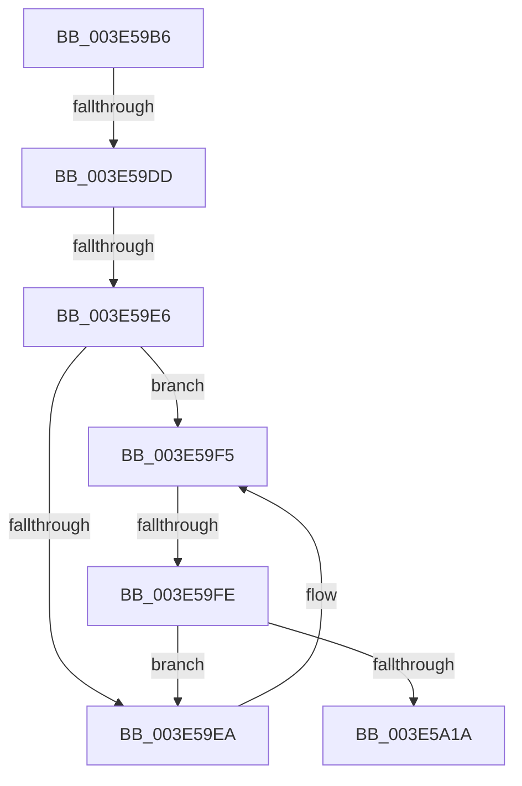

# sub_003E59B6

- RVA: `0x003E59B6`–`0x003E5A48` (길이 `146` bytes)
- VA: `0x00000001403E59B6`
- 실행 섹션: `.text`
- PDB 이름 있음: `아니요`; PDB Function 태그: `아니요`
- unwind 정보 RVA: `0x00094EA4`
- 디코드: `41`개 명령, `146/146` bytes 표시
- 미해석 바이트: `0` (있으면 어셈블리에 `.byte`로 보존)

> 이 문서는 커널 이미지의 기계어와 PDB 기호를 분석해 생성했습니다. 4번과 5번은 함수 원형과 자료형을 바이너리 사용 방식에서 추정한 C 해석이며 원본 소스 복구 결과는 아닙니다.

## 1. Dependencies

- 직접 호출 지점: **2**; 고유 호출 대상: **2**
- 직접 호출자로 확인된 함수: **0**
- RIP 상대 이미지 참조: **1**

### Outgoing calls
- `0x003E59ED` → [RealSuccessor](RealSuccessor_function_003E5B20.md) (function, `0x003E5B20`)
- `0x003E5A0E` → [guard_dispatch_icall](../6B/guard_dispatch_icall_function_006BAAD0.md) (function, `0x006BAAD0`)

### Direct callers
- 이 함수 시작 RVA로 연결되는 직접 call은 확인되지 않았습니다. 간접 호출은 완전히 역산할 수 없습니다.

### Static image references
- `0x003E59BB` → RVA `0x0048FDC0` (`HalAdjustResourceList`; read)

## 2. Other-region calls and transfers

- 다른 실행 섹션으로 향하는 call: **0**
- call이 아닌 외부 분기/꼬리 이동: **3**
  - `0x003E59D7` → [sub_003E5A63](Unknown_function_003E5A63.md) (`tail-transfer`)
  - `0x003E59E0` → [sub_003E5A63 + 0x5](Unknown_function_003E5A63.md) (`tail-transfer`)
  - `0x003E59F8` → [sub_003E5A63 + 0x2B](Unknown_function_003E5A63.md) (`tail-transfer`)

## 3. Assembly (complete function range)

```asm
003E59B6  4C 89 64 24 50                  mov qword ptr [rsp + 0x50], r12
003E59BB  4C 8D 25 FE A3 0A 00            lea r12, [rip + 0xaa3fe]
003E59C2  4C 0F 45 E2                     cmovne r12, rdx
003E59C6  4C 89 6C 24 58                  mov qword ptr [rsp + 0x58], r13
003E59CB  4C 8B 6C 24 78                  mov r13, qword ptr [rsp + 0x78]
003E59D0  45 33 FF                        xor r15d, r15d
003E59D3  41 39 45 00                     cmp dword ptr [r13], eax
003E59D7  0F 85 86 00 00 00               jne 0x1403e5a63
003E59DD  48 85 FF                        test rdi, rdi
003E59E0  0F 84 82 00 00 00               je 0x1403e5a68
003E59E6  85 ED                           test ebp, ebp
003E59E8  74 0B                           je 0x1403e59f5
003E59EA  48 8B CF                        mov rcx, rdi
003E59ED  E8 2E 01 00 00                  call 0x1403e5b20
003E59F2  48 8B F8                        mov rdi, rax
003E59F5  48 85 FF                        test rdi, rdi
003E59F8  0F 84 90 00 00 00               je 0x1403e5a8e
003E59FE  48 8D 6F 20                     lea rbp, [rdi + 0x20]
003E5A02  4D 8B C6                        mov r8, r14
003E5A05  48 8B D5                        mov rdx, rbp
003E5A08  48 8B CB                        mov rcx, rbx
003E5A0B  49 8B C4                        mov rax, r12
003E5A0E  E8 BD 50 2D 00                  call 0x1406baad0
003E5A13  3D 72 02 00 C0                  cmp eax, 0xc0000272
003E5A18  74 D0                           je 0x1403e59ea
003E5A1A  85 C0                           test eax, eax
003E5A1C  48 89 3E                        mov qword ptr [rsi], rdi
003E5A1F  8B 4B 40                        mov ecx, dword ptr [rbx + 0x40]
003E5A22  4C 0F 44 FD                     cmove r15, rbp
003E5A26  41 89 4D 00                     mov dword ptr [r13], ecx
003E5A2A  49 8B C7                        mov rax, r15
003E5A2D  4C 8B 64 24 50                  mov r12, qword ptr [rsp + 0x50]
003E5A32  4C 8B 6C 24 58                  mov r13, qword ptr [rsp + 0x58]
003E5A37  48 8B 5C 24 60                  mov rbx, qword ptr [rsp + 0x60]
003E5A3C  48 83 C4 20                     add rsp, 0x20
003E5A40  41 5F                           pop r15
003E5A42  41 5E                           pop r14
003E5A44  5F                              pop rdi
003E5A45  5E                              pop rsi
003E5A46  5D                              pop rbp
003E5A47  C3                              ret
```

## 4. C-style interpretation (structured pseudocode)

```c
__int64 __fastcall sub_003E59B6(__int64 a1, __int64 a2, __int64 a3, __int64 a4, __int64 a5, __int64 a6, __int64 a7, __int64 a8, __int64 a9, __int64 a10, __int64 a11, __int64 a12, __int64 a13, __int64 a14, __int64 a15)
{
    __int64 result;
    __int64 v_r12;
    __int64 v_r15;
    __int64 v_rdi;
    __int64 v_rsp;
    unsigned __int64 v_stack_p50;
    unsigned __int64 v_stack_p58;

    v_stack_p50 = v_r12;
    v_r12 = v_rip + 697342;
    if (condition_is_not_equal) { v_r12 = a2; }
    v_stack_p58 = v_r13;
    v_r15 = 0;
    if ((unsigned int)(v_rbp) != 0) {
        a1 = v_rdi;
        result = RealSuccessor(a1, a2, a3, a4);
        v_rdi = result;
    }
    result = guard_dispatch_icall(v_rbx, v_rdi + 32, v_r14, a4);
    if (((unsigned int)(result)) == 0xC0000272ULL) goto loc_003E59EA;
    *(unsigned __int64 *)(v_rsi) = v_rdi;
    if ((unsigned int)(result) == 0) { v_r15 = v_rdi + 32; }
    *(unsigned int *)(a15) = (unsigned int)((unsigned int)(*(unsigned int *)(v_rbx + 64)));
    v_rsp = (v_rsp) + (32);
    return v_r15;
}
```

## 5. (Beta) C Style

```c
int64_t sub_003E59B6(int64_t Arg1, int64_t Arg2, int64_t Arg3, int64_t Arg4, uint64_t Arg5, uint64_t Arg6, uint64_t Arg7, uint64_t Arg8, uint64_t Arg9, int64_t Arg10, int64_t Arg11, int64_t Arg12, uint64_t Arg13, uint64_t Arg14, void *Arg15)
{
    uint8_t *arg15 = (uint8_t *)Arg15;

    int64_t result;
    int64_t local_r12;
    int64_t local_r15;
    int64_t local_rdi;
    int64_t local_rsp;
    uint64_t v_stack_p50;
    uint64_t v_stack_p58;

    v_stack_p50 = local_r12;
    local_r12 = v_rip + 697342;
    if (condition_is_not_equal) { local_r12 = Arg2; }
    v_stack_p58 = local_r13;
    local_r15 = 0;
    if ((uint32_t)(local_rbp) != 0) {
        Arg1 = local_rdi;
        result = RealSuccessor(Arg1, Arg2, Arg3, Arg4);
        local_rdi = result;
    }
    result = guard_dispatch_icall(local_rbx, local_rdi + 32, local_r14, Arg4);
    if (((uint32_t)(result)) == 0xC0000272ULL) goto loc_003E59EA;
    *(uint64_t *)(local_rsi) = local_rdi;
    if ((uint32_t)(result) == 0) { local_r15 = local_rdi + 32; }
    *(uint32_t *)(arg15) = (uint32_t)((uint32_t)(*(uint32_t *)(local_rbx + 0x40)));
    local_rsp = (local_rsp) + (32);
    return local_r15;
}
```

### 관측된 메모리 오프셋

구조체 형식이 확인되지 않은 접근은 인자 기준의 오프셋으로만 기록했습니다.

| 기준 인자 | 오프셋 표현 | 폭 (bit) | 접근 |
|---|---:|---:|---|
| `Arg15` | `+ 0x0` | `32` | `R` |
| `Arg15` | `+ 0x0` | `32` | `W` |

## 6. Execution-region graph

[열기: 2D/3D 그래프와 함수 탐색 컨트롤 패널](../../../control-panel.html?section=text&rva=0x003E59B6&view=graph)

- 2D 그래프는 위에서 아래로 흐르고, 3D 그래프는 빈 공간을 드래그해 회전합니다. Shift+드래그는 이동, 휠은 확대·축소, 함수 노드 선택은 대상 보고서 이동입니다.

### Static fallback


