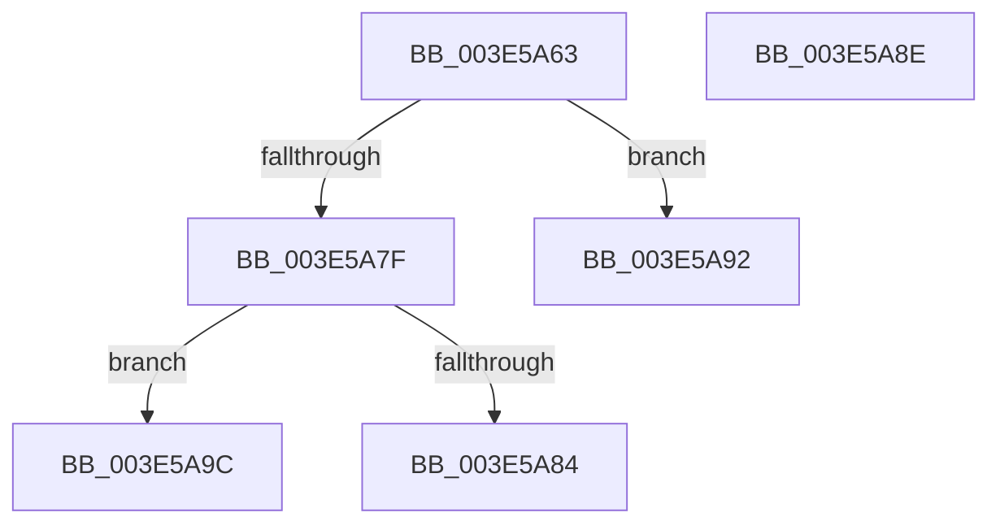

# sub_003E5A63

- RVA: `0x003E5A63`–`0x003E5AA6` (길이 `67` bytes)
- VA: `0x00000001403E5A63`
- 실행 섹션: `.text`
- PDB 이름 있음: `아니요`; PDB Function 태그: `아니요`
- unwind 정보 RVA: `0x00094ED4`
- 디코드: `16`개 명령, `67/67` bytes 표시
- 미해석 바이트: `0` (있으면 어셈블리에 `.byte`로 보존)

> 이 문서는 커널 이미지의 기계어와 PDB 기호를 분석해 생성했습니다. 4번과 5번은 함수 원형과 자료형을 바이너리 사용 방식에서 추정한 C 해석이며 원본 소스 복구 결과는 아닙니다.

## 1. Dependencies

- 직접 호출 지점: **1**; 고유 호출 대상: **1**
- 직접 호출자로 확인된 함수: **0**
- RIP 상대 이미지 참조: **0**

### Outgoing calls
- `0x003E5A75` → [FindNodeOrParent](FindNodeOrParent_function_003E5C10.md) (function, `0x003E5C10`)

### Direct callers
- 이 함수 시작 RVA로 연결되는 직접 call은 확인되지 않았습니다. 간접 호출은 완전히 역산할 수 없습니다.

### Static image references
- 디코드된 RIP-relative 메모리 참조가 없습니다.

## 2. Other-region calls and transfers

- 다른 실행 섹션으로 향하는 call: **0**
- call이 아닌 외부 분기/꼬리 이동: **4**
  - `0x003E5A89` → [sub_003E59B6 + 0x3F](Unknown_function_003E59B6.md) (`tail-transfer`)
  - `0x003E5A90` → [sub_003E59B6 + 0x77](Unknown_function_003E59B6.md) (`tail-transfer`)
  - `0x003E5A97` → [sub_003E59B6 + 0x30](Unknown_function_003E59B6.md) (`tail-transfer`)
  - `0x003E5AA1` → [sub_003E59B6 + 0x37](Unknown_function_003E59B6.md) (`tail-transfer`)

## 3. Assembly (complete function range)

```asm
003E5A63  4C 89 7C 24 70                  mov qword ptr [rsp + 0x70], r15
003E5A68  48 8B 94 24 80 00 00 00         mov rdx, qword ptr [rsp + 0x80]
003E5A70  4C 8D 44 24 70                  lea r8, [rsp + 0x70]
003E5A75  E8 96 01 00 00                  call 0x1403e5c10
003E5A7A  83 F8 01                        cmp eax, 1
003E5A7D  74 13                           je 0x1403e5a92
003E5A7F  83 F8 03                        cmp eax, 3
003E5A82  74 18                           je 0x1403e5a9c
003E5A84  48 8B 7C 24 70                  mov rdi, qword ptr [rsp + 0x70]
003E5A89  E9 67 FF FF FF                  jmp 0x1403e59f5
003E5A8E  33 C0                           xor eax, eax
003E5A90  EB 9B                           jmp 0x1403e5a2d
003E5A92  48 8B 7C 24 70                  mov rdi, qword ptr [rsp + 0x70]
003E5A97  E9 4A FF FF FF                  jmp 0x1403e59e6
003E5A9C  48 8B 4C 24 70                  mov rcx, qword ptr [rsp + 0x70]
003E5AA1  E9 47 FF FF FF                  jmp 0x1403e59ed
```

## 4. C-style interpretation (structured pseudocode)

```c
__int64 __fastcall sub_003E5A63(__int64 a1, __int64 a2, __int64 a3, __int64 a4, __int64 a5, __int64 a6, __int64 a7, __int64 a8, __int64 a9, __int64 a10, __int64 a11, __int64 a12, __int64 a13, __int64 a14, __int64 a15, __int64 a16)
{
    __int64 result;
    unsigned __int64 v_stack_p70;

    v_stack_p70 = v_r15;
    result = FindNodeOrParent(a1, a16, a14, a4);
    if (((unsigned int)(result)) == 1) goto loc_003E5A92;
    if (((unsigned int)(result)) == 3) goto loc_003E5A9C;
loc_003E5A92:
loc_003E5A9C:
}
```

## 5. (Beta) C Style

```c
int64_t sub_003E5A63(int64_t Arg1, int64_t Arg2, int64_t Arg3, int64_t Arg4, uint64_t Arg5, uint64_t Arg6, uint64_t Arg7, uint64_t Arg8, uint64_t Arg9, uint64_t Arg10, uint64_t Arg11, uint64_t Arg12, uint64_t Arg13, int64_t Arg14, uint64_t Arg15, int64_t Arg16)
{
    int64_t result;
    uint64_t v_stack_p70;

    v_stack_p70 = local_r15;
    result = FindNodeOrParent(Arg1, Arg16, Arg14, Arg4);
    if (((uint32_t)(result)) == 1) goto loc_003E5A92;
    if (((uint32_t)(result)) == 3) goto loc_003E5A9C;
loc_003E5A92:
loc_003E5A9C:
}
```

## 6. Execution-region graph

[열기: 2D/3D 그래프와 함수 탐색 컨트롤 패널](../../../control-panel.html?section=text&rva=0x003E5A63&view=graph)

- 2D 그래프는 위에서 아래로 흐르고, 3D 그래프는 빈 공간을 드래그해 회전합니다. Shift+드래그는 이동, 휠은 확대·축소, 함수 노드 선택은 대상 보고서 이동입니다.

### Static fallback


