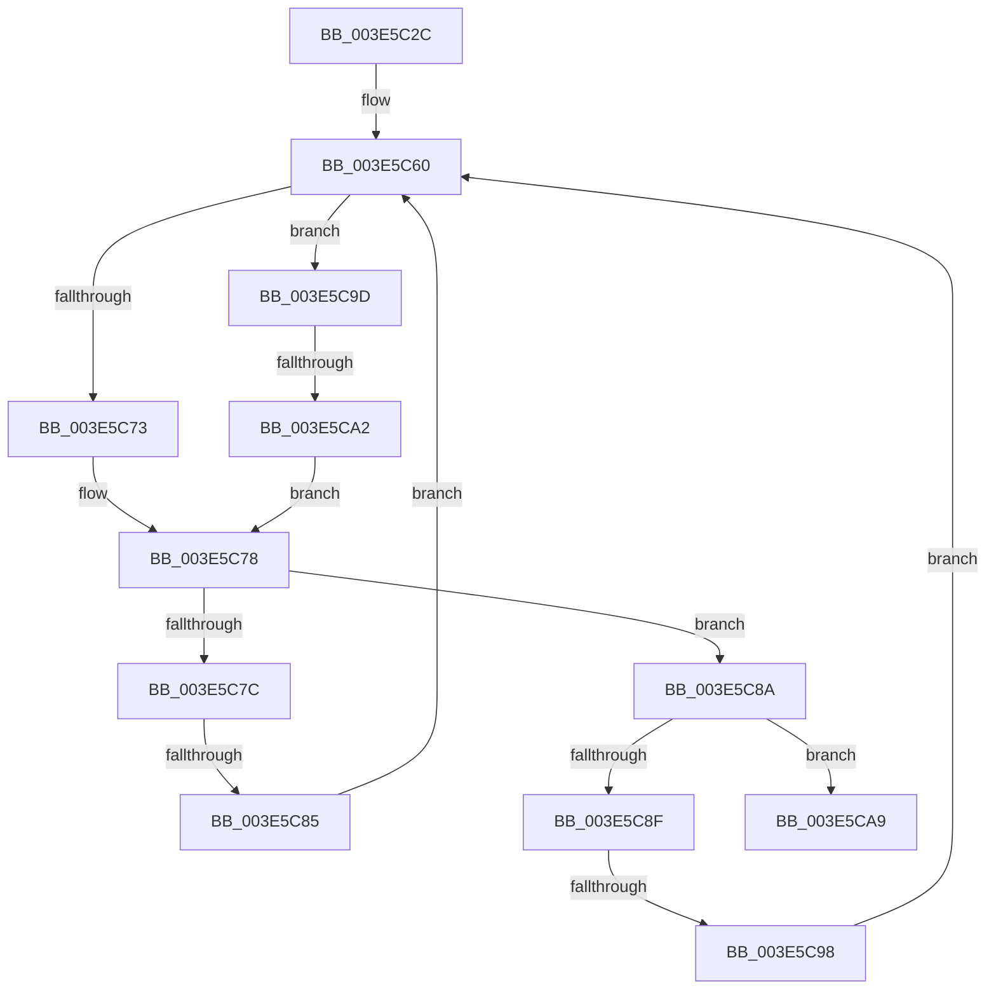

# sub_003E5C2C

- RVA: `0x003E5C2C`–`0x003E5CCE` (길이 `162` bytes)
- VA: `0x00000001403E5C2C`
- 실행 섹션: `.text`
- PDB 이름 있음: `아니요`; PDB Function 태그: `아니요`
- unwind 정보 RVA: `0x00094F20`
- 디코드: `45`개 명령, `162/162` bytes 표시
- 미해석 바이트: `0` (있으면 어셈블리에 `.byte`로 보존)

> 이 문서는 커널 이미지의 기계어와 PDB 기호를 분석해 생성했습니다. 4번과 5번은 함수 원형과 자료형을 바이너리 사용 방식에서 추정한 C 해석이며 원본 소스 복구 결과는 아닙니다.

## 1. Dependencies

- 직접 호출 지점: **2**; 고유 호출 대상: **2**
- 직접 호출자로 확인된 함수: **0**
- RIP 상대 이미지 참조: **3**

### Outgoing calls
- `0x003E5C73` → [PiDmCompareObjects](../../page/9A/PiDmCompareObjects_function_009A2AD0.md) (function, `0x009A2AD0`)
- `0x003E5CA2` → [PnpCompareInstancePath](../../page/9A/PnpCompareInstancePath_function_009A9B60.md) (function, `0x009A9B60`)

### Direct callers
- 이 함수 시작 RVA로 연결되는 직접 call은 확인되지 않았습니다. 간접 호출은 완전히 역산할 수 없습니다.

### Static image references
- `0x003E5C3A` → RVA `0x009A2AD0` (`PiDmCompareObjects`; read)
- `0x003E5C46` → RVA `0x00A11280` (`PiPnpRtlObjectEventCompareObjects`; read)
- `0x003E5C52` → RVA `0x009A9B60` (`PnpCompareInstancePath`; read)

## 2. Other-region calls and transfers

- 다른 실행 섹션으로 향하는 call: **2**
  - `0x003E5C73` → [PiDmCompareObjects](../../page/9A/PiDmCompareObjects_function_009A2AD0.md) (`.text` → `PAGE`)
  - `0x003E5CA2` → [PnpCompareInstancePath](../../page/9A/PnpCompareInstancePath_function_009A9B60.md) (`.text` → `PAGE`)
- call이 아닌 외부 분기/꼬리 이동: **3**
  - `0x003E5C83` → [sub_003E5CDB + 0x7](Unknown_function_003E5CDB.md) (`tail-transfer`)
  - `0x003E5C96` → [sub_003E5CDB](Unknown_function_003E5CDB.md) (`tail-transfer`)
  - `0x003E5CA0` → [sub_003E5CDB + 0xE](Unknown_function_003E5CDB.md) (`tail-transfer`)

## 3. Assembly (complete function range)

```asm
003E5C2C  48 89 5C 24 40                  mov qword ptr [rsp + 0x40], rbx
003E5C31  48 8B 59 10                     mov rbx, qword ptr [rcx + 0x10]
003E5C35  48 89 6C 24 48                  mov qword ptr [rsp + 0x48], rbp
003E5C3A  48 8D 2D 8F CE 5B 00            lea rbp, [rip + 0x5bce8f]
003E5C41  4C 89 64 24 50                  mov qword ptr [rsp + 0x50], r12
003E5C46  4C 8D 25 33 B6 62 00            lea r12, [rip + 0x62b633]
003E5C4D  4C 89 7C 24 58                  mov qword ptr [rsp + 0x58], r15
003E5C52  4C 8D 3D 07 3F 5C 00            lea r15, [rip + 0x5c3f07]
003E5C59  0F 1F 80 00 00 00 00            nop dword ptr [rax]
003E5C60  48 8B 47 48                     mov rax, qword ptr [rdi + 0x48]
003E5C64  4C 8D 43 20                     lea r8, [rbx + 0x20]
003E5C68  48 8B D6                        mov rdx, rsi
003E5C6B  48 8B CF                        mov rcx, rdi
003E5C6E  48 3B C5                        cmp rax, rbp
003E5C71  75 2A                           jne 0x1403e5c9d
003E5C73  E8 58 CE 5B 00                  call 0x1409a2ad0
003E5C78  85 C0                           test eax, eax
003E5C7A  75 0E                           jne 0x1403e5c8a
003E5C7C  48 8B 43 08                     mov rax, qword ptr [rbx + 8]
003E5C80  48 85 C0                        test rax, rax
003E5C83  74 5D                           je 0x1403e5ce2
003E5C85  48 8B D8                        mov rbx, rax
003E5C88  EB D6                           jmp 0x1403e5c60
003E5C8A  83 F8 01                        cmp eax, 1
003E5C8D  75 1A                           jne 0x1403e5ca9
003E5C8F  48 8B 43 10                     mov rax, qword ptr [rbx + 0x10]
003E5C93  48 85 C0                        test rax, rax
003E5C96  74 43                           je 0x1403e5cdb
003E5C98  48 8B D8                        mov rbx, rax
003E5C9B  EB C3                           jmp 0x1403e5c60
003E5C9D  49 3B C7                        cmp rax, r15
003E5CA0  75 47                           jne 0x1403e5ce9
003E5CA2  E8 B9 3E 5C 00                  call 0x1409a9b60
003E5CA7  EB CF                           jmp 0x1403e5c78
003E5CA9  B8 01 00 00 00                  mov eax, 1
003E5CAE  4C 8B 64 24 50                  mov r12, qword ptr [rsp + 0x50]
003E5CB3  48 8B 6C 24 48                  mov rbp, qword ptr [rsp + 0x48]
003E5CB8  4C 8B 7C 24 58                  mov r15, qword ptr [rsp + 0x58]
003E5CBD  49 89 1E                        mov qword ptr [r14], rbx
003E5CC0  48 8B 5C 24 40                  mov rbx, qword ptr [rsp + 0x40]
003E5CC5  48 83 C4 20                     add rsp, 0x20
003E5CC9  41 5E                           pop r14
003E5CCB  5F                              pop rdi
003E5CCC  5E                              pop rsi
003E5CCD  C3                              ret
```

## 4. C-style interpretation (structured pseudocode)

```c
__int64 __fastcall sub_003E5C2C(__int64 a1, __int64 a2, __int64 a3, __int64 a4, __int64 a5, __int64 a6, __int64 a7, __int64 a8, __int64 a9, __int64 a10, __int64 a11)
{
    __int64 result;
    __int64 v_rsp;
    unsigned __int64 v_stack_p40;
    unsigned __int64 v_stack_p48;
    unsigned __int64 v_stack_p50;
    unsigned __int64 v_stack_p58;

    v_stack_p40 = v_rbx;
    v_stack_p48 = v_rbp;
    v_stack_p50 = v_r12;
    v_stack_p58 = v_r15;
loc_003E5C60:
    if ((*(unsigned __int64 *)(v_rdi + 72)) != (v_rip + 6016655)) goto loc_003E5C9D;
    result = PiDmCompareObjects(v_rdi, v_rsi, *(unsigned __int64 *)(a1 + 16) + 32, a4);
loc_003E5C78:
    if ((unsigned int)(result) != 0) goto loc_003E5C8A;
    goto loc_003E5C60;
loc_003E5C8A:
    if (((unsigned int)(*(unsigned __int64 *)(*(unsigned __int64 *)(a1 + 16) + 8))) != 1) goto loc_003E5CA9;
    goto loc_003E5C60;
loc_003E5C9D:
    result = PnpCompareInstancePath(v_rdi, v_rsi, *(unsigned __int64 *)(a1 + 16) + 32, a4);
    goto loc_003E5C78;
loc_003E5CA9:
    *(unsigned __int64 *)(v_r14) = *(unsigned __int64 *)(*(unsigned __int64 *)(*(unsigned __int64 *)(a1 + 16) + 8) + 16);
    v_rsp = (v_rsp) + (32);
    return 1;
}
```

## 5. (Beta) C Style

```c
int64_t sub_003E5C2C(void *Arg1, int64_t Arg2, int64_t Arg3, int64_t Arg4, uint64_t Arg5, uint64_t Arg6, uint64_t Arg7, int64_t Arg8, int64_t Arg9, int64_t Arg10, int64_t Arg11)
{
    uint8_t *arg1 = (uint8_t *)Arg1;

    int64_t result;
    int64_t local_rsp;
    uint64_t v_stack_p40;
    uint64_t v_stack_p48;
    uint64_t v_stack_p50;
    uint64_t v_stack_p58;

    v_stack_p40 = local_rbx;
    v_stack_p48 = local_rbp;
    v_stack_p50 = local_r12;
    v_stack_p58 = local_r15;
loc_003E5C60:
    if ((*(uint64_t *)(local_rdi + 0x48)) != (v_rip + 6016655)) goto loc_003E5C9D;
    result = PiDmCompareObjects(local_rdi, local_rsi, *(uint64_t *)(arg1 + 0x10) + 32, Arg4);
loc_003E5C78:
    if ((uint32_t)(result) != 0) goto loc_003E5C8A;
    goto loc_003E5C60;
loc_003E5C8A:
    if (((uint32_t)(*(uint64_t *)(*(uint64_t *)(arg1 + 0x10) + 0x8))) != 1) goto loc_003E5CA9;
    goto loc_003E5C60;
loc_003E5C9D:
    result = PnpCompareInstancePath(local_rdi, local_rsi, *(uint64_t *)(arg1 + 0x10) + 32, Arg4);
    goto loc_003E5C78;
loc_003E5CA9:
    *(uint64_t *)(local_r14) = *(uint64_t *)(*(uint64_t *)(*(uint64_t *)(arg1 + 0x10) + 0x8) + 0x10);
    local_rsp = (local_rsp) + (32);
    return 1;
}
```

### 관측된 메모리 오프셋

구조체 형식이 확인되지 않은 접근은 인자 기준의 오프셋으로만 기록했습니다.

| 기준 인자 | 오프셋 표현 | 폭 (bit) | 접근 |
|---|---:|---:|---|
| `Arg1` | `+ 0x10` | `64` | `R` |

## 6. Execution-region graph

[열기: 2D/3D 그래프와 함수 탐색 컨트롤 패널](../../../control-panel.html?section=text&rva=0x003E5C2C&view=graph)

- 2D 그래프는 위에서 아래로 흐르고, 3D 그래프는 빈 공간을 드래그해 회전합니다. Shift+드래그는 이동, 휠은 확대·축소, 함수 노드 선택은 대상 보고서 이동입니다.

### Static fallback


