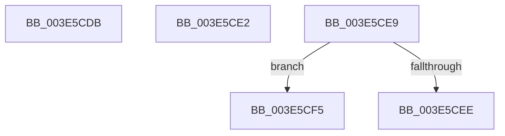

# sub_003E5CDB

- RVA: `0x003E5CDB`–`0x003E5CFF` (길이 `36` bytes)
- VA: `0x00000001403E5CDB`
- 실행 섹션: `.text`
- PDB 이름 있음: `아니요`; PDB Function 태그: `아니요`
- unwind 정보 RVA: `0x00094F58`
- 디코드: `10`개 명령, `36/36` bytes 표시
- 미해석 바이트: `0` (있으면 어셈블리에 `.byte`로 보존)

> 이 문서는 커널 이미지의 기계어와 PDB 기호를 분석해 생성했습니다. 4번과 5번은 함수 원형과 자료형을 바이너리 사용 방식에서 추정한 C 해석이며 원본 소스 복구 결과는 아닙니다.

## 1. Dependencies

- 직접 호출 지점: **2**; 고유 호출 대상: **2**
- 직접 호출자로 확인된 함수: **0**
- RIP 상대 이미지 참조: **0**

### Outgoing calls
- `0x003E5CEE` → [PiPnpRtlObjectEventCompareObjects](../../page/A1/PiPnpRtlObjectEventCompareObjects_function_00A11280.md) (function, `0x00A11280`)
- `0x003E5CF5` → [guard_dispatch_icall](../6B/guard_dispatch_icall_function_006BAAD0.md) (function, `0x006BAAD0`)

### Direct callers
- 이 함수 시작 RVA로 연결되는 직접 call은 확인되지 않았습니다. 간접 호출은 완전히 역산할 수 없습니다.

### Static image references
- 디코드된 RIP-relative 메모리 참조가 없습니다.

## 2. Other-region calls and transfers

- 다른 실행 섹션으로 향하는 call: **1**
  - `0x003E5CEE` → [PiPnpRtlObjectEventCompareObjects](../../page/A1/PiPnpRtlObjectEventCompareObjects_function_00A11280.md) (`.text` → `PAGE`)
- call이 아닌 외부 분기/꼬리 이동: **4**
  - `0x003E5CE0` → [sub_003E5C2C + 0x82](Unknown_function_003E5C2C.md) (`tail-transfer`)
  - `0x003E5CE7` → [sub_003E5C2C + 0x82](Unknown_function_003E5C2C.md) (`tail-transfer`)
  - `0x003E5CF3` → [sub_003E5C2C + 0x4C](Unknown_function_003E5C2C.md) (`tail-transfer`)
  - `0x003E5CFA` → [sub_003E5C2C + 0x4C](Unknown_function_003E5C2C.md) (`tail-transfer`)

## 3. Assembly (complete function range)

```asm
003E5CDB  B8 03 00 00 00                  mov eax, 3
003E5CE0  EB CC                           jmp 0x1403e5cae
003E5CE2  B8 02 00 00 00                  mov eax, 2
003E5CE7  EB C5                           jmp 0x1403e5cae
003E5CE9  49 3B C4                        cmp rax, r12
003E5CEC  75 07                           jne 0x1403e5cf5
003E5CEE  E8 8D B5 62 00                  call 0x140a11280
003E5CF3  EB 83                           jmp 0x1403e5c78
003E5CF5  E8 D6 4D 2D 00                  call 0x1406baad0
003E5CFA  E9 79 FF FF FF                  jmp 0x1403e5c78
```

## 4. C-style interpretation (structured pseudocode)

```c
__int64 __fastcall sub_003E5CDB(void)
{
}
```

## 5. (Beta) C Style

```c
void sub_003E5CDB(void)
{
}
```

## 6. Execution-region graph

[열기: 2D/3D 그래프와 함수 탐색 컨트롤 패널](../../../control-panel.html?section=text&rva=0x003E5CDB&view=graph)

- 2D 그래프는 위에서 아래로 흐르고, 3D 그래프는 빈 공간을 드래그해 회전합니다. Shift+드래그는 이동, 휠은 확대·축소, 함수 노드 선택은 대상 보고서 이동입니다.

### Static fallback


