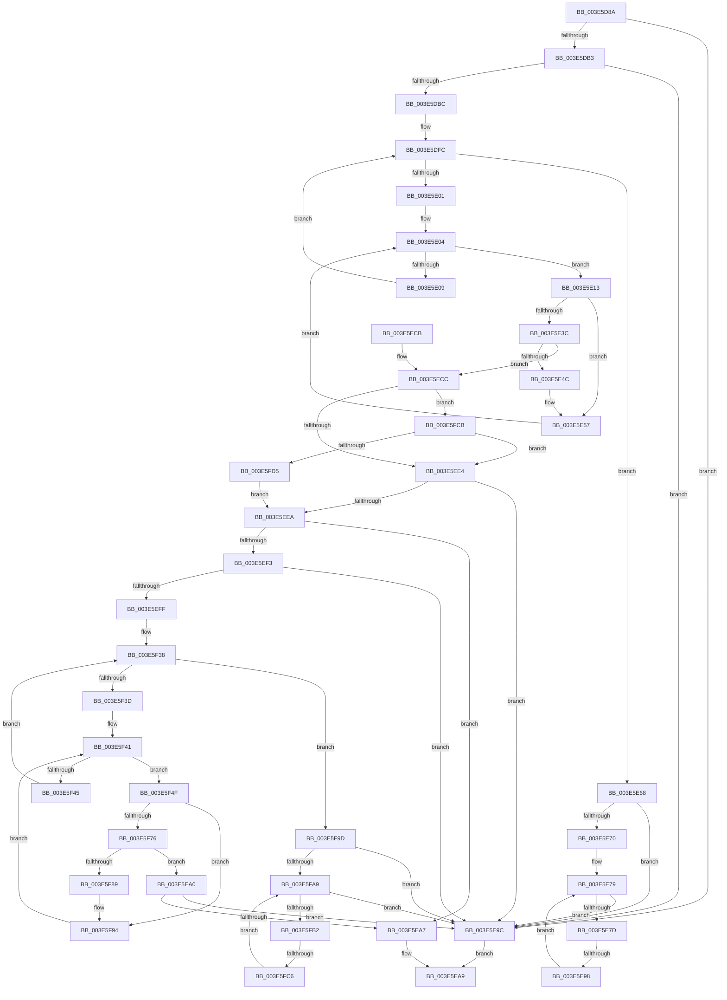

# sub_003E5D8A

- RVA: `0x003E5D8A`–`0x003E5FDA` (길이 `592` bytes)
- VA: `0x00000001403E5D8A`
- 실행 섹션: `.text`
- PDB 이름 있음: `아니요`; PDB Function 태그: `아니요`
- unwind 정보 RVA: `0x00094F84`
- 디코드: `155`개 명령, `592/592` bytes 표시
- 미해석 바이트: `0` (있으면 어셈블리에 `.byte`로 보존)

> 이 문서는 커널 이미지의 기계어와 PDB 기호를 분석해 생성했습니다. 4번과 5번은 함수 원형과 자료형을 바이너리 사용 방식에서 추정한 C 해석이며 원본 소스 복구 결과는 아닙니다.

## 1. Dependencies

- 직접 호출 지점: **2**; 고유 호출 대상: **1**
- 직접 호출자로 확인된 함수: **0**
- RIP 상대 이미지 참조: **1**

### Outgoing calls
- `0x003E5E3F` → [memcmp](../6C/memcmp_function_006C6B10.md) (function, `0x006C6B10`)
- `0x003E5F7C` → [memcmp](../6C/memcmp_function_006C6B10.md) (function, `0x006C6B10`)

### Direct callers
- 이 함수 시작 RVA로 연결되는 직접 call은 확인되지 않았습니다. 간접 호출은 완전히 역산할 수 없습니다.

### Static image references
- `0x003E5DF2` → RVA `0x00011DE0` (`.rdata`; read)

## 2. Other-region calls and transfers

- 다른 실행 섹션으로 향하는 call: **0**
- call이 아닌 외부 분기/꼬리 이동: **2**
  - `0x003E5E92` → [sub_003E5FE3](Unknown_function_003E5FE3.md) (`tail-transfer`)
  - `0x003E5FC4` → [sub_003E5FE3 + 0x20](Unknown_function_003E5FE3.md) (`tail-transfer`)

## 3. Assembly (complete function range)

```asm
003E5D8A  48 89 5C 24 78                  mov qword ptr [rsp + 0x78], rbx
003E5D8F  4C 8D B1 E8 00 00 00            lea r14, [rcx + 0xe8]
003E5D96  48 89 7C 24 38                  mov qword ptr [rsp + 0x38], rdi
003E5D9B  4C 89 64 24 30                  mov qword ptr [rsp + 0x30], r12
003E5DA0  4C 89 6C 24 28                  mov qword ptr [rsp + 0x28], r13
003E5DA5  4C 89 7C 24 20                  mov qword ptr [rsp + 0x20], r15
003E5DAA  4D 85 F6                        test r14, r14
003E5DAD  0F 84 E9 00 00 00               je 0x1403e5e9c
003E5DB3  48 85 F6                        test rsi, rsi
003E5DB6  0F 84 E0 00 00 00               je 0x1403e5e9c
003E5DBC  0F B6 46 01                     movzx eax, byte ptr [rsi + 1]
003E5DC0  44 0F B7 0E                     movzx r9d, word ptr [rsi]
003E5DC4  66 44 89 4C 24 70               mov word ptr [rsp + 0x70], r9w
003E5DCA  0F B6 4C 86 04                  movzx ecx, byte ptr [rsi + rax*4 + 4]
003E5DCF  44 8D 04 85 08 00 00 00         lea r8d, [rax*4 + 8]
003E5DD7  8B D9                           mov ebx, ecx
003E5DD9  44 89 44 24 60                  mov dword ptr [rsp + 0x60], r8d
003E5DDE  48 C1 EB 04                     shr rbx, 4
003E5DE2  83 E1 0F                        and ecx, 0xf
003E5DE5  49 8B 9C DE 90 00 00 00         mov rbx, qword ptr [r14 + rbx*8 + 0x90]
003E5DED  49 23 5C CE 10                  and rbx, qword ptr [r14 + rcx*8 + 0x10]
003E5DF2  48 8D 0D E7 BF C2 FF            lea rcx, [rip - 0x3d4019]
003E5DF9  45 32 E4                        xor r12b, r12b
003E5DFC  48 85 DB                        test rbx, rbx
003E5DFF  74 67                           je 0x1403e5e68
003E5E01  0F B6 FB                        movzx edi, bl
003E5E04  40 84 FF                        test dil, dil
003E5E07  75 0A                           jne 0x1403e5e13
003E5E09  41 80 C4 08                     add r12b, 8
003E5E0D  48 C1 EB 08                     shr rbx, 8
003E5E11  EB E9                           jmp 0x1403e5dfc
003E5E13  45 0F B6 FC                     movzx r15d, r12b
003E5E17  40 0F B6 C7                     movzx eax, dil
003E5E1B  44 0F B6 2C 08                  movzx r13d, byte ptr [rax + rcx]
003E5E20  49 8B 4E 08                     mov rcx, qword ptr [r14 + 8]
003E5E24  45 03 FD                        add r15d, r13d
003E5E27  49 C1 E7 04                     shl r15, 4
003E5E2B  4C 03 F9                        add r15, rcx
003E5E2E  48 89 4C 24 68                  mov qword ptr [rsp + 0x68], rcx
003E5E33  49 8B 17                        mov rdx, qword ptr [r15]
003E5E36  66 44 39 0A                     cmp word ptr [rdx], r9w
003E5E3A  75 1B                           jne 0x1403e5e57
003E5E3C  48 8B CE                        mov rcx, rsi
003E5E3F  E8 CC 0C 2E 00                  call 0x1406c6b10
003E5E44  85 C0                           test eax, eax
003E5E46  0F 84 80 00 00 00               je 0x1403e5ecc
003E5E4C  44 8B 44 24 60                  mov r8d, dword ptr [rsp + 0x60]
003E5E51  44 0F B7 4C 24 70               movzx r9d, word ptr [rsp + 0x70]
003E5E57  40 0F B6 FF                     movzx edi, dil
003E5E5B  48 8D 0D 7E BF C2 FF            lea rcx, [rip - 0x3d4082]
003E5E62  44 0F BB EF                     btc edi, r13d
003E5E66  EB 9C                           jmp 0x1403e5e04
003E5E68  41 8B 1E                        mov ebx, dword ptr [r14]
003E5E6B  83 FB 40                        cmp ebx, 0x40
003E5E6E  76 2C                           jbe 0x1403e5e9c
003E5E70  41 BD 40 00 00 00               mov r13d, 0x40
003E5E76  41 8B FD                        mov edi, r13d
003E5E79  3B FB                           cmp edi, ebx
003E5E7B  73 1F                           jae 0x1403e5e9c
003E5E7D  4D 8B 66 08                     mov r12, qword ptr [r14 + 8]
003E5E81  44 8B FF                        mov r15d, edi
003E5E84  49 C1 E7 04                     shl r15, 4
003E5E88  4D 03 FC                        add r15, r12
003E5E8B  49 8B 17                        mov rdx, qword ptr [r15]
003E5E8E  66 44 39 0A                     cmp word ptr [rdx], r9w
003E5E92  0F 84 4B 01 00 00               je 0x1403e5fe3
003E5E98  FF C7                           inc edi
003E5E9A  EB DD                           jmp 0x1403e5e79
003E5E9C  32 C0                           xor al, al
003E5E9E  EB 09                           jmp 0x1403e5ea9
003E5EA0  8B 47 08                        mov eax, dword ptr [rdi + 8]
003E5EA3  A8 04                           test al, 4
003E5EA5  74 F5                           je 0x1403e5e9c
003E5EA7  B0 01                           mov al, 1
003E5EA9  4C 8B 7C 24 20                  mov r15, qword ptr [rsp + 0x20]
003E5EAE  4C 8B 6C 24 28                  mov r13, qword ptr [rsp + 0x28]
003E5EB3  4C 8B 64 24 30                  mov r12, qword ptr [rsp + 0x30]
003E5EB8  48 8B 7C 24 38                  mov rdi, qword ptr [rsp + 0x38]
003E5EBD  48 8B 5C 24 78                  mov rbx, qword ptr [rsp + 0x78]
003E5EC2  48 83 C4 40                     add rsp, 0x40
003E5EC6  41 5E                           pop r14
003E5EC8  5E                              pop rsi
003E5EC9  5D                              pop rbp
003E5ECA  C3                              ret
003E5ECB  CC                              int3
003E5ECC  4C 8B 64 24 68                  mov r12, qword ptr [rsp + 0x68]
003E5ED1  41 BD 40 00 00 00               mov r13d, 0x40
003E5ED7  49 8D 4F 08                     lea rcx, [r15 + 8]
003E5EDB  4D 3B FC                        cmp r15, r12
003E5EDE  0F 84 E7 00 00 00               je 0x1403e5fcb
003E5EE4  8B 01                           mov eax, dword ptr [rcx]
003E5EE6  A8 04                           test al, 4
003E5EE8  74 B2                           je 0x1403e5e9c
003E5EEA  83 BD 80 00 00 00 00            cmp dword ptr [rbp + 0x80], 0
003E5EF1  74 B4                           je 0x1403e5ea7
003E5EF3  4C 8D B5 F8 01 00 00            lea r14, [rbp + 0x1f8]
003E5EFA  4D 85 F6                        test r14, r14
003E5EFD  74 9D                           je 0x1403e5e9c
003E5EFF  0F B6 46 01                     movzx eax, byte ptr [rsi + 1]
003E5F03  44 0F B7 06                     movzx r8d, word ptr [rsi]
003E5F07  66 44 89 44 24 70               mov word ptr [rsp + 0x70], r8w
003E5F0D  0F B6 4C 86 04                  movzx ecx, byte ptr [rsi + rax*4 + 4]
003E5F12  44 8D 0C 85 08 00 00 00         lea r9d, [rax*4 + 8]
003E5F1A  8B C1                           mov eax, ecx
003E5F1C  44 89 4C 24 60                  mov dword ptr [rsp + 0x60], r9d
003E5F21  48 C1 E8 04                     shr rax, 4
003E5F25  83 E1 0F                        and ecx, 0xf
003E5F28  49 8B AC C6 90 00 00 00         mov rbp, qword ptr [r14 + rax*8 + 0x90]
003E5F30  49 23 6C CE 10                  and rbp, qword ptr [r14 + rcx*8 + 0x10]
003E5F35  45 32 FF                        xor r15b, r15b
003E5F38  48 85 ED                        test rbp, rbp
003E5F3B  74 60                           je 0x1403e5f9d
003E5F3D  40 0F B6 DD                     movzx ebx, bpl
003E5F41  84 DB                           test bl, bl
003E5F43  75 0A                           jne 0x1403e5f4f
003E5F45  41 80 C7 08                     add r15b, 8
003E5F49  48 C1 ED 08                     shr rbp, 8
003E5F4D  EB E9                           jmp 0x1403e5f38
003E5F4F  41 0F B6 FF                     movzx edi, r15b
003E5F53  48 8D 0D 86 BE C2 FF            lea rcx, [rip - 0x3d417a]
003E5F5A  0F B6 C3                        movzx eax, bl
003E5F5D  44 0F B6 24 08                  movzx r12d, byte ptr [rax + rcx]
003E5F62  41 03 FC                        add edi, r12d
003E5F65  48 C1 E7 04                     shl rdi, 4
003E5F69  49 03 7E 08                     add rdi, qword ptr [r14 + 8]
003E5F6D  48 8B 17                        mov rdx, qword ptr [rdi]
003E5F70  66 44 39 02                     cmp word ptr [rdx], r8w
003E5F74  75 1E                           jne 0x1403e5f94
003E5F76  45 8B C1                        mov r8d, r9d
003E5F79  48 8B CE                        mov rcx, rsi
003E5F7C  E8 8F 0B 2E 00                  call 0x1406c6b10
003E5F81  85 C0                           test eax, eax
003E5F83  0F 84 17 FF FF FF               je 0x1403e5ea0
003E5F89  44 0F B7 44 24 70               movzx r8d, word ptr [rsp + 0x70]
003E5F8F  44 8B 4C 24 60                  mov r9d, dword ptr [rsp + 0x60]
003E5F94  0F B6 DB                        movzx ebx, bl
003E5F97  44 0F BB E3                     btc ebx, r12d
003E5F9B  EB A4                           jmp 0x1403e5f41
003E5F9D  41 8B 1E                        mov ebx, dword ptr [r14]
003E5FA0  83 FB 40                        cmp ebx, 0x40
003E5FA3  0F 86 F3 FE FF FF               jbe 0x1403e5e9c
003E5FA9  44 3B EB                        cmp r13d, ebx
003E5FAC  0F 83 EA FE FF FF               jae 0x1403e5e9c
003E5FB2  41 8B FD                        mov edi, r13d
003E5FB5  48 C1 E7 04                     shl rdi, 4
003E5FB9  49 03 7E 08                     add rdi, qword ptr [r14 + 8]
003E5FBD  48 8B 17                        mov rdx, qword ptr [rdi]
003E5FC0  66 44 39 02                     cmp word ptr [rdx], r8w
003E5FC4  74 3D                           je 0x1403e6003
003E5FC6  41 FF C5                        inc r13d
003E5FC9  EB DE                           jmp 0x1403e5fa9
003E5FCB  8B 01                           mov eax, dword ptr [rcx]
003E5FCD  A8 10                           test al, 0x10
003E5FCF  0F 85 0F FF FF FF               jne 0x1403e5ee4
003E5FD5  E9 10 FF FF FF                  jmp 0x1403e5eea
```

## 4. C-style interpretation (structured pseudocode)

```c
__int64 __fastcall sub_003E5D8A(__int64 a1, __int64 a2, __int64 a3, __int64 a4, __int64 a5, __int64 a6, __int64 a7, __int64 a8, __int64 a9, __int64 a10, __int64 a11, unsigned int a12, __int64 a13, unsigned __int16 a14, __int64 a15)
{
    __int64 result;
    __int64 v_r12;
    __int64 v_r13;
    __int64 v_r15;
    __int64 v_rbp;
    __int64 v_rbx;
    __int64 v_rdi;
    __int64 v_rsp;
    unsigned __int64 v_stack_p20;
    unsigned __int64 v_stack_p28;
    unsigned __int64 v_stack_p30;
    unsigned __int64 v_stack_p38;
    unsigned int v_stack_p60;
    unsigned __int64 v_stack_p68;
    unsigned __int16 v_stack_p70;
    unsigned __int64 v_stack_p78;
    unsigned int v_stack_pB8;
    unsigned __int16 v_stack_pC8;

    v_stack_p78 = v_rbx;
    v_stack_p38 = v_rdi;
    v_stack_p30 = v_r12;
    v_stack_p28 = v_r13;
    v_stack_p20 = v_r15;
    if (a1 + 232 == 0) goto loc_003E5E9C;
    if (v_rsi == 0) goto loc_003E5E9C;
    v_stack_p70 = (unsigned __int16)(*(unsigned __int16 *)(v_rsi));
    v_stack_p60 = (unsigned int)(*(unsigned __int8 *)(v_rsi + 1) * 4 + 8);
    v_rbx = ((unsigned int)((unsigned int)(*(unsigned __int8 *)(v_rsi + *(unsigned __int8 *)(v_rsi + 1) * 4 + 4)))) >> (4);
    a1 = (unsigned int)((*(unsigned __int8 *)(v_rsi + *(unsigned __int8 *)(v_rsi + 1) * 4 + 4)) & (15));
    v_rbx = (*(unsigned __int64 *)(a1 + 232 + v_rbx * 8 + 144)) & (*(unsigned __int64 *)(a1 + 232 + a1 * 8 + 16));
    v_r12 = 0;
loc_003E5DFC:
    if (v_rbx == 0) goto loc_003E5E68;
loc_003E5E04:
    if ((unsigned __int8)((unsigned __int8)(v_rbx)) != 0) goto loc_003E5E13;
    v_r12 = (unsigned __int8)((v_r12) + (8));
    v_rbx = (v_rbx) >> (8);
    goto loc_003E5DFC;
loc_003E5E13:
    v_r15 = (unsigned int)(((unsigned __int8)(v_r12)) + ((unsigned int)(*(unsigned __int8 *)((unsigned __int8)((unsigned __int8)(v_rbx)) + v_rip - 4014105 * 1))));
    v_r15 = (v_r15) << (4);
    v_r15 = (v_r15) + (*(unsigned __int64 *)(a1 + 232 + 8));
    v_stack_p68 = *(unsigned __int64 *)(a1 + 232 + 8);
    if ((*(unsigned __int16 *)(*(unsigned __int64 *)(v_r15))) != ((unsigned __int16)(*(unsigned __int16 *)(v_rsi)))) goto loc_003E5E57;
    result = memcmp(v_rsi, *(unsigned __int64 *)(v_r15), *(unsigned __int8 *)(v_rsi + 1) * 4 + 8, *(unsigned __int16 *)(v_rsi));
    if ((unsigned int)(result) == 0) goto loc_003E5ECC;
loc_003E5E57:
    goto loc_003E5E04;
loc_003E5E68:
    if (((unsigned int)((unsigned int)(*(unsigned int *)(a1 + 232)))) <= 64) goto loc_003E5E9C;
loc_003E5E79:
    if (64 >= ((unsigned int)((unsigned int)(*(unsigned int *)(a1 + 232))))) goto loc_003E5E9C;
    v_r15 = (64) << (4);
    v_r15 = (v_r15) + (*(unsigned __int64 *)(a1 + 232 + 8));
    v_rdi = (unsigned int)((64) + 1);
    goto loc_003E5E79;
loc_003E5E9C:
    result = 0;
    goto loc_003E5EA9;
loc_003E5EA0:
    if ((((unsigned __int8)((unsigned int)(*(unsigned int *)(v_rdi + 8)))) & (4)) == 0) goto loc_003E5E9C;
loc_003E5EA7:
loc_003E5EA9:
    v_rsp = (v_rsp) + (64);
    return 1;
loc_003E5ECC:
    if (v_stack_p20 == a13) goto loc_003E5FCB;
loc_003E5EE4:
    if ((((unsigned __int8)((unsigned int)(*(unsigned int *)(v_stack_p20 + 8)))) & (4)) == 0) goto loc_003E5E9C;
loc_003E5EEA:
    if ((*(unsigned int *)(v_rbp + 128)) == 0) goto loc_003E5EA7;
    if (v_rbp + 504 == 0) goto loc_003E5E9C;
    v_stack_pC8 = (unsigned __int16)(*(unsigned __int16 *)(v_rsi));
    v_stack_pB8 = (unsigned int)(*(unsigned __int8 *)(v_rsi + 1) * 4 + 8);
    result = ((unsigned int)((unsigned int)(*(unsigned __int8 *)(v_rsi + *(unsigned __int8 *)(v_rsi + 1) * 4 + 4)))) >> (4);
    a1 = (unsigned int)((*(unsigned __int8 *)(v_rsi + *(unsigned __int8 *)(v_rsi + 1) * 4 + 4)) & (15));
    v_rbp = (*(unsigned __int64 *)(v_rbp + 504 + result * 8 + 144)) & (*(unsigned __int64 *)(v_rbp + 504 + a1 * 8 + 16));
    v_r15 = 0;
loc_003E5F38:
    if (v_rbp == 0) goto loc_003E5F9D;
loc_003E5F41:
    if ((unsigned __int8)((unsigned __int8)(v_rbp)) != 0) goto loc_003E5F4F;
    v_r15 = (unsigned __int8)((v_r15) + (8));
    v_rbp = (v_rbp) >> (8);
    goto loc_003E5F38;
loc_003E5F4F:
    v_rdi = (unsigned int)(((unsigned __int8)(v_r15)) + ((unsigned int)(*(unsigned __int8 *)((unsigned __int8)((unsigned __int8)(v_rbp)) + v_rip - 4014458 * 1))));
    v_rdi = (v_rdi) << (4);
    v_rdi = (v_rdi) + (*(unsigned __int64 *)(v_rbp + 504 + 8));
    if ((*(unsigned __int16 *)(*(unsigned __int64 *)(v_rdi))) != ((unsigned __int16)(*(unsigned __int16 *)(v_rsi)))) goto loc_003E5F94;
    result = memcmp(v_rsi, *(unsigned __int64 *)(v_rdi), (unsigned int)((unsigned int)(*(unsigned __int8 *)(v_rsi + 1) * 4 + 8)), *(unsigned __int8 *)(v_rsi + 1) * 4 + 8);
    if ((unsigned int)(result) == 0) goto loc_003E5EA0;
loc_003E5F94:
    goto loc_003E5F41;
loc_003E5F9D:
    if (((unsigned int)((unsigned int)(*(unsigned int *)(v_rbp + 504)))) <= 64) goto loc_003E5E9C;
loc_003E5FA9:
    if (64 >= ((unsigned int)((unsigned int)(*(unsigned int *)(v_rbp + 504))))) goto loc_003E5E9C;
    v_rdi = (64) << (4);
    v_rdi = (v_rdi) + (*(unsigned __int64 *)(v_rbp + 504 + 8));
    v_r13 = (unsigned int)((64) + 1);
    goto loc_003E5FA9;
loc_003E5FCB:
    if ((((unsigned __int8)((unsigned int)(*(unsigned int *)(v_rsi)))) & (16)) != 0) goto loc_003E5EE4;
    goto loc_003E5EEA;
}
```

## 5. (Beta) C Style

```c
int64_t sub_003E5D8A(void *Arg1, int64_t Arg2, int64_t Arg3, int64_t Arg4, int64_t Arg5, int64_t Arg6, int64_t Arg7, uint64_t Arg8, uint64_t Arg9, uint64_t Arg10, uint64_t Arg11, uint32_t Arg12, int64_t Arg13, uint16_t Arg14, int64_t Arg15)
{
    uint8_t *arg1 = (uint8_t *)Arg1;

    int64_t result;
    int64_t local_r12;
    int64_t local_r13;
    int64_t local_r15;
    int64_t local_rbp;
    int64_t local_rbx;
    int64_t local_rdi;
    int64_t local_rsp;
    uint64_t v_stack_p20;
    uint64_t v_stack_p28;
    uint64_t v_stack_p30;
    uint64_t v_stack_p38;
    uint32_t v_stack_p60;
    uint64_t v_stack_p68;
    uint16_t v_stack_p70;
    uint64_t v_stack_p78;
    uint32_t v_stack_pB8;
    uint16_t v_stack_pC8;

    v_stack_p78 = local_rbx;
    v_stack_p38 = local_rdi;
    v_stack_p30 = local_r12;
    v_stack_p28 = local_r13;
    v_stack_p20 = local_r15;
    if (Arg1 + 232 == 0) goto loc_003E5E9C;
    if (local_rsi == 0) goto loc_003E5E9C;
    v_stack_p70 = (uint16_t)(*(uint16_t *)(local_rsi));
    v_stack_p60 = (uint32_t)(*(uint8_t *)(local_rsi + 0x1) * 4 + 8);
    local_rbx = ((uint32_t)((uint32_t)(*(uint8_t *)(local_rsi + *(uint8_t *)(local_rsi + 0x1) * 4 + 0x4)))) >> (4);
    Arg1 = (uint32_t)((*(uint8_t *)(local_rsi + *(uint8_t *)(local_rsi + 0x1) * 4 + 0x4)) & (15));
    local_rbx = (*(uint64_t *)(arg1 + 0xE8 + local_rbx * 8 + 0x90)) & (*(uint64_t *)(arg1 + 0xE8 + arg1 * 8 + 0x10));
    local_r12 = 0;
loc_003E5DFC:
    if (local_rbx == 0) goto loc_003E5E68;
loc_003E5E04:
    if ((uint8_t)((uint8_t)(local_rbx)) != 0) goto loc_003E5E13;
    local_r12 = (uint8_t)((local_r12) + (8));
    local_rbx = (local_rbx) >> (8);
    goto loc_003E5DFC;
loc_003E5E13:
    local_r15 = (uint32_t)(((uint8_t)(local_r12)) + ((uint32_t)(*(uint8_t *)((uint8_t)((uint8_t)(local_rbx)) + v_rip - 0x3D4019 * 1))));
    local_r15 = (local_r15) << (4);
    local_r15 = (local_r15) + (*(uint64_t *)(arg1 + 0xE8 + 0x8));
    v_stack_p68 = *(uint64_t *)(arg1 + 0xE8 + 0x8);
    if ((*(uint16_t *)(*(uint64_t *)(local_r15))) != ((uint16_t)(*(uint16_t *)(local_rsi)))) goto loc_003E5E57;
    result = memcmp(local_rsi, *(uint64_t *)(local_r15), *(uint8_t *)(local_rsi + 0x1) * 4 + 8, *(uint16_t *)(local_rsi));
    if ((uint32_t)(result) == 0) goto loc_003E5ECC;
loc_003E5E57:
    goto loc_003E5E04;
loc_003E5E68:
    if (((uint32_t)((uint32_t)(*(uint32_t *)(arg1 + 0xE8)))) <= 64) goto loc_003E5E9C;
loc_003E5E79:
    if (64 >= ((uint32_t)((uint32_t)(*(uint32_t *)(arg1 + 0xE8))))) goto loc_003E5E9C;
    local_r15 = (64) << (4);
    local_r15 = (local_r15) + (*(uint64_t *)(arg1 + 0xE8 + 0x8));
    local_rdi = (uint32_t)((64) + 1);
    goto loc_003E5E79;
loc_003E5E9C:
    result = 0;
    goto loc_003E5EA9;
loc_003E5EA0:
    if ((((uint8_t)((uint32_t)(*(uint32_t *)(local_rdi + 0x8)))) & (4)) == 0) goto loc_003E5E9C;
loc_003E5EA7:
loc_003E5EA9:
    local_rsp = (local_rsp) + (64);
    return 1;
loc_003E5ECC:
    if (v_stack_p20 == Arg13) goto loc_003E5FCB;
loc_003E5EE4:
    if ((((uint8_t)((uint32_t)(*(uint32_t *)(v_stack_p20 + 0x8)))) & (4)) == 0) goto loc_003E5E9C;
loc_003E5EEA:
    if ((*(uint32_t *)(local_rbp + 0x80)) == 0) goto loc_003E5EA7;
    if (local_rbp + 504 == 0) goto loc_003E5E9C;
    v_stack_pC8 = (uint16_t)(*(uint16_t *)(local_rsi));
    v_stack_pB8 = (uint32_t)(*(uint8_t *)(local_rsi + 0x1) * 4 + 8);
    result = ((uint32_t)((uint32_t)(*(uint8_t *)(local_rsi + *(uint8_t *)(local_rsi + 0x1) * 4 + 0x4)))) >> (4);
    Arg1 = (uint32_t)((*(uint8_t *)(local_rsi + *(uint8_t *)(local_rsi + 0x1) * 4 + 0x4)) & (15));
    local_rbp = (*(uint64_t *)(local_rbp + 0x1F8 + result * 8 + 0x90)) & (*(uint64_t *)(local_rbp + 0x1F8 + arg1 * 8 + 0x10));
    local_r15 = 0;
loc_003E5F38:
    if (local_rbp == 0) goto loc_003E5F9D;
loc_003E5F41:
    if ((uint8_t)((uint8_t)(local_rbp)) != 0) goto loc_003E5F4F;
    local_r15 = (uint8_t)((local_r15) + (8));
    local_rbp = (local_rbp) >> (8);
    goto loc_003E5F38;
loc_003E5F4F:
    local_rdi = (uint32_t)(((uint8_t)(local_r15)) + ((uint32_t)(*(uint8_t *)((uint8_t)((uint8_t)(local_rbp)) + v_rip - 0x3D417A * 1))));
    local_rdi = (local_rdi) << (4);
    local_rdi = (local_rdi) + (*(uint64_t *)(local_rbp + 0x1F8 + 0x8));
    if ((*(uint16_t *)(*(uint64_t *)(local_rdi))) != ((uint16_t)(*(uint16_t *)(local_rsi)))) goto loc_003E5F94;
    result = memcmp(local_rsi, *(uint64_t *)(local_rdi), (uint32_t)((uint32_t)(*(uint8_t *)(local_rsi + 0x1) * 4 + 8)), *(uint8_t *)(local_rsi + 0x1) * 4 + 8);
    if ((uint32_t)(result) == 0) goto loc_003E5EA0;
loc_003E5F94:
    goto loc_003E5F41;
loc_003E5F9D:
    if (((uint32_t)((uint32_t)(*(uint32_t *)(local_rbp + 0x1F8)))) <= 64) goto loc_003E5E9C;
loc_003E5FA9:
    if (64 >= ((uint32_t)((uint32_t)(*(uint32_t *)(local_rbp + 0x1F8))))) goto loc_003E5E9C;
    local_rdi = (64) << (4);
    local_rdi = (local_rdi) + (*(uint64_t *)(local_rbp + 0x1F8 + 0x8));
    local_r13 = (uint32_t)((64) + 1);
    goto loc_003E5FA9;
loc_003E5FCB:
    if ((((uint8_t)((uint32_t)(*(uint32_t *)(local_rsi)))) & (16)) != 0) goto loc_003E5EE4;
    goto loc_003E5EEA;
}
```

### 관측된 메모리 오프셋

구조체 형식이 확인되지 않은 접근은 인자 기준의 오프셋으로만 기록했습니다.

| 기준 인자 | 오프셋 표현 | 폭 (bit) | 접근 |
|---|---:|---:|---|
| `Arg1` | `+ 0xE8` | `64` | `R` |

## 6. Execution-region graph

[열기: 2D/3D 그래프와 함수 탐색 컨트롤 패널](../../../control-panel.html?section=text&rva=0x003E5D8A&view=graph)

- 2D 그래프는 위에서 아래로 흐르고, 3D 그래프는 빈 공간을 드래그해 회전합니다. Shift+드래그는 이동, 휠은 확대·축소, 함수 노드 선택은 대상 보고서 이동입니다.

### Static fallback


