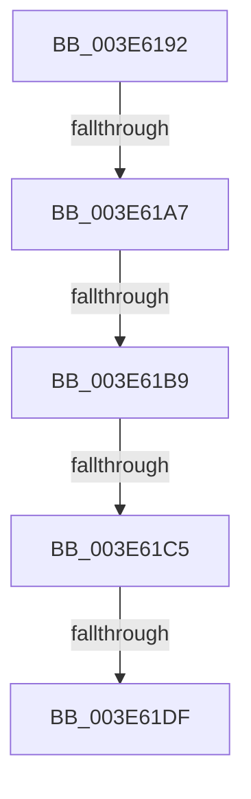

# sub_003E6192

- RVA: `0x003E6192`–`0x003E61EB` (길이 `89` bytes)
- VA: `0x00000001403E6192`
- 실행 섹션: `.text`
- PDB 이름 있음: `아니요`; PDB Function 태그: `아니요`
- unwind 정보 RVA: `0x00095350`
- 디코드: `22`개 명령, `89/89` bytes 표시
- 미해석 바이트: `0` (있으면 어셈블리에 `.byte`로 보존)

> 이 문서는 커널 이미지의 기계어와 PDB 기호를 분석해 생성했습니다. 4번과 5번은 함수 원형과 자료형을 바이너리 사용 방식에서 추정한 C 해석이며 원본 소스 복구 결과는 아닙니다.

## 1. Dependencies

- 직접 호출 지점: **1**; 고유 호출 대상: **1**
- 직접 호출자로 확인된 함수: **0**
- RIP 상대 이미지 참조: **2**

### Outgoing calls
- `0x003E61D1` → [guard_dispatch_icall](../6B/guard_dispatch_icall_function_006BAAD0.md) (function, `0x006BAAD0`)

### Direct callers
- 이 함수 시작 RVA로 연결되는 직접 call은 확인되지 않았습니다. 간접 호출은 완전히 역산할 수 없습니다.

### Static image references
- `0x003E61AA` → RVA `0x00E10452` (`.data`; read)
- `0x003E61C5` → RVA `0x00E10448` (`.data`; read)

## 2. Other-region calls and transfers

- 다른 실행 섹션으로 향하는 call: **0**
- call이 아닌 외부 분기/꼬리 이동: **4**
  - `0x003E61A5` → [sub_003E61FE](Unknown_function_003E61FE.md) (`tail-transfer`)
  - `0x003E61B3` → [sub_003E623E](Unknown_function_003E623E.md) (`tail-transfer`)
  - `0x003E61BF` → [sub_003E623E + 0xAB](Unknown_function_003E623E.md) (`tail-transfer`)
  - `0x003E61D9` → [sub_003E623E + 0x4E](Unknown_function_003E623E.md) (`tail-transfer`)

## 3. Assembly (complete function range)

```asm
003E6192  48 89 74 24 78                  mov qword ptr [rsp + 0x78], rsi
003E6197  33 F6                           xor esi, esi
003E6199  4C 89 7C 24 40                  mov qword ptr [rsp + 0x40], r15
003E619E  45 0F B6 FE                     movzx r15d, r14b
003E61A2  83 F8 04                        cmp eax, 4
003E61A5  75 57                           jne 0x1403e61fe
003E61A7  8B 47 08                        mov eax, dword ptr [rdi + 8]
003E61AA  40 38 35 A1 A2 A2 00            cmp byte ptr [rip + 0xa2a2a1], sil
003E61B1  8B F0                           mov esi, eax
003E61B3  0F 84 85 00 00 00               je 0x1403e623e
003E61B9  8B 4B 04                        mov ecx, dword ptr [rbx + 4]
003E61BC  41 3B CC                        cmp ecx, r12d
003E61BF  0F 85 24 01 00 00               jne 0x1403e62e9
003E61C5  48 8B 05 7C A2 A2 00            mov rax, qword ptr [rip + 0xa2a27c]
003E61CC  41 8B D7                        mov edx, r15d
003E61CF  8B CE                           mov ecx, esi
003E61D1  E8 FA 48 2D 00                  call 0x1406baad0
003E61D6  40 84 ED                        test bpl, bpl
003E61D9  0F 85 AD 00 00 00               jne 0x1403e628c
003E61DF  33 C0                           xor eax, eax
003E61E1  48 8B 74 24 78                  mov rsi, qword ptr [rsp + 0x78]
003E61E6  4C 8B 7C 24 40                  mov r15, qword ptr [rsp + 0x40]
```

## 4. C-style interpretation (structured pseudocode)

```c
__int64 __fastcall sub_003E6192(__int64 a1, __int64 a2, __int64 a3, __int64 a4, __int64 a5, __int64 a6, __int64 a7, __int64 a8, __int64 a9, __int64 a10, __int64 a11, __int64 a12, __int64 a13, __int64 a14, __int64 a15)
{
    __int64 result;
    __int64 v_rsi;
    unsigned __int64 v_stack_p40;
    unsigned __int64 v_stack_p78;

    v_stack_p78 = v_rsi;
    v_rsi = 0;
    v_stack_p40 = v_r15;
    result = guard_dispatch_icall((unsigned int)((unsigned int)((unsigned int)((unsigned int)((unsigned int)(*(unsigned int *)(v_rdi + 8)))))), (unsigned int)((unsigned int)((unsigned __int8)(v_r14))), a3, a4);
    result = 0;
    return result;
}
```

## 5. (Beta) C Style

```c
int64_t sub_003E6192(int64_t Arg1, int64_t Arg2, int64_t Arg3, int64_t Arg4, uint64_t Arg5, uint64_t Arg6, uint64_t Arg7, int64_t Arg8, uint64_t Arg9, uint64_t Arg10, uint64_t Arg11, uint64_t Arg12, uint64_t Arg13, uint64_t Arg14, int64_t Arg15)
{
    int64_t result;
    int64_t local_rsi;
    uint64_t v_stack_p40;
    uint64_t v_stack_p78;

    v_stack_p78 = local_rsi;
    local_rsi = 0;
    v_stack_p40 = local_r15;
    result = guard_dispatch_icall((uint32_t)((uint32_t)((uint32_t)((uint32_t)((uint32_t)(*(uint32_t *)(local_rdi + 0x8)))))), (uint32_t)((uint32_t)((uint8_t)(local_r14))), Arg3, Arg4);
    result = 0;
    return result;
}
```

## 6. Execution-region graph

[열기: 2D/3D 그래프와 함수 탐색 컨트롤 패널](../../../control-panel.html?section=text&rva=0x003E6192&view=graph)

- 2D 그래프는 위에서 아래로 흐르고, 3D 그래프는 빈 공간을 드래그해 회전합니다. Shift+드래그는 이동, 휠은 확대·축소, 함수 노드 선택은 대상 보고서 이동입니다.

### Static fallback


