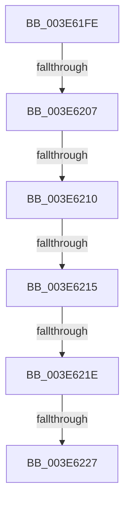

# sub_003E61FE

- RVA: `0x003E61FE`–`0x003E622E` (길이 `48` bytes)
- VA: `0x00000001403E61FE`
- 실행 섹션: `.text`
- PDB 이름 있음: `아니요`; PDB Function 태그: `아니요`
- unwind 정보 RVA: `0x0009538C`
- 디코드: `12`개 명령, `48/48` bytes 표시
- 미해석 바이트: `0` (있으면 어셈블리에 `.byte`로 보존)

> 이 문서는 커널 이미지의 기계어와 PDB 기호를 분석해 생성했습니다. 4번과 5번은 함수 원형과 자료형을 바이너리 사용 방식에서 추정한 C 해석이며 원본 소스 복구 결과는 아닙니다.

## 1. Dependencies

- 직접 호출 지점: **0**; 고유 호출 대상: **0**
- 직접 호출자로 확인된 함수: **0**
- RIP 상대 이미지 참조: **0**

### Outgoing calls
- 직접 디코드된 call 명령이 없습니다.

### Direct callers
- 이 함수 시작 RVA로 연결되는 직접 call은 확인되지 않았습니다. 간접 호출은 완전히 역산할 수 없습니다.

### Static image references
- 디코드된 RIP-relative 메모리 참조가 없습니다.

## 2. Other-region calls and transfers

- 다른 실행 섹션으로 향하는 call: **0**
- call이 아닌 외부 분기/꼬리 이동: **6**
  - `0x003E6201` → [sub_003E63AC + 0xA](Unknown_function_003E63AC.md) (`tail-transfer`)
  - `0x003E620A` → [sub_003E623E + 0xF1](Unknown_function_003E623E.md) (`tail-transfer`)
  - `0x003E6213` → [sub_003E623E + 0x3D](Unknown_function_003E623E.md) (`tail-transfer`)
  - `0x003E6218` → [sub_003E623E + 0xFD](Unknown_function_003E623E.md) (`tail-transfer`)
  - `0x003E6221` → [sub_003E623E + 0x8A](Unknown_function_003E623E.md) (`tail-transfer`)
  - `0x003E622C` → [sub_003E6192 + 0x4F](Unknown_function_003E6192.md) (`tail-transfer`)

## 3. Assembly (complete function range)

```asm
003E61FE  41 2B C4                        sub eax, r12d
003E6201  0F 84 AF 01 00 00               je 0x1403e63b6
003E6207  41 2B C4                        sub eax, r12d
003E620A  0F 84 1F 01 00 00               je 0x1403e632f
003E6210  41 2B C4                        sub eax, r12d
003E6213  74 66                           je 0x1403e627b
003E6215  83 E8 02                        sub eax, 2
003E6218  0F 84 1D 01 00 00               je 0x1403e633b
003E621E  41 3B C4                        cmp eax, r12d
003E6221  0F 84 A1 00 00 00               je 0x1403e62c8
003E6227  B8 0D 00 00 C0                  mov eax, 0xc000000d
003E622C  EB B3                           jmp 0x1403e61e1
```

## 4. C-style interpretation (structured pseudocode)

```c
__int64 __fastcall sub_003E61FE(void)
{
    __int64 result;

    result = (unsigned int)((result) - ((unsigned int)(v_r12)));
    result = (unsigned int)((result) - ((unsigned int)(v_r12)));
    result = (unsigned int)((result) - ((unsigned int)(v_r12)));
    result = (unsigned int)((result) - (2));
}
```

## 5. (Beta) C Style

```c
void sub_003E61FE(void)
{
    int64_t result;

    result = (uint32_t)((result) - ((uint32_t)(local_r12)));
    result = (uint32_t)((result) - ((uint32_t)(local_r12)));
    result = (uint32_t)((result) - ((uint32_t)(local_r12)));
    result = (uint32_t)((result) - (2));
}
```

## 6. Execution-region graph

[열기: 2D/3D 그래프와 함수 탐색 컨트롤 패널](../../../control-panel.html?section=text&rva=0x003E61FE&view=graph)

- 2D 그래프는 위에서 아래로 흐르고, 3D 그래프는 빈 공간을 드래그해 회전합니다. Shift+드래그는 이동, 휠은 확대·축소, 함수 노드 선택은 대상 보고서 이동입니다.

### Static fallback


