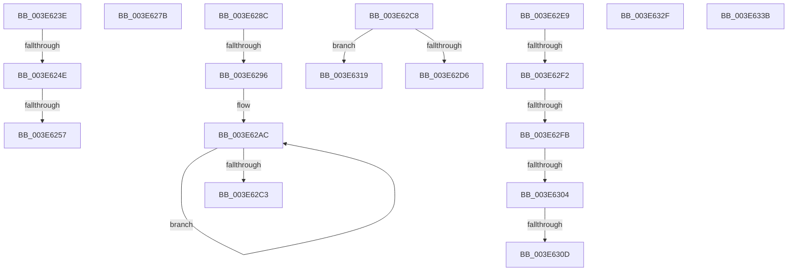

# sub_003E623E

- RVA: `0x003E623E`–`0x003E634B` (길이 `269` bytes)
- VA: `0x00000001403E623E`
- 실행 섹션: `.text`
- PDB 이름 있음: `아니요`; PDB Function 태그: `아니요`
- unwind 정보 RVA: `0x000953BC`
- 디코드: `62`개 명령, `269/269` bytes 표시
- 미해석 바이트: `0` (있으면 어셈블리에 `.byte`로 보존)

> 이 문서는 커널 이미지의 기계어와 PDB 기호를 분석해 생성했습니다. 4번과 5번은 함수 원형과 자료형을 바이너리 사용 방식에서 추정한 C 해석이며 원본 소스 복구 결과는 아닙니다.

## 1. Dependencies

- 직접 호출 지점: **2**; 고유 호출 대상: **1**
- 직접 호출자로 확인된 함수: **0**
- RIP 상대 이미지 참조: **3**

### Outgoing calls
- `0x003E6263` → [guard_dispatch_icall](../6B/guard_dispatch_icall_function_006BAAD0.md) (function, `0x006BAAD0`)
- `0x003E62B9` → [guard_dispatch_icall](../6B/guard_dispatch_icall_function_006BAAD0.md) (function, `0x006BAAD0`)

### Direct callers
- 이 함수 시작 RVA로 연결되는 직접 call은 확인되지 않았습니다. 간접 호출은 완전히 역산할 수 없습니다.

### Static image references
- `0x003E6241` → RVA `0x00E10450` (`.data`; read)
- `0x003E6257` → RVA `0x00E10438` (`.data`; read)
- `0x003E62CD` → RVA `0x00E10452` (`.data`; read)

## 2. Other-region calls and transfers

- 다른 실행 섹션으로 향하는 call: **0**
- call이 아닌 외부 분기/꼬리 이동: **15**
  - `0x003E6248` → [sub_003E6192 + 0x27](Unknown_function_003E6192.md) (`tail-transfer`)
  - `0x003E6251` → [sub_003E6192 + 0x27](Unknown_function_003E6192.md) (`tail-transfer`)
  - `0x003E6276` → [sub_003E6192 + 0x27](Unknown_function_003E6192.md) (`tail-transfer`)
  - `0x003E6287` → [sub_003E6192 + 0x27](Unknown_function_003E6192.md) (`tail-transfer`)
  - `0x003E6290` → [sub_003E6192 + 0x4D](Unknown_function_003E6192.md) (`tail-transfer`)
  - `0x003E62C3` → [sub_003E6192 + 0x4D](Unknown_function_003E6192.md) (`tail-transfer`)
  - `0x003E62E4` → [sub_003E6192 + 0x27](Unknown_function_003E6192.md) (`tail-transfer`)
  - `0x003E62EC` → [sub_003E63AC](Unknown_function_003E63AC.md) (`tail-transfer`)
  - `0x003E62F5` → [sub_003E63AC + 0x20](Unknown_function_003E63AC.md) (`tail-transfer`)
  - `0x003E62FE` → [sub_003E63AC + 0x14](Unknown_function_003E63AC.md) (`tail-transfer`)
  - `0x003E6307` → [sub_003E61FE + 0x29](Unknown_function_003E61FE.md) (`tail-transfer`)
  - `0x003E6314` → [sub_003E6192 + 0x33](Unknown_function_003E6192.md) (`tail-transfer`)
  - `0x003E632A` → [sub_003E6192 + 0x27](Unknown_function_003E6192.md) (`tail-transfer`)
  - `0x003E6336` → [sub_003E6192 + 0x27](Unknown_function_003E6192.md) (`tail-transfer`)
  - `0x003E6346` → [sub_003E6192 + 0x27](Unknown_function_003E6192.md) (`tail-transfer`)

## 3. Assembly (complete function range)

```asm
003E623E  C1 E6 18                        shl esi, 0x18
003E6241  40 38 2D 08 A2 A2 00            cmp byte ptr [rip + 0xa2a208], bpl
003E6248  0F 84 6B FF FF FF               je 0x1403e61b9
003E624E  83 F8 FF                        cmp eax, -1
003E6251  0F 84 62 FF FF FF               je 0x1403e61b9
003E6257  48 8B 05 DA A1 A2 00            mov rax, qword ptr [rip + 0xa2a1da]
003E625E  B9 20 00 00 00                  mov ecx, 0x20
003E6263  E8 68 48 2D 00                  call 0x1406baad0
003E6268  C1 E8 18                        shr eax, 0x18
003E626B  3B 47 08                        cmp eax, dword ptr [rdi + 8]
003E626E  40 0F B6 ED                     movzx ebp, bpl
003E6272  41 0F 44 EC                     cmove ebp, r12d
003E6276  E9 3E FF FF FF                  jmp 0x1403e61b9
003E627B  0F B6 2D CE A1 A2 00            movzx ebp, byte ptr [rip + 0xa2a1ce]
003E6282  41 0F BA EF 12                  bts r15d, 0x12
003E6287  E9 2D FF FF FF                  jmp 0x1403e61b9
003E628C  44 39 63 04                     cmp dword ptr [rbx + 4], r12d
003E6290  0F 85 49 FF FF FF               jne 0x1403e61df
003E6296  41 8B DE                        mov ebx, r14d
003E6299  41 83 E6 1F                     and r14d, 0x1f
003E629D  D1 EB                           shr ebx, 1
003E629F  41 0F B6 CE                     movzx ecx, r14b
003E62A3  81 E3 F0 FF FF 7F               and ebx, 0x7ffffff0
003E62A9  41 D3 E4                        shl r12d, cl
003E62AC  48 8B 05 85 A1 A2 00            mov rax, qword ptr [rip + 0xa2a185]
003E62B3  8D 8B 00 02 00 00               lea ecx, [rbx + 0x200]
003E62B9  E8 12 48 2D 00                  call 0x1406baad0
003E62BE  41 85 C4                        test r12d, eax
003E62C1  74 E9                           je 0x1403e62ac
003E62C3  E9 17 FF FF FF                  jmp 0x1403e61df
003E62C8  41 0F BA EF 0B                  bts r15d, 0xb
003E62CD  40 38 35 7E A1 A2 00            cmp byte ptr [rip + 0xa2a17e], sil
003E62D4  74 43                           je 0x1403e6319
003E62D6  8B 47 0C                        mov eax, dword ptr [rdi + 0xc]
003E62D9  0F B7 F0                        movzx esi, ax
003E62DC  8B 47 08                        mov eax, dword ptr [rdi + 8]
003E62DF  C1 E0 10                        shl eax, 0x10
003E62E2  0B F0                           or esi, eax
003E62E4  E9 D0 FE FF FF                  jmp 0x1403e61b9
003E62E9  83 E9 02                        sub ecx, 2
003E62EC  0F 84 BA 00 00 00               je 0x1403e63ac
003E62F2  41 2B CC                        sub ecx, r12d
003E62F5  0F 84 D1 00 00 00               je 0x1403e63cc
003E62FB  41 2B CC                        sub ecx, r12d
003E62FE  0F 84 BC 00 00 00               je 0x1403e63c0
003E6304  83 F9 03                        cmp ecx, 3
003E6307  0F 85 1A FF FF FF               jne 0x1403e6227
003E630D  41 81 CF 00 05 00 00            or r15d, 0x500
003E6314  E9 AC FE FF FF                  jmp 0x1403e61c5
003E6319  8B 77 0C                        mov esi, dword ptr [rdi + 0xc]
003E631C  8B 47 08                        mov eax, dword ptr [rdi + 8]
003E631F  83 E6 0F                        and esi, 0xf
003E6322  C1 E0 04                        shl eax, 4
003E6325  0B F0                           or esi, eax
003E6327  C1 E6 18                        shl esi, 0x18
003E632A  E9 8A FE FF FF                  jmp 0x1403e61b9
003E632F  41 81 CF 00 00 0C 00            or r15d, 0xc0000
003E6336  E9 7E FE FF FF                  jmp 0x1403e61b9
003E633B  8B 77 08                        mov esi, dword ptr [rdi + 8]
003E633E  41 0F BA EF 0B                  bts r15d, 0xb
003E6343  C1 E6 18                        shl esi, 0x18
003E6346  E9 6E FE FF FF                  jmp 0x1403e61b9
```

## 4. C-style interpretation (structured pseudocode)

```c
__int64 __fastcall sub_003E623E(void)
{
    __int64 result;
    __int64 v_rbp;
    __int64 v_rsi;

    v_rsi = (unsigned int)((v_rsi) << (24));
    result = guard_dispatch_icall(32, a2, a3, a4);
    result = (unsigned int)((result) >> (24));
    v_rbp = (unsigned __int8)(v_rbp);
    if (((unsigned int)(result)) == (*(unsigned int *)(v_rdi + 8))) { v_rbp = (unsigned int)(v_r12); }
}
```

## 5. (Beta) C Style

```c
void sub_003E623E(void)
{
    int64_t result;
    int64_t local_rbp;
    int64_t local_rsi;

    local_rsi = (uint32_t)((local_rsi) << (24));
    result = guard_dispatch_icall(32, a2, a3, a4);
    result = (uint32_t)((result) >> (24));
    local_rbp = (uint8_t)(local_rbp);
    if (((uint32_t)(result)) == (*(uint32_t *)(local_rdi + 0x8))) { local_rbp = (uint32_t)(local_r12); }
}
```

## 6. Execution-region graph

[열기: 2D/3D 그래프와 함수 탐색 컨트롤 패널](../../../control-panel.html?section=text&rva=0x003E623E&view=graph)

- 2D 그래프는 위에서 아래로 흐르고, 3D 그래프는 빈 공간을 드래그해 회전합니다. Shift+드래그는 이동, 휠은 확대·축소, 함수 노드 선택은 대상 보고서 이동입니다.

### Static fallback


