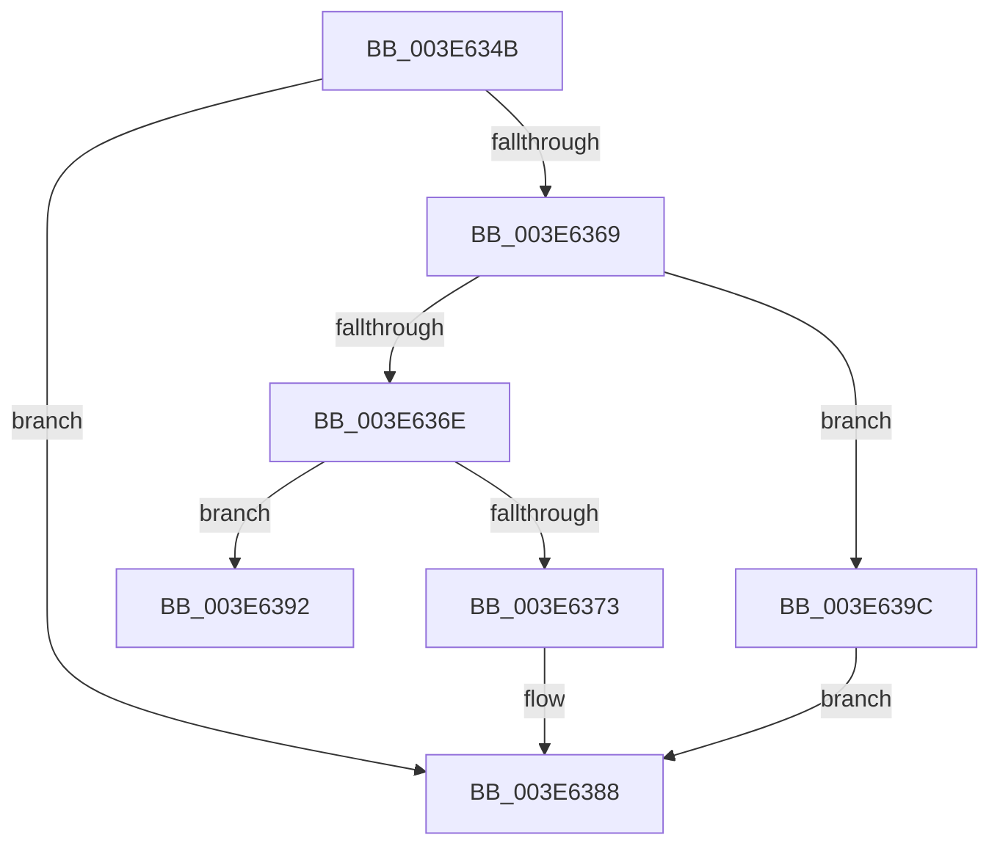

# sub_003E634B

- RVA: `0x003E634B`–`0x003E63AC` (길이 `97` bytes)
- VA: `0x00000001403E634B`
- 실행 섹션: `.text`
- PDB 이름 있음: `아니요`; PDB Function 태그: `아니요`
- unwind 정보 RVA: `0x000953D8`
- 디코드: `26`개 명령, `97/97` bytes 표시
- 미해석 바이트: `0` (있으면 어셈블리에 `.byte`로 보존)

> 이 문서는 커널 이미지의 기계어와 PDB 기호를 분석해 생성했습니다. 4번과 5번은 함수 원형과 자료형을 바이너리 사용 방식에서 추정한 C 해석이며 원본 소스 복구 결과는 아닙니다.

## 1. Dependencies

- 직접 호출 지점: **0**; 고유 호출 대상: **0**
- 직접 호출자로 확인된 함수: **0**
- RIP 상대 이미지 참조: **0**

### Outgoing calls
- 직접 디코드된 call 명령이 없습니다.

### Direct callers
- 이 함수 시작 RVA로 연결되는 직접 call은 확인되지 않았습니다. 간접 호출은 완전히 역산할 수 없습니다.

### Static image references
- 디코드된 RIP-relative 메모리 참조가 없습니다.

## 2. Other-region calls and transfers

- 다른 실행 섹션으로 향하는 call: **0**
- call이 아닌 외부 분기/꼬리 이동: **2**
  - `0x003E638D` → [sub_003E617E + 0x12](Unknown_function_003E617E.md) (`tail-transfer`)
  - `0x003E6397` → [sub_003E61EB](Unknown_function_003E61EB.md) (`tail-transfer`)

## 3. Assembly (complete function range)

```asm
003E634B  41 0F 10 08                     movups xmm1, xmmword ptr [r8]
003E634F  F2 41 0F 10 40 10               movsd xmm0, qword ptr [r8 + 0x10]
003E6355  66 0F 7E C9                     movd ecx, xmm1
003E6359  0F 11 4C 24 20                  movups xmmword ptr [rsp + 0x20], xmm1
003E635E  F2 0F 11 44 24 30               movsd qword ptr [rsp + 0x30], xmm0
003E6364  83 E9 04                        sub ecx, 4
003E6367  74 1F                           je 0x1403e6388
003E6369  41 2B CC                        sub ecx, r12d
003E636C  74 2E                           je 0x1403e639c
003E636E  41 3B CC                        cmp ecx, r12d
003E6371  75 1F                           jne 0x1403e6392
003E6373  48 8B 44 24 28                  mov rax, qword ptr [rsp + 0x28]
003E6378  48 C1 E8 20                     shr rax, 0x20
003E637C  0F BC C8                        bsf ecx, eax
003E637F  41 8B C4                        mov eax, r12d
003E6382  D3 E0                           shl eax, cl
003E6384  89 44 24 2C                     mov dword ptr [rsp + 0x2c], eax
003E6388  48 8D 7C 24 20                  lea rdi, [rsp + 0x20]
003E638D  E9 FE FD FF FF                  jmp 0x1403e6190
003E6392  B8 0D 00 00 C0                  mov eax, 0xc000000d
003E6397  E9 4F FE FF FF                  jmp 0x1403e61eb
003E639C  0F BC 4C 24 28                  bsf ecx, dword ptr [rsp + 0x28]
003E63A1  41 8B C4                        mov eax, r12d
003E63A4  D3 E0                           shl eax, cl
003E63A6  89 44 24 28                     mov dword ptr [rsp + 0x28], eax
003E63AA  EB DC                           jmp 0x1403e6388
```

## 4. C-style interpretation (structured pseudocode)

```c
__int64 __fastcall sub_003E634B(__int64 a1, __int64 a2, __int64 a3, __int64 a4, unsigned int a5)
{
    __int64 result;
    unsigned __int64 v_stack_p20;
    unsigned int v_stack_p28;
    unsigned int v_stack_p2C;
    unsigned __int64 v_stack_p30;

    v_stack_p20 = v_xmm1;
    v_stack_p30 = v_xmm0;
    a1 = (unsigned int)((a1) - (4));
    if (condition_is_equal) goto loc_003E6388;
    a1 = (unsigned int)((a1) - ((unsigned int)(v_r12)));
    if (condition_is_equal) goto loc_003E639C;
    if (((unsigned int)(a1)) != ((unsigned int)(v_r12))) goto loc_003E6392;
    result = (a5) >> (32);
    result = (unsigned int)(((unsigned int)((unsigned int)(v_r12))) << ((unsigned __int8)(a1)));
    v_stack_p2C = (unsigned int)(result);
loc_003E6388:
loc_003E6392:
loc_003E639C:
    result = (unsigned int)(((unsigned int)((unsigned int)(v_r12))) << ((unsigned __int8)(a1)));
    v_stack_p28 = (unsigned int)(result);
    goto loc_003E6388;
}
```

## 5. (Beta) C Style

```c
int64_t sub_003E634B(int64_t Arg1, int64_t Arg2, void *Arg3, int64_t Arg4, uint32_t Arg5)
{
    uint8_t *arg3 = (uint8_t *)Arg3;

    int64_t result;
    uint64_t v_stack_p20;
    uint32_t v_stack_p28;
    uint32_t v_stack_p2C;
    uint64_t v_stack_p30;

    v_stack_p20 = v_xmm1;
    v_stack_p30 = v_xmm0;
    Arg1 = (uint32_t)((Arg1) - (4));
    if (condition_is_equal) goto loc_003E6388;
    Arg1 = (uint32_t)((Arg1) - ((uint32_t)(local_r12)));
    if (condition_is_equal) goto loc_003E639C;
    if (((uint32_t)(Arg1)) != ((uint32_t)(local_r12))) goto loc_003E6392;
    result = (Arg5) >> (32);
    result = (uint32_t)(((uint32_t)((uint32_t)(local_r12))) << ((uint8_t)(Arg1)));
    v_stack_p2C = (uint32_t)(result);
loc_003E6388:
loc_003E6392:
loc_003E639C:
    result = (uint32_t)(((uint32_t)((uint32_t)(local_r12))) << ((uint8_t)(Arg1)));
    v_stack_p28 = (uint32_t)(result);
    goto loc_003E6388;
}
```

### 관측된 메모리 오프셋

구조체 형식이 확인되지 않은 접근은 인자 기준의 오프셋으로만 기록했습니다.

| 기준 인자 | 오프셋 표현 | 폭 (bit) | 접근 |
|---|---:|---:|---|
| `Arg3` | `+ 0x0` | `128` | `R` |
| `Arg3` | `+ 0x10` | `64` | `R` |

## 6. Execution-region graph

[열기: 2D/3D 그래프와 함수 탐색 컨트롤 패널](../../../control-panel.html?section=text&rva=0x003E634B&view=graph)

- 2D 그래프는 위에서 아래로 흐르고, 3D 그래프는 빈 공간을 드래그해 회전합니다. Shift+드래그는 이동, 휠은 확대·축소, 함수 노드 선택은 대상 보고서 이동입니다.

### Static fallback


