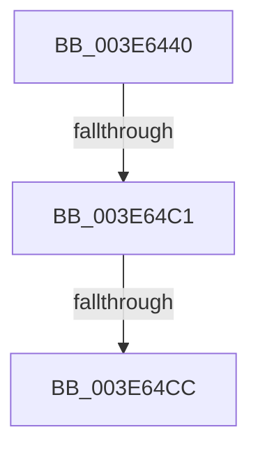

# sub_003E6440

- RVA: `0x003E6440`–`0x003E64E5` (길이 `165` bytes)
- VA: `0x00000001403E6440`
- 실행 섹션: `.text`
- PDB 이름 있음: `아니요`; PDB Function 태그: `아니요`
- unwind 정보 RVA: `0x00095420`
- 디코드: `33`개 명령, `165/165` bytes 표시
- 미해석 바이트: `0` (있으면 어셈블리에 `.byte`로 보존)

> 이 문서는 커널 이미지의 기계어와 PDB 기호를 분석해 생성했습니다. 4번과 5번은 함수 원형과 자료형을 바이너리 사용 방식에서 추정한 C 해석이며 원본 소스 복구 결과는 아닙니다.

## 1. Dependencies

- 직접 호출 지점: **0**; 고유 호출 대상: **0**
- 직접 호출자로 확인된 함수: **0**
- RIP 상대 이미지 참조: **1**

### Outgoing calls
- 직접 디코드된 call 명령이 없습니다.

### Direct callers
- 이 함수 시작 RVA로 연결되는 직접 call은 확인되지 않았습니다. 간접 호출은 완전히 역산할 수 없습니다.

### Static image references
- `0x003E64AF` → RVA `0x00FC6B48` (`ALMOSTRO`; read)

## 2. Other-region calls and transfers

- 다른 실행 섹션으로 향하는 call: **0**
- call이 아닌 외부 분기/꼬리 이동: **2**
  - `0x003E64BB` → [sub_003E6AFA](Unknown_function_003E6AFA.md) (`tail-transfer`)
  - `0x003E64C6` → [sub_003E6717](Unknown_function_003E6717.md) (`tail-transfer`)

## 3. Assembly (complete function range)

```asm
003E6440  4C 89 A4 24 F8 01 00 00         mov qword ptr [rsp + 0x1f8], r12
003E6448  FA                              cli
003E6449  0F B7 86 D8 06 00 00            movzx eax, word ptr [rsi + 0x6d8]
003E6450  B9 EF FF 00 00                  mov ecx, 0xffef
003E6455  66 23 C1                        and ax, cx
003E6458  B9 BF FF 00 00                  mov ecx, 0xffbf
003E645D  66 23 C1                        and ax, cx
003E6460  B9 FD FF 00 00                  mov ecx, 0xfffd
003E6465  66 23 C1                        and ax, cx
003E6468  B9 FB FF 00 00                  mov ecx, 0xfffb
003E646D  66 23 C1                        and ax, cx
003E6470  B9 F7 FF 00 00                  mov ecx, 0xfff7
003E6475  66 23 C1                        and ax, cx
003E6478  B9 7F FF 00 00                  mov ecx, 0xff7f
003E647D  66 23 C1                        and ax, cx
003E6480  B9 DF FF 00 00                  mov ecx, 0xffdf
003E6485  66 23 C1                        and ax, cx
003E6488  66 89 86 D8 06 00 00            mov word ptr [rsi + 0x6d8], ax
003E648F  4D 8B A7 60 07 00 00            mov r12, qword ptr [r15 + 0x760]
003E6496  41 8B 87 FC 05 00 00            mov eax, dword ptr [r15 + 0x5fc]
003E649D  25 00 00 40 00                  and eax, 0x400000
003E64A2  89 44 24 40                     mov dword ptr [rsp + 0x40], eax
003E64A6  B8 01 00 00 00                  mov eax, 1
003E64AB  4C 0F 44 E0                     cmove r12, rax
003E64AF  48 8B 05 92 06 BE 00            mov rax, qword ptr [rip + 0xbe0692]
003E64B6  48 0F BA E0 33                  bt rax, 0x33
003E64BB  0F 82 39 06 00 00               jb 0x1403e6afa
003E64C1  F6 44 24 48 01                  test byte ptr [rsp + 0x48], 1
003E64C6  0F 85 4B 02 00 00               jne 0x1403e6717
003E64CC  48 8B 4C 24 48                  mov rcx, qword ptr [rsp + 0x48]
003E64D1  48 B8 00 00 00 00 00 02 00 00   movabs rax, 0x20000000000
003E64DB  0F B7 96 E6 06 00 00            movzx edx, word ptr [rsi + 0x6e6]
003E64E2  4C 8B C9                        mov r9, rcx
```

## 4. C-style interpretation (structured pseudocode)

```c
__int64 __fastcall sub_003E6440(__int64 a1, __int64 a2, __int64 a3, __int64 a4, __int64 a5, __int64 a6, __int64 a7, __int64 a8, unsigned __int8 a9)
{
    __int64 result;
    __int64 v_r12;
    unsigned __int64 v_stack_p1F8;
    unsigned int v_stack_p40;

    v_stack_p1F8 = v_r12;
    result = (unsigned __int16)((*(unsigned __int16 *)(v_rsi + 1752)) & ((unsigned __int16)((unsigned int)(0xFFEFULL))));
    result = (unsigned __int16)((result) & ((unsigned __int16)((unsigned int)(0xFFBFULL))));
    result = (unsigned __int16)((result) & ((unsigned __int16)((unsigned int)(0xFFFDULL))));
    result = (unsigned __int16)((result) & ((unsigned __int16)((unsigned int)(0xFFFBULL))));
    result = (unsigned __int16)((result) & ((unsigned __int16)((unsigned int)(0xFFF7ULL))));
    result = (unsigned __int16)((result) & ((unsigned __int16)((unsigned int)(0xFF7FULL))));
    result = (unsigned __int16)((result) & ((unsigned __int16)((unsigned int)(0xFFDFULL))));
    *(unsigned __int16 *)(v_rsi + 1752) = (unsigned __int16)(result);
    result = (unsigned int)(((unsigned int)(*(unsigned int *)(v_r15 + 1532))) & (0x400000ULL));
    v_stack_p40 = (unsigned int)(result);
    v_r12 = *(unsigned __int64 *)(v_r15 + 1888);
    if (condition_is_equal) { v_r12 = 1; }
    return *(unsigned __int64 *)(v_rip + 12453522);
}
```

## 5. (Beta) C Style

```c
int64_t sub_003E6440(int64_t Arg1, int64_t Arg2, int64_t Arg3, int64_t Arg4, uint64_t Arg5, uint64_t Arg6, uint64_t Arg7, uint64_t Arg8, uint8_t Arg9)
{
    int64_t result;
    int64_t local_r12;
    uint64_t v_stack_p1F8;
    uint32_t v_stack_p40;

    v_stack_p1F8 = local_r12;
    result = (uint16_t)((*(uint16_t *)(local_rsi + 0x6D8)) & ((uint16_t)((uint32_t)(0xFFEFULL))));
    result = (uint16_t)((result) & ((uint16_t)((uint32_t)(0xFFBFULL))));
    result = (uint16_t)((result) & ((uint16_t)((uint32_t)(0xFFFDULL))));
    result = (uint16_t)((result) & ((uint16_t)((uint32_t)(0xFFFBULL))));
    result = (uint16_t)((result) & ((uint16_t)((uint32_t)(0xFFF7ULL))));
    result = (uint16_t)((result) & ((uint16_t)((uint32_t)(0xFF7FULL))));
    result = (uint16_t)((result) & ((uint16_t)((uint32_t)(0xFFDFULL))));
    *(uint16_t *)(local_rsi + 0x6D8) = (uint16_t)(result);
    result = (uint32_t)(((uint32_t)(*(uint32_t *)(local_r15 + 0x5FC))) & (0x400000ULL));
    v_stack_p40 = (uint32_t)(result);
    local_r12 = *(uint64_t *)(local_r15 + 0x760);
    if (condition_is_equal) { local_r12 = 1; }
    return *(uint64_t *)(v_rip + 0xBE0692);
}
```

## 6. Execution-region graph

[열기: 2D/3D 그래프와 함수 탐색 컨트롤 패널](../../../control-panel.html?section=text&rva=0x003E6440&view=graph)

- 2D 그래프는 위에서 아래로 흐르고, 3D 그래프는 빈 공간을 드래그해 회전합니다. Shift+드래그는 이동, 휠은 확대·축소, 함수 노드 선택은 대상 보고서 이동입니다.

### Static fallback


