# sub_003E64F5

- RVA: `0x003E64F5`–`0x003E66AC` (길이 `439` bytes)
- VA: `0x00000001403E64F5`
- 실행 섹션: `.text`
- PDB 이름 있음: `아니요`; PDB Function 태그: `아니요`
- unwind 정보 RVA: `0x0009544C`
- 디코드: `93`개 명령, `439/439` bytes 표시
- 미해석 바이트: `0` (있으면 어셈블리에 `.byte`로 보존)

> 이 문서는 커널 이미지의 기계어와 PDB 기호를 분석해 생성했습니다. 4번과 5번은 함수 원형과 자료형을 바이너리 사용 방식에서 추정한 C 해석이며 원본 소스 복구 결과는 아닙니다.

## 1. Dependencies

- 직접 호출 지점: **0**; 고유 호출 대상: **0**
- 직접 호출자로 확인된 함수: **0**
- RIP 상대 이미지 참조: **0**

### Outgoing calls
- 직접 디코드된 call 명령이 없습니다.

### Direct callers
- 이 함수 시작 RVA로 연결되는 직접 call은 확인되지 않았습니다. 간접 호출은 완전히 역산할 수 없습니다.

### Static image references
- 디코드된 RIP-relative 메모리 참조가 없습니다.

## 2. Other-region calls and transfers

- 다른 실행 섹션으로 향하는 call: **0**
- call이 아닌 외부 분기/꼬리 이동: **16**
  - `0x003E6515` → [sub_003E6BB1](Unknown_function_003E6BB1.md) (`tail-transfer`)
  - `0x003E6522` → [sub_003E6DFD + 0xA4](Unknown_function_003E6DFD.md) (`tail-transfer`)
  - `0x003E6566` → [sub_003E6C44 + 0xF9](Unknown_function_003E6C44.md) (`tail-transfer`)
  - `0x003E6571` → [sub_003E6C44 + 0x116](Unknown_function_003E6C44.md) (`tail-transfer`)
  - `0x003E6589` → [sub_003E6DFD + 0x197](Unknown_function_003E6DFD.md) (`tail-transfer`)
  - `0x003E65BE` → [sub_003E673E](Unknown_function_003E673E.md) (`tail-transfer`)
  - `0x003E65C7` → [sub_003E673E + 0x6F](Unknown_function_003E673E.md) (`tail-transfer`)
  - `0x003E65EF` → [sub_003E6905](Unknown_function_003E6905.md) (`tail-transfer`)
  - `0x003E6604` → [sub_003E6C44 + 0xEC](Unknown_function_003E6C44.md) (`tail-transfer`)
  - `0x003E660D` → [sub_003E6DFD + 0x118](Unknown_function_003E6DFD.md) (`tail-transfer`)
  - `0x003E6616` → [sub_003E6C44 + 0xDB](Unknown_function_003E6C44.md) (`tail-transfer`)
  - `0x003E661F` → [sub_003E6A11 + 0x63](Unknown_function_003E6A11.md) (`tail-transfer`)
  - `0x003E666F` → [sub_003E6C44 + 0x49](Unknown_function_003E6C44.md) (`tail-transfer`)
  - `0x003E668A` → [sub_003E6905 + 0x4D](Unknown_function_003E6905.md) (`tail-transfer`)
  - `0x003E6698` → [sub_003E6C44 + 0xC](Unknown_function_003E6C44.md) (`tail-transfer`)
  - `0x003E66AA` → [sub_003E670E](Unknown_function_003E670E.md) (`tail-transfer`)

## 3. Assembly (complete function range)

```asm
003E64F5  4C 89 AC 24 B8 01 00 00         mov qword ptr [rsp + 0x1b8], r13
003E64FD  45 32 ED                        xor r13b, r13b
003E6500  4C 89 B4 24 B0 01 00 00         mov qword ptr [rsp + 0x1b0], r14
003E6508  66 89 54 24 32                  mov word ptr [rsp + 0x32], dx
003E650D  C6 44 24 30 00                  mov byte ptr [rsp + 0x30], 0
003E6512  4C 23 C8                        and r9, rax
003E6515  0F 85 96 06 00 00               jne 0x1403e6bb1
003E651B  33 DB                           xor ebx, ebx
003E651D  48 0F BA E1 26                  bt rcx, 0x26
003E6522  0F 82 79 09 00 00               jb 0x1403e6ea1
003E6528  44 0F B7 D3                     movzx r10d, bx
003E652C  41 B8 E8 06 00 00               mov r8d, 0x6e8
003E6532  4C 8B F6                        mov r14, rsi
003E6535  4D 03 F0                        add r14, r8
003E6538  B8 E2 06 00 00                  mov eax, 0x6e2
003E653D  4C 8B DE                        mov r11, rsi
003E6540  48 8B FE                        mov rdi, rsi
003E6543  4C 03 D8                        add r11, rax
003E6546  41 8D 50 04                     lea edx, [r8 + 4]
003E654A  41 B8 80 00 00 00               mov r8d, 0x80
003E6550  66 45 89 16                     mov word ptr [r14], r10w
003E6554  66 44 89 14 16                  mov word ptr [rsi + rdx], r10w
003E6559  41 0F B7 D2                     movzx edx, r10w
003E655D  66 45 89 13                     mov word ptr [r11], r10w
003E6561  48 0F BA E1 0D                  bt rcx, 0xd
003E6566  0F 82 D1 07 00 00               jb 0x1403e6d3d
003E656C  48 0F BA E1 2B                  bt rcx, 0x2b
003E6571  0F 82 E3 07 00 00               jb 0x1403e6d5a
003E6577  48 BF 00 00 00 00 00 00 40 00   movabs rdi, 0x40000000000000
003E6581  B8 00 04 00 00                  mov eax, 0x400
003E6586  48 85 CF                        test rdi, rcx
003E6589  0F 85 05 0A 00 00               jne 0x1403e6f94
003E658F  41 8B 87 FC 05 00 00            mov eax, dword ptr [r15 + 0x5fc]
003E6596  4C 8B 44 24 48                  mov r8, qword ptr [rsp + 0x48]
003E659B  25 00 00 80 00                  and eax, 0x800000
003E65A0  49 0F BA E0 25                  bt r8, 0x25
003E65A5  4C 8B 96 D0 06 00 00            mov r10, qword ptr [rsi + 0x6d0]
003E65AC  41 0F B6 C8                     movzx ecx, r8b
003E65B0  4C 89 54 24 60                  mov qword ptr [rsp + 0x60], r10
003E65B5  48 89 4C 24 38                  mov qword ptr [rsp + 0x38], rcx
003E65BA  89 44 24 44                     mov dword ptr [rsp + 0x44], eax
003E65BE  0F 83 7A 01 00 00               jae 0x1403e673e
003E65C4  4D 85 E4                        test r12, r12
003E65C7  0F 85 E0 01 00 00               jne 0x1403e67ad
003E65CD  49 B9 00 00 00 00 80 00 00 00   movabs r9, 0x8000000000
003E65D7  0F B7 54 24 32                  movzx edx, word ptr [rsp + 0x32]
003E65DC  B8 FB FF 00 00                  mov eax, 0xfffb
003E65E1  66 21 86 E4 06 00 00            and word ptr [rsi + 0x6e4], ax
003E65E8  0F B6 C1                        movzx eax, cl
003E65EB  24 42                           and al, 0x42
003E65ED  3C 42                           cmp al, 0x42
003E65EF  0F 84 10 03 00 00               je 0x1403e6905
003E65F5  49 BE 00 00 00 00 00 02 00 00   movabs r14, 0x20000000000
003E65FF  49 0F BA E0 2B                  bt r8, 0x2b
003E6604  0F 82 26 07 00 00               jb 0x1403e6d30
003E660A  4D 85 C1                        test r9, r8
003E660D  0F 85 02 09 00 00               jne 0x1403e6f15
003E6613  4C 85 C7                        test rdi, r8
003E6616  0F 85 03 07 00 00               jne 0x1403e6d1f
003E661C  4D 85 D2                        test r10, r10
003E661F  0F 85 4F 04 00 00               jne 0x1403e6a74
003E6625  44 0F B6 4C 24 30               movzx r9d, byte ptr [rsp + 0x30]
003E662B  0F B7 CA                        movzx ecx, dx
003E662E  49 8B C0                        mov rax, r8
003E6631  25 00 20 00 00                  and eax, 0x2000
003E6636  41 BE 80 00 00 00               mov r14d, 0x80
003E663C  66 41 0B CE                     or cx, r14w
003E6640  48 85 C0                        test rax, rax
003E6643  B8 00 04 00 00                  mov eax, 0x400
003E6648  66 0F 44 CA                     cmove cx, dx
003E664C  0F B7 D1                        movzx edx, cx
003E664F  66 83 CA 02                     or dx, 2
003E6653  49 0F BA E0 2B                  bt r8, 0x2b
003E6658  66 0F 43 D1                     cmovae dx, cx
003E665C  4C 23 C7                        and r8, rdi
003E665F  0F B7 FA                        movzx edi, dx
003E6662  66 0B F8                        or di, ax
003E6665  4D 85 C0                        test r8, r8
003E6668  66 0F 44 FA                     cmove di, dx
003E666C  45 84 C9                        test r9b, r9b
003E666F  0F 85 18 06 00 00               jne 0x1403e6c8d
003E6675  0F B7 86 E0 06 00 00            movzx eax, word ptr [rsi + 0x6e0]
003E667C  44 8B F3                        mov r14d, ebx
003E667F  44 0F B7 CF                     movzx r9d, di
003E6683  BA 00 01 00 00                  mov edx, 0x100
003E6688  A8 04                           test al, 4
003E668A  0F 85 C2 02 00 00               jne 0x1403e6952
003E6690  66 44 3B 8E E6 06 00 00         cmp r9w, word ptr [rsi + 0x6e6]
003E6698  0F 85 B2 05 00 00               jne 0x1403e6c50
003E669E  45 84 ED                        test r13b, r13b
003E66A1  90                              nop
003E66A2  4C 8B AC 24 B8 01 00 00         mov r13, qword ptr [rsp + 0x1b8]
003E66AA  75 62                           jne 0x1403e670e
```

## 4. C-style interpretation (structured pseudocode)

```c
__int64 __fastcall sub_003E64F5(__int64 a1, unsigned __int16 a2, __int64 a3, __int64 a4, __int64 a5, unsigned __int8 a6, __int64 a7, __int64 a8, __int64 a9, __int64 a10, __int64 a11, __int64 a12, __int64 a13, __int64 a14, __int64 a15, __int64 a16, __int64 a17, __int64 a18, __int64 a19, __int64 a20, __int64 a21, __int64 a22, __int64 a23, __int64 a24, __int64 a25, __int64 a26, __int64 a27, __int64 a28, __int64 a29, __int64 a30, __int64 a31, __int64 a32, __int64 a33, __int64 a34, __int64 a35, __int64 a36, __int64 a37, __int64 a38, __int64 a39, __int64 a40, __int64 a41, __int64 a42, __int64 a43, __int64 a44, __int64 a45, __int64 a46, __int64 a47, __int64 a48, __int64 a49, __int64 a50, __int64 a51, __int64 a52, __int64 a53, __int64 a54, __int64 a55)
{
    __int64 result;
    __int64 v_r11;
    __int64 v_r13;
    __int64 v_r14;
    __int64 v_rbx;
    __int64 v_rdi;
    unsigned __int64 v_stack_p1B0;
    unsigned __int64 v_stack_p1B8;
    unsigned __int8 v_stack_p30;
    unsigned __int16 v_stack_p32;
    unsigned __int64 v_stack_p38;
    unsigned int v_stack_p44;
    unsigned __int64 v_stack_p60;

    v_stack_p1B8 = v_r13;
    v_r13 = 0;
    v_stack_p1B0 = v_r14;
    v_stack_p32 = a2;
    v_stack_p30 = 0;
    a4 = (a4) & (result);
    v_rbx = 0;
    v_r14 = (v_rsi) + ((unsigned int)(0x6E8ULL));
    v_r11 = (v_rsi) + ((unsigned int)(0x6E2ULL));
    *(unsigned __int16 *)(v_r14) = 0;
    *(unsigned __int16 *)(v_rsi + (unsigned int)(0x6E8ULL) + 4 * 1) = 0;
    *(unsigned __int16 *)(v_r11) = 0;
    result = (unsigned int)(((unsigned int)(*(unsigned int *)(v_r15 + 1532))) & (0x800000ULL));
    v_stack_p60 = *(unsigned __int64 *)(v_rsi + 1744);
    v_stack_p38 = (unsigned __int8)(a9);
    v_stack_p44 = (unsigned int)(result);
    result = (unsigned __int8)(((unsigned __int8)((unsigned __int8)(a9))) & (66));
    result = (unsigned int)((a9) & (0x2000ULL));
    a1 = (unsigned __int16)(((unsigned __int16)(v_stack_p32)) | (128));
    if (result == 0) { a1 = (unsigned __int16)(v_stack_p32); }
    a2 = (unsigned __int16)(((unsigned __int16)(a1)) | (2));
    if (condition_is_above_or_equal) { a2 = (unsigned __int16)(a1); }
    a3 = (a9) & (v_rsi);
    v_rdi = (unsigned __int16)((a2) | ((unsigned __int16)((unsigned int)(0x400ULL))));
    if (a3 == 0) { v_rdi = a2; }
}
```

## 5. (Beta) C Style

```c
int64_t sub_003E64F5(int64_t Arg1, uint16_t Arg2, int64_t Arg3, int64_t Arg4, uint64_t Arg5, uint8_t Arg6, uint64_t Arg7, uint64_t Arg8, int64_t Arg9, uint64_t Arg10, uint64_t Arg11, uint64_t Arg12, uint64_t Arg13, uint64_t Arg14, uint64_t Arg15, uint64_t Arg16, uint64_t Arg17, uint64_t Arg18, uint64_t Arg19, uint64_t Arg20, uint64_t Arg21, uint64_t Arg22, uint64_t Arg23, uint64_t Arg24, uint64_t Arg25, uint64_t Arg26, uint64_t Arg27, uint64_t Arg28, uint64_t Arg29, uint64_t Arg30, uint64_t Arg31, uint64_t Arg32, uint64_t Arg33, uint64_t Arg34, uint64_t Arg35, uint64_t Arg36, uint64_t Arg37, uint64_t Arg38, uint64_t Arg39, uint64_t Arg40, uint64_t Arg41, uint64_t Arg42, uint64_t Arg43, uint64_t Arg44, uint64_t Arg45, uint64_t Arg46, uint64_t Arg47, uint64_t Arg48, uint64_t Arg49, uint64_t Arg50, uint64_t Arg51, uint64_t Arg52, uint64_t Arg53, uint64_t Arg54, int64_t Arg55)
{
    int64_t result;
    int64_t local_r11;
    int64_t local_r13;
    int64_t local_r14;
    int64_t local_rbx;
    int64_t local_rdi;
    uint64_t v_stack_p1B0;
    uint64_t v_stack_p1B8;
    uint8_t v_stack_p30;
    uint16_t v_stack_p32;
    uint64_t v_stack_p38;
    uint32_t v_stack_p44;
    uint64_t v_stack_p60;

    v_stack_p1B8 = local_r13;
    local_r13 = 0;
    v_stack_p1B0 = local_r14;
    v_stack_p32 = Arg2;
    v_stack_p30 = 0;
    Arg4 = (Arg4) & (result);
    local_rbx = 0;
    local_r14 = (local_rsi) + ((uint32_t)(0x6E8ULL));
    local_r11 = (local_rsi) + ((uint32_t)(0x6E2ULL));
    *(uint16_t *)(local_r14) = 0;
    *(uint16_t *)(local_rsi + (uint32_t)(0x6E8ULL) + 0x4 * 1) = 0;
    *(uint16_t *)(local_r11) = 0;
    result = (uint32_t)(((uint32_t)(*(uint32_t *)(local_r15 + 0x5FC))) & (0x800000ULL));
    v_stack_p60 = *(uint64_t *)(local_rsi + 0x6D0);
    v_stack_p38 = (uint8_t)(Arg9);
    v_stack_p44 = (uint32_t)(result);
    result = (uint8_t)(((uint8_t)((uint8_t)(Arg9))) & (66));
    result = (uint32_t)((Arg9) & (0x2000ULL));
    Arg1 = (uint16_t)(((uint16_t)(v_stack_p32)) | (128));
    if (result == 0) { Arg1 = (uint16_t)(v_stack_p32); }
    Arg2 = (uint16_t)(((uint16_t)(Arg1)) | (2));
    if (condition_is_above_or_equal) { Arg2 = (uint16_t)(Arg1); }
    Arg3 = (Arg9) & (local_rsi);
    local_rdi = (uint16_t)((Arg2) | ((uint16_t)((uint32_t)(0x400ULL))));
    if (Arg3 == 0) { local_rdi = Arg2; }
}
```

## 6. Execution-region graph

[열기: 2D/3D 그래프와 함수 탐색 컨트롤 패널](../../../control-panel.html?section=text&rva=0x003E64F5&view=graph)

- 2D 그래프는 위에서 아래로 흐르고, 3D 그래프는 빈 공간을 드래그해 회전합니다. Shift+드래그는 이동, 휠은 확대·축소, 함수 노드 선택은 대상 보고서 이동입니다.

### Static fallback

```mermaid
flowchart TD
  bb_003E64F5[BB_003E64F5]
  bb_003E651B[BB_003E651B]
  bb_003E6528[BB_003E6528]
  bb_003E656C[BB_003E656C]
  bb_003E6577[BB_003E6577]
  bb_003E658F[BB_003E658F]
  bb_003E65C4[BB_003E65C4]
  bb_003E65CD[BB_003E65CD]
  bb_003E65F5[BB_003E65F5]
  bb_003E660A[BB_003E660A]
  bb_003E6613[BB_003E6613]
  bb_003E661C[BB_003E661C]
  bb_003E6625[BB_003E6625]
  bb_003E6675[BB_003E6675]
  bb_003E6690[BB_003E6690]
  bb_003E669E[BB_003E669E]
  bb_003E64F5 -->|fallthrough| bb_003E651B
  bb_003E651B -->|fallthrough| bb_003E6528
  bb_003E6528 -->|fallthrough| bb_003E656C
  bb_003E656C -->|fallthrough| bb_003E6577
  bb_003E6577 -->|fallthrough| bb_003E658F
  bb_003E658F -->|fallthrough| bb_003E65C4
  bb_003E65C4 -->|fallthrough| bb_003E65CD
  bb_003E65CD -->|fallthrough| bb_003E65F5
  bb_003E65F5 -->|fallthrough| bb_003E660A
  bb_003E660A -->|fallthrough| bb_003E6613
  bb_003E6613 -->|fallthrough| bb_003E661C
  bb_003E661C -->|fallthrough| bb_003E6625
  bb_003E6625 -->|fallthrough| bb_003E6675
  bb_003E6675 -->|fallthrough| bb_003E6690
  bb_003E6690 -->|fallthrough| bb_003E669E
```


