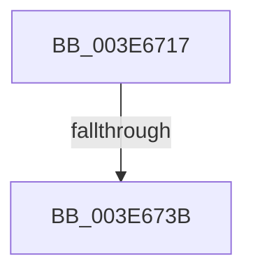

# sub_003E6717

- RVA: `0x003E6717`–`0x003E673E` (길이 `39` bytes)
- VA: `0x00000001403E6717`
- 실행 섹션: `.text`
- PDB 이름 있음: `아니요`; PDB Function 태그: `아니요`
- unwind 정보 RVA: `0x000954BC`
- 디코드: `9`개 명령, `39/39` bytes 표시
- 미해석 바이트: `0` (있으면 어셈블리에 `.byte`로 보존)

> 이 문서는 커널 이미지의 기계어와 PDB 기호를 분석해 생성했습니다. 4번과 5번은 함수 원형과 자료형을 바이너리 사용 방식에서 추정한 C 해석이며 원본 소스 복구 결과는 아닙니다.

## 1. Dependencies

- 직접 호출 지점: **1**; 고유 호출 대상: **1**
- 직접 호출자로 확인된 함수: **0**
- RIP 상대 이미지 참조: **0**

### Outgoing calls
- `0x003E671D` → [KiUpdateSpecCtrlEnhancedIBRS](KiUpdateSpecCtrlEnhancedIBRS_function_003E6FB0.md) (function, `0x003E6FB0`)

### Direct callers
- 이 함수 시작 RVA로 연결되는 직접 call은 확인되지 않았습니다. 간접 호출은 완전히 역산할 수 없습니다.

### Static image references
- 디코드된 RIP-relative 메모리 참조가 없습니다.

## 2. Other-region calls and transfers

- 다른 실행 섹션으로 향하는 call: **0**
- call이 아닌 외부 분기/꼬리 이동: **2**
  - `0x003E6735` → [sub_003E6BE8](Unknown_function_003E6BE8.md) (`tail-transfer`)
  - `0x003E673C` → [sub_003E66EA](Unknown_function_003E66EA.md) (`tail-transfer`)

## 3. Assembly (complete function range)

```asm
003E6717  49 8B D7                        mov rdx, r15
003E671A  48 8B CE                        mov rcx, rsi
003E671D  E8 8E 08 00 00                  call 0x1403e6fb0
003E6722  65 48 8B 0C 25 20 00 00 00      mov rcx, qword ptr gs:[0x20]
003E672B  4C 8B 81 B8 8E 00 00            mov r8, qword ptr [rcx + 0x8eb8]
003E6732  4D 85 C0                        test r8, r8
003E6735  0F 85 AD 04 00 00               jne 0x1403e6be8
003E673B  FB                              sti
003E673C  EB AC                           jmp 0x1403e66ea
```

## 4. C-style interpretation (structured pseudocode)

```c
__int64 __fastcall sub_003E6717(void)
{
    __int64 result;

    result = KiUpdateSpecCtrlEnhancedIBRS(v_rsi, v_r15, a3, a4);
}
```

## 5. (Beta) C Style

```c
void sub_003E6717(void)
{
    int64_t result;

    result = KiUpdateSpecCtrlEnhancedIBRS(local_rsi, local_r15, a3, a4);
}
```

## 6. Execution-region graph

[열기: 2D/3D 그래프와 함수 탐색 컨트롤 패널](../../../control-panel.html?section=text&rva=0x003E6717&view=graph)

- 2D 그래프는 위에서 아래로 흐르고, 3D 그래프는 빈 공간을 드래그해 회전합니다. Shift+드래그는 이동, 휠은 확대·축소, 함수 노드 선택은 대상 보고서 이동입니다.

### Static fallback


