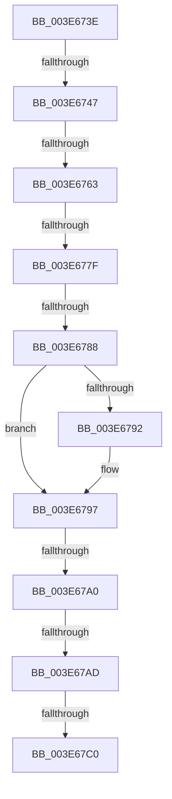

# sub_003E673E

- RVA: `0x003E673E`–`0x003E67E6` (길이 `168` bytes)
- VA: `0x00000001403E673E`
- 실행 섹션: `.text`
- PDB 이름 있음: `아니요`; PDB Function 태그: `아니요`
- unwind 정보 RVA: `0x000954D0`
- 디코드: `31`개 명령, `168/168` bytes 표시
- 미해석 바이트: `0` (있으면 어셈블리에 `.byte`로 보존)

> 이 문서는 커널 이미지의 기계어와 PDB 기호를 분석해 생성했습니다. 4번과 5번은 함수 원형과 자료형을 바이너리 사용 방식에서 추정한 C 해석이며 원본 소스 복구 결과는 아닙니다.

## 1. Dependencies

- 직접 호출 지점: **0**; 고유 호출 대상: **0**
- 직접 호출자로 확인된 함수: **0**
- RIP 상대 이미지 참조: **0**

### Outgoing calls
- 직접 디코드된 call 명령이 없습니다.

### Direct callers
- 이 함수 시작 RVA로 연결되는 직접 call은 확인되지 않았습니다. 간접 호출은 완전히 역산할 수 없습니다.

### Static image references
- 디코드된 RIP-relative 메모리 참조가 없습니다.

## 2. Other-region calls and transfers

- 다른 실행 섹션으로 향하는 call: **0**
- call이 아닌 외부 분기/꼬리 이동: **8**
  - `0x003E6741` → [sub_003E6A11](Unknown_function_003E6A11.md) (`tail-transfer`)
  - `0x003E675D` → [sub_003E6C44 + 0x14C](Unknown_function_003E6C44.md) (`tail-transfer`)
  - `0x003E6779` → [sub_003E6C44 + 0x14C](Unknown_function_003E6C44.md) (`tail-transfer`)
  - `0x003E6782` → [sub_003E6DFD](Unknown_function_003E6DFD.md) (`tail-transfer`)
  - `0x003E679A` → [sub_003E6C44 + 0xCE](Unknown_function_003E6C44.md) (`tail-transfer`)
  - `0x003E67A7` → [sub_003E6C44 + 0x12C](Unknown_function_003E6C44.md) (`tail-transfer`)
  - `0x003E67BA` → [sub_003E64F5 + 0xE2](Unknown_function_003E64F5.md) (`tail-transfer`)
  - `0x003E67E1` → [sub_003E64F5 + 0xF3](Unknown_function_003E64F5.md) (`tail-transfer`)

## 3. Assembly (complete function range)

```asm
003E673E  4D 85 E4                        test r12, r12
003E6741  0F 84 CA 02 00 00               je 0x1403e6a11
003E6747  49 8B C0                        mov rax, r8
003E674A  48 BA 00 80 00 00 00 30 00 00   movabs rdx, 0x300000008000
003E6754  48 23 C2                        and rax, rdx
003E6757  48 3D 00 80 00 00               cmp rax, 0x8000
003E675D  0F 84 2D 06 00 00               je 0x1403e6d90
003E6763  49 8B C0                        mov rax, r8
003E6766  48 BA 00 00 20 00 00 80 01 00   movabs rdx, 0x1800000200000
003E6770  48 23 C2                        and rax, rdx
003E6773  48 3D 00 00 20 00               cmp rax, 0x200000
003E6779  0F 84 11 06 00 00               je 0x1403e6d90
003E677F  F6 C1 10                        test cl, 0x10
003E6782  0F 84 75 06 00 00               je 0x1403e6dfd
003E6788  66 41 83 0B 01                  or word ptr [r11], 1
003E678D  4D 85 C9                        test r9, r9
003E6790  75 05                           jne 0x1403e6797
003E6792  66 41 83 0E 01                  or word ptr [r14], 1
003E6797  F6 C1 20                        test cl, 0x20
003E679A  0F 84 72 05 00 00               je 0x1403e6d12
003E67A0  F6 86 DC 06 00 00 30            test byte ptr [rsi + 0x6dc], 0x30
003E67A7  0F 85 C3 05 00 00               jne 0x1403e6d70
003E67AD  49 B9 00 00 00 00 80 00 00 00   movabs r9, 0x8000000000
003E67B7  4D 85 C1                        test r9, r8
003E67BA  0F 84 17 FE FF FF               je 0x1403e65d7
003E67C0  66 83 8E E2 06 00 00 04         or word ptr [rsi + 0x6e2], 4
003E67C8  66 83 8E E4 06 00 00 04         or word ptr [rsi + 0x6e4], 4
003E67D0  66 83 8E E8 06 00 00 04         or word ptr [rsi + 0x6e8], 4
003E67D8  0F B7 54 24 32                  movzx edx, word ptr [rsp + 0x32]
003E67DD  66 83 CA 04                     or dx, 4
003E67E1  E9 02 FE FF FF                  jmp 0x1403e65e8
```

## 4. C-style interpretation (structured pseudocode)

```c
__int64 __fastcall sub_003E673E(unsigned __int8 a1, __int64 a2, __int64 a3, __int64 a4)
{
    __int64 result;
    unsigned __int16 v_stack_p32;

    result = (a3) & (a2);
    result = (a3) & (a2);
    if (a4 == 0) {
    }
    a2 = (unsigned __int16)((v_stack_p32) | (4));
}
```

## 5. (Beta) C Style

```c
int64_t sub_003E673E(uint8_t Arg1, int64_t Arg2, int64_t Arg3, int64_t Arg4)
{
    int64_t result;
    uint16_t v_stack_p32;

    result = (Arg3) & (Arg2);
    result = (Arg3) & (Arg2);
    if (Arg4 == 0) {
    }
    Arg2 = (uint16_t)((v_stack_p32) | (4));
}
```

## 6. Execution-region graph

[열기: 2D/3D 그래프와 함수 탐색 컨트롤 패널](../../../control-panel.html?section=text&rva=0x003E673E&view=graph)

- 2D 그래프는 위에서 아래로 흐르고, 3D 그래프는 빈 공간을 드래그해 회전합니다. Shift+드래그는 이동, 휠은 확대·축소, 함수 노드 선택은 대상 보고서 이동입니다.

### Static fallback


