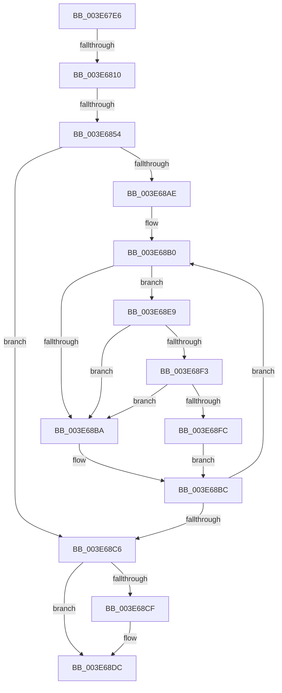

# sub_003E67E6

- RVA: `0x003E67E6`–`0x003E6905` (길이 `287` bytes)
- VA: `0x00000001403E67E6`
- 실행 섹션: `.text`
- PDB 이름 있음: `아니요`; PDB Function 태그: `아니요`
- unwind 정보 RVA: `0x000954F4`
- 디코드: `69`개 명령, `287/287` bytes 표시
- 미해석 바이트: `0` (있으면 어셈블리에 `.byte`로 보존)

> 이 문서는 커널 이미지의 기계어와 PDB 기호를 분석해 생성했습니다. 4번과 5번은 함수 원형과 자료형을 바이너리 사용 방식에서 추정한 C 해석이며 원본 소스 복구 결과는 아닙니다.

## 1. Dependencies

- 직접 호출 지점: **6**; 고유 호출 대상: **5**
- 직접 호출자로 확인된 함수: **0**
- RIP 상대 이미지 참조: **5**

### Outgoing calls
- `0x003E67F2` → [memset](../6C/memset_function_006C6C40.md) (function, `0x006C6C40`)
- `0x003E682B` → [memset](../6C/memset_function_006C6C40.md) (function, `0x006C6C40`)
- `0x003E689F` → [KiIpiSendRequest](../31/KiIpiSendRequest_function_003113C0.md) (function, `0x003113C0`)
- `0x003E68D7` → [KiLowerIrqlProcessIrqlFlags](../4F/KiLowerIrqlProcessIrqlFlags_function_004F5698.md) (function, `0x004F5698`)
- `0x003E68F3` → [KiCheckVpBackingLongSpinWaitHypercall](../30/KiCheckVpBackingLongSpinWaitHypercall_function_0030F490.md) (function, `0x0030F490`)
- `0x003E68FE` → [HvlNotifyLongSpinWait](../30/HvlNotifyLongSpinWait_function_0030F460.md) (function, `0x0030F460`)

### Direct callers
- 이 함수 시작 RVA로 연결되는 직접 call은 확인되지 않았습니다. 간접 호출은 완전히 역산할 수 없습니다.

### Static image references
- `0x003E6804` → RVA `0x00FC6D20` (`ALMOSTRO`; read)
- `0x003E6833` → RVA `0x00F231B0` (`.data`; read)
- `0x003E6872` → RVA `0x00494D60` (`KiSynchronizeStibpPairingTarget`; read)
- `0x003E68B2` → RVA `0x00FC52AC` (`ALMOSTRO`; reference)
- `0x003E68E9` → RVA `0x00FC6AB8` (`ALMOSTRO`; read)

## 2. Other-region calls and transfers

- 다른 실행 섹션으로 향하는 call: **0**
- call이 아닌 외부 분기/꼬리 이동: **3**
  - `0x003E680A` → [sub_003E6BA0](Unknown_function_003E6BA0.md) (`tail-transfer`)
  - `0x003E684E` → [sub_003E6DE5](Unknown_function_003E6DE5.md) (`tail-transfer`)
  - `0x003E68E4` → [sub_003E66AC + 0x26](Unknown_function_003E66AC.md) (`tail-transfer`)

## 3. Assembly (complete function range)

```asm
003E67E6  33 D2                           xor edx, edx
003E67E8  48 8D 4D 98                     lea rcx, [rbp - 0x68]
003E67EC  41 B8 00 01 00 00               mov r8d, 0x100
003E67F2  E8 49 04 2E 00                  call 0x1406c6c40
003E67F7  45 0F 20 C6                     mov r14, cr8
003E67FB  B8 0C 00 00 00                  mov eax, 0xc
003E6800  44 0F 22 C0                     mov cr8, rax
003E6804  39 1D 16 05 BE 00               cmp dword ptr [rip + 0xbe0516], ebx
003E680A  0F 85 90 03 00 00               jne 0x1403e6ba0
003E6810  48 8B BE B0 2D 00 00            mov rdi, qword ptr [rsi + 0x2db0]
003E6817  48 8D 4D 98                     lea rcx, [rbp - 0x68]
003E681B  33 D2                           xor edx, edx
003E681D  48 C7 45 90 01 00 20 00         mov qword ptr [rbp - 0x70], 0x200001
003E6825  41 B8 00 01 00 00               mov r8d, 0x100
003E682B  E8 10 04 2E 00                  call 0x1406c6c40
003E6830  8B 4F 24                        mov ecx, dword ptr [rdi + 0x24]
003E6833  48 8B 05 76 C9 B3 00            mov rax, qword ptr [rip + 0xb3c976]
003E683A  44 8B 04 88                     mov r8d, dword ptr [rax + rcx*4]
003E683E  41 8B C8                        mov ecx, r8d
003E6841  0F B7 45 90                     movzx eax, word ptr [rbp - 0x70]
003E6845  41 83 E0 3F                     and r8d, 0x3f
003E6849  C1 E9 06                        shr ecx, 6
003E684C  3B C1                           cmp eax, ecx
003E684E  0F 86 91 05 00 00               jbe 0x1403e6de5
003E6854  48 8D 55 98                     lea rdx, [rbp - 0x68]
003E6858  41 8B C0                        mov eax, r8d
003E685B  48 8D 14 CA                     lea rdx, [rdx + rcx*8]
003E685F  48 8B 0A                        mov rcx, qword ptr [rdx]
003E6862  48 0F AB C1                     bts rcx, rax
003E6866  48 89 0A                        mov qword ptr [rdx], rcx
003E6869  65 48 8B 0C 25 20 00 00 00      mov rcx, qword ptr gs:[0x20]
003E6872  48 8D 05 E7 E4 0A 00            lea rax, [rip + 0xae4e7]
003E6879  0F 57 C0                        xorps xmm0, xmm0
003E687C  48 89 45 80                     mov qword ptr [rbp - 0x80], rax
003E6880  4C 8D 4C 24 68                  lea r9, [rsp + 0x68]
003E6885  48 89 5C 24 78                  mov qword ptr [rsp + 0x78], rbx
003E688A  4C 8D 45 90                     lea r8, [rbp - 0x70]
003E688E  48 C7 44 24 20 05 00 00 00      mov qword ptr [rsp + 0x20], 5
003E6897  33 D2                           xor edx, edx
003E6899  F3 0F 7F 44 24 68               movdqu xmmword ptr [rsp + 0x68], xmm0
003E689F  E8 1C AB F2 FF                  call 0x1403113c0
003E68A4  8B 86 80 2D 00 00               mov eax, dword ptr [rsi + 0x2d80]
003E68AA  85 C0                           test eax, eax
003E68AC  74 18                           je 0x1403e68c6
003E68AE  66 90                           nop
003E68B0  FF C3                           inc ebx
003E68B2  85 1D F4 E9 BD 00               test dword ptr [rip + 0xbde9f4], ebx
003E68B8  74 2F                           je 0x1403e68e9
003E68BA  F3 90                           pause
003E68BC  8B 86 80 2D 00 00               mov eax, dword ptr [rsi + 0x2d80]
003E68C2  85 C0                           test eax, eax
003E68C4  75 EA                           jne 0x1403e68b0
003E68C6  83 3D 53 04 BE 00 00            cmp dword ptr [rip + 0xbe0453], 0
003E68CD  74 0D                           je 0x1403e68dc
003E68CF  44 0F 20 C1                     mov rcx, cr8
003E68D3  41 0F B6 D6                     movzx edx, r14b
003E68D7  E8 BC ED 10 00                  call 0x1404f5698
003E68DC  41 0F B6 C6                     movzx eax, r14b
003E68E0  44 0F 22 C0                     mov cr8, rax
003E68E4  E9 E9 FD FF FF                  jmp 0x1403e66d2
003E68E9  8B 05 C9 01 BE 00               mov eax, dword ptr [rip + 0xbe01c9]
003E68EF  A8 40                           test al, 0x40
003E68F1  74 C7                           je 0x1403e68ba
003E68F3  E8 98 8B F2 FF                  call 0x14030f490
003E68F8  84 C0                           test al, al
003E68FA  74 BE                           je 0x1403e68ba
003E68FC  8B CB                           mov ecx, ebx
003E68FE  E8 5D 8B F2 FF                  call 0x14030f460
003E6903  EB B7                           jmp 0x1403e68bc
```

## 4. C-style interpretation (structured pseudocode)

```c
__int64 __fastcall sub_003E67E6(__int64 a1, int a2, __int64 a3, __int64 a4, __int64 a5, __int64 a6, __int64 a7, __int64 a8, __int64 a9, __int64 a10, __int64 a11, __int64 a12, __int64 a13)
{
    __int64 result;
    __int64 v_rbx;
    unsigned __int64 v_stack_p20;
    unsigned __int64 v_stack_p68;
    unsigned __int64 v_stack_p78;

    a2 = 0;
    result = memset(v_rbp - 104, a2, 256, a4);
    a2 = 0;
    *(unsigned __int64 *)(v_rbp - 112) = 0x200001ULL;
    result = memset(v_rbp - 104, a2, 256, a4);
    a3 = (unsigned int)(((unsigned int)(*(unsigned int *)(*(unsigned __int64 *)(v_rip + 11782518) + (unsigned int)(*(unsigned int *)(*(unsigned __int64 *)(v_rsi + 11696) + 36)) * 4))) & (63));
    a1 = (unsigned int)(((unsigned int)((unsigned int)((unsigned int)(*(unsigned int *)(*(unsigned __int64 *)(v_rip + 11782518) + (unsigned int)(*(unsigned int *)(*(unsigned __int64 *)(v_rsi + 11696) + 36)) * 4))))) >> (6));
    *(unsigned __int64 *)(v_rbp - 104 + a1 * 8) = *(unsigned __int64 *)(v_rbp - 104 + a1 * 8);
    *(unsigned __int64 *)(v_rbp - 128) = v_rip + 713959;
    v_stack_p78 = v_rbx;
    v_stack_p20 = 5;
    a2 = 0;
    v_stack_p68 = v_xmm0;
    result = KiIpiSendRequest(*(unsigned __int64 *)(gs_base + (0 + 32)), a2, v_rbp - 112, a13);
    if ((unsigned int)((unsigned int)(*(unsigned int *)(v_rsi + 11648))) == 0) goto loc_003E68C6;
loc_003E68B0:
    v_rbx = (unsigned int)((v_rbx) + 1);
    if (((*(unsigned int *)(v_rip + 12446196)) & ((unsigned int)(v_rbx))) == 0) goto loc_003E68E9;
loc_003E68BA:
loc_003E68BC:
    if ((unsigned int)((unsigned int)(*(unsigned int *)(v_rsi + 11648))) != 0) goto loc_003E68B0;
loc_003E68C6:
    result = (unsigned int)(*(unsigned int *)(v_rsi + 11648));
    if ((*(unsigned int *)(v_rip + 12452947)) != 0) {
        a1 = 12;
        a2 = (unsigned __int8)(v_cr8);
        result = KiLowerIrqlProcessIrqlFlags(a1, a2, v_rbp - 112, a13);
    }
loc_003E68E9:
    if ((((unsigned __int8)((unsigned int)(*(unsigned int *)(v_rip + 12452297)))) & (64)) == 0) goto loc_003E68BA;
    result = KiCheckVpBackingLongSpinWaitHypercall(a1, a2, v_rbp - 112, a13);
    if ((unsigned __int8)(result) == 0) goto loc_003E68BA;
    result = HvlNotifyLongSpinWait((unsigned int)((unsigned int)(v_rbx)), a2, v_rbp - 112, a13);
    goto loc_003E68BC;
}
```

## 5. (Beta) C Style

```c
int64_t sub_003E67E6(int64_t Arg1, int32_t Arg2, int64_t Arg3, int64_t Arg4, uint64_t Arg5, uint64_t Arg6, uint64_t Arg7, uint64_t Arg8, uint64_t Arg9, uint64_t Arg10, uint64_t Arg11, uint64_t Arg12, int64_t Arg13)
{
    int64_t result;
    int64_t local_rbx;
    uint64_t v_stack_p20;
    uint64_t v_stack_p68;
    uint64_t v_stack_p78;

    Arg2 = 0;
    result = memset(local_rbp - 104, Arg2, 256, Arg4);
    Arg2 = 0;
    *(uint64_t *)(local_rbp - 0x70) = 0x200001ULL;
    result = memset(local_rbp - 104, Arg2, 256, Arg4);
    Arg3 = (uint32_t)(((uint32_t)(*(uint32_t *)(*(uint64_t *)(v_rip + 0xB3C976) + (uint32_t)(*(uint32_t *)(*(uint64_t *)(local_rsi + 0x2DB0) + 0x24)) * 4))) & (63));
    Arg1 = (uint32_t)(((uint32_t)((uint32_t)((uint32_t)(*(uint32_t *)(*(uint64_t *)(v_rip + 0xB3C976) + (uint32_t)(*(uint32_t *)(*(uint64_t *)(local_rsi + 0x2DB0) + 0x24)) * 4))))) >> (6));
    *(uint64_t *)(local_rbp - 0x68 + Arg1 * 8) = *(uint64_t *)(local_rbp - 0x68 + Arg1 * 8);
    *(uint64_t *)(local_rbp - 0x80) = v_rip + 713959;
    v_stack_p78 = local_rbx;
    v_stack_p20 = 5;
    Arg2 = 0;
    v_stack_p68 = v_xmm0;
    result = KiIpiSendRequest(*(uint64_t *)(gs_base + (0 + 0x20)), Arg2, local_rbp - 112, Arg13);
    if ((uint32_t)((uint32_t)(*(uint32_t *)(local_rsi + 0x2D80))) == 0) goto loc_003E68C6;
loc_003E68B0:
    local_rbx = (uint32_t)((local_rbx) + 1);
    if (((*(uint32_t *)(v_rip + 0xBDE9F4)) & ((uint32_t)(local_rbx))) == 0) goto loc_003E68E9;
loc_003E68BA:
loc_003E68BC:
    if ((uint32_t)((uint32_t)(*(uint32_t *)(local_rsi + 0x2D80))) != 0) goto loc_003E68B0;
loc_003E68C6:
    result = (uint32_t)(*(uint32_t *)(local_rsi + 0x2D80));
    if ((*(uint32_t *)(v_rip + 0xBE0453)) != 0) {
        Arg1 = 12;
        Arg2 = (uint8_t)(v_cr8);
        result = KiLowerIrqlProcessIrqlFlags(Arg1, Arg2, local_rbp - 112, Arg13);
    }
loc_003E68E9:
    if ((((uint8_t)((uint32_t)(*(uint32_t *)(v_rip + 0xBE01C9)))) & (64)) == 0) goto loc_003E68BA;
    result = KiCheckVpBackingLongSpinWaitHypercall(Arg1, Arg2, local_rbp - 112, Arg13);
    if ((uint8_t)(result) == 0) goto loc_003E68BA;
    result = HvlNotifyLongSpinWait((uint32_t)((uint32_t)(local_rbx)), Arg2, local_rbp - 112, Arg13);
    goto loc_003E68BC;
}
```

## 6. Execution-region graph

[열기: 2D/3D 그래프와 함수 탐색 컨트롤 패널](../../../control-panel.html?section=text&rva=0x003E67E6&view=graph)

- 2D 그래프는 위에서 아래로 흐르고, 3D 그래프는 빈 공간을 드래그해 회전합니다. Shift+드래그는 이동, 휠은 확대·축소, 함수 노드 선택은 대상 보고서 이동입니다.

### Static fallback


