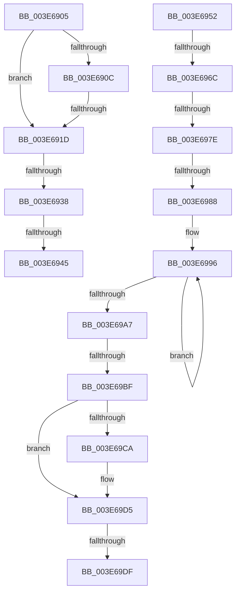

# sub_003E6905

- RVA: `0x003E6905`–`0x003E69E9` (길이 `228` bytes)
- VA: `0x00000001403E6905`
- 실행 섹션: `.text`
- PDB 이름 있음: `아니요`; PDB Function 태그: `아니요`
- unwind 정보 RVA: `0x00095514`
- 디코드: `41`개 명령, `228/228` bytes 표시
- 미해석 바이트: `0` (있으면 어셈블리에 `.byte`로 보존)

> 이 문서는 커널 이미지의 기계어와 PDB 기호를 분석해 생성했습니다. 4번과 5번은 함수 원형과 자료형을 바이너리 사용 방식에서 추정한 C 해석이며 원본 소스 복구 결과는 아닙니다.

## 1. Dependencies

- 직접 호출 지점: **0**; 고유 호출 대상: **0**
- 직접 호출자로 확인된 함수: **0**
- RIP 상대 이미지 참조: **2**

### Outgoing calls
- 직접 디코드된 call 명령이 없습니다.

### Direct callers
- 이 함수 시작 RVA로 연결되는 직접 call은 확인되지 않았습니다. 간접 호출은 완전히 역산할 수 없습니다.

### Static image references
- `0x003E6938` → RVA `0x00FC6AB0` (`ALMOSTRO`; read)
- `0x003E69AB` → RVA `0x00FC6B48` (`ALMOSTRO`; read)

## 2. Other-region calls and transfers

- 다른 실행 섹션으로 향하는 call: **0**
- call이 아닌 외부 분기/꼬리 이동: **10**
  - `0x003E6917` → [sub_003E64F5 + 0x100](Unknown_function_003E64F5.md) (`tail-transfer`)
  - `0x003E6932` → [sub_003E64F5 + 0x10A](Unknown_function_003E64F5.md) (`tail-transfer`)
  - `0x003E693F` → [sub_003E64F5 + 0x10A](Unknown_function_003E64F5.md) (`tail-transfer`)
  - `0x003E694D` → [sub_003E64F5 + 0x10A](Unknown_function_003E64F5.md) (`tail-transfer`)
  - `0x003E6966` → [sub_003E6A11 + 0x34](Unknown_function_003E6A11.md) (`tail-transfer`)
  - `0x003E6978` → [sub_003E6B14](Unknown_function_003E6B14.md) (`tail-transfer`)
  - `0x003E6982` → [sub_003E64F5 + 0x19B](Unknown_function_003E64F5.md) (`tail-transfer`)
  - `0x003E69B9` → [sub_003E6DFD + 0x14F](Unknown_function_003E6DFD.md) (`tail-transfer`)
  - `0x003E69D9` → [sub_003E6B14 + 0x7E](Unknown_function_003E6B14.md) (`tail-transfer`)
  - `0x003E69E4` → [sub_003E6B14 + 0x7E](Unknown_function_003E6B14.md) (`tail-transfer`)

## 3. Assembly (complete function range)

```asm
003E6905  49 0F BA E0 20                  bt r8, 0x20
003E690A  72 11                           jb 0x1403e691d
003E690C  41 F7 87 50 07 00 00 00 00 00 40  test dword ptr [r15 + 0x750], 0x40000000
003E6917  0F 84 D8 FC FF FF               je 0x1403e65f5
003E691D  66 83 8E EC 06 00 00 02         or word ptr [rsi + 0x6ec], 2
003E6925  49 BE 00 00 00 00 00 02 00 00   movabs r14, 0x20000000000
003E692F  4D 85 C6                        test r14, r8
003E6932  0F 84 C7 FC FF FF               je 0x1403e65ff
003E6938  4C 3B 3D 71 01 BE 00            cmp r15, qword ptr [rip + 0xbe0171]
003E693F  0F 84 BA FC FF FF               je 0x1403e65ff
003E6945  66 83 8E E8 06 00 00 02         or word ptr [rsi + 0x6e8], 2
003E694D  E9 AD FC FF FF                  jmp 0x1403e65ff
003E6952  48 8B 86 B0 2D 00 00            mov rax, qword ptr [rsi + 0x2db0]
003E6959  49 B8 00 00 00 00 00 02 00 00   movabs r8, 0x20000000000
003E6963  4D 3B D4                        cmp r10, r12
003E6966  0F 84 D9 00 00 00               je 0x1403e6a45
003E696C  66 F0 83 8E E0 06 00 00 02      lock or word ptr [rsi + 0x6e0], 2
003E6975  4D 85 E4                        test r12, r12
003E6978  0F 84 96 01 00 00               je 0x1403e6b14
003E697E  39 5C 24 44                     cmp dword ptr [rsp + 0x44], ebx
003E6982  0F 84 08 FD FF FF               je 0x1403e6690
003E6988  0F 0D 8E E0 06 00 00            prefetchw byte ptr [rsi + 0x6e0]
003E698F  0F B7 86 E0 06 00 00            movzx eax, word ptr [rsi + 0x6e0]
003E6996  0F B7 C8                        movzx ecx, ax
003E6999  66 0B CA                        or cx, dx
003E699C  66 F0 0F B1 8E E0 06 00 00      lock cmpxchg word ptr [rsi + 0x6e0], cx
003E69A5  75 EF                           jne 0x1403e6996
003E69A7  44 0F B7 F0                     movzx r14d, ax
003E69AB  48 8B 05 96 01 BE 00            mov rax, qword ptr [rip + 0xbe0196]
003E69B2  41 83 E6 01                     and r14d, 1
003E69B6  49 85 C0                        test r8, rax
003E69B9  0F 85 8D 05 00 00               jne 0x1403e6f4c
003E69BF  0F B7 86 E8 06 00 00            movzx eax, word ptr [rsi + 0x6e8]
003E69C6  A8 03                           test al, 3
003E69C8  75 0B                           jne 0x1403e69d5
003E69CA  66 83 C8 02                     or ax, 2
003E69CE  66 89 86 E8 06 00 00            mov word ptr [rsi + 0x6e8], ax
003E69D5  40 F6 C7 03                     test dil, 3
003E69D9  0F 85 B3 01 00 00               jne 0x1403e6b92
003E69DF  66 41 83 C9 02                  or r9w, 2
003E69E4  E9 A9 01 00 00                  jmp 0x1403e6b92
```

## 4. C-style interpretation (structured pseudocode)

```c
__int64 __fastcall sub_003E6905(__int64 a1, unsigned __int16 a2, __int64 a3, unsigned __int16 a4)
{
    unsigned int v_stack_p44;

    if (condition_is_below) goto loc_003E691D;
loc_003E691D:
}
```

## 5. (Beta) C Style

```c
int64_t sub_003E6905(int64_t Arg1, uint16_t Arg2, int64_t Arg3, uint16_t Arg4)
{
    uint32_t v_stack_p44;

    if (condition_is_below) goto loc_003E691D;
loc_003E691D:
}
```

## 6. Execution-region graph

[열기: 2D/3D 그래프와 함수 탐색 컨트롤 패널](../../../control-panel.html?section=text&rva=0x003E6905&view=graph)

- 2D 그래프는 위에서 아래로 흐르고, 3D 그래프는 빈 공간을 드래그해 회전합니다. Shift+드래그는 이동, 휠은 확대·축소, 함수 노드 선택은 대상 보고서 이동입니다.

### Static fallback


