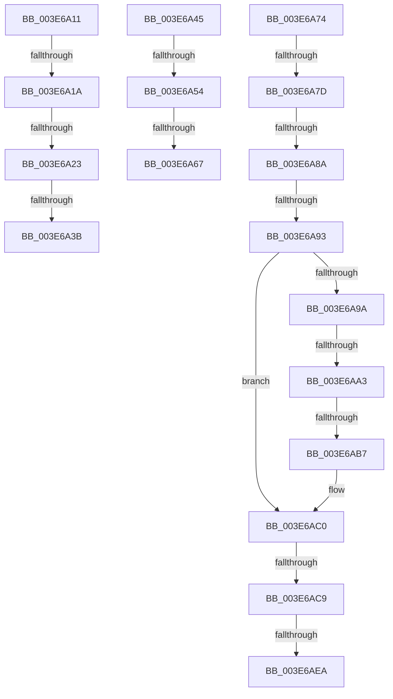

# sub_003E6A11

- RVA: `0x003E6A11`–`0x003E6AFA` (길이 `233` bytes)
- VA: `0x00000001403E6A11`
- 실행 섹션: `.text`
- PDB 이름 있음: `아니요`; PDB Function 태그: `아니요`
- unwind 정보 RVA: `0x00095558`
- 디코드: `45`개 명령, `233/233` bytes 표시
- 미해석 바이트: `0` (있으면 어셈블리에 `.byte`로 보존)

> 이 문서는 커널 이미지의 기계어와 PDB 기호를 분석해 생성했습니다. 4번과 5번은 함수 원형과 자료형을 바이너리 사용 방식에서 추정한 C 해석이며 원본 소스 복구 결과는 아닙니다.

## 1. Dependencies

- 직접 호출 지점: **0**; 고유 호출 대상: **0**
- 직접 호출자로 확인된 함수: **0**
- RIP 상대 이미지 참조: **0**

### Outgoing calls
- 직접 디코드된 call 명령이 없습니다.

### Direct callers
- 이 함수 시작 RVA로 연결되는 직접 call은 확인되지 않았습니다. 간접 호출은 완전히 역산할 수 없습니다.

### Static image references
- 디코드된 RIP-relative 메모리 참조가 없습니다.

## 2. Other-region calls and transfers

- 다른 실행 섹션으로 향하는 call: **0**
- call이 아닌 외부 분기/꼬리 이동: **15**
  - `0x003E6A14` → [sub_003E64F5 + 0xD8](Unknown_function_003E64F5.md) (`tail-transfer`)
  - `0x003E6A1D` → [sub_003E6DFD + 0xC5](Unknown_function_003E6DFD.md) (`tail-transfer`)
  - `0x003E6A35` → [sub_003E64F5 + 0xE2](Unknown_function_003E64F5.md) (`tail-transfer`)
  - `0x003E6A40` → [sub_003E64F5 + 0xE2](Unknown_function_003E64F5.md) (`tail-transfer`)
  - `0x003E6A4E` → [sub_003E6C10](Unknown_function_003E6C10.md) (`tail-transfer`)
  - `0x003E6A61` → [sub_003E6905 + 0x70](Unknown_function_003E6905.md) (`tail-transfer`)
  - `0x003E6A6F` → [sub_003E6905 + 0x70](Unknown_function_003E6905.md) (`tail-transfer`)
  - `0x003E6A77` → [sub_003E64F5 + 0x130](Unknown_function_003E64F5.md) (`tail-transfer`)
  - `0x003E6A84` → [sub_003E64F5 + 0x130](Unknown_function_003E64F5.md) (`tail-transfer`)
  - `0x003E6A8D` → [sub_003E6C44 + 0x9F](Unknown_function_003E6C44.md) (`tail-transfer`)
  - `0x003E6A9D` → [sub_003E6C44 + 0x2A](Unknown_function_003E6C44.md) (`tail-transfer`)
  - `0x003E6AB1` → [sub_003E6DFD + 0x42](Unknown_function_003E6DFD.md) (`tail-transfer`)
  - `0x003E6AC3` → [sub_003E6C44](Unknown_function_003E6C44.md) (`tail-transfer`)
  - `0x003E6AE4` → [sub_003E64F5 + 0x136](Unknown_function_003E64F5.md) (`tail-transfer`)
  - `0x003E6AF5` → [sub_003E64F5 + 0x136](Unknown_function_003E64F5.md) (`tail-transfer`)

## 3. Assembly (complete function range)

```asm
003E6A11  F6 C1 02                        test cl, 2
003E6A14  0F 84 B3 FB FF FF               je 0x1403e65cd
003E6A1A  F6 C1 40                        test cl, 0x40
003E6A1D  0F 84 9F 04 00 00               je 0x1403e6ec2
003E6A23  66 41 83 0B 02                  or word ptr [r11], 2
003E6A28  4D 85 C9                        test r9, r9
003E6A2B  49 B9 00 00 00 00 80 00 00 00   movabs r9, 0x8000000000
003E6A35  0F 85 9C FB FF FF               jne 0x1403e65d7
003E6A3B  66 41 83 0E 02                  or word ptr [r14], 2
003E6A40  E9 92 FB FF FF                  jmp 0x1403e65d7
003E6A45  0F B7 80 E0 06 00 00            movzx eax, word ptr [rax + 0x6e0]
003E6A4C  A8 01                           test al, 1
003E6A4E  0F 85 BC 01 00 00               jne 0x1403e6c10
003E6A54  66 83 8E EC 06 00 00 02         or word ptr [rsi + 0x6ec], 2
003E6A5C  4C 85 44 24 48                  test qword ptr [rsp + 0x48], r8
003E6A61  0F 84 0E FF FF FF               je 0x1403e6975
003E6A67  66 83 8E E8 06 00 00 02         or word ptr [rsi + 0x6e8], 2
003E6A6F  E9 01 FF FF FF                  jmp 0x1403e6975
003E6A74  4D 3B D4                        cmp r10, r12
003E6A77  0F 84 A8 FB FF FF               je 0x1403e6625
003E6A7D  4D 3B 97 68 07 00 00            cmp r10, qword ptr [r15 + 0x768]
003E6A84  0F 84 9B FB FF FF               je 0x1403e6625
003E6A8A  F6 C2 01                        test dl, 1
003E6A8D  0F 84 50 02 00 00               je 0x1403e6ce3
003E6A93  49 0F BA E0 38                  bt r8, 0x38
003E6A98  72 26                           jb 0x1403e6ac0
003E6A9A  F6 C1 02                        test cl, 2
003E6A9D  0F 84 CB 01 00 00               je 0x1403e6c6e
003E6AA3  0F B7 86 E0 06 00 00            movzx eax, word ptr [rsi + 0x6e0]
003E6AAA  4C 8B 44 24 48                  mov r8, qword ptr [rsp + 0x48]
003E6AAF  A8 04                           test al, 4
003E6AB1  0F 84 88 03 00 00               je 0x1403e6e3f
003E6AB7  41 0F B6 C8                     movzx ecx, r8b
003E6ABB  48 89 4C 24 38                  mov qword ptr [rsp + 0x38], rcx
003E6AC0  F6 C2 01                        test dl, 1
003E6AC3  0F 84 7B 01 00 00               je 0x1403e6c44
003E6AC9  0F B7 86 D8 06 00 00            movzx eax, word ptr [rsi + 0x6d8]
003E6AD0  44 0F B6 4C 24 30               movzx r9d, byte ptr [rsp + 0x30]
003E6AD6  66 83 C8 04                     or ax, 4
003E6ADA  66 89 86 D8 06 00 00            mov word ptr [rsi + 0x6d8], ax
003E6AE1  F6 C1 08                        test cl, 8
003E6AE4  0F 85 41 FB FF FF               jne 0x1403e662b
003E6AEA  66 83 C8 20                     or ax, 0x20
003E6AEE  66 89 86 D8 06 00 00            mov word ptr [rsi + 0x6d8], ax
003E6AF5  E9 31 FB FF FF                  jmp 0x1403e662b
```

## 4. C-style interpretation (structured pseudocode)

```c
__int64 __fastcall sub_003E6A11(unsigned __int8 a1, unsigned __int8 a2, __int64 a3, __int64 a4)
{
    unsigned __int8 v_stack_p30;
    unsigned __int64 v_stack_p38;
    unsigned __int64 v_stack_p48;
}
```

## 5. (Beta) C Style

```c
int64_t sub_003E6A11(uint8_t Arg1, uint8_t Arg2, int64_t Arg3, int64_t Arg4)
{
    uint8_t v_stack_p30;
    uint64_t v_stack_p38;
    uint64_t v_stack_p48;
}
```

## 6. Execution-region graph

[열기: 2D/3D 그래프와 함수 탐색 컨트롤 패널](../../../control-panel.html?section=text&rva=0x003E6A11&view=graph)

- 2D 그래프는 위에서 아래로 흐르고, 3D 그래프는 빈 공간을 드래그해 회전합니다. Shift+드래그는 이동, 휠은 확대·축소, 함수 노드 선택은 대상 보고서 이동입니다.

### Static fallback


