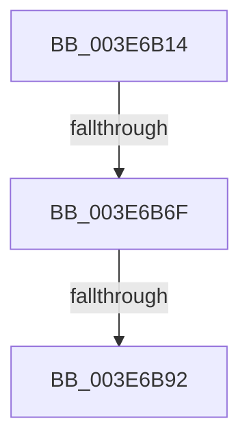

# sub_003E6B14

- RVA: `0x003E6B14`–`0x003E6BA0` (길이 `140` bytes)
- VA: `0x00000001403E6B14`
- 실행 섹션: `.text`
- PDB 이름 있음: `아니요`; PDB Function 태그: `아니요`
- unwind 정보 RVA: `0x00095590`
- 디코드: `29`개 명령, `140/140` bytes 표시
- 미해석 바이트: `0` (있으면 어셈블리에 `.byte`로 보존)

> 이 문서는 커널 이미지의 기계어와 PDB 기호를 분석해 생성했습니다. 4번과 5번은 함수 원형과 자료형을 바이너리 사용 방식에서 추정한 C 해석이며 원본 소스 복구 결과는 아닙니다.

## 1. Dependencies

- 직접 호출 지점: **1**; 고유 호출 대상: **1**
- 직접 호출자로 확인된 함수: **0**
- RIP 상대 이미지 참조: **0**

### Outgoing calls
- `0x003E6B17` → [KiUpdateStibpPairing](KiUpdateStibpPairing_function_003E71C0.md) (function, `0x003E71C0`)

### Direct callers
- 이 함수 시작 RVA로 연결되는 직접 call은 확인되지 않았습니다. 간접 호출은 완전히 역산할 수 없습니다.

### Static image references
- 디코드된 RIP-relative 메모리 참조가 없습니다.

## 2. Other-region calls and transfers

- 다른 실행 섹션으로 향하는 call: **0**
- call이 아닌 외부 분기/꼬리 이동: **3**
  - `0x003E6B69` → [sub_003E6C44 + 0x33](Unknown_function_003E6C44.md) (`tail-transfer`)
  - `0x003E6B8C` → [sub_003E64F5 + 0x19B](Unknown_function_003E64F5.md) (`tail-transfer`)
  - `0x003E6B9B` → [sub_003E64F5 + 0x19B](Unknown_function_003E64F5.md) (`tail-transfer`)

## 3. Assembly (complete function range)

```asm
003E6B14  49 8B CF                        mov rcx, r15
003E6B17  E8 A4 06 00 00                  call 0x1403e71c0
003E6B1C  44 0F B7 86 E4 06 00 00         movzx r8d, word ptr [rsi + 0x6e4]
003E6B24  44 8B F0                        mov r14d, eax
003E6B27  0F B7 8E E2 06 00 00            movzx ecx, word ptr [rsi + 0x6e2]
003E6B2E  B8 FC FF 00 00                  mov eax, 0xfffc
003E6B33  41 0F B7 D0                     movzx edx, r8w
003E6B37  44 0F B7 CF                     movzx r9d, di
003E6B3B  66 33 D1                        xor dx, cx
003E6B3E  66 44 23 C8                     and r9w, ax
003E6B42  66 83 E2 03                     and dx, 3
003E6B46  44 0F B7 D1                     movzx r10d, cx
003E6B4A  66 41 33 D0                     xor dx, r8w
003E6B4E  66 41 83 E2 03                  and r10w, 3
003E6B53  48 B8 00 00 00 00 00 02 00 00   movabs rax, 0x20000000000
003E6B5D  66 89 96 E4 06 00 00            mov word ptr [rsi + 0x6e4], dx
003E6B64  48 85 44 24 48                  test qword ptr [rsp + 0x48], rax
003E6B69  0F 85 08 01 00 00               jne 0x1403e6c77
003E6B6F  0F B6 86 E8 06 00 00            movzx eax, byte ptr [rsi + 0x6e8]
003E6B76  24 03                           and al, 3
003E6B78  F6 D8                           neg al
003E6B7A  66 1B C0                        sbb ax, ax
003E6B7D  41 B5 01                        mov r13b, 1
003E6B80  66 83 E0 02                     and ax, 2
003E6B84  66 44 0B C8                     or r9w, ax
003E6B88  39 5C 24 40                     cmp dword ptr [rsp + 0x40], ebx
003E6B8C  0F 85 FE FA FF FF               jne 0x1403e6690
003E6B92  66 F0 83 8E E0 06 00 00 02      lock or word ptr [rsi + 0x6e0], 2
003E6B9B  E9 F0 FA FF FF                  jmp 0x1403e6690
```

## 4. C-style interpretation (structured pseudocode)

```c
__int64 __fastcall sub_003E6B14(__int64 a1, __int64 a2, __int64 a3, __int64 a4, __int64 a5, __int64 a6, __int64 a7, unsigned int a8, __int64 a9)
{
    __int64 result;
    __int64 v_r10;

    result = KiUpdateStibpPairing(v_r15, a2, a3, a4);
    a2 = (unsigned __int16)(((unsigned __int16)(*(unsigned __int16 *)(v_rsi + 1764))) ^ ((unsigned __int16)(*(unsigned __int16 *)(v_rsi + 1762))));
    a4 = (unsigned __int16)(((unsigned __int16)(v_rdi)) & ((unsigned __int16)((unsigned int)(0xFFFCULL))));
    a2 = (unsigned __int16)((a2) & (3));
    a2 = (unsigned __int16)((a2) ^ ((unsigned __int16)(*(unsigned __int16 *)(v_rsi + 1764))));
    v_r10 = (unsigned __int16)(((unsigned __int16)(*(unsigned __int16 *)(v_rsi + 1762))) & (3));
    *(unsigned __int16 *)(v_rsi + 1764) = (unsigned __int16)(a2);
    result = (unsigned __int8)((*(unsigned __int8 *)(v_rsi + 1768)) & (3));
    result = (unsigned __int8)(-(result));
    result = (unsigned __int16)((result) & (2));
    a4 = (unsigned __int16)((a4) | ((unsigned __int16)(result)));
}
```

## 5. (Beta) C Style

```c
int64_t sub_003E6B14(int64_t Arg1, int64_t Arg2, int64_t Arg3, int64_t Arg4, uint64_t Arg5, uint64_t Arg6, uint64_t Arg7, uint32_t Arg8, int64_t Arg9)
{
    int64_t result;
    int64_t local_r10;

    result = KiUpdateStibpPairing(local_r15, Arg2, Arg3, Arg4);
    Arg2 = (uint16_t)(((uint16_t)(*(uint16_t *)(local_rsi + 0x6E4))) ^ ((uint16_t)(*(uint16_t *)(local_rsi + 0x6E2))));
    Arg4 = (uint16_t)(((uint16_t)(local_rdi)) & ((uint16_t)((uint32_t)(0xFFFCULL))));
    Arg2 = (uint16_t)((Arg2) & (3));
    Arg2 = (uint16_t)((Arg2) ^ ((uint16_t)(*(uint16_t *)(local_rsi + 0x6E4))));
    local_r10 = (uint16_t)(((uint16_t)(*(uint16_t *)(local_rsi + 0x6E2))) & (3));
    *(uint16_t *)(local_rsi + 0x6E4) = (uint16_t)(Arg2);
    result = (uint8_t)((*(uint8_t *)(local_rsi + 0x6E8)) & (3));
    result = (uint8_t)(-(result));
    result = (uint16_t)((result) & (2));
    Arg4 = (uint16_t)((Arg4) | ((uint16_t)(result)));
}
```

## 6. Execution-region graph

[열기: 2D/3D 그래프와 함수 탐색 컨트롤 패널](../../../control-panel.html?section=text&rva=0x003E6B14&view=graph)

- 2D 그래프는 위에서 아래로 흐르고, 3D 그래프는 빈 공간을 드래그해 회전합니다. Shift+드래그는 이동, 휠은 확대·축소, 함수 노드 선택은 대상 보고서 이동입니다.

### Static fallback


