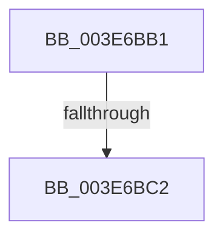

# sub_003E6BB1

- RVA: `0x003E6BB1`–`0x003E6BE8` (길이 `55` bytes)
- VA: `0x00000001403E6BB1`
- 실행 섹션: `.text`
- PDB 이름 있음: `아니요`; PDB Function 태그: `아니요`
- unwind 정보 RVA: `0x000955D4`
- 디코드: `12`개 명령, `55/55` bytes 표시
- 미해석 바이트: `0` (있으면 어셈블리에 `.byte`로 보존)

> 이 문서는 커널 이미지의 기계어와 PDB 기호를 분석해 생성했습니다. 4번과 5번은 함수 원형과 자료형을 바이너리 사용 방식에서 추정한 C 해석이며 원본 소스 복구 결과는 아닙니다.

## 1. Dependencies

- 직접 호출 지점: **0**; 고유 호출 대상: **0**
- 직접 호출자로 확인된 함수: **0**
- RIP 상대 이미지 참조: **0**

### Outgoing calls
- 직접 디코드된 call 명령이 없습니다.

### Direct callers
- 이 함수 시작 RVA로 연결되는 직접 call은 확인되지 않았습니다. 간접 호출은 완전히 역산할 수 없습니다.

### Static image references
- 디코드된 RIP-relative 메모리 참조가 없습니다.

## 2. Other-region calls and transfers

- 다른 실행 섹션으로 향하는 call: **0**
- call이 아닌 외부 분기/꼬리 이동: **2**
  - `0x003E6BBC` → [sub_003E64F5 + 0x26](Unknown_function_003E64F5.md) (`tail-transfer`)
  - `0x003E6BE3` → [sub_003E64F5 + 0x26](Unknown_function_003E64F5.md) (`tail-transfer`)

## 3. Assembly (complete function range)

```asm
003E6BB1  0F B6 86 DE 06 00 00            movzx eax, byte ptr [rsi + 0x6de]
003E6BB8  24 03                           and al, 3
003E6BBA  3C 01                           cmp al, 1
003E6BBC  0F 85 59 F9 FF FF               jne 0x1403e651b
003E6BC2  0F B7 96 E4 06 00 00            movzx edx, word ptr [rsi + 0x6e4]
003E6BC9  44 0F B6 E8                     movzx r13d, al
003E6BCD  0F B6 86 DA 06 00 00            movzx eax, byte ptr [rsi + 0x6da]
003E6BD4  C0 E8 04                        shr al, 4
003E6BD7  41 22 C5                        and al, r13b
003E6BDA  66 89 54 24 32                  mov word ptr [rsp + 0x32], dx
003E6BDF  88 44 24 30                     mov byte ptr [rsp + 0x30], al
003E6BE3  E9 33 F9 FF FF                  jmp 0x1403e651b
```

## 4. C-style interpretation (structured pseudocode)

```c
__int64 __fastcall sub_003E6BB1(void)
{
    __int64 result;
    unsigned __int8 v_stack_p30;
    unsigned __int16 v_stack_p32;

    result = (unsigned __int8)((*(unsigned __int8 *)(v_rsi + 1758)) & (3));
    result = (unsigned __int8)((*(unsigned __int8 *)(v_rsi + 1754)) >> (4));
    result = (unsigned __int8)((result) & ((unsigned __int8)((unsigned __int8)(result))));
    v_stack_p32 = (unsigned __int16)(*(unsigned __int16 *)(v_rsi + 1764));
    v_stack_p30 = (unsigned __int8)(result);
}
```

## 5. (Beta) C Style

```c
void sub_003E6BB1(void)
{
    int64_t result;
    uint8_t v_stack_p30;
    uint16_t v_stack_p32;

    result = (uint8_t)((*(uint8_t *)(local_rsi + 0x6DE)) & (3));
    result = (uint8_t)((*(uint8_t *)(local_rsi + 0x6DA)) >> (4));
    result = (uint8_t)((result) & ((uint8_t)((uint8_t)(result))));
    v_stack_p32 = (uint16_t)(*(uint16_t *)(local_rsi + 0x6E4));
    v_stack_p30 = (uint8_t)(result);
}
```

## 6. Execution-region graph

[열기: 2D/3D 그래프와 함수 탐색 컨트롤 패널](../../../control-panel.html?section=text&rva=0x003E6BB1&view=graph)

- 2D 그래프는 위에서 아래로 흐르고, 3D 그래프는 빈 공간을 드래그해 회전합니다. Shift+드래그는 이동, 휠은 확대·축소, 함수 노드 선택은 대상 보고서 이동입니다.

### Static fallback


