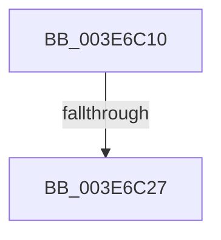

# sub_003E6C10

- RVA: `0x003E6C10`–`0x003E6C33` (길이 `35` bytes)
- VA: `0x00000001403E6C10`
- 실행 섹션: `.text`
- PDB 이름 있음: `아니요`; PDB Function 태그: `아니요`
- unwind 정보 RVA: `0x0009560C`
- 디코드: `6`개 명령, `35/35` bytes 표시
- 미해석 바이트: `0` (있으면 어셈블리에 `.byte`로 보존)

> 이 문서는 커널 이미지의 기계어와 PDB 기호를 분석해 생성했습니다. 4번과 5번은 함수 원형과 자료형을 바이너리 사용 방식에서 추정한 C 해석이며 원본 소스 복구 결과는 아닙니다.

## 1. Dependencies

- 직접 호출 지점: **0**; 고유 호출 대상: **0**
- 직접 호출자로 확인된 함수: **0**
- RIP 상대 이미지 참조: **0**

### Outgoing calls
- 직접 디코드된 call 명령이 없습니다.

### Direct callers
- 이 함수 시작 RVA로 연결되는 직접 call은 확인되지 않았습니다. 간접 호출은 완전히 역산할 수 없습니다.

### Static image references
- 디코드된 RIP-relative 메모리 참조가 없습니다.

## 2. Other-region calls and transfers

- 다른 실행 섹션으로 향하는 call: **0**
- call이 아닌 외부 분기/꼬리 이동: **2**
  - `0x003E6C21` → [sub_003E6905 + 0x70](Unknown_function_003E6905.md) (`tail-transfer`)
  - `0x003E6C2E` → [sub_003E6905 + 0x70](Unknown_function_003E6905.md) (`tail-transfer`)

## 3. Assembly (complete function range)

```asm
003E6C10  B9 FD FF 00 00                  mov ecx, 0xfffd
003E6C15  66 21 8E EC 06 00 00            and word ptr [rsi + 0x6ec], cx
003E6C1C  4C 85 44 24 48                  test qword ptr [rsp + 0x48], r8
003E6C21  0F 84 4E FD FF FF               je 0x1403e6975
003E6C27  66 21 8E E8 06 00 00            and word ptr [rsi + 0x6e8], cx
003E6C2E  E9 42 FD FF FF                  jmp 0x1403e6975
```

## 4. C-style interpretation (structured pseudocode)

```c
void __fastcall sub_003E6C10(__int64 a1, __int64 a2, __int64 a3, __int64 a4, __int64 a5, __int64 a6, __int64 a7, __int64 a8, __int64 a9)
{
}
```

## 5. (Beta) C Style

```c
void sub_003E6C10(int64_t Arg1, int64_t Arg2, int64_t Arg3, int64_t Arg4, uint64_t Arg5, uint64_t Arg6, uint64_t Arg7, uint64_t Arg8, int64_t Arg9)
{
}
```

## 6. Execution-region graph

[열기: 2D/3D 그래프와 함수 탐색 컨트롤 패널](../../../control-panel.html?section=text&rva=0x003E6C10&view=graph)

- 2D 그래프는 위에서 아래로 흐르고, 3D 그래프는 빈 공간을 드래그해 회전합니다. Shift+드래그는 이동, 휠은 확대·축소, 함수 노드 선택은 대상 보고서 이동입니다.

### Static fallback


