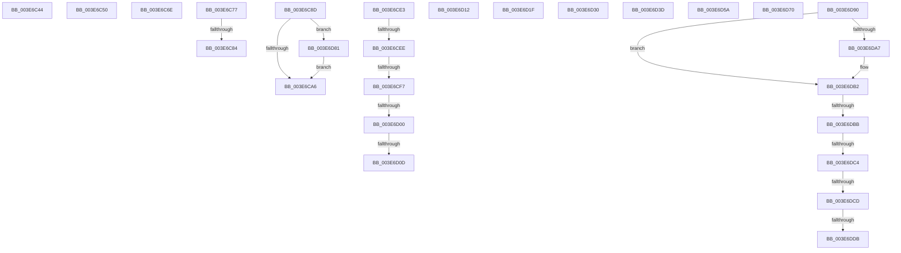

# sub_003E6C44

- RVA: `0x003E6C44`–`0x003E6DE5` (길이 `417` bytes)
- VA: `0x00000001403E6C44`
- 실행 섹션: `.text`
- PDB 이름 있음: `아니요`; PDB Function 태그: `아니요`
- unwind 정보 RVA: `0x00095644`
- 디코드: `85`개 명령, `417/417` bytes 표시
- 미해석 바이트: `0` (있으면 어셈블리에 `.byte`로 보존)

> 이 문서는 커널 이미지의 기계어와 PDB 기호를 분석해 생성했습니다. 4번과 5번은 함수 원형과 자료형을 바이너리 사용 방식에서 추정한 C 해석이며 원본 소스 복구 결과는 아닙니다.

## 1. Dependencies

- 직접 호출 지점: **1**; 고유 호출 대상: **1**
- 직접 호출자로 확인된 함수: **0**
- RIP 상대 이미지 참조: **0**

### Outgoing calls
- `0x003E6D81` → [KiFlushCurrentRsb](../6C/KiFlushCurrentRsb_function_006C6540.md) (function, `0x006C6540`)

### Direct callers
- 이 함수 시작 RVA로 연결되는 직접 call은 확인되지 않았습니다. 간접 호출은 완전히 역산할 수 없습니다.

### Static image references
- 디코드된 RIP-relative 메모리 참조가 없습니다.

## 2. Other-region calls and transfers

- 다른 실행 섹션으로 향하는 call: **0**
- call이 아닌 외부 분기/꼬리 이동: **22**
  - `0x003E6C4B` → [sub_003E64F5 + 0x136](Unknown_function_003E64F5.md) (`tail-transfer`)
  - `0x003E6C69` → [sub_003E64F5 + 0x1A9](Unknown_function_003E64F5.md) (`tail-transfer`)
  - `0x003E6C72` → [sub_003E6A11 + 0xAF](Unknown_function_003E6A11.md) (`tail-transfer`)
  - `0x003E6C7E` → [sub_003E6B14 + 0x5B](Unknown_function_003E6B14.md) (`tail-transfer`)
  - `0x003E6C88` → [sub_003E6B14 + 0x66](Unknown_function_003E6B14.md) (`tail-transfer`)
  - `0x003E6CDE` → [sub_003E64F5 + 0x180](Unknown_function_003E64F5.md) (`tail-transfer`)
  - `0x003E6CE8` → [sub_003E6A11 + 0xB8](Unknown_function_003E6A11.md) (`tail-transfer`)
  - `0x003E6CF1` → [sub_003E6A11 + 0xB8](Unknown_function_003E6A11.md) (`tail-transfer`)
  - `0x003E6CFA` → [sub_003E64F5 + 0x130](Unknown_function_003E64F5.md) (`tail-transfer`)
  - `0x003E6D07` → [sub_003E64F5 + 0x130](Unknown_function_003E64F5.md) (`tail-transfer`)
  - `0x003E6D0D` → [sub_003E6A11 + 0xB8](Unknown_function_003E6A11.md) (`tail-transfer`)
  - `0x003E6D1A` → [sub_003E673E + 0x62](Unknown_function_003E673E.md) (`tail-transfer`)
  - `0x003E6D2B` → [sub_003E64F5 + 0x127](Unknown_function_003E64F5.md) (`tail-transfer`)
  - `0x003E6D38` → [sub_003E64F5 + 0x115](Unknown_function_003E64F5.md) (`tail-transfer`)
  - `0x003E6D55` → [sub_003E64F5 + 0x77](Unknown_function_003E64F5.md) (`tail-transfer`)
  - `0x003E6D6B` → [sub_003E64F5 + 0x82](Unknown_function_003E64F5.md) (`tail-transfer`)
  - `0x003E6D7C` → [sub_003E673E + 0x6F](Unknown_function_003E673E.md) (`tail-transfer`)
  - `0x003E6DB5` → [sub_003E673E + 0x62](Unknown_function_003E673E.md) (`tail-transfer`)
  - `0x003E6DBE` → [sub_003E6DFD + 0x100](Unknown_function_003E6DFD.md) (`tail-transfer`)
  - `0x003E6DC7` → [sub_003E673E + 0x62](Unknown_function_003E673E.md) (`tail-transfer`)
  - `0x003E6DD5` → [sub_003E673E + 0x62](Unknown_function_003E673E.md) (`tail-transfer`)
  - `0x003E6DE0` → [sub_003E673E + 0x62](Unknown_function_003E673E.md) (`tail-transfer`)

## 3. Assembly (complete function range)

```asm
003E6C44  41 B1 01                        mov r9b, 1
003E6C47  45 0F B6 E9                     movzx r13d, r9b
003E6C4B  E9 DB F9 FF FF                  jmp 0x1403e662b
003E6C50  41 0F B7 D1                     movzx edx, r9w
003E6C54  B9 48 00 00 00                  mov ecx, 0x48
003E6C59  8B C2                           mov eax, edx
003E6C5B  66 44 89 8E E6 06 00 00         mov word ptr [rsi + 0x6e6], r9w
003E6C63  48 C1 EA 20                     shr rdx, 0x20
003E6C67  0F 30                           wrmsr
003E6C69  E9 30 FA FF FF                  jmp 0x1403e669e
003E6C6E  66 83 E2 04                     and dx, 4
003E6C72  E9 49 FE FF FF                  jmp 0x1403e6ac0
003E6C77  F6 86 DE 06 00 00 01            test byte ptr [rsi + 0x6de], 1
003E6C7E  0F 84 EB FE FF FF               je 0x1403e6b6f
003E6C84  66 41 F7 DA                     neg r10w
003E6C88  E9 ED FE FF FF                  jmp 0x1403e6b7a
003E6C8D  B8 01 00 00 00                  mov eax, 1
003E6C92  33 D2                           xor edx, edx
003E6C94  B9 49 00 00 00                  mov ecx, 0x49
003E6C99  0F 30                           wrmsr
003E6C9B  F6 44 24 38 08                  test byte ptr [rsp + 0x38], 8
003E6CA0  0F 84 DB 00 00 00               je 0x1403e6d81
003E6CA6  0F B7 86 D8 06 00 00            movzx eax, word ptr [rsi + 0x6d8]
003E6CAD  B9 FB FF 00 00                  mov ecx, 0xfffb
003E6CB2  66 23 C1                        and ax, cx
003E6CB5  48 89 9E D0 06 00 00            mov qword ptr [rsi + 0x6d0], rbx
003E6CBC  B9 DF FF 00 00                  mov ecx, 0xffdf
003E6CC1  66 89 BE E4 06 00 00            mov word ptr [rsi + 0x6e4], di
003E6CC8  66 23 C1                        and ax, cx
003E6CCB  66 89 86 D8 06 00 00            mov word ptr [rsi + 0x6d8], ax
003E6CD2  B8 AF FF 00 00                  mov eax, 0xffaf
003E6CD7  66 21 86 DA 06 00 00            and word ptr [rsi + 0x6da], ax
003E6CDE  E9 92 F9 FF FF                  jmp 0x1403e6675
003E6CE3  49 0F BA E0 25                  bt r8, 0x25
003E6CE8  0F 82 DB FD FF FF               jb 0x1403e6ac9
003E6CEE  F6 C1 10                        test cl, 0x10
003E6CF1  0F 85 D2 FD FF FF               jne 0x1403e6ac9
003E6CF7  4D 85 C6                        test r14, r8
003E6CFA  0F 84 25 F9 FF FF               je 0x1403e6625
003E6D00  F6 86 DE 06 00 00 02            test byte ptr [rsi + 0x6de], 2
003E6D07  0F 85 18 F9 FF FF               jne 0x1403e6625
003E6D0D  E9 B7 FD FF FF                  jmp 0x1403e6ac9
003E6D12  66 83 8E D8 06 00 00 02         or word ptr [rsi + 0x6d8], 2
003E6D1A  E9 81 FA FF FF                  jmp 0x1403e67a0
003E6D1F  B8 00 04 00 00                  mov eax, 0x400
003E6D24  66 09 86 EC 06 00 00            or word ptr [rsi + 0x6ec], ax
003E6D2B  E9 EC F8 FF FF                  jmp 0x1403e661c
003E6D30  66 83 8E EC 06 00 00 02         or word ptr [rsi + 0x6ec], 2
003E6D38  E9 CD F8 FF FF                  jmp 0x1403e660a
003E6D3D  41 0F B7 C2                     movzx eax, r10w
003E6D41  66 41 0B C0                     or ax, r8w
003E6D45  66 41 0B D0                     or dx, r8w
003E6D49  66 41 89 06                     mov word ptr [r14], ax
003E6D4D  66 41 89 13                     mov word ptr [r11], dx
003E6D51  44 0F B7 D0                     movzx r10d, ax
003E6D55  E9 12 F8 FF FF                  jmp 0x1403e656c
003E6D5A  66 41 83 CA 02                  or r10w, 2
003E6D5F  66 83 CA 02                     or dx, 2
003E6D63  66 45 89 16                     mov word ptr [r14], r10w
003E6D67  66 41 89 13                     mov word ptr [r11], dx
003E6D6B  E9 07 F8 FF FF                  jmp 0x1403e6577
003E6D70  B8 80 00 00 00                  mov eax, 0x80
003E6D75  66 09 86 D8 06 00 00            or word ptr [rsi + 0x6d8], ax
003E6D7C  E9 2C FA FF FF                  jmp 0x1403e67ad
003E6D81  E8 BA F7 2D 00                  call 0x1406c6540
003E6D86  4C 8B 54 24 60                  mov r10, qword ptr [rsp + 0x60]
003E6D8B  E9 16 FF FF FF                  jmp 0x1403e6ca6
003E6D90  0F B7 86 D8 06 00 00            movzx eax, word ptr [rsi + 0x6d8]
003E6D97  66 83 C8 08                     or ax, 8
003E6D9B  66 89 86 D8 06 00 00            mov word ptr [rsi + 0x6d8], ax
003E6DA2  F6 C1 08                        test cl, 8
003E6DA5  75 0B                           jne 0x1403e6db2
003E6DA7  66 83 C8 02                     or ax, 2
003E6DAB  66 89 86 D8 06 00 00            mov word ptr [rsi + 0x6d8], ax
003E6DB2  F6 C1 02                        test cl, 2
003E6DB5  0F 84 E5 F9 FF FF               je 0x1403e67a0
003E6DBB  F6 C1 40                        test cl, 0x40
003E6DBE  0F 85 39 01 00 00               jne 0x1403e6efd
003E6DC4  F6 C1 10                        test cl, 0x10
003E6DC7  0F 84 D3 F9 FF FF               je 0x1403e67a0
003E6DCD  66 41 83 0B 01                  or word ptr [r11], 1
003E6DD2  4D 85 C9                        test r9, r9
003E6DD5  0F 85 C5 F9 FF FF               jne 0x1403e67a0
003E6DDB  66 41 83 0E 01                  or word ptr [r14], 1
003E6DE0  E9 BB F9 FF FF                  jmp 0x1403e67a0
```

## 4. C-style interpretation (structured pseudocode)

```c
__int64 __fastcall sub_003E6C44(__int64 a1, __int64 a2, __int64 a3)
{
    unsigned __int8 v_stack_p38;
    unsigned __int64 v_stack_p60;
}
```

## 5. (Beta) C Style

```c
int64_t sub_003E6C44(int64_t Arg1, int64_t Arg2, int64_t Arg3)
{
    uint8_t v_stack_p38;
    uint64_t v_stack_p60;
}
```

## 6. Execution-region graph

[열기: 2D/3D 그래프와 함수 탐색 컨트롤 패널](../../../control-panel.html?section=text&rva=0x003E6C44&view=graph)

- 2D 그래프는 위에서 아래로 흐르고, 3D 그래프는 빈 공간을 드래그해 회전합니다. Shift+드래그는 이동, 휠은 확대·축소, 함수 노드 선택은 대상 보고서 이동입니다.

### Static fallback


