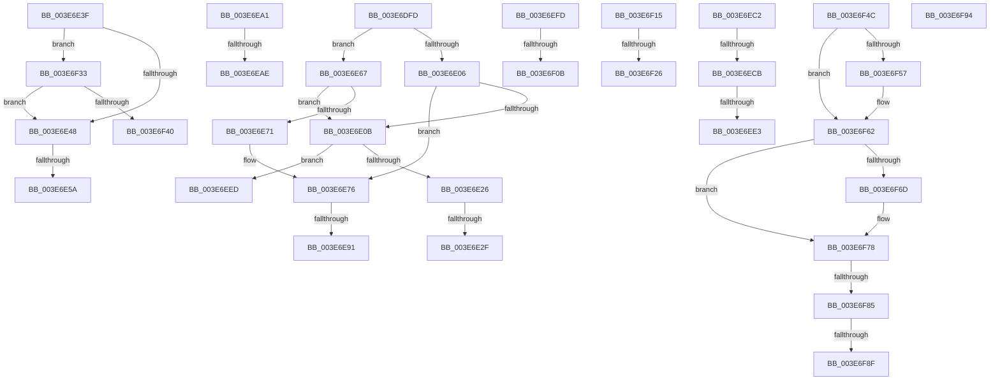

# sub_003E6DFD

- RVA: `0x003E6DFD`–`0x003E6FA8` (길이 `427` bytes)
- VA: `0x00000001403E6DFD`
- 실행 섹션: `.text`
- PDB 이름 있음: `아니요`; PDB Function 태그: `아니요`
- unwind 정보 RVA: `0x00095688`
- 디코드: `88`개 명령, `427/427` bytes 표시
- 미해석 바이트: `0` (있으면 어셈블리에 `.byte`로 보존)

> 이 문서는 커널 이미지의 기계어와 PDB 기호를 분석해 생성했습니다. 4번과 5번은 함수 원형과 자료형을 바이너리 사용 방식에서 추정한 C 해석이며 원본 소스 복구 결과는 아닙니다.

## 1. Dependencies

- 직접 호출 지점: **0**; 고유 호출 대상: **0**
- 직접 호출자로 확인된 함수: **0**
- RIP 상대 이미지 참조: **1**

### Outgoing calls
- 직접 디코드된 call 명령이 없습니다.

### Direct callers
- 이 함수 시작 RVA로 연결되는 직접 call은 확인되지 않았습니다. 간접 호출은 완전히 역산할 수 없습니다.

### Static image references
- `0x003E6EA1` → RVA `0x00E0B1F8` (`.data`; read)

## 2. Other-region calls and transfers

- 다른 실행 섹션으로 향하는 call: **0**
- call이 아닌 외부 분기/꼬리 이동: **21**
  - `0x003E6E29` → [sub_003E673E + 0x62](Unknown_function_003E673E.md) (`tail-transfer`)
  - `0x003E6E3A` → [sub_003E673E + 0x62](Unknown_function_003E673E.md) (`tail-transfer`)
  - `0x003E6E54` → [sub_003E6A11 + 0xAF](Unknown_function_003E6A11.md) (`tail-transfer`)
  - `0x003E6E62` → [sub_003E6A11 + 0xAF](Unknown_function_003E6A11.md) (`tail-transfer`)
  - `0x003E6E8B` → [sub_003E673E + 0x62](Unknown_function_003E673E.md) (`tail-transfer`)
  - `0x003E6E9C` → [sub_003E673E + 0x62](Unknown_function_003E673E.md) (`tail-transfer`)
  - `0x003E6EA8` → [sub_003E64F5 + 0x33](Unknown_function_003E64F5.md) (`tail-transfer`)
  - `0x003E6EBD` → [sub_003E64F5 + 0x37](Unknown_function_003E64F5.md) (`tail-transfer`)
  - `0x003E6EC5` → [sub_003E64F5 + 0xD8](Unknown_function_003E64F5.md) (`tail-transfer`)
  - `0x003E6EDD` → [sub_003E64F5 + 0xE2](Unknown_function_003E64F5.md) (`tail-transfer`)
  - `0x003E6EE8` → [sub_003E64F5 + 0xE2](Unknown_function_003E64F5.md) (`tail-transfer`)
  - `0x003E6EF8` → [sub_003E673E + 0x62](Unknown_function_003E673E.md) (`tail-transfer`)
  - `0x003E6F05` → [sub_003E673E + 0x62](Unknown_function_003E673E.md) (`tail-transfer`)
  - `0x003E6F10` → [sub_003E673E + 0x62](Unknown_function_003E673E.md) (`tail-transfer`)
  - `0x003E6F20` → [sub_003E64F5 + 0x11E](Unknown_function_003E64F5.md) (`tail-transfer`)
  - `0x003E6F2E` → [sub_003E64F5 + 0x11E](Unknown_function_003E64F5.md) (`tail-transfer`)
  - `0x003E6F47` → [sub_003E6A11 + 0xAA](Unknown_function_003E6A11.md) (`tail-transfer`)
  - `0x003E6F7F` → [sub_003E6B14 + 0x7E](Unknown_function_003E6B14.md) (`tail-transfer`)
  - `0x003E6F89` → [sub_003E6B14 + 0x7E](Unknown_function_003E6B14.md) (`tail-transfer`)
  - `0x003E6F8F` → [sub_003E6905 + 0xDA](Unknown_function_003E6905.md) (`tail-transfer`)
  - `0x003E6FA3` → [sub_003E64F5 + 0x9A](Unknown_function_003E64F5.md) (`tail-transfer`)

## 3. Assembly (complete function range)

```asm
003E6DFD  0F B6 C1                        movzx eax, cl
003E6E00  24 42                           and al, 0x42
003E6E02  3C 42                           cmp al, 0x42
003E6E04  74 61                           je 0x1403e6e67
003E6E06  4D 85 C9                        test r9, r9
003E6E09  74 6B                           je 0x1403e6e76
003E6E0B  0F B7 86 D8 06 00 00            movzx eax, word ptr [rsi + 0x6d8]
003E6E12  66 83 C8 10                     or ax, 0x10
003E6E16  66 89 86 D8 06 00 00            mov word ptr [rsi + 0x6d8], ax
003E6E1D  F6 C1 20                        test cl, 0x20
003E6E20  0F 84 C7 00 00 00               je 0x1403e6eed
003E6E26  F6 C1 08                        test cl, 8
003E6E29  0F 85 71 F9 FF FF               jne 0x1403e67a0
003E6E2F  66 83 C8 40                     or ax, 0x40
003E6E33  66 89 86 D8 06 00 00            mov word ptr [rsi + 0x6d8], ax
003E6E3A  E9 61 F9 FF FF                  jmp 0x1403e67a0
003E6E3F  4D 85 C6                        test r14, r8
003E6E42  0F 85 EB 00 00 00               jne 0x1403e6f33
003E6E48  41 0F B6 C8                     movzx ecx, r8b
003E6E4C  48 89 4C 24 38                  mov qword ptr [rsp + 0x38], rcx
003E6E51  F6 C1 40                        test cl, 0x40
003E6E54  0F 84 66 FC FF FF               je 0x1403e6ac0
003E6E5A  66 83 E2 04                     and dx, 4
003E6E5E  66 83 CA 02                     or dx, 2
003E6E62  E9 59 FC FF FF                  jmp 0x1403e6ac0
003E6E67  66 41 83 0B 02                  or word ptr [r11], 2
003E6E6C  4D 85 C9                        test r9, r9
003E6E6F  75 9A                           jne 0x1403e6e0b
003E6E71  66 41 83 0E 02                  or word ptr [r14], 2
003E6E76  0F B7 86 D8 06 00 00            movzx eax, word ptr [rsi + 0x6d8]
003E6E7D  66 83 C8 08                     or ax, 8
003E6E81  66 89 86 D8 06 00 00            mov word ptr [rsi + 0x6d8], ax
003E6E88  F6 C1 08                        test cl, 8
003E6E8B  0F 85 0F F9 FF FF               jne 0x1403e67a0
003E6E91  66 83 C8 02                     or ax, 2
003E6E95  66 89 86 D8 06 00 00            mov word ptr [rsi + 0x6d8], ax
003E6E9C  E9 FF F8 FF FF                  jmp 0x1403e67a0
003E6EA1  83 3D 50 43 A2 00 48            cmp dword ptr [rip + 0xa24350], 0x48
003E6EA8  0F 85 7A F6 FF FF               jne 0x1403e6528
003E6EAE  66 83 CA 04                     or dx, 4
003E6EB2  41 BA 04 00 00 00               mov r10d, 4
003E6EB8  66 89 54 24 32                  mov word ptr [rsp + 0x32], dx
003E6EBD  E9 6A F6 FF FF                  jmp 0x1403e652c
003E6EC2  F6 C1 10                        test cl, 0x10
003E6EC5  0F 84 02 F7 FF FF               je 0x1403e65cd
003E6ECB  66 41 83 0B 01                  or word ptr [r11], 1
003E6ED0  4D 85 C9                        test r9, r9
003E6ED3  49 B9 00 00 00 00 80 00 00 00   movabs r9, 0x8000000000
003E6EDD  0F 85 F4 F6 FF FF               jne 0x1403e65d7
003E6EE3  66 41 83 0E 01                  or word ptr [r14], 1
003E6EE8  E9 EA F6 FF FF                  jmp 0x1403e65d7
003E6EED  66 83 C8 02                     or ax, 2
003E6EF1  66 89 86 D8 06 00 00            mov word ptr [rsi + 0x6d8], ax
003E6EF8  E9 A3 F8 FF FF                  jmp 0x1403e67a0
003E6EFD  66 41 83 0B 02                  or word ptr [r11], 2
003E6F02  4D 85 C9                        test r9, r9
003E6F05  0F 85 95 F8 FF FF               jne 0x1403e67a0
003E6F0B  66 41 83 0E 02                  or word ptr [r14], 2
003E6F10  E9 8B F8 FF FF                  jmp 0x1403e67a0
003E6F15  41 F7 87 54 07 00 00 00 20 00 00  test dword ptr [r15 + 0x754], 0x2000
003E6F20  0F 84 ED F6 FF FF               je 0x1403e6613
003E6F26  66 83 8E EC 06 00 00 04         or word ptr [rsi + 0x6ec], 4
003E6F2E  E9 E0 F6 FF FF                  jmp 0x1403e6613
003E6F33  F6 86 DE 06 00 00 01            test byte ptr [rsi + 0x6de], 1
003E6F3A  0F 85 08 FF FF FF               jne 0x1403e6e48
003E6F40  66 83 E2 04                     and dx, 4
003E6F44  49 8B C8                        mov rcx, r8
003E6F47  E9 6F FB FF FF                  jmp 0x1403e6abb
003E6F4C  0F B7 86 E2 06 00 00            movzx eax, word ptr [rsi + 0x6e2]
003E6F53  A8 03                           test al, 3
003E6F55  75 0B                           jne 0x1403e6f62
003E6F57  66 83 C8 02                     or ax, 2
003E6F5B  66 89 86 E2 06 00 00            mov word ptr [rsi + 0x6e2], ax
003E6F62  0F B7 86 E4 06 00 00            movzx eax, word ptr [rsi + 0x6e4]
003E6F69  A8 03                           test al, 3
003E6F6B  75 0B                           jne 0x1403e6f78
003E6F6D  66 83 C8 02                     or ax, 2
003E6F71  66 89 86 E4 06 00 00            mov word ptr [rsi + 0x6e4], ax
003E6F78  F6 86 DE 06 00 00 01            test byte ptr [rsi + 0x6de], 1
003E6F7F  0F 84 0D FC FF FF               je 0x1403e6b92
003E6F85  40 F6 C7 03                     test dil, 3
003E6F89  0F 85 03 FC FF FF               jne 0x1403e6b92
003E6F8F  E9 4B FA FF FF                  jmp 0x1403e69df
003E6F94  66 44 0B D0                     or r10w, ax
003E6F98  66 0B D0                        or dx, ax
003E6F9B  66 45 89 16                     mov word ptr [r14], r10w
003E6F9F  66 41 89 13                     mov word ptr [r11], dx
003E6FA3  E9 E7 F5 FF FF                  jmp 0x1403e658f
```

## 4. C-style interpretation (structured pseudocode)

```c
__int64 __fastcall sub_003E6DFD(unsigned __int8 a1, unsigned __int16 a2, __int64 a3, __int64 a4)
{
    __int64 result;
    unsigned __int16 v_stack_p32;
    unsigned __int64 v_stack_p38;

    result = (unsigned __int8)((a1) & (66));
    if (((unsigned __int8)(result)) == 66) goto loc_003E6E67;
    if (a4 == 0) goto loc_003E6E76;
loc_003E6E0B:
    result = (unsigned __int16)((*(unsigned __int16 *)(v_rsi + 1752)) | (16));
    *(unsigned __int16 *)(v_rsi + 1752) = (unsigned __int16)(result);
    if (((a1) & (32)) == 0) goto loc_003E6EED;
    result = (unsigned __int16)((result) | (64));
    *(unsigned __int16 *)(v_rsi + 1752) = (unsigned __int16)(result);
loc_003E6E67:
    if (a4 != 0) goto loc_003E6E0B;
loc_003E6E76:
    result = (unsigned __int16)((*(unsigned __int16 *)(v_rsi + 1752)) | (8));
    *(unsigned __int16 *)(v_rsi + 1752) = (unsigned __int16)(result);
    result = (unsigned __int16)((result) | (2));
    *(unsigned __int16 *)(v_rsi + 1752) = (unsigned __int16)(result);
loc_003E6EED:
    result = (unsigned __int16)((result) | (2));
    *(unsigned __int16 *)(v_rsi + 1752) = (unsigned __int16)(result);
}
```

## 5. (Beta) C Style

```c
int64_t sub_003E6DFD(uint8_t Arg1, uint16_t Arg2, int64_t Arg3, int64_t Arg4)
{
    int64_t result;
    uint16_t v_stack_p32;
    uint64_t v_stack_p38;

    result = (uint8_t)((Arg1) & (66));
    if (((uint8_t)(result)) == 66) goto loc_003E6E67;
    if (Arg4 == 0) goto loc_003E6E76;
loc_003E6E0B:
    result = (uint16_t)((*(uint16_t *)(local_rsi + 0x6D8)) | (16));
    *(uint16_t *)(local_rsi + 0x6D8) = (uint16_t)(result);
    if (((Arg1) & (32)) == 0) goto loc_003E6EED;
    result = (uint16_t)((result) | (64));
    *(uint16_t *)(local_rsi + 0x6D8) = (uint16_t)(result);
loc_003E6E67:
    if (Arg4 != 0) goto loc_003E6E0B;
loc_003E6E76:
    result = (uint16_t)((*(uint16_t *)(local_rsi + 0x6D8)) | (8));
    *(uint16_t *)(local_rsi + 0x6D8) = (uint16_t)(result);
    result = (uint16_t)((result) | (2));
    *(uint16_t *)(local_rsi + 0x6D8) = (uint16_t)(result);
loc_003E6EED:
    result = (uint16_t)((result) | (2));
    *(uint16_t *)(local_rsi + 0x6D8) = (uint16_t)(result);
}
```

## 6. Execution-region graph

[열기: 2D/3D 그래프와 함수 탐색 컨트롤 패널](../../../control-panel.html?section=text&rva=0x003E6DFD&view=graph)

- 2D 그래프는 위에서 아래로 흐르고, 3D 그래프는 빈 공간을 드래그해 회전합니다. Shift+드래그는 이동, 휠은 확대·축소, 함수 노드 선택은 대상 보고서 이동입니다.

### Static fallback


