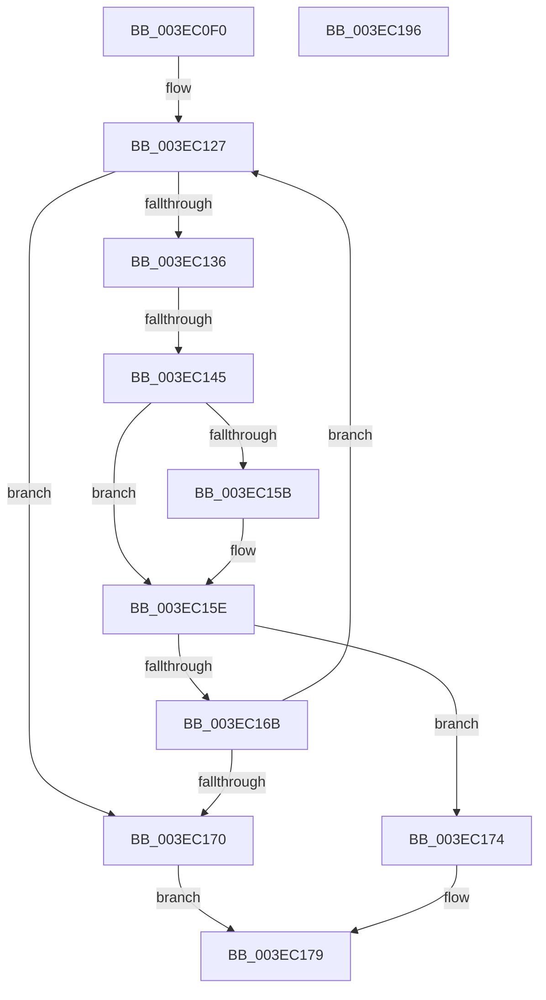

# sub_003EC0F0

- RVA: `0x003EC0F0`–`0x003EC197` (길이 `167` bytes)
- VA: `0x00000001403EC0F0`
- 실행 섹션: `.text`
- PDB 이름 있음: `아니요`; PDB Function 태그: `아니요`
- unwind 정보 RVA: `0x00095B5C`
- 디코드: `39`개 명령, `167/167` bytes 표시
- 미해석 바이트: `0` (있으면 어셈블리에 `.byte`로 보존)

> 이 문서는 커널 이미지의 기계어와 PDB 기호를 분석해 생성했습니다. 4번과 5번은 함수 원형과 자료형을 바이너리 사용 방식에서 추정한 C 해석이며 원본 소스 복구 결과는 아닙니다.

## 1. Dependencies

- 직접 호출 지점: **0**; 고유 호출 대상: **0**
- 직접 호출자로 확인된 함수: **0**
- RIP 상대 이미지 참조: **1**

### Outgoing calls
- 직접 디코드된 call 명령이 없습니다.

### Direct callers
- 이 함수 시작 RVA로 연결되는 직접 call은 확인되지 않았습니다. 간접 호출은 완전히 역산할 수 없습니다.

### Static image references
- `0x003EC14E` → RVA `0x00FC6A88` (`ALMOSTRO`; read)

## 2. Other-region calls and transfers

- 다른 실행 섹션으로 향하는 call: **0**
- call이 아닌 외부 분기/꼬리 이동: **1**
  - `0x003EC13F` → [sub_003EC202](Unknown_function_003EC202.md) (`tail-transfer`)

## 3. Assembly (complete function range)

```asm
003EC0F0  48 89 7C 24 50                  mov qword ptr [rsp + 0x50], rdi
003EC0F5  49 BF FF FF FF FF FF FF FF DF   movabs r15, 0xdfffffffffffffff
003EC0FF  49 BC 20 00 00 00 00 00 00 10   movabs r12, 0x1000000000000020
003EC109  49 B9 00 00 00 00 40 00 00 00   movabs r9, 0x4000000000
003EC113  49 B8 00 00 00 00 80 F6 FF FF   movabs r8, 0xfffff68000000000
003EC11D  48 BA 00 00 00 00 00 00 00 20   movabs rdx, 0x2000000000000000
003EC127  48 B9 00 00 00 00 10 00 00 00   movabs rcx, 0x1000000000
003EC131  F6 C3 01                        test bl, 1
003EC134  74 3A                           je 0x1403ec170
003EC136  48 8B C3                        mov rax, rbx
003EC139  48 C1 E8 3C                     shr rax, 0x3c
003EC13D  A8 01                           test al, 1
003EC13F  0F 85 BD 00 00 00               jne 0x1403ec202
003EC145  48 8B CB                        mov rcx, rbx
003EC148  49 23 CF                        and rcx, r15
003EC14B  49 0B CC                        or rcx, r12
003EC14E  48 F7 05 2F A9 BD 00 00 00 00 02  test qword ptr [rip + 0xbda92f], 0x2000000
003EC159  74 03                           je 0x1403ec15e
003EC15B  0F AE E8                        lfence
003EC15E  48 8B C3                        mov rax, rbx
003EC161  F0 48 0F B1 0E                  lock cmpxchg qword ptr [rsi], rcx
003EC166  48 8B D8                        mov rbx, rax
003EC169  74 09                           je 0x1403ec174
003EC16B  45 85 F6                        test r14d, r14d
003EC16E  74 B7                           je 0x1403ec127
003EC170  33 C0                           xor eax, eax
003EC172  EB 05                           jmp 0x1403ec179
003EC174  B8 01 00 00 00                  mov eax, 1
003EC179  48 8B 7C 24 50                  mov rdi, qword ptr [rsp + 0x50]
003EC17E  48 8B 5C 24 58                  mov rbx, qword ptr [rsp + 0x58]
003EC183  48 8B 6C 24 60                  mov rbp, qword ptr [rsp + 0x60]
003EC188  48 83 C4 20                     add rsp, 0x20
003EC18C  41 5F                           pop r15
003EC18E  41 5E                           pop r14
003EC190  41 5D                           pop r13
003EC192  41 5C                           pop r12
003EC194  5E                              pop rsi
003EC195  C3                              ret
003EC196  CC                              int3
```

## 4. C-style interpretation (structured pseudocode)

```c
__int64 __fastcall sub_003EC0F0(__int64 a1, __int64 a2, __int64 a3, __int64 a4, __int64 a5, __int64 a6, __int64 a7, __int64 a8, __int64 a9, __int64 a10, __int64 a11, __int64 a12)
{
    __int64 result;
    __int64 v_rsp;
    unsigned __int64 v_stack_p50;

    v_stack_p50 = v_rdi;
loc_003EC127:
    if ((((unsigned __int8)(v_rbx)) & (1)) == 0) goto loc_003EC170;
    result = (v_rbx) >> (60);
    a1 = (v_rbx) & (v_r15);
    a1 = (a1) | (v_r12);
    if (((*(unsigned __int64 *)(v_rip + 12429615)) & (0x2000000ULL)) != 0) {
    }
    if (((*(unsigned __int64 *)(v_rip + 12429615)) & (0x2000000ULL)) == 0) goto loc_003EC174;
    if ((unsigned int)(v_r14) == 0) goto loc_003EC127;
loc_003EC170:
    result = 0;
    goto loc_003EC179;
loc_003EC174:
loc_003EC179:
    v_rsp = (v_rsp) + (32);
    return 1;
}
```

## 5. (Beta) C Style

```c
int64_t sub_003EC0F0(int64_t Arg1, int64_t Arg2, int64_t Arg3, int64_t Arg4, uint64_t Arg5, uint64_t Arg6, uint64_t Arg7, uint64_t Arg8, uint64_t Arg9, int64_t Arg10, int64_t Arg11, int64_t Arg12)
{
    int64_t result;
    int64_t local_rsp;
    uint64_t v_stack_p50;

    v_stack_p50 = local_rdi;
loc_003EC127:
    if ((((uint8_t)(local_rbx)) & (1)) == 0) goto loc_003EC170;
    result = (local_rbx) >> (60);
    Arg1 = (local_rbx) & (local_r15);
    Arg1 = (Arg1) | (local_r12);
    if (((*(uint64_t *)(v_rip + 0xBDA92F)) & (0x2000000ULL)) != 0) {
    }
    if (((*(uint64_t *)(v_rip + 0xBDA92F)) & (0x2000000ULL)) == 0) goto loc_003EC174;
    if ((uint32_t)(local_r14) == 0) goto loc_003EC127;
loc_003EC170:
    result = 0;
    goto loc_003EC179;
loc_003EC174:
loc_003EC179:
    local_rsp = (local_rsp) + (32);
    return 1;
}
```

## 6. Execution-region graph

[열기: 2D/3D 그래프와 함수 탐색 컨트롤 패널](../../../control-panel.html?section=text&rva=0x003EC0F0&view=graph)

- 2D 그래프는 위에서 아래로 흐르고, 3D 그래프는 빈 공간을 드래그해 회전합니다. Shift+드래그는 이동, 휠은 확대·축소, 함수 노드 선택은 대상 보고서 이동입니다.

### Static fallback


