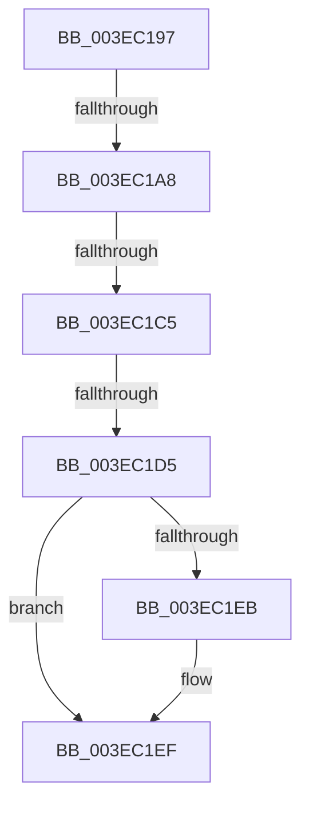

# sub_003EC197

- RVA: `0x003EC197`–`0x003EC202` (길이 `107` bytes)
- VA: `0x00000001403EC197`
- 실행 섹션: `.text`
- PDB 이름 있음: `아니요`; PDB Function 태그: `아니요`
- unwind 정보 RVA: `0x00095B74`
- 디코드: `21`개 명령, `107/107` bytes 표시
- 미해석 바이트: `0` (있으면 어셈블리에 `.byte`로 보존)

> 이 문서는 커널 이미지의 기계어와 PDB 기호를 분석해 생성했습니다. 4번과 5번은 함수 원형과 자료형을 바이너리 사용 방식에서 추정한 C 해석이며 원본 소스 복구 결과는 아닙니다.

## 1. Dependencies

- 직접 호출 지점: **0**; 고유 호출 대상: **0**
- 직접 호출자로 확인된 함수: **0**
- RIP 상대 이미지 참조: **1**

### Outgoing calls
- 직접 디코드된 call 명령이 없습니다.

### Direct callers
- 이 함수 시작 RVA로 연결되는 직접 call은 확인되지 않았습니다. 간접 호출은 완전히 역산할 수 없습니다.

### Static image references
- `0x003EC197` → RVA `0x00FC6A88` (`ALMOSTRO`; read)

## 2. Other-region calls and transfers

- 다른 실행 섹션으로 향하는 call: **0**
- call이 아닌 외부 분기/꼬리 이동: **4**
  - `0x003EC1A2` → [MiLockPte + 0x5C](MiLockPte_function_003EC090.md) (`tail-transfer`)
  - `0x003EC1BF` → [MiLockPte + 0x5C](MiLockPte_function_003EC090.md) (`tail-transfer`)
  - `0x003EC1CF` → [MiLockPte + 0x5C](MiLockPte_function_003EC090.md) (`tail-transfer`)
  - `0x003EC1FD` → [MiLockPte + 0x5C](MiLockPte_function_003EC090.md) (`tail-transfer`)

## 3. Assembly (complete function range)

```asm
003EC197  48 F7 05 E6 A8 BD 00 00 00 60 00  test qword ptr [rip + 0xbda8e6], 0x600000
003EC1A2  0F 84 44 FF FF FF               je 0x1403ec0ec
003EC1A8  65 48 8B 0C 25 88 01 00 00      mov rcx, qword ptr gs:[0x188]
003EC1B1  48 8B 91 B8 00 00 00            mov rdx, qword ptr [rcx + 0xb8]
003EC1B8  80 BA 60 01 00 00 01            cmp byte ptr [rdx + 0x160], 1
003EC1BF  0F 84 27 FF FF FF               je 0x1403ec0ec
003EC1C5  4C 8B 82 08 05 00 00            mov r8, qword ptr [rdx + 0x508]
003EC1CC  4D 85 C0                        test r8, r8
003EC1CF  0F 84 17 FF FF FF               je 0x1403ec0ec
003EC1D5  48 8B CE                        mov rcx, rsi
003EC1D8  48 C1 E9 03                     shr rcx, 3
003EC1DC  81 E1 FF 01 00 00               and ecx, 0x1ff
003EC1E2  49 8B 0C C8                     mov rcx, qword ptr [r8 + rcx*8]
003EC1E6  F6 C1 20                        test cl, 0x20
003EC1E9  74 04                           je 0x1403ec1ef
003EC1EB  48 83 C8 20                     or rax, 0x20
003EC1EF  48 8B D8                        mov rbx, rax
003EC1F2  48 83 CB 42                     or rbx, 0x42
003EC1F6  F6 C1 42                        test cl, 0x42
003EC1F9  48 0F 44 D8                     cmove rbx, rax
003EC1FD  E9 EA FE FF FF                  jmp 0x1403ec0ec
```

## 4. C-style interpretation (structured pseudocode)

```c
__int64 __fastcall sub_003EC197(void)
{
    __int64 result;
    __int64 v_rbx;

    a1 = (v_rsi) >> (3);
    a1 = (unsigned int)((a1) & (511));
    if ((((unsigned __int8)(*(unsigned __int64 *)(*(unsigned __int64 *)(*(unsigned __int64 *)(*(unsigned __int64 *)(gs_base + (0 + 392)) + 184) + 1288) + a1 * 8))) & (32)) != 0) {
        result = (result) | (32);
    }
    v_rbx = (result) | (66);
    if ((((unsigned __int8)(*(unsigned __int64 *)(*(unsigned __int64 *)(*(unsigned __int64 *)(*(unsigned __int64 *)(gs_base + (0 + 392)) + 184) + 1288) + a1 * 8))) & (66)) == 0) { v_rbx = result; }
}
```

## 5. (Beta) C Style

```c
void sub_003EC197(void)
{
    int64_t result;
    int64_t local_rbx;

    a1 = (local_rsi) >> (3);
    a1 = (uint32_t)((a1) & (511));
    if ((((uint8_t)(*(uint64_t *)(*(uint64_t *)(*(uint64_t *)(*(uint64_t *)(gs_base + (0 + 0x188)) + 0xB8) + 0x508) + a1 * 8))) & (32)) != 0) {
        result = (result) | (32);
    }
    local_rbx = (result) | (66);
    if ((((uint8_t)(*(uint64_t *)(*(uint64_t *)(*(uint64_t *)(*(uint64_t *)(gs_base + (0 + 0x188)) + 0xB8) + 0x508) + a1 * 8))) & (66)) == 0) { local_rbx = result; }
}
```

## 6. Execution-region graph

[열기: 2D/3D 그래프와 함수 탐색 컨트롤 패널](../../../control-panel.html?section=text&rva=0x003EC197&view=graph)

- 2D 그래프는 위에서 아래로 흐르고, 3D 그래프는 빈 공간을 드래그해 회전합니다. Shift+드래그는 이동, 휠은 확대·축소, 함수 노드 선택은 대상 보고서 이동입니다.

### Static fallback


