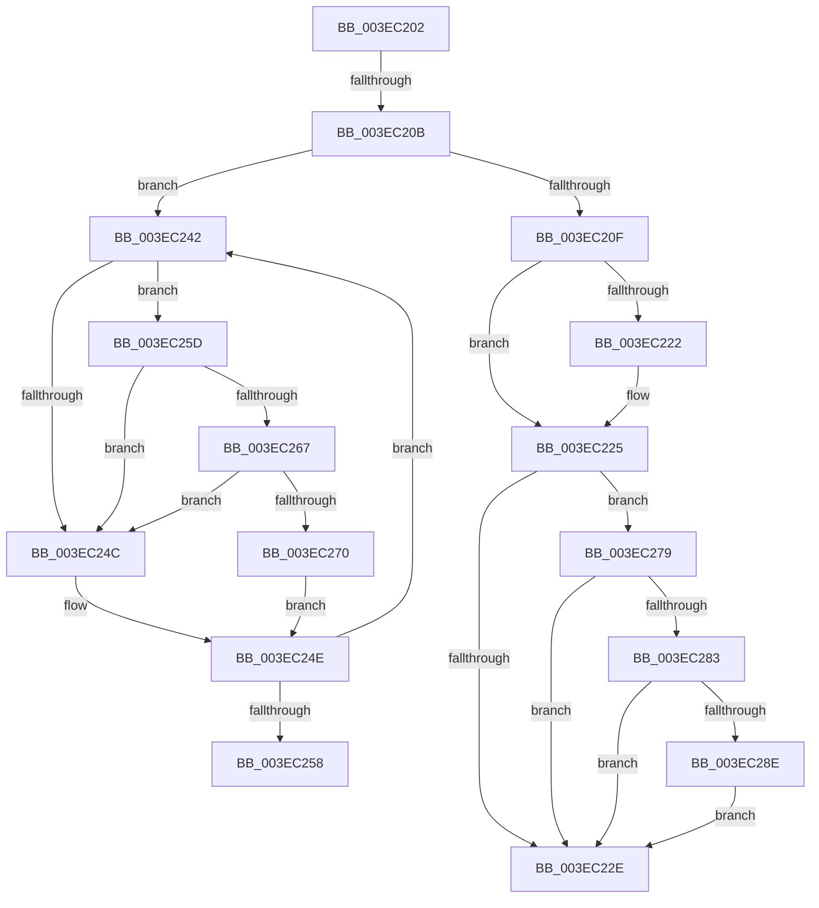

# sub_003EC202

- RVA: `0x003EC202`–`0x003EC2CC` (길이 `202` bytes)
- VA: `0x00000001403EC202`
- 실행 섹션: `.text`
- PDB 이름 있음: `아니요`; PDB Function 태그: `아니요`
- unwind 정보 RVA: `0x00095B84`
- 디코드: `50`개 명령, `202/202` bytes 표시
- 미해석 바이트: `0` (있으면 어셈블리에 `.byte`로 보존)

> 이 문서는 커널 이미지의 기계어와 PDB 기호를 분석해 생성했습니다. 4번과 5번은 함수 원형과 자료형을 바이너리 사용 방식에서 추정한 C 해석이며 원본 소스 복구 결과는 아닙니다.

## 1. Dependencies

- 직접 호출 지점: **3**; 고유 호출 대상: **3**
- 직접 호출자로 확인된 함수: **0**
- RIP 상대 이미지 참조: **3**

### Outgoing calls
- `0x003EC267` → [KiCheckVpBackingLongSpinWaitHypercall](../30/KiCheckVpBackingLongSpinWaitHypercall_function_0030F490.md) (function, `0x0030F490`)
- `0x003EC272` → [HvlNotifyLongSpinWait](../30/HvlNotifyLongSpinWait_function_0030F460.md) (function, `0x0030F460`)
- `0x003EC29A` → [MiCheckLinearProtectedPteAccessedBit](../29/MiCheckLinearProtectedPteAccessedBit_function_00292D80.md) (function, `0x00292D80`)

### Direct callers
- 이 함수 시작 RVA로 연결되는 직접 call은 확인되지 않았습니다. 간접 호출은 완전히 역산할 수 없습니다.

### Static image references
- `0x003EC215` → RVA `0x00FC6A88` (`ALMOSTRO`; read)
- `0x003EC244` → RVA `0x00FC52AC` (`ALMOSTRO`; reference)
- `0x003EC25D` → RVA `0x00FC6AB8` (`ALMOSTRO`; read)

## 2. Other-region calls and transfers

- 다른 실행 섹션으로 향하는 call: **0**
- call이 아닌 외부 분기/꼬리 이동: **3**
  - `0x003EC205` → [sub_003EC0F0 + 0x80](Unknown_function_003EC0F0.md) (`tail-transfer`)
  - `0x003EC23D` → [sub_003EC0F0 + 0x41](Unknown_function_003EC0F0.md) (`tail-transfer`)
  - `0x003EC258` → [sub_003EC0F0 + 0x19](Unknown_function_003EC0F0.md) (`tail-transfer`)

## 3. Assembly (complete function range)

```asm
003EC202  45 85 F6                        test r14d, r14d
003EC205  0F 85 65 FF FF FF               jne 0x1403ec170
003EC20B  A8 02                           test al, 2
003EC20D  75 33                           jne 0x1403ec242
003EC20F  48 8B FB                        mov rdi, rbx
003EC212  48 0B FA                        or rdi, rdx
003EC215  48 F7 05 68 A8 BD 00 00 00 00 02  test qword ptr [rip + 0xbda868], 0x2000000
003EC220  74 03                           je 0x1403ec225
003EC222  0F AE E8                        lfence
003EC225  48 85 0D 5C A8 BD 00            test qword ptr [rip + 0xbda85c], rcx
003EC22C  75 4B                           jne 0x1403ec279
003EC22E  48 8B C3                        mov rax, rbx
003EC231  F0 48 0F B1 3E                  lock cmpxchg qword ptr [rsi], rdi
003EC236  48 8B D8                        mov rbx, rax
003EC239  48 0F 44 DF                     cmove rbx, rdi
003EC23D  E9 EF FE FF FF                  jmp 0x1403ec131
003EC242  FF C5                           inc ebp
003EC244  85 2D 62 90 BD 00               test dword ptr [rip + 0xbd9062], ebp
003EC24A  74 11                           je 0x1403ec25d
003EC24C  F3 90                           pause
003EC24E  48 8B 1E                        mov rbx, qword ptr [rsi]
003EC251  48 0F BA E3 3C                  bt rbx, 0x3c
003EC256  72 EA                           jb 0x1403ec242
003EC258  E9 AC FE FF FF                  jmp 0x1403ec109
003EC25D  8B 05 55 A8 BD 00               mov eax, dword ptr [rip + 0xbda855]
003EC263  A8 40                           test al, 0x40
003EC265  74 E5                           je 0x1403ec24c
003EC267  E8 24 32 F2 FF                  call 0x14030f490
003EC26C  84 C0                           test al, al
003EC26E  74 DC                           je 0x1403ec24c
003EC270  8B CD                           mov ecx, ebp
003EC272  E8 E9 31 F2 FF                  call 0x14030f460
003EC277  EB D5                           jmp 0x1403ec24e
003EC279  40 0F B6 C7                     movzx eax, dil
003EC27D  24 21                           and al, 0x21
003EC27F  3C 01                           cmp al, 1
003EC281  75 AB                           jne 0x1403ec22e
003EC283  49 8B C0                        mov rax, r8
003EC286  49 03 C1                        add rax, r9
003EC289  48 3B F0                        cmp rsi, rax
003EC28C  72 A0                           jb 0x1403ec22e
003EC28E  41 B8 80 00 00 00               mov r8d, 0x80
003EC294  48 8B D7                        mov rdx, rdi
003EC297  48 8B CE                        mov rcx, rsi
003EC29A  E8 E1 6A EA FF                  call 0x140292d80
003EC29F  48 B9 00 00 00 00 10 00 00 00   movabs rcx, 0x1000000000
003EC2A9  49 B8 00 00 00 00 80 F6 FF FF   movabs r8, 0xfffff68000000000
003EC2B3  48 BA 00 00 00 00 00 00 00 20   movabs rdx, 0x2000000000000000
003EC2BD  49 B9 00 00 00 00 40 00 00 00   movabs r9, 0x4000000000
003EC2C7  E9 62 FF FF FF                  jmp 0x1403ec22e
```

## 4. C-style interpretation (structured pseudocode)

```c
__int64 __fastcall sub_003EC202(__int64 a1, __int64 a2, __int64 a3, __int64 a4)
{
    __int64 result;
    __int64 v_rbp;
    __int64 v_rbx;
    __int64 v_rdi;

    if ((((unsigned __int8)(result)) & (2)) != 0) goto loc_003EC242;
    v_rdi = (v_rbx) | (a2);
    if (((*(unsigned __int64 *)(v_rip + 12429416)) & (0x2000000ULL)) != 0) {
    }
    if (((*(unsigned __int64 *)(v_rip + 12429404)) & (a1)) != 0) goto loc_003EC279;
loc_003EC22E:
    if (((*(unsigned __int64 *)(v_rip + 12429404)) & (a1)) == 0) { v_rbx = v_rdi; }
loc_003EC242:
    v_rbp = (unsigned int)((v_rbp) + 1);
    if (((*(unsigned int *)(v_rip + 12423266)) & ((unsigned int)(v_rbp))) == 0) goto loc_003EC25D;
loc_003EC24C:
loc_003EC24E:
    if (condition_is_below) goto loc_003EC242;
loc_003EC25D:
    if ((((unsigned __int8)((unsigned int)(*(unsigned int *)(v_rip + 12429397)))) & (64)) == 0) goto loc_003EC24C;
    result = KiCheckVpBackingLongSpinWaitHypercall(a1, a2, a3, a4);
    if ((unsigned __int8)(result) == 0) goto loc_003EC24C;
    result = HvlNotifyLongSpinWait((unsigned int)((unsigned int)(v_rbp)), a2, a3, a4);
    goto loc_003EC24E;
loc_003EC279:
    result = (unsigned __int8)(((unsigned __int8)(v_rdi)) & (33));
    if (((unsigned __int8)(result)) != 1) goto loc_003EC22E;
    result = (a3) + (a4);
    if (v_rsi < result) goto loc_003EC22E;
    result = MiCheckLinearProtectedPteAccessedBit(v_rsi, v_rdi, 128, a4);
    goto loc_003EC22E;
}
```

## 5. (Beta) C Style

```c
int64_t sub_003EC202(int64_t Arg1, int64_t Arg2, int64_t Arg3, int64_t Arg4)
{
    int64_t result;
    int64_t local_rbp;
    int64_t local_rbx;
    int64_t local_rdi;

    if ((((uint8_t)(result)) & (2)) != 0) goto loc_003EC242;
    local_rdi = (local_rbx) | (Arg2);
    if (((*(uint64_t *)(v_rip + 0xBDA868)) & (0x2000000ULL)) != 0) {
    }
    if (((*(uint64_t *)(v_rip + 0xBDA85C)) & (Arg1)) != 0) goto loc_003EC279;
loc_003EC22E:
    if (((*(uint64_t *)(v_rip + 0xBDA85C)) & (Arg1)) == 0) { local_rbx = local_rdi; }
loc_003EC242:
    local_rbp = (uint32_t)((local_rbp) + 1);
    if (((*(uint32_t *)(v_rip + 0xBD9062)) & ((uint32_t)(local_rbp))) == 0) goto loc_003EC25D;
loc_003EC24C:
loc_003EC24E:
    if (condition_is_below) goto loc_003EC242;
loc_003EC25D:
    if ((((uint8_t)((uint32_t)(*(uint32_t *)(v_rip + 0xBDA855)))) & (64)) == 0) goto loc_003EC24C;
    result = KiCheckVpBackingLongSpinWaitHypercall(Arg1, Arg2, Arg3, Arg4);
    if ((uint8_t)(result) == 0) goto loc_003EC24C;
    result = HvlNotifyLongSpinWait((uint32_t)((uint32_t)(local_rbp)), Arg2, Arg3, Arg4);
    goto loc_003EC24E;
loc_003EC279:
    result = (uint8_t)(((uint8_t)(local_rdi)) & (33));
    if (((uint8_t)(result)) != 1) goto loc_003EC22E;
    result = (Arg3) + (Arg4);
    if (local_rsi < result) goto loc_003EC22E;
    result = MiCheckLinearProtectedPteAccessedBit(local_rsi, local_rdi, 128, Arg4);
    goto loc_003EC22E;
}
```

## 6. Execution-region graph

[열기: 2D/3D 그래프와 함수 탐색 컨트롤 패널](../../../control-panel.html?section=text&rva=0x003EC202&view=graph)

- 2D 그래프는 위에서 아래로 흐르고, 3D 그래프는 빈 공간을 드래그해 회전합니다. Shift+드래그는 이동, 휠은 확대·축소, 함수 노드 선택은 대상 보고서 이동입니다.

### Static fallback


