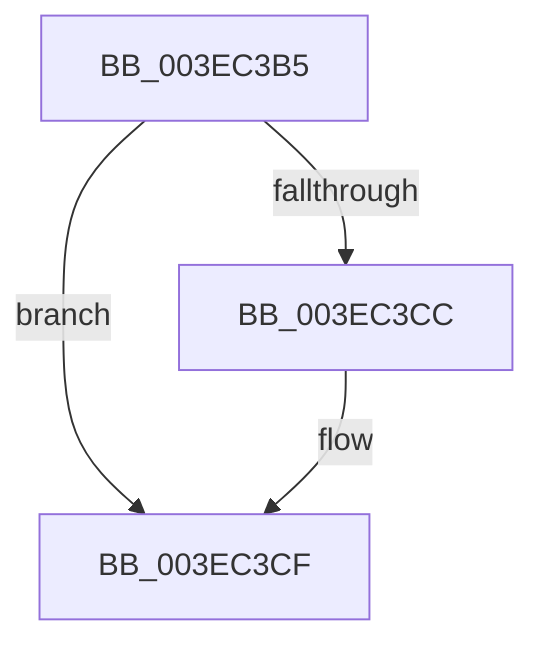

# sub_003EC3B5

- RVA: `0x003EC3B5`–`0x003EC3E4` (길이 `47` bytes)
- VA: `0x00000001403EC3B5`
- 실행 섹션: `.text`
- PDB 이름 있음: `아니요`; PDB Function 태그: `아니요`
- unwind 정보 RVA: `0x00095BB0`
- 디코드: `11`개 명령, `47/47` bytes 표시
- 미해석 바이트: `0` (있으면 어셈블리에 `.byte`로 보존)

> 이 문서는 커널 이미지의 기계어와 PDB 기호를 분석해 생성했습니다. 4번과 5번은 함수 원형과 자료형을 바이너리 사용 방식에서 추정한 C 해석이며 원본 소스 복구 결과는 아닙니다.

## 1. Dependencies

- 직접 호출 지점: **0**; 고유 호출 대상: **0**
- 직접 호출자로 확인된 함수: **0**
- RIP 상대 이미지 참조: **0**

### Outgoing calls
- 직접 디코드된 call 명령이 없습니다.

### Direct callers
- 이 함수 시작 RVA로 연결되는 직접 call은 확인되지 않았습니다. 간접 호출은 완전히 역산할 수 없습니다.

### Static image references
- 디코드된 RIP-relative 메모리 참조가 없습니다.

## 2. Other-region calls and transfers

- 다른 실행 섹션으로 향하는 call: **0**
- call이 아닌 외부 분기/꼬리 이동: **1**
  - `0x003EC3DE` → [sub_003EC798](Unknown_function_003EC798.md) (`tail-transfer`)

## 3. Assembly (complete function range)

```asm
003EC3B5  48 89 58 18                     mov qword ptr [rax + 0x18], rbx
003EC3B9  33 DB                           xor ebx, ebx
003EC3BB  48 89 68 E8                     mov qword ptr [rax - 0x18], rbp
003EC3BF  48 8B 84 24 E0 00 00 00         mov rax, qword ptr [rsp + 0xe0]
003EC3C7  48 85 C0                        test rax, rax
003EC3CA  74 03                           je 0x1403ec3cf
003EC3CC  48 89 18                        mov qword ptr [rax], rbx
003EC3CF  48 8B AC 24 A0 00 00 00         mov rbp, qword ptr [rsp + 0xa0]
003EC3D7  41 8B 46 28                     mov eax, dword ptr [r14 + 0x28]
003EC3DB  48 3B E8                        cmp rbp, rax
003EC3DE  0F 83 B4 03 00 00               jae 0x1403ec798
```

## 4. C-style interpretation (structured pseudocode)

```c
__int64 __fastcall sub_003EC3B5(__int64 a1, __int64 a2, __int64 a3, __int64 a4, __int64 a5, __int64 a6, __int64 a7, __int64 a8, __int64 a9, __int64 a10, __int64 a11, __int64 a12, __int64 a13, __int64 a14, __int64 a15, __int64 a16, __int64 a17, __int64 a18, __int64 a19, __int64 a20, __int64 a21, __int64 a22, __int64 a23, __int64 a24, __int64 a25, __int64 a26, __int64 a27, __int64 a28)
{
    __int64 v_rbx;

    *(unsigned __int64 *)(result + 24) = v_rbx;
    v_rbx = 0;
    *(unsigned __int64 *)(result - 24) = v_rbp;
    if (a28 != 0) {
        *(unsigned __int64 *)(a28) = 0;
    }
}
```

## 5. (Beta) C Style

```c
int64_t sub_003EC3B5(int64_t Arg1, int64_t Arg2, int64_t Arg3, int64_t Arg4, uint64_t Arg5, uint64_t Arg6, uint64_t Arg7, uint64_t Arg8, uint64_t Arg9, uint64_t Arg10, uint64_t Arg11, uint64_t Arg12, uint64_t Arg13, uint64_t Arg14, uint64_t Arg15, uint64_t Arg16, uint64_t Arg17, uint64_t Arg18, uint64_t Arg19, int64_t Arg20, uint64_t Arg21, uint64_t Arg22, uint64_t Arg23, uint64_t Arg24, uint64_t Arg25, uint64_t Arg26, uint64_t Arg27, int64_t Arg28)
{
    int64_t local_rbx;

    *(uint64_t *)(result + 0x18) = local_rbx;
    local_rbx = 0;
    *(uint64_t *)(result - 0x18) = local_rbp;
    if (Arg28 != 0) {
        *(uint64_t *)(Arg28) = 0;
    }
}
```

## 6. Execution-region graph

[열기: 2D/3D 그래프와 함수 탐색 컨트롤 패널](../../../control-panel.html?section=text&rva=0x003EC3B5&view=graph)

- 2D 그래프는 위에서 아래로 흐르고, 3D 그래프는 빈 공간을 드래그해 회전합니다. Shift+드래그는 이동, 휠은 확대·축소, 함수 노드 선택은 대상 보고서 이동입니다.

### Static fallback


