# sub_003EC3E4

- RVA: `0x003EC3E4`–`0x003EC6FC` (길이 `792` bytes)
- VA: `0x00000001403EC3E4`
- 실행 섹션: `.text`
- PDB 이름 있음: `아니요`; PDB Function 태그: `아니요`
- unwind 정보 RVA: `0x00095BC8`
- 디코드: `202`개 명령, `792/792` bytes 표시
- 미해석 바이트: `0` (있으면 어셈블리에 `.byte`로 보존)

> 이 문서는 커널 이미지의 기계어와 PDB 기호를 분석해 생성했습니다. 4번과 5번은 함수 원형과 자료형을 바이너리 사용 방식에서 추정한 C 해석이며 원본 소스 복구 결과는 아닙니다.

## 1. Dependencies

- 직접 호출 지점: **2**; 고유 호출 대상: **2**
- 직접 호출자로 확인된 함수: **0**
- RIP 상대 이미지 참조: **0**

### Outgoing calls
- `0x003EC69A` → [guard_dispatch_icall](../6B/guard_dispatch_icall_function_006BAAD0.md) (function, `0x006BAAD0`)
- `0x003EC6BE` → [ExFreePoolWithTag](../../poolcode/B8/ExFreePoolWithTag_function_00B82870.md) (function, `0x00B82870`)

### Direct callers
- 이 함수 시작 RVA로 연결되는 직접 call은 확인되지 않았습니다. 간접 호출은 완전히 역산할 수 없습니다.

### Static image references
- 디코드된 RIP-relative 메모리 참조가 없습니다.

## 2. Other-region calls and transfers

- 다른 실행 섹션으로 향하는 call: **1**
  - `0x003EC6BE` → [ExFreePoolWithTag](../../poolcode/B8/ExFreePoolWithTag_function_00B82870.md) (`.text` → `POOLCODE`)
- call이 아닌 외부 분기/꼬리 이동: **8**
  - `0x003EC4CA` → [sub_003EC713](Unknown_function_003EC713.md) (`tail-transfer`)
  - `0x003EC578` → [sub_003EC7B1](Unknown_function_003EC7B1.md) (`tail-transfer`)
  - `0x003EC5B4` → [sub_003EC7B1 + 0xA](Unknown_function_003EC7B1.md) (`tail-transfer`)
  - `0x003EC670` → [sub_003EC7B1 + 0xF](Unknown_function_003EC7B1.md) (`tail-transfer`)
  - `0x003EC67D` → [sub_003EC713 + 0x50](Unknown_function_003EC713.md) (`tail-transfer`)
  - `0x003EC6A1` → [sub_003EC713 + 0x27](Unknown_function_003EC713.md) (`tail-transfer`)
  - `0x003EC6B3` → [sub_003EC713 + 0x3F](Unknown_function_003EC713.md) (`tail-transfer`)
  - `0x003EC6C3` → [sub_003EC713 + 0x3F](Unknown_function_003EC713.md) (`tail-transfer`)

## 3. Assembly (complete function range)

```asm
003EC3E4  48 89 74 24 58                  mov qword ptr [rsp + 0x58], rsi
003EC3E9  48 8B D5                        mov rdx, rbp
003EC3EC  48 89 7C 24 50                  mov qword ptr [rsp + 0x50], rdi
003EC3F1  49 8B C6                        mov rax, r14
003EC3F4  4C 89 64 24 48                  mov qword ptr [rsp + 0x48], r12
003EC3F9  8B FB                           mov edi, ebx
003EC3FB  44 8B A4 24 A8 00 00 00         mov r12d, dword ptr [rsp + 0xa8]
003EC403  45 8B CC                        mov r9d, r12d
003EC406  4C 89 7C 24 40                  mov qword ptr [rsp + 0x40], r15
003EC40B  45 85 E4                        test r12d, r12d
003EC40E  0F 84 99 00 00 00               je 0x1403ec4ad
003EC414  48 8B F3                        mov rsi, rbx
003EC417  48 85 C0                        test rax, rax
003EC41A  0F 84 85 00 00 00               je 0x1403ec4a5
003EC420  8B 48 28                        mov ecx, dword ptr [rax + 0x28]
003EC423  45 8B C1                        mov r8d, r9d
003EC426  2B CA                           sub ecx, edx
003EC428  41 3B C9                        cmp ecx, r9d
003EC42B  44 0F 46 C1                     cmovbe r8d, ecx
003EC42F  03 50 2C                        add edx, dword ptr [rax + 0x2c]
003EC432  44 8B D2                        mov r10d, edx
003EC435  45 2B C8                        sub r9d, r8d
003EC438  48 C1 EA 0C                     shr rdx, 0xc
003EC43C  41 81 E2 FF 0F 00 00            and r10d, 0xfff
003EC443  48 83 C2 06                     add rdx, 6
003EC447  48 8D 14 D0                     lea rdx, [rax + rdx*8]
003EC44B  45 85 C0                        test r8d, r8d
003EC44E  74 46                           je 0x1403ec496
003EC450  4C 8B 1A                        mov r11, qword ptr [rdx]
003EC453  41 8B CA                        mov ecx, r10d
003EC456  49 C1 E3 0C                     shl r11, 0xc
003EC45A  4C 03 D9                        add r11, rcx
003EC45D  B9 00 10 00 00                  mov ecx, 0x1000
003EC462  41 2B CA                        sub ecx, r10d
003EC465  45 8B D0                        mov r10d, r8d
003EC468  41 3B C8                        cmp ecx, r8d
003EC46B  44 0F 46 D1                     cmovbe r10d, ecx
003EC46F  48 8D 4E 01                     lea rcx, [rsi + 1]
003EC473  4C 3B D9                        cmp r11, rcx
003EC476  0F 84 5A 02 00 00               je 0x1403ec6d6
003EC47C  FF C7                           inc edi
003EC47E  41 8B F2                        mov esi, r10d
003EC481  45 2B C2                        sub r8d, r10d
003EC484  48 FF CE                        dec rsi
003EC487  48 83 C2 08                     add rdx, 8
003EC48B  49 03 F3                        add rsi, r11
003EC48E  44 8B D3                        mov r10d, ebx
003EC491  45 85 C0                        test r8d, r8d
003EC494  75 BA                           jne 0x1403ec450
003EC496  48 8B 00                        mov rax, qword ptr [rax]
003EC499  48 8B D3                        mov rdx, rbx
003EC49C  45 85 C9                        test r9d, r9d
003EC49F  0F 85 72 FF FF FF               jne 0x1403ec417
003EC4A5  4C 8B 84 24 88 00 00 00         mov r8, qword ptr [rsp + 0x88]
003EC4AD  48 8B B4 24 D0 00 00 00         mov rsi, qword ptr [rsp + 0xd0]
003EC4B5  8B C7                           mov eax, edi
003EC4B7  48 8D 0C 40                     lea rcx, [rax + rax*2]
003EC4BB  4C 8D 3C CD 10 00 00 00         lea r15, [rcx*8 + 0x10]
003EC4C3  49 8D 57 68                     lea rdx, [r15 + 0x68]
003EC4C7  48 85 F6                        test rsi, rsi
003EC4CA  0F 84 43 02 00 00               je 0x1403ec713
003EC4D0  8B 84 24 D8 00 00 00            mov eax, dword ptr [rsp + 0xd8]
003EC4D7  48 3B C2                        cmp rax, rdx
003EC4DA  0F 82 03 02 00 00               jb 0x1403ec6e3
003EC4E0  4C 8B CE                        mov r9, rsi
003EC4E3  48 89 B4 24 98 00 00 00         mov qword ptr [rsp + 0x98], rsi
003EC4EB  41 89 39                        mov dword ptr [r9], edi
003EC4EE  48 85 F6                        test rsi, rsi
003EC4F1  4B 8D 3C 0F                     lea rdi, [r15 + r9]
003EC4F5  0F 94 C0                        sete al
003EC4F8  4C 89 47 20                     mov qword ptr [rdi + 0x20], r8
003EC4FC  88 47 61                        mov byte ptr [rdi + 0x61], al
003EC4FF  48 8B 84 24 80 00 00 00         mov rax, qword ptr [rsp + 0x80]
003EC507  48 89 47 18                     mov qword ptr [rdi + 0x18], rax
003EC50B  49 8B 40 20                     mov rax, qword ptr [r8 + 0x20]
003EC50F  48 89 47 28                     mov qword ptr [rdi + 0x28], rax
003EC513  48 8B 84 24 B8 00 00 00         mov rax, qword ptr [rsp + 0xb8]
003EC51B  48 89 47 40                     mov qword ptr [rdi + 0x40], rax
003EC51F  48 8B 84 24 C0 00 00 00         mov rax, qword ptr [rsp + 0xc0]
003EC527  48 89 47 48                     mov qword ptr [rdi + 0x48], rax
003EC52B  0F B6 84 24 B0 00 00 00         movzx eax, byte ptr [rsp + 0xb0]
003EC533  24 01                           and al, 1
003EC535  44 89 67 38                     mov dword ptr [rdi + 0x38], r12d
003EC539  4C 89 77 30                     mov qword ptr [rdi + 0x30], r14
003EC53D  89 6F 3C                        mov dword ptr [rdi + 0x3c], ebp
003EC540  4C 89 4F 50                     mov qword ptr [rdi + 0x50], r9
003EC544  88 47 60                        mov byte ptr [rdi + 0x60], al
003EC547  C7 47 10 02 00 00 00            mov dword ptr [rdi + 0x10], 2
003EC54E  88 5F 62                        mov byte ptr [rdi + 0x62], bl
003EC551  48 89 5F 58                     mov qword ptr [rdi + 0x58], rbx
003EC555  4D 85 ED                        test r13, r13
003EC558  74 24                           je 0x1403ec57e
003EC55A  49 8D 55 08                     lea rdx, [r13 + 8]
003EC55E  49 89 7D 58                     mov qword ptr [r13 + 0x58], rdi
003EC562  48 89 57 58                     mov qword ptr [rdi + 0x58], rdx
003EC566  0F 0D 0A                        prefetchw byte ptr [rdx]
003EC569  8B 02                           mov eax, dword ptr [rdx]
003EC56B  8B C8                           mov ecx, eax
003EC56D  83 C9 04                        or ecx, 4
003EC570  F0 0F B1 0A                     lock cmpxchg dword ptr [rdx], ecx
003EC574  75 F5                           jne 0x1403ec56b
003EC576  A8 02                           test al, 2
003EC578  0F 85 33 02 00 00               jne 0x1403ec7b1
003EC57E  48 8B 6F 50                     mov rbp, qword ptr [rdi + 0x50]
003EC582  4C 8B EB                        mov r13, rbx
003EC585  4C 8B 4F 58                     mov r9, qword ptr [rdi + 0x58]
003EC589  44 8B DB                        mov r11d, ebx
003EC58C  44 8B 47 38                     mov r8d, dword ptr [rdi + 0x38]
003EC590  48 8B 57 30                     mov rdx, qword ptr [rdi + 0x30]
003EC594  8B 4F 3C                        mov ecx, dword ptr [rdi + 0x3c]
003EC597  4C 8D 7D 10                     lea r15, [rbp + 0x10]
003EC59B  4C 8B 67 40                     mov r12, qword ptr [rdi + 0x40]
003EC59F  48 89 7D 08                     mov qword ptr [rbp + 8], rdi
003EC5A3  4C 89 4C 24 30                  mov qword ptr [rsp + 0x30], r9
003EC5A8  45 85 C0                        test r8d, r8d
003EC5AB  0F 84 B7 00 00 00               je 0x1403ec668
003EC5B1  48 85 D2                        test rdx, rdx
003EC5B4  0F 84 01 02 00 00               je 0x1403ec7bb
003EC5BA  8B 42 28                        mov eax, dword ptr [rdx + 0x28]
003EC5BD  45 8B C8                        mov r9d, r8d
003EC5C0  2B C1                           sub eax, ecx
003EC5C2  41 3B C0                        cmp eax, r8d
003EC5C5  44 0F 46 C8                     cmovbe r9d, eax
003EC5C9  03 4A 2C                        add ecx, dword ptr [rdx + 0x2c]
003EC5CC  44 8B F1                        mov r14d, ecx
003EC5CF  44 8B D1                        mov r10d, ecx
003EC5D2  49 C1 EE 0C                     shr r14, 0xc
003EC5D6  45 2B C1                        sub r8d, r9d
003EC5D9  49 83 C6 06                     add r14, 6
003EC5DD  41 81 E2 FF 0F 00 00            and r10d, 0xfff
003EC5E4  4E 8D 34 F2                     lea r14, [rdx + r14*8]
003EC5E8  45 85 C9                        test r9d, r9d
003EC5EB  74 68                           je 0x1403ec655
003EC5ED  49 8B 36                        mov rsi, qword ptr [r14]
003EC5F0  41 8B C2                        mov eax, r10d
003EC5F3  48 C1 E6 0C                     shl rsi, 0xc
003EC5F7  48 03 F0                        add rsi, rax
003EC5FA  B8 00 10 00 00                  mov eax, 0x1000
003EC5FF  41 2B C2                        sub eax, r10d
003EC602  45 8B D1                        mov r10d, r9d
003EC605  41 3B C1                        cmp eax, r9d
003EC608  44 0F 46 D0                     cmovbe r10d, eax
003EC60C  49 8D 45 01                     lea rax, [r13 + 1]
003EC610  48 3B F0                        cmp rsi, rax
003EC613  0F 84 AF 00 00 00               je 0x1403ec6c8
003EC619  41 8B C3                        mov eax, r11d
003EC61C  48 8D 0C 40                     lea rcx, [rax + rax*2]
003EC620  4C 8D 3C CD 10 00 00 00         lea r15, [rcx*8 + 0x10]
003EC628  4C 03 FD                        add r15, rbp
003EC62B  41 FF C3                        inc r11d
003EC62E  49 89 37                        mov qword ptr [r15], rsi
003EC631  41 89 5F 08                     mov dword ptr [r15 + 8], ebx
003EC635  49 89 5F 10                     mov qword ptr [r15 + 0x10], rbx
003EC639  45 01 57 08                     add dword ptr [r15 + 8], r10d
003EC63D  45 2B CA                        sub r9d, r10d
003EC640  45 8B EA                        mov r13d, r10d
003EC643  49 83 C6 08                     add r14, 8
003EC647  49 FF CD                        dec r13
003EC64A  44 8B D3                        mov r10d, ebx
003EC64D  4C 03 EE                        add r13, rsi
003EC650  45 85 C9                        test r9d, r9d
003EC653  75 98                           jne 0x1403ec5ed
003EC655  48 8B 12                        mov rdx, qword ptr [rdx]
003EC658  8B CB                           mov ecx, ebx
003EC65A  45 85 C0                        test r8d, r8d
003EC65D  0F 85 4E FF FF FF               jne 0x1403ec5b1
003EC663  4C 8B 4C 24 30                  mov r9, qword ptr [rsp + 0x30]
003EC668  48 85 D2                        test rdx, rdx
003EC66B  75 09                           jne 0x1403ec676
003EC66D  45 85 C0                        test r8d, r8d
003EC670  0F 85 4A 01 00 00               jne 0x1403ec7c0
003EC676  44 89 5D 00                     mov dword ptr [rbp], r11d
003EC67A  4D 85 C9                        test r9, r9
003EC67D  0F 85 E0 00 00 00               jne 0x1403ec763
003EC683  4D 85 E4                        test r12, r12
003EC686  74 17                           je 0x1403ec69f
003EC688  4C 8B 4F 48                     mov r9, qword ptr [rdi + 0x48]
003EC68C  4C 8B C5                        mov r8, rbp
003EC68F  48 8B 57 28                     mov rdx, qword ptr [rdi + 0x28]
003EC693  49 8B C4                        mov rax, r12
003EC696  48 8B 4F 20                     mov rcx, qword ptr [rdi + 0x20]
003EC69A  E8 31 E4 2C 00                  call 0x1406baad0
003EC69F  85 DB                           test ebx, ebx
003EC6A1  0F 89 93 00 00 00               jns 0x1403ec73a
003EC6A7  4C 8B 8C 24 98 00 00 00         mov r9, qword ptr [rsp + 0x98]
003EC6AF  80 7F 61 00                     cmp byte ptr [rdi + 0x61], 0
003EC6B3  0F 84 99 00 00 00               je 0x1403ec752
003EC6B9  33 D2                           xor edx, edx
003EC6BB  49 8B C9                        mov rcx, r9
003EC6BE  E8 AD 61 79 00                  call 0x140b82870
003EC6C3  E9 8A 00 00 00                  jmp 0x1403ec752
003EC6C8  45 85 DB                        test r11d, r11d
003EC6CB  0F 85 68 FF FF FF               jne 0x1403ec639
003EC6D1  E9 43 FF FF FF                  jmp 0x1403ec619
003EC6D6  85 FF                           test edi, edi
003EC6D8  0F 85 A0 FD FF FF               jne 0x1403ec47e
003EC6DE  E9 99 FD FF FF                  jmp 0x1403ec47c
003EC6E3  B8 23 00 00 C0                  mov eax, 0xc0000023
003EC6E8  4C 8B 64 24 48                  mov r12, qword ptr [rsp + 0x48]
003EC6ED  48 8B 7C 24 50                  mov rdi, qword ptr [rsp + 0x50]
003EC6F2  48 8B 74 24 58                  mov rsi, qword ptr [rsp + 0x58]
003EC6F7  4C 8B 7C 24 40                  mov r15, qword ptr [rsp + 0x40]
```

## 4. C-style interpretation (structured pseudocode)

```c
__int64 __fastcall sub_003EC3E4(__int64 a1, __int64 a2, __int64 a3, __int64 a4, __int64 a5, __int64 a6, __int64 a7, __int64 a8, __int64 a9, __int64 a10, __int64 a11, __int64 a12, __int64 a13, __int64 a14, __int64 a15, __int64 a16, __int64 a17, __int64 a18, __int64 a19, __int64 a20, unsigned int a21, unsigned __int8 a22, __int64 a23, __int64 a24, __int64 a25, __int64 a26, unsigned int a27)
{
    __int64 result;
    __int64 v_r10;
    __int64 v_r11;
    __int64 v_r13;
    __int64 v_r14;
    __int64 v_r15;
    __int64 v_rdi;
    __int64 v_rsi;
    unsigned __int64 v_stack_p30;
    unsigned __int64 v_stack_p40;
    unsigned __int64 v_stack_p48;
    unsigned __int64 v_stack_p50;
    unsigned __int64 v_stack_p58;
    unsigned __int64 v_stack_p98;

    v_stack_p58 = v_rsi;
    v_stack_p50 = v_rdi;
    v_stack_p48 = v_r12;
    v_stack_p40 = v_r15;
    if ((unsigned int)((unsigned int)(a21)) == 0) goto loc_003EC4AD;
loc_003EC417:
    if (v_r14 == 0) goto loc_003EC4A5;
    a1 = (unsigned int)(((unsigned int)(*(unsigned int *)(v_r14 + 40))) - ((unsigned int)(v_rbp)));
    a3 = (unsigned int)((unsigned int)((unsigned int)((unsigned int)((unsigned int)(a21)))));
    if (((unsigned int)(a1)) <= ((unsigned int)((unsigned int)((unsigned int)((unsigned int)(a21)))))) { a3 = (unsigned int)(a1); }
    a2 = (unsigned int)((v_rbp) + (*(unsigned int *)(v_r14 + 44)));
    a4 = (unsigned int)(((unsigned int)((unsigned int)((unsigned int)(a21)))) - ((unsigned int)(a3)));
    a2 = (a2) >> (12);
    v_r10 = (unsigned int)(((unsigned int)((unsigned int)(a2))) & (0xFFFULL));
    a2 = (a2) + (6);
    if ((unsigned int)(a3) == 0) goto loc_003EC496;
loc_003EC450:
    v_r11 = (*(unsigned __int64 *)(v_r14 + a2 * 8)) << (12);
    v_r11 = (v_r11) + ((unsigned int)((unsigned int)(v_r10)));
    a1 = (unsigned int)(((unsigned int)(0x1000ULL)) - ((unsigned int)(v_r10)));
    v_r10 = (unsigned int)((unsigned int)(a3));
    if (((unsigned int)(a1)) <= ((unsigned int)(a3))) { v_r10 = (unsigned int)(a1); }
    if (v_r11 == (v_rbx + 1)) goto loc_003EC6D6;
loc_003EC47C:
    v_rdi = (unsigned int)(((unsigned int)((unsigned int)(v_rbx))) + 1);
loc_003EC47E:
    a3 = (unsigned int)((a3) - ((unsigned int)(v_r10)));
    v_rsi = ((unsigned int)((unsigned int)(v_r10))) - 1;
    a2 = (v_r14 + a2 * 8) + (8);
    v_rsi = (v_rsi) + (v_r11);
    if ((unsigned int)(a3) != 0) goto loc_003EC450;
loc_003EC496:
    if ((unsigned int)(a4) != 0) goto loc_003EC417;
loc_003EC4A5:
loc_003EC4AD:
    if (((unsigned int)(a27)) < ((unsigned int)((unsigned int)(v_rdi)) + (unsigned int)((unsigned int)(v_rdi)) * 2 * 8 + 16 + 104)) goto loc_003EC6E3;
    v_stack_p98 = a26;
    *(unsigned int *)(a26) = (unsigned int)(v_rdi);
    result = (a26 == 0) ? 1 : 0;
    *(unsigned __int64 *)((unsigned int)((unsigned int)(v_rdi)) + (unsigned int)((unsigned int)(v_rdi)) * 2 * 8 + 16 + a26 * 1 + 32) = a17;
    *(unsigned __int8 *)((unsigned int)((unsigned int)(v_rdi)) + (unsigned int)((unsigned int)(v_rdi)) * 2 * 8 + 16 + a26 * 1 + 97) = (unsigned __int8)(result);
    *(unsigned __int64 *)((unsigned int)((unsigned int)(v_rdi)) + (unsigned int)((unsigned int)(v_rdi)) * 2 * 8 + 16 + a26 * 1 + 24) = a16;
    *(unsigned __int64 *)((unsigned int)((unsigned int)(v_rdi)) + (unsigned int)((unsigned int)(v_rdi)) * 2 * 8 + 16 + a26 * 1 + 40) = *(unsigned __int64 *)(a17 + 32);
    *(unsigned __int64 *)((unsigned int)((unsigned int)(v_rdi)) + (unsigned int)((unsigned int)(v_rdi)) * 2 * 8 + 16 + a26 * 1 + 64) = a23;
    *(unsigned __int64 *)((unsigned int)((unsigned int)(v_rdi)) + (unsigned int)((unsigned int)(v_rdi)) * 2 * 8 + 16 + a26 * 1 + 72) = a24;
    result = (unsigned __int8)((a22) & (1));
    *(unsigned int *)((unsigned int)((unsigned int)(v_rdi)) + (unsigned int)((unsigned int)(v_rdi)) * 2 * 8 + 16 + a26 * 1 + 56) = (unsigned int)((unsigned int)(a21));
    *(unsigned __int64 *)((unsigned int)((unsigned int)(v_rdi)) + (unsigned int)((unsigned int)(v_rdi)) * 2 * 8 + 16 + a26 * 1 + 48) = v_r14;
    *(unsigned int *)((unsigned int)((unsigned int)(v_rdi)) + (unsigned int)((unsigned int)(v_rdi)) * 2 * 8 + 16 + a26 * 1 + 60) = (unsigned int)(v_rbp);
    *(unsigned __int64 *)((unsigned int)((unsigned int)(v_rdi)) + (unsigned int)((unsigned int)(v_rdi)) * 2 * 8 + 16 + a26 * 1 + 80) = a26;
    *(unsigned __int8 *)((unsigned int)((unsigned int)(v_rdi)) + (unsigned int)((unsigned int)(v_rdi)) * 2 * 8 + 16 + a26 * 1 + 96) = (unsigned __int8)(result);
    *(unsigned int *)((unsigned int)((unsigned int)(v_rdi)) + (unsigned int)((unsigned int)(v_rdi)) * 2 * 8 + 16 + a26 * 1 + 16) = 2;
    *(unsigned __int8 *)((unsigned int)((unsigned int)(v_rdi)) + (unsigned int)((unsigned int)(v_rdi)) * 2 * 8 + 16 + a26 * 1 + 98) = (unsigned __int8)(v_rbx);
    *(unsigned __int64 *)((unsigned int)((unsigned int)(v_rdi)) + (unsigned int)((unsigned int)(v_rdi)) * 2 * 8 + 16 + a26 * 1 + 88) = v_rbx;
    if (v_r13 == 0) goto loc_003EC57E;
    *(unsigned __int64 *)(v_r13 + 88) = (unsigned int)((unsigned int)(v_rdi)) + (unsigned int)((unsigned int)(v_rdi)) * 2 * 8 + 16 + a26 * 1;
    *(unsigned __int64 *)((unsigned int)((unsigned int)(v_rdi)) + (unsigned int)((unsigned int)(v_rdi)) * 2 * 8 + 16 + a26 * 1 + 88) = v_r13 + 8;
loc_003EC56B:
    a1 = (unsigned int)(((unsigned int)((unsigned int)((unsigned int)(*(unsigned int *)(v_r13 + 8))))) | (4));
    if (condition_is_not_equal) goto loc_003EC56B;
loc_003EC57E:
    *(unsigned __int64 *)(*(unsigned __int64 *)((unsigned int)((unsigned int)(v_rdi)) + (unsigned int)((unsigned int)(v_rdi)) * 2 * 8 + 16 + a26 * 1 + 80) + 8) = (unsigned int)((unsigned int)(v_rdi)) + (unsigned int)((unsigned int)(v_rdi)) * 2 * 8 + 16 + a26 * 1;
    v_stack_p30 = *(unsigned __int64 *)((unsigned int)((unsigned int)(v_rdi)) + (unsigned int)((unsigned int)(v_rdi)) * 2 * 8 + 16 + a26 * 1 + 88);
    if ((unsigned int)((unsigned int)(*(unsigned int *)((unsigned int)((unsigned int)(v_rdi)) + (unsigned int)((unsigned int)(v_rdi)) * 2 * 8 + 16 + a26 * 1 + 56))) == 0) goto loc_003EC668;
loc_003EC5B1:
    result = (unsigned int)(((unsigned int)(*(unsigned int *)(*(unsigned __int64 *)((unsigned int)((unsigned int)(v_rdi)) + (unsigned int)((unsigned int)(v_rdi)) * 2 * 8 + 16 + a26 * 1 + 48) + 40))) - ((unsigned int)((unsigned int)(*(unsigned int *)((unsigned int)((unsigned int)(v_rdi)) + (unsigned int)((unsigned int)(v_rdi)) * 2 * 8 + 16 + a26 * 1 + 60)))));
    a4 = (unsigned int)((unsigned int)((unsigned int)(*(unsigned int *)((unsigned int)((unsigned int)(v_rdi)) + (unsigned int)((unsigned int)(v_rdi)) * 2 * 8 + 16 + a26 * 1 + 56))));
    if (((unsigned int)(result)) <= ((unsigned int)((unsigned int)(*(unsigned int *)((unsigned int)((unsigned int)(v_rdi)) + (unsigned int)((unsigned int)(v_rdi)) * 2 * 8 + 16 + a26 * 1 + 56))))) { a4 = (unsigned int)(result); }
    a1 = (unsigned int)(((unsigned int)(*(unsigned int *)((unsigned int)((unsigned int)(v_rdi)) + (unsigned int)((unsigned int)(v_rdi)) * 2 * 8 + 16 + a26 * 1 + 60))) + (*(unsigned int *)(*(unsigned __int64 *)((unsigned int)((unsigned int)(v_rdi)) + (unsigned int)((unsigned int)(v_rdi)) * 2 * 8 + 16 + a26 * 1 + 48) + 44)));
    v_r14 = ((unsigned int)((unsigned int)(a1))) >> (12);
    a3 = (unsigned int)(((unsigned int)(*(unsigned int *)((unsigned int)((unsigned int)(v_rdi)) + (unsigned int)((unsigned int)(v_rdi)) * 2 * 8 + 16 + a26 * 1 + 56))) - ((unsigned int)(a4)));
    v_r14 = (v_r14) + (6);
    v_r10 = (unsigned int)(((unsigned int)((unsigned int)(a1))) & (0xFFFULL));
    if ((unsigned int)(a4) == 0) goto loc_003EC655;
loc_003EC5ED:
    v_rsi = (*(unsigned __int64 *)(*(unsigned __int64 *)((unsigned int)((unsigned int)(v_rdi)) + (unsigned int)((unsigned int)(v_rdi)) * 2 * 8 + 16 + a26 * 1 + 48) + v_r14 * 8)) << (12);
    v_rsi = (v_rsi) + ((unsigned int)((unsigned int)(v_r10)));
    result = (unsigned int)(((unsigned int)(0x1000ULL)) - ((unsigned int)(v_r10)));
    v_r10 = (unsigned int)((unsigned int)(a4));
    if (((unsigned int)(result)) <= ((unsigned int)(a4))) { v_r10 = (unsigned int)(result); }
    if (v_rsi == (v_rbx + 1)) goto loc_003EC6C8;
loc_003EC619:
    v_r15 = ((unsigned int)((unsigned int)((unsigned int)((unsigned int)(v_rbx)))) + (unsigned int)((unsigned int)((unsigned int)((unsigned int)(v_rbx)))) * 2 * 8 + 16) + (*(unsigned __int64 *)((unsigned int)((unsigned int)(v_rdi)) + (unsigned int)((unsigned int)(v_rdi)) * 2 * 8 + 16 + a26 * 1 + 80));
    v_r11 = (unsigned int)(((unsigned int)((unsigned int)(v_rbx))) + 1);
    *(unsigned __int64 *)(v_r15) = v_rsi;
    *(unsigned int *)(v_r15 + 8) = (unsigned int)(v_rbx);
    *(unsigned __int64 *)(v_r15 + 16) = v_rbx;
loc_003EC639:
    a4 = (unsigned int)((a4) - ((unsigned int)(v_r10)));
    v_r14 = (*(unsigned __int64 *)((unsigned int)((unsigned int)(v_rdi)) + (unsigned int)((unsigned int)(v_rdi)) * 2 * 8 + 16 + a26 * 1 + 48) + v_r14 * 8) + (8);
    v_r13 = ((unsigned int)((unsigned int)(v_r10))) - 1;
    v_r13 = (v_r13) + (v_rsi);
    if ((unsigned int)(a4) != 0) goto loc_003EC5ED;
loc_003EC655:
    if ((unsigned int)(a3) != 0) goto loc_003EC5B1;
loc_003EC668:
    if (*(unsigned __int64 *)(*(unsigned __int64 *)((unsigned int)((unsigned int)(v_rdi)) + (unsigned int)((unsigned int)(v_rdi)) * 2 * 8 + 16 + a26 * 1 + 48)) != 0) goto loc_003EC676;
loc_003EC676:
    *(unsigned int *)(*(unsigned __int64 *)((unsigned int)((unsigned int)(v_rdi)) + (unsigned int)((unsigned int)(v_rdi)) * 2 * 8 + 16 + a26 * 1 + 80)) = (unsigned int)(v_r11);
    result = (unsigned int)((unsigned int)((unsigned int)((unsigned int)(v_rbx))));
    if (*(unsigned __int64 *)((unsigned int)((unsigned int)(v_rdi)) + (unsigned int)((unsigned int)(v_rdi)) * 2 * 8 + 16 + a26 * 1 + 64) != 0) {
        a4 = *(unsigned __int64 *)((unsigned int)((unsigned int)(v_rdi)) + (unsigned int)((unsigned int)(v_rdi)) * 2 * 8 + 16 + a26 * 1 + 72);
        a3 = *(unsigned __int64 *)((unsigned int)((unsigned int)(v_rdi)) + (unsigned int)((unsigned int)(v_rdi)) * 2 * 8 + 16 + a26 * 1 + 80);
        a2 = *(unsigned __int64 *)((unsigned int)((unsigned int)(v_rdi)) + (unsigned int)((unsigned int)(v_rdi)) * 2 * 8 + 16 + a26 * 1 + 40);
        result = *(unsigned __int64 *)((unsigned int)((unsigned int)(v_rdi)) + (unsigned int)((unsigned int)(v_rdi)) * 2 * 8 + 16 + a26 * 1 + 64);
        a1 = *(unsigned __int64 *)((unsigned int)((unsigned int)(v_rdi)) + (unsigned int)((unsigned int)(v_rdi)) * 2 * 8 + 16 + a26 * 1 + 32);
        result = guard_dispatch_icall(a1, a2, a3, a4);
    }
    a2 = 0;
    result = ExFreePoolWithTag(a19, a2, a3, a19);
loc_003EC6C8:
    if ((unsigned int)(v_r11) != 0) goto loc_003EC639;
    goto loc_003EC619;
loc_003EC6D6:
    if ((unsigned int)((unsigned int)((unsigned int)(v_rdi)) + (unsigned int)((unsigned int)(v_rdi)) * 2 * 8 + 16 + a26 * 1) != 0) goto loc_003EC47E;
    goto loc_003EC47C;
loc_003EC6E3:
    return (unsigned int)(0xC0000023ULL);
}
```

## 5. (Beta) C Style

```c
int64_t sub_003EC3E4(int64_t Arg1, int64_t Arg2, int64_t Arg3, int64_t Arg4, uint64_t Arg5, int64_t Arg6, uint64_t Arg7, int64_t Arg8, int64_t Arg9, int64_t Arg10, int64_t Arg11, uint64_t Arg12, uint64_t Arg13, uint64_t Arg14, uint64_t Arg15, int64_t Arg16, int64_t Arg17, uint64_t Arg18, int64_t Arg19, uint64_t Arg20, uint32_t Arg21, uint8_t Arg22, int64_t Arg23, int64_t Arg24, uint64_t Arg25, int64_t Arg26, uint32_t Arg27)
{
    int64_t result;
    int64_t local_r10;
    int64_t local_r11;
    int64_t local_r13;
    int64_t local_r14;
    int64_t local_r15;
    int64_t local_rdi;
    int64_t local_rsi;
    uint64_t v_stack_p30;
    uint64_t v_stack_p40;
    uint64_t v_stack_p48;
    uint64_t v_stack_p50;
    uint64_t v_stack_p58;
    uint64_t v_stack_p98;

    v_stack_p58 = local_rsi;
    v_stack_p50 = local_rdi;
    v_stack_p48 = local_r12;
    v_stack_p40 = local_r15;
    if ((uint32_t)((uint32_t)(Arg21)) == 0) goto loc_003EC4AD;
loc_003EC417:
    if (local_r14 == 0) goto loc_003EC4A5;
    Arg1 = (uint32_t)(((uint32_t)(*(uint32_t *)(local_r14 + 0x28))) - ((uint32_t)(local_rbp)));
    Arg3 = (uint32_t)((uint32_t)((uint32_t)((uint32_t)((uint32_t)(Arg21)))));
    if (((uint32_t)(Arg1)) <= ((uint32_t)((uint32_t)((uint32_t)((uint32_t)(Arg21)))))) { Arg3 = (uint32_t)(Arg1); }
    Arg2 = (uint32_t)((local_rbp) + (*(uint32_t *)(local_r14 + 0x2C)));
    Arg4 = (uint32_t)(((uint32_t)((uint32_t)((uint32_t)(Arg21)))) - ((uint32_t)(Arg3)));
    Arg2 = (Arg2) >> (12);
    local_r10 = (uint32_t)(((uint32_t)((uint32_t)(Arg2))) & (0xFFFULL));
    Arg2 = (Arg2) + (6);
    if ((uint32_t)(Arg3) == 0) goto loc_003EC496;
loc_003EC450:
    local_r11 = (*(uint64_t *)(local_r14 + Arg2 * 8)) << (12);
    local_r11 = (local_r11) + ((uint32_t)((uint32_t)(local_r10)));
    Arg1 = (uint32_t)(((uint32_t)(0x1000ULL)) - ((uint32_t)(local_r10)));
    local_r10 = (uint32_t)((uint32_t)(Arg3));
    if (((uint32_t)(Arg1)) <= ((uint32_t)(Arg3))) { local_r10 = (uint32_t)(Arg1); }
    if (local_r11 == (local_rbx + 1)) goto loc_003EC6D6;
loc_003EC47C:
    local_rdi = (uint32_t)(((uint32_t)((uint32_t)(local_rbx))) + 1);
loc_003EC47E:
    Arg3 = (uint32_t)((Arg3) - ((uint32_t)(local_r10)));
    local_rsi = ((uint32_t)((uint32_t)(local_r10))) - 1;
    Arg2 = (local_r14 + Arg2 * 8) + (8);
    local_rsi = (local_rsi) + (local_r11);
    if ((uint32_t)(Arg3) != 0) goto loc_003EC450;
loc_003EC496:
    if ((uint32_t)(Arg4) != 0) goto loc_003EC417;
loc_003EC4A5:
loc_003EC4AD:
    if (((uint32_t)(Arg27)) < ((uint32_t)((uint32_t)(local_rdi)) + (uint32_t)((uint32_t)(local_rdi)) * 2 * 8 + 16 + 104)) goto loc_003EC6E3;
    v_stack_p98 = Arg26;
    *(uint32_t *)(Arg26) = (uint32_t)(local_rdi);
    result = (Arg26 == 0) ? 1 : 0;
    *(uint64_t *)((uint32_t)((uint32_t)(local_rdi)) + (uint32_t)((uint32_t)(local_rdi)) * 2 * 8 + 0x10 + Arg26 * 1 + 0x20) = Arg17;
    *(uint8_t *)((uint32_t)((uint32_t)(local_rdi)) + (uint32_t)((uint32_t)(local_rdi)) * 2 * 8 + 0x10 + Arg26 * 1 + 0x61) = (uint8_t)(result);
    *(uint64_t *)((uint32_t)((uint32_t)(local_rdi)) + (uint32_t)((uint32_t)(local_rdi)) * 2 * 8 + 0x10 + Arg26 * 1 + 0x18) = Arg16;
    *(uint64_t *)((uint32_t)((uint32_t)(local_rdi)) + (uint32_t)((uint32_t)(local_rdi)) * 2 * 8 + 0x10 + Arg26 * 1 + 0x28) = *(uint64_t *)(Arg17 + 0x20);
    *(uint64_t *)((uint32_t)((uint32_t)(local_rdi)) + (uint32_t)((uint32_t)(local_rdi)) * 2 * 8 + 0x10 + Arg26 * 1 + 0x40) = Arg23;
    *(uint64_t *)((uint32_t)((uint32_t)(local_rdi)) + (uint32_t)((uint32_t)(local_rdi)) * 2 * 8 + 0x10 + Arg26 * 1 + 0x48) = Arg24;
    result = (uint8_t)((Arg22) & (1));
    *(uint32_t *)((uint32_t)((uint32_t)(local_rdi)) + (uint32_t)((uint32_t)(local_rdi)) * 2 * 8 + 0x10 + Arg26 * 1 + 0x38) = (uint32_t)((uint32_t)(Arg21));
    *(uint64_t *)((uint32_t)((uint32_t)(local_rdi)) + (uint32_t)((uint32_t)(local_rdi)) * 2 * 8 + 0x10 + Arg26 * 1 + 0x30) = local_r14;
    *(uint32_t *)((uint32_t)((uint32_t)(local_rdi)) + (uint32_t)((uint32_t)(local_rdi)) * 2 * 8 + 0x10 + Arg26 * 1 + 0x3C) = (uint32_t)(local_rbp);
    *(uint64_t *)((uint32_t)((uint32_t)(local_rdi)) + (uint32_t)((uint32_t)(local_rdi)) * 2 * 8 + 0x10 + Arg26 * 1 + 0x50) = Arg26;
    *(uint8_t *)((uint32_t)((uint32_t)(local_rdi)) + (uint32_t)((uint32_t)(local_rdi)) * 2 * 8 + 0x10 + Arg26 * 1 + 0x60) = (uint8_t)(result);
    *(uint32_t *)((uint32_t)((uint32_t)(local_rdi)) + (uint32_t)((uint32_t)(local_rdi)) * 2 * 8 + 0x10 + Arg26 * 1 + 0x10) = 2;
    *(uint8_t *)((uint32_t)((uint32_t)(local_rdi)) + (uint32_t)((uint32_t)(local_rdi)) * 2 * 8 + 0x10 + Arg26 * 1 + 0x62) = (uint8_t)(local_rbx);
    *(uint64_t *)((uint32_t)((uint32_t)(local_rdi)) + (uint32_t)((uint32_t)(local_rdi)) * 2 * 8 + 0x10 + Arg26 * 1 + 0x58) = local_rbx;
    if (local_r13 == 0) goto loc_003EC57E;
    *(uint64_t *)(local_r13 + 0x58) = (uint32_t)((uint32_t)(local_rdi)) + (uint32_t)((uint32_t)(local_rdi)) * 2 * 8 + 16 + Arg26 * 1;
    *(uint64_t *)((uint32_t)((uint32_t)(local_rdi)) + (uint32_t)((uint32_t)(local_rdi)) * 2 * 8 + 0x10 + Arg26 * 1 + 0x58) = local_r13 + 8;
loc_003EC56B:
    Arg1 = (uint32_t)(((uint32_t)((uint32_t)((uint32_t)(*(uint32_t *)(local_r13 + 0x8))))) | (4));
    if (condition_is_not_equal) goto loc_003EC56B;
loc_003EC57E:
    *(uint64_t *)(*(uint64_t *)((uint32_t)((uint32_t)(local_rdi)) + (uint32_t)((uint32_t)(local_rdi)) * 2 * 8 + 0x10 + Arg26 * 1 + 0x50) + 0x8) = (uint32_t)((uint32_t)(local_rdi)) + (uint32_t)((uint32_t)(local_rdi)) * 2 * 8 + 16 + Arg26 * 1;
    v_stack_p30 = *(uint64_t *)((uint32_t)((uint32_t)(local_rdi)) + (uint32_t)((uint32_t)(local_rdi)) * 2 * 8 + 0x10 + Arg26 * 1 + 0x58);
    if ((uint32_t)((uint32_t)(*(uint32_t *)((uint32_t)((uint32_t)(local_rdi)) + (uint32_t)((uint32_t)(local_rdi)) * 2 * 8 + 0x10 + Arg26 * 1 + 0x38))) == 0) goto loc_003EC668;
loc_003EC5B1:
    result = (uint32_t)(((uint32_t)(*(uint32_t *)(*(uint64_t *)((uint32_t)((uint32_t)(local_rdi)) + (uint32_t)((uint32_t)(local_rdi)) * 2 * 8 + 0x10 + Arg26 * 1 + 0x30) + 0x28))) - ((uint32_t)((uint32_t)(*(uint32_t *)((uint32_t)((uint32_t)(local_rdi)) + (uint32_t)((uint32_t)(local_rdi)) * 2 * 8 + 0x10 + Arg26 * 1 + 0x3C)))));
    Arg4 = (uint32_t)((uint32_t)((uint32_t)(*(uint32_t *)((uint32_t)((uint32_t)(local_rdi)) + (uint32_t)((uint32_t)(local_rdi)) * 2 * 8 + 0x10 + Arg26 * 1 + 0x38))));
    if (((uint32_t)(result)) <= ((uint32_t)((uint32_t)(*(uint32_t *)((uint32_t)((uint32_t)(local_rdi)) + (uint32_t)((uint32_t)(local_rdi)) * 2 * 8 + 0x10 + Arg26 * 1 + 0x38))))) { Arg4 = (uint32_t)(result); }
    Arg1 = (uint32_t)(((uint32_t)(*(uint32_t *)((uint32_t)((uint32_t)(local_rdi)) + (uint32_t)((uint32_t)(local_rdi)) * 2 * 8 + 0x10 + Arg26 * 1 + 0x3C))) + (*(uint32_t *)(*(uint64_t *)((uint32_t)((uint32_t)(local_rdi)) + (uint32_t)((uint32_t)(local_rdi)) * 2 * 8 + 0x10 + Arg26 * 1 + 0x30) + 0x2C)));
    local_r14 = ((uint32_t)((uint32_t)(Arg1))) >> (12);
    Arg3 = (uint32_t)(((uint32_t)(*(uint32_t *)((uint32_t)((uint32_t)(local_rdi)) + (uint32_t)((uint32_t)(local_rdi)) * 2 * 8 + 0x10 + Arg26 * 1 + 0x38))) - ((uint32_t)(Arg4)));
    local_r14 = (local_r14) + (6);
    local_r10 = (uint32_t)(((uint32_t)((uint32_t)(Arg1))) & (0xFFFULL));
    if ((uint32_t)(Arg4) == 0) goto loc_003EC655;
loc_003EC5ED:
    local_rsi = (*(uint64_t *)(*(uint64_t *)((uint32_t)((uint32_t)(local_rdi)) + (uint32_t)((uint32_t)(local_rdi)) * 2 * 8 + 0x10 + Arg26 * 1 + 0x30) + local_r14 * 8)) << (12);
    local_rsi = (local_rsi) + ((uint32_t)((uint32_t)(local_r10)));
    result = (uint32_t)(((uint32_t)(0x1000ULL)) - ((uint32_t)(local_r10)));
    local_r10 = (uint32_t)((uint32_t)(Arg4));
    if (((uint32_t)(result)) <= ((uint32_t)(Arg4))) { local_r10 = (uint32_t)(result); }
    if (local_rsi == (local_rbx + 1)) goto loc_003EC6C8;
loc_003EC619:
    local_r15 = ((uint32_t)((uint32_t)((uint32_t)((uint32_t)(local_rbx)))) + (uint32_t)((uint32_t)((uint32_t)((uint32_t)(local_rbx)))) * 2 * 8 + 16) + (*(uint64_t *)((uint32_t)((uint32_t)(local_rdi)) + (uint32_t)((uint32_t)(local_rdi)) * 2 * 8 + 0x10 + Arg26 * 1 + 0x50));
    local_r11 = (uint32_t)(((uint32_t)((uint32_t)(local_rbx))) + 1);
    *(uint64_t *)(local_r15) = local_rsi;
    *(uint32_t *)(local_r15 + 0x8) = (uint32_t)(local_rbx);
    *(uint64_t *)(local_r15 + 0x10) = local_rbx;
loc_003EC639:
    Arg4 = (uint32_t)((Arg4) - ((uint32_t)(local_r10)));
    local_r14 = (*(uint64_t *)((uint32_t)((uint32_t)(local_rdi)) + (uint32_t)((uint32_t)(local_rdi)) * 2 * 8 + 0x10 + Arg26 * 1 + 0x30) + local_r14 * 8) + (8);
    local_r13 = ((uint32_t)((uint32_t)(local_r10))) - 1;
    local_r13 = (local_r13) + (local_rsi);
    if ((uint32_t)(Arg4) != 0) goto loc_003EC5ED;
loc_003EC655:
    if ((uint32_t)(Arg3) != 0) goto loc_003EC5B1;
loc_003EC668:
    if (*(uint64_t *)(*(uint64_t *)((uint32_t)((uint32_t)(local_rdi)) + (uint32_t)((uint32_t)(local_rdi)) * 2 * 8 + 0x10 + Arg26 * 1 + 0x30)) != 0) goto loc_003EC676;
loc_003EC676:
    *(uint32_t *)(*(uint64_t *)((uint32_t)((uint32_t)(local_rdi)) + (uint32_t)((uint32_t)(local_rdi)) * 2 * 8 + 0x10 + Arg26 * 1 + 0x50)) = (uint32_t)(local_r11);
    result = (uint32_t)((uint32_t)((uint32_t)((uint32_t)(local_rbx))));
    if (*(uint64_t *)((uint32_t)((uint32_t)(local_rdi)) + (uint32_t)((uint32_t)(local_rdi)) * 2 * 8 + 0x10 + Arg26 * 1 + 0x40) != 0) {
        Arg4 = *(uint64_t *)((uint32_t)((uint32_t)(local_rdi)) + (uint32_t)((uint32_t)(local_rdi)) * 2 * 8 + 0x10 + Arg26 * 1 + 0x48);
        Arg3 = *(uint64_t *)((uint32_t)((uint32_t)(local_rdi)) + (uint32_t)((uint32_t)(local_rdi)) * 2 * 8 + 0x10 + Arg26 * 1 + 0x50);
        Arg2 = *(uint64_t *)((uint32_t)((uint32_t)(local_rdi)) + (uint32_t)((uint32_t)(local_rdi)) * 2 * 8 + 0x10 + Arg26 * 1 + 0x28);
        result = *(uint64_t *)((uint32_t)((uint32_t)(local_rdi)) + (uint32_t)((uint32_t)(local_rdi)) * 2 * 8 + 0x10 + Arg26 * 1 + 0x40);
        Arg1 = *(uint64_t *)((uint32_t)((uint32_t)(local_rdi)) + (uint32_t)((uint32_t)(local_rdi)) * 2 * 8 + 0x10 + Arg26 * 1 + 0x20);
        result = guard_dispatch_icall(Arg1, Arg2, Arg3, Arg4);
    }
    Arg2 = 0;
    result = ExFreePoolWithTag(Arg19, Arg2, Arg3, Arg19);
loc_003EC6C8:
    if ((uint32_t)(local_r11) != 0) goto loc_003EC639;
    goto loc_003EC619;
loc_003EC6D6:
    if ((uint32_t)((uint32_t)((uint32_t)(local_rdi)) + (uint32_t)((uint32_t)(local_rdi)) * 2 * 8 + 16 + Arg26 * 1) != 0) goto loc_003EC47E;
    goto loc_003EC47C;
loc_003EC6E3:
    return (uint32_t)(0xC0000023ULL);
}
```

## 6. Execution-region graph

[열기: 2D/3D 그래프와 함수 탐색 컨트롤 패널](../../../control-panel.html?section=text&rva=0x003EC3E4&view=graph)

- 2D 그래프는 위에서 아래로 흐르고, 3D 그래프는 빈 공간을 드래그해 회전합니다. Shift+드래그는 이동, 휠은 확대·축소, 함수 노드 선택은 대상 보고서 이동입니다.

### Static fallback

```mermaid
flowchart TD
  bb_003EC3E4[BB_003EC3E4]
  bb_003EC414[BB_003EC414]
  bb_003EC417[BB_003EC417]
  bb_003EC420[BB_003EC420]
  bb_003EC450[BB_003EC450]
  bb_003EC47C[BB_003EC47C]
  bb_003EC47E[BB_003EC47E]
  bb_003EC496[BB_003EC496]
  bb_003EC4A5[BB_003EC4A5]
  bb_003EC4AD[BB_003EC4AD]
  bb_003EC4D0[BB_003EC4D0]
  bb_003EC4E0[BB_003EC4E0]
  bb_003EC55A[BB_003EC55A]
  bb_003EC56B[BB_003EC56B]
  bb_003EC576[BB_003EC576]
  bb_003EC57E[BB_003EC57E]
  bb_003EC5B1[BB_003EC5B1]
  bb_003EC5BA[BB_003EC5BA]
  bb_003EC5ED[BB_003EC5ED]
  bb_003EC619[BB_003EC619]
  bb_003EC639[BB_003EC639]
  bb_003EC655[BB_003EC655]
  bb_003EC663[BB_003EC663]
  bb_003EC668[BB_003EC668]
  bb_003EC66D[BB_003EC66D]
  bb_003EC676[BB_003EC676]
  bb_003EC683[BB_003EC683]
  bb_003EC688[BB_003EC688]
  bb_003EC69F[BB_003EC69F]
  bb_003EC6A7[BB_003EC6A7]
  bb_003EC6B9[BB_003EC6B9]
  bb_003EC6C8[BB_003EC6C8]
  bb_003EC6D1[BB_003EC6D1]
  bb_003EC6D6[BB_003EC6D6]
  bb_003EC6DE[BB_003EC6DE]
  bb_003EC6E3[BB_003EC6E3]
  bb_003EC3E4 -->|branch| bb_003EC4AD
  bb_003EC3E4 -->|fallthrough| bb_003EC414
  bb_003EC414 -->|flow| bb_003EC417
  bb_003EC417 -->|branch| bb_003EC4A5
  bb_003EC417 -->|fallthrough| bb_003EC420
  bb_003EC420 -->|branch| bb_003EC496
  bb_003EC420 -->|fallthrough| bb_003EC450
  bb_003EC450 -->|branch| bb_003EC6D6
  bb_003EC450 -->|fallthrough| bb_003EC47C
  bb_003EC47C -->|flow| bb_003EC47E
  bb_003EC47E -->|branch| bb_003EC450
  bb_003EC47E -->|fallthrough| bb_003EC496
  bb_003EC496 -->|branch| bb_003EC417
  bb_003EC496 -->|fallthrough| bb_003EC4A5
  bb_003EC4A5 -->|flow| bb_003EC4AD
  bb_003EC4AD -->|fallthrough| bb_003EC4D0
  bb_003EC4D0 -->|branch| bb_003EC6E3
  bb_003EC4D0 -->|fallthrough| bb_003EC4E0
  bb_003EC4E0 -->|branch| bb_003EC57E
  bb_003EC4E0 -->|fallthrough| bb_003EC55A
  bb_003EC55A -->|flow| bb_003EC56B
  bb_003EC56B -->|branch| bb_003EC56B
  bb_003EC56B -->|fallthrough| bb_003EC576
  bb_003EC576 -->|fallthrough| bb_003EC57E
  bb_003EC57E -->|branch| bb_003EC668
  bb_003EC57E -->|fallthrough| bb_003EC5B1
  bb_003EC5B1 -->|fallthrough| bb_003EC5BA
  bb_003EC5BA -->|branch| bb_003EC655
  bb_003EC5BA -->|fallthrough| bb_003EC5ED
  bb_003EC5ED -->|branch| bb_003EC6C8
  bb_003EC5ED -->|fallthrough| bb_003EC619
  bb_003EC619 -->|flow| bb_003EC639
  bb_003EC639 -->|branch| bb_003EC5ED
  bb_003EC639 -->|fallthrough| bb_003EC655
  bb_003EC655 -->|branch| bb_003EC5B1
  bb_003EC655 -->|fallthrough| bb_003EC663
  bb_003EC663 -->|flow| bb_003EC668
  bb_003EC668 -->|branch| bb_003EC676
  bb_003EC668 -->|fallthrough| bb_003EC66D
  bb_003EC66D -->|fallthrough| bb_003EC676
  bb_003EC676 -->|fallthrough| bb_003EC683
  bb_003EC683 -->|branch| bb_003EC69F
  bb_003EC683 -->|fallthrough| bb_003EC688
  bb_003EC688 -->|flow| bb_003EC69F
  bb_003EC69F -->|fallthrough| bb_003EC6A7
  bb_003EC6A7 -->|fallthrough| bb_003EC6B9
  bb_003EC6C8 -->|branch| bb_003EC639
  bb_003EC6C8 -->|fallthrough| bb_003EC6D1
  bb_003EC6D1 -->|branch| bb_003EC619
  bb_003EC6D6 -->|branch| bb_003EC47E
  bb_003EC6D6 -->|fallthrough| bb_003EC6DE
  bb_003EC6DE -->|branch| bb_003EC47C
```


