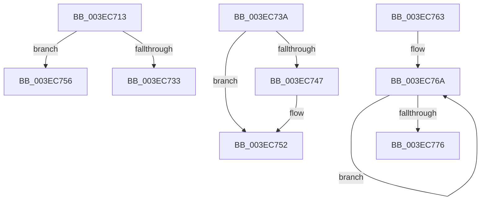

# sub_003EC713

- RVA: `0x003EC713`–`0x003EC789` (길이 `118` bytes)
- VA: `0x00000001403EC713`
- 실행 섹션: `.text`
- PDB 이름 있음: `아니요`; PDB Function 태그: `아니요`
- unwind 정보 RVA: `0x00095C0C`
- 디코드: `30`개 명령, `118/118` bytes 표시
- 미해석 바이트: `0` (있으면 어셈블리에 `.byte`로 보존)

> 이 문서는 커널 이미지의 기계어와 PDB 기호를 분석해 생성했습니다. 4번과 5번은 함수 원형과 자료형을 바이너리 사용 방식에서 추정한 C 해석이며 원본 소스 복구 결과는 아닙니다.

## 1. Dependencies

- 직접 호출 지점: **1**; 고유 호출 대상: **1**
- 직접 호출자로 확인된 함수: **0**
- RIP 상대 이미지 참조: **0**

### Outgoing calls
- `0x003EC71E` → [ExAllocatePool2](../../poolcode/B8/ExAllocatePool2_function_00B820F0.md) (function, `0x00B820F0`)

### Direct callers
- 이 함수 시작 RVA로 연결되는 직접 call은 확인되지 않았습니다. 간접 호출은 완전히 역산할 수 없습니다.

### Static image references
- 디코드된 RIP-relative 메모리 참조가 없습니다.

## 2. Other-region calls and transfers

- 다른 실행 섹션으로 향하는 call: **1**
  - `0x003EC71E` → [ExAllocatePool2](../../poolcode/B8/ExAllocatePool2_function_00B820F0.md) (`.text` → `POOLCODE`)
- call이 아닌 외부 분기/꼬리 이동: **4**
  - `0x003EC738` → [sub_003EC3E4 + 0x304](Unknown_function_003EC3E4.md) (`tail-transfer`)
  - `0x003EC754` → [sub_003EC3E4 + 0x304](Unknown_function_003EC3E4.md) (`tail-transfer`)
  - `0x003EC75E` → [sub_003EC3E4 + 0x107](Unknown_function_003EC3E4.md) (`tail-transfer`)
  - `0x003EC784` → [sub_003EC3E4 + 0x29F](Unknown_function_003EC3E4.md) (`tail-transfer`)

## 3. Assembly (complete function range)

```asm
003EC713  B9 42 00 00 00                  mov ecx, 0x42
003EC718  41 B8 48 61 6C 44               mov r8d, 0x446c6148
003EC71E  E8 CD 59 79 00                  call 0x140b820f0
003EC723  48 89 84 24 98 00 00 00         mov qword ptr [rsp + 0x98], rax
003EC72B  4C 8B C8                        mov r9, rax
003EC72E  48 85 C0                        test rax, rax
003EC731  75 23                           jne 0x1403ec756
003EC733  B8 9A 00 00 C0                  mov eax, 0xc000009a
003EC738  EB AE                           jmp 0x1403ec6e8
003EC73A  48 8B 84 24 E0 00 00 00         mov rax, qword ptr [rsp + 0xe0]
003EC742  48 85 C0                        test rax, rax
003EC745  74 0B                           je 0x1403ec752
003EC747  48 8B 8C 24 98 00 00 00         mov rcx, qword ptr [rsp + 0x98]
003EC74F  48 89 08                        mov qword ptr [rax], rcx
003EC752  8B C3                           mov eax, ebx
003EC754  EB 92                           jmp 0x1403ec6e8
003EC756  4C 8B 84 24 88 00 00 00         mov r8, qword ptr [rsp + 0x88]
003EC75E  E9 88 FD FF FF                  jmp 0x1403ec4eb
003EC763  41 0F 0D 09                     prefetchw byte ptr [r9]
003EC767  41 8B 01                        mov eax, dword ptr [r9]
003EC76A  8B C8                           mov ecx, eax
003EC76C  83 C9 01                        or ecx, 1
003EC76F  F0 41 0F B1 09                  lock cmpxchg dword ptr [r9], ecx
003EC774  75 F4                           jne 0x1403ec76a
003EC776  A8 02                           test al, 2
003EC778  8B C3                           mov eax, ebx
003EC77A  BB 20 01 00 C0                  mov ebx, 0xc0000120
003EC77F  0F 45 C3                        cmovne eax, ebx
003EC782  8B D8                           mov ebx, eax
003EC784  E9 FA FE FF FF                  jmp 0x1403ec683
```

## 4. C-style interpretation (structured pseudocode)

```c
__int64 __fastcall sub_003EC713(__int64 a1, __int64 a2, __int64 a3, __int64 a4, __int64 a5, __int64 a6, __int64 a7, __int64 a8, __int64 a9, __int64 a10, __int64 a11, __int64 a12, __int64 a13, __int64 a14, __int64 a15, __int64 a16, __int64 a17)
{
    __int64 result;
    unsigned __int64 v_stack_p98;
    unsigned __int64 v_stack_pE0;

    result = ExAllocatePool2(66, a2, (unsigned int)(0x446C6148ULL), a4);
    v_stack_p98 = result;
    if (result != 0) goto loc_003EC756;
loc_003EC756:
}
```

## 5. (Beta) C Style

```c
int64_t sub_003EC713(int64_t Arg1, int64_t Arg2, int64_t Arg3, int64_t Arg4, uint64_t Arg5, uint64_t Arg6, uint64_t Arg7, uint64_t Arg8, uint64_t Arg9, uint64_t Arg10, uint64_t Arg11, uint64_t Arg12, uint64_t Arg13, uint64_t Arg14, uint64_t Arg15, uint64_t Arg16, int64_t Arg17)
{
    int64_t result;
    uint64_t v_stack_p98;
    uint64_t v_stack_pE0;

    result = ExAllocatePool2(66, Arg2, (uint32_t)(0x446C6148ULL), Arg4);
    v_stack_p98 = result;
    if (result != 0) goto loc_003EC756;
loc_003EC756:
}
```

## 6. Execution-region graph

[열기: 2D/3D 그래프와 함수 탐색 컨트롤 패널](../../../control-panel.html?section=text&rva=0x003EC713&view=graph)

- 2D 그래프는 위에서 아래로 흐르고, 3D 그래프는 빈 공간을 드래그해 회전합니다. Shift+드래그는 이동, 휠은 확대·축소, 함수 노드 선택은 대상 보고서 이동입니다.

### Static fallback


