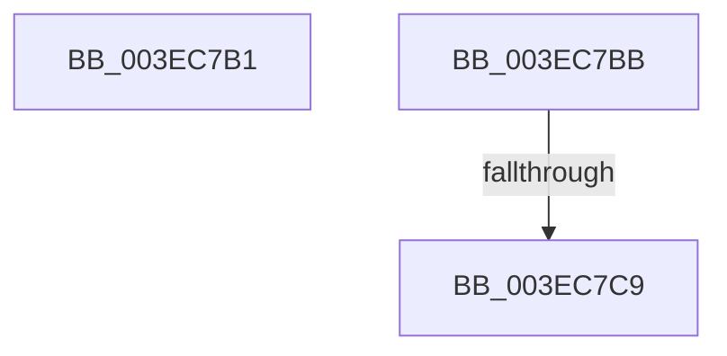

# sub_003EC7B1

- RVA: `0x003EC7B1`–`0x003EC7DF` (길이 `46` bytes)
- VA: `0x00000001403EC7B1`
- 실행 섹션: `.text`
- PDB 이름 있음: `아니요`; PDB Function 태그: `아니요`
- unwind 정보 RVA: `0x00095C60`
- 디코드: `10`개 명령, `46/46` bytes 표시
- 미해석 바이트: `0` (있으면 어셈블리에 `.byte`로 보존)

> 이 문서는 커널 이미지의 기계어와 PDB 기호를 분석해 생성했습니다. 4번과 5번은 함수 원형과 자료형을 바이너리 사용 방식에서 추정한 C 해석이며 원본 소스 복구 결과는 아닙니다.

## 1. Dependencies

- 직접 호출 지점: **0**; 고유 호출 대상: **0**
- 직접 호출자로 확인된 함수: **0**
- RIP 상대 이미지 참조: **0**

### Outgoing calls
- 직접 디코드된 call 명령이 없습니다.

### Direct callers
- 이 함수 시작 RVA로 연결되는 직접 call은 확인되지 않았습니다. 간접 호출은 완전히 역산할 수 없습니다.

### Static image references
- 디코드된 RIP-relative 메모리 참조가 없습니다.

## 2. Other-region calls and transfers

- 다른 실행 섹션으로 향하는 call: **0**
- call이 아닌 외부 분기/꼬리 이동: **3**
  - `0x003EC7B6` → [sub_003EC3E4 + 0x2CB](Unknown_function_003EC3E4.md) (`tail-transfer`)
  - `0x003EC7C3` → [sub_003EC3E4 + 0x292](Unknown_function_003EC3E4.md) (`tail-transfer`)
  - `0x003EC7DA` → [sub_003EC3E4 + 0x292](Unknown_function_003EC3E4.md) (`tail-transfer`)

## 3. Assembly (complete function range)

```asm
003EC7B1  BB 20 01 00 C0                  mov ebx, 0xc0000120
003EC7B6  E9 F4 FE FF FF                  jmp 0x1403ec6af
003EC7BB  4C 8B 4C 24 30                  mov r9, qword ptr [rsp + 0x30]
003EC7C0  45 85 DB                        test r11d, r11d
003EC7C3  0F 84 AD FE FF FF               je 0x1403ec676
003EC7C9  41 8D 4B FF                     lea ecx, [r11 - 1]
003EC7CD  48 8D 49 01                     lea rcx, [rcx + 1]
003EC7D1  48 8D 04 49                     lea rax, [rcx + rcx*2]
003EC7D5  44 01 44 C5 00                  add dword ptr [rbp + rax*8], r8d
003EC7DA  E9 97 FE FF FF                  jmp 0x1403ec676
```

## 4. C-style interpretation (structured pseudocode)

```c
__int64 __fastcall sub_003EC7B1(__int64 a1, __int64 a2, int a3)
{
    unsigned __int64 v_stack_p30;
}
```

## 5. (Beta) C Style

```c
int64_t sub_003EC7B1(int64_t Arg1, int64_t Arg2, int32_t Arg3)
{
    uint64_t v_stack_p30;
}
```

## 6. Execution-region graph

[열기: 2D/3D 그래프와 함수 탐색 컨트롤 패널](../../../control-panel.html?section=text&rva=0x003EC7B1&view=graph)

- 2D 그래프는 위에서 아래로 흐르고, 3D 그래프는 빈 공간을 드래그해 회전합니다. Shift+드래그는 이동, 휠은 확대·축소, 함수 노드 선택은 대상 보고서 이동입니다.

### Static fallback


