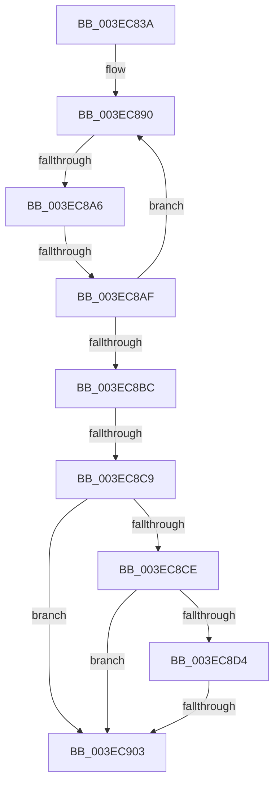

# sub_003EC83A

- RVA: `0x003EC83A`–`0x003EC924` (길이 `234` bytes)
- VA: `0x00000001403EC83A`
- 실행 섹션: `.text`
- PDB 이름 있음: `아니요`; PDB Function 태그: `아니요`
- unwind 정보 RVA: `0x00096570`
- 디코드: `55`개 명령, `234/234` bytes 표시
- 미해석 바이트: `0` (있으면 어셈블리에 `.byte`로 보존)

> 이 문서는 커널 이미지의 기계어와 PDB 기호를 분석해 생성했습니다. 4번과 5번은 함수 원형과 자료형을 바이너리 사용 방식에서 추정한 C 해석이며 원본 소스 복구 결과는 아닙니다.

## 1. Dependencies

- 직접 호출 지점: **0**; 고유 호출 대상: **0**
- 직접 호출자로 확인된 함수: **0**
- RIP 상대 이미지 참조: **1**

### Outgoing calls
- 직접 디코드된 call 명령이 없습니다.

### Direct callers
- 이 함수 시작 RVA로 연결되는 직접 call은 확인되지 않았습니다. 간접 호출은 완전히 역산할 수 없습니다.

### Static image references
- `0x003EC85C` → RVA `0x00FC7350` (`ALMOSTRO`; read)

## 2. Other-region calls and transfers

- 다른 실행 섹션으로 향하는 call: **0**
- call이 아닌 외부 분기/꼬리 이동: **4**
  - `0x003EC8A0` → [sub_003EC92C + 0x6B](Unknown_function_003EC92C.md) (`tail-transfer`)
  - `0x003EC8A9` → [sub_003EC92C + 0x10](Unknown_function_003EC92C.md) (`tail-transfer`)
  - `0x003EC8C7` → [sub_003EC92C](Unknown_function_003EC92C.md) (`tail-transfer`)
  - `0x003EC901` → [sub_003EC92C + 0x51](Unknown_function_003EC92C.md) (`tail-transfer`)

## 3. Assembly (complete function range)

```asm
003EC83A  48 89 5C 24 68                  mov qword ptr [rsp + 0x68], rbx
003EC83F  48 89 7C 24 70                  mov qword ptr [rsp + 0x70], rdi
003EC844  4C 89 64 24 78                  mov qword ptr [rsp + 0x78], r12
003EC849  45 33 E4                        xor r12d, r12d
003EC84C  41 8B C4                        mov eax, r12d
003EC84F  4C 89 6C 24 40                  mov qword ptr [rsp + 0x40], r13
003EC854  83 FA 01                        cmp edx, 1
003EC857  4C 89 74 24 38                  mov qword ptr [rsp + 0x38], r14
003EC85C  4C 8D 2D ED AA BD 00            lea r13, [rip + 0xbdaaed]
003EC863  4C 89 7C 24 30                  mov qword ptr [rsp + 0x30], r15
003EC868  0F 94 C0                        sete al
003EC86B  44 8B F0                        mov r14d, eax
003EC86E  48 8B 81 F8 02 00 00            mov rax, qword ptr [rcx + 0x2f8]
003EC875  41 8B FE                        mov edi, r14d
003EC878  48 C1 E7 07                     shl rdi, 7
003EC87C  48 03 F8                        add rdi, rax
003EC87F  47 0F B6 7C F5 00               movzx r15d, byte ptr [r13 + r14*8]
003EC885  0F 0D 0F                        prefetchw byte ptr [rdi]
003EC888  48 8B 1F                        mov rbx, qword ptr [rdi]
003EC88B  F0 44 09 24 24                  lock or dword ptr [rsp], r12d
003EC890  48 8B 47 40                     mov rax, qword ptr [rdi + 0x40]
003EC894  48 89 44 24 60                  mov qword ptr [rsp + 0x60], rax
003EC899  48 8D 0C 33                     lea rcx, [rbx + rsi]
003EC89D  48 3B CB                        cmp rcx, rbx
003EC8A0  0F 82 F1 00 00 00               jb 0x1403ec997
003EC8A6  48 3B C8                        cmp rcx, rax
003EC8A9  0F 87 8D 00 00 00               ja 0x1403ec93c
003EC8AF  48 8B C3                        mov rax, rbx
003EC8B2  F0 48 0F B1 0F                  lock cmpxchg qword ptr [rdi], rcx
003EC8B7  48 8B D8                        mov rbx, rax
003EC8BA  75 D4                           jne 0x1403ec890
003EC8BC  0F 0D 4F 08                     prefetchw byte ptr [rdi + 8]
003EC8C0  48 8B 47 08                     mov rax, qword ptr [rdi + 8]
003EC8C4  48 3B C8                        cmp rcx, rax
003EC8C7  77 63                           ja 0x1403ec92c
003EC8C9  48 85 ED                        test rbp, rbp
003EC8CC  74 35                           je 0x1403ec903
003EC8CE  41 F6 C7 04                     test r15b, 4
003EC8D2  74 2F                           je 0x1403ec903
003EC8D4  48 8B D6                        mov rdx, rsi
003EC8D7  F0 4A 0F C1 94 F5 00 02 00 00   lock xadd qword ptr [rbp + r14*8 + 0x200], rdx
003EC8E1  48 03 D6                        add rdx, rsi
003EC8E4  4E 8D 04 F5 00 00 00 00         lea r8, [r14*8]
003EC8EC  4C 03 C5                        add r8, rbp
003EC8EF  41 0F 0D 88 10 02 00 00         prefetchw byte ptr [r8 + 0x210]
003EC8F7  49 8B 80 10 02 00 00            mov rax, qword ptr [r8 + 0x210]
003EC8FE  48 3B D0                        cmp rdx, rax
003EC901  77 7A                           ja 0x1403ec97d
003EC903  4C 8B 7C 24 30                  mov r15, qword ptr [rsp + 0x30]
003EC908  41 8B C4                        mov eax, r12d
003EC90B  4C 8B 64 24 78                  mov r12, qword ptr [rsp + 0x78]
003EC910  4C 8B 74 24 38                  mov r14, qword ptr [rsp + 0x38]
003EC915  4C 8B 6C 24 40                  mov r13, qword ptr [rsp + 0x40]
003EC91A  48 8B 7C 24 70                  mov rdi, qword ptr [rsp + 0x70]
003EC91F  48 8B 5C 24 68                  mov rbx, qword ptr [rsp + 0x68]
```

## 4. C-style interpretation (structured pseudocode)

```c
__int64 __fastcall sub_003EC83A(__int64 a1, int a2, __int64 a3, __int64 a4, __int64 a5, __int64 a6, __int64 a7, __int64 a8, __int64 a9, __int64 a10, __int64 a11, __int64 a12, __int64 a13, __int64 a14, __int64 a15)
{
    __int64 result;
    __int64 v_r12;
    __int64 v_rdi;
    unsigned int v_stack_p0;
    unsigned __int64 v_stack_p30;
    unsigned __int64 v_stack_p38;
    unsigned __int64 v_stack_p40;
    unsigned __int64 v_stack_p60;
    unsigned __int64 v_stack_p68;
    unsigned __int64 v_stack_p70;
    unsigned __int64 v_stack_p78;

    v_stack_p68 = v_rbx;
    v_stack_p70 = v_rdi;
    v_stack_p78 = v_r12;
    v_r12 = 0;
    v_stack_p40 = v_r13;
    v_stack_p38 = v_r14;
    v_stack_p30 = v_r15;
    result = (a2 == 1) ? 1 : 0;
    v_rdi = ((unsigned int)((unsigned int)((unsigned int)((unsigned int)(result))))) << (7);
    v_rdi = (v_rdi) + (*(unsigned __int64 *)(a1 + 760));
loc_003EC890:
    v_stack_p60 = *(unsigned __int64 *)(v_rdi + 64);
    if ((*(unsigned __int64 *)(v_rdi) + v_rsi * 1) != (*(unsigned __int64 *)(v_rdi + 64))) goto loc_003EC890;
    if (v_rbp == 0) goto loc_003EC903;
    if ((((unsigned __int8)(*(unsigned __int8 *)(v_rip + 12430061 + (unsigned int)((unsigned int)(result)) * 8))) & (4)) == 0) goto loc_003EC903;
    a2 = (v_rsi) + (v_rsi);
    a3 = ((unsigned int)((unsigned int)(result)) * 8) + (v_rbp);
loc_003EC903:
    return 0;
}
```

## 5. (Beta) C Style

```c
int64_t sub_003EC83A(void *Arg1, int32_t Arg2, int64_t Arg3, int64_t Arg4, uint64_t Arg5, int64_t Arg6, int64_t Arg7, int64_t Arg8, uint64_t Arg9, uint64_t Arg10, uint64_t Arg11, uint64_t Arg12, int64_t Arg13, int64_t Arg14, int64_t Arg15)
{
    uint8_t *arg1 = (uint8_t *)Arg1;

    int64_t result;
    int64_t local_r12;
    int64_t local_rdi;
    uint32_t v_stack_p0;
    uint64_t v_stack_p30;
    uint64_t v_stack_p38;
    uint64_t v_stack_p40;
    uint64_t v_stack_p60;
    uint64_t v_stack_p68;
    uint64_t v_stack_p70;
    uint64_t v_stack_p78;

    v_stack_p68 = local_rbx;
    v_stack_p70 = local_rdi;
    v_stack_p78 = local_r12;
    local_r12 = 0;
    v_stack_p40 = local_r13;
    v_stack_p38 = local_r14;
    v_stack_p30 = local_r15;
    result = (Arg2 == 1) ? 1 : 0;
    local_rdi = ((uint32_t)((uint32_t)((uint32_t)((uint32_t)(result))))) << (7);
    local_rdi = (local_rdi) + (*(uint64_t *)(arg1 + 0x2F8));
loc_003EC890:
    v_stack_p60 = *(uint64_t *)(local_rdi + 0x40);
    if ((*(uint64_t *)(local_rdi) + local_rsi * 1) != (*(uint64_t *)(local_rdi + 0x40))) goto loc_003EC890;
    if (local_rbp == 0) goto loc_003EC903;
    if ((((uint8_t)(*(uint8_t *)(v_rip + 0xBDAAED + (uint32_t)((uint32_t)(result)) * 8))) & (4)) == 0) goto loc_003EC903;
    Arg2 = (local_rsi) + (local_rsi);
    Arg3 = ((uint32_t)((uint32_t)(result)) * 8) + (local_rbp);
loc_003EC903:
    return 0;
}
```

### 관측된 메모리 오프셋

구조체 형식이 확인되지 않은 접근은 인자 기준의 오프셋으로만 기록했습니다.

| 기준 인자 | 오프셋 표현 | 폭 (bit) | 접근 |
|---|---:|---:|---|
| `Arg1` | `+ 0x2F8` | `64` | `R` |

## 6. Execution-region graph

[열기: 2D/3D 그래프와 함수 탐색 컨트롤 패널](../../../control-panel.html?section=text&rva=0x003EC83A&view=graph)

- 2D 그래프는 위에서 아래로 흐르고, 3D 그래프는 빈 공간을 드래그해 회전합니다. Shift+드래그는 이동, 휠은 확대·축소, 함수 노드 선택은 대상 보고서 이동입니다.

### Static fallback


