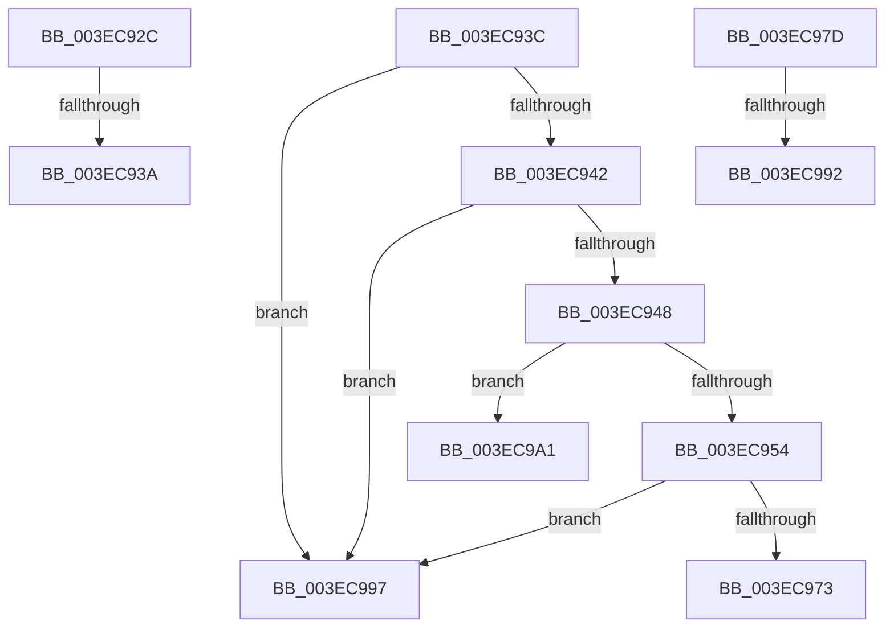

# sub_003EC92C

- RVA: `0x003EC92C`–`0x003EC9B2` (길이 `134` bytes)
- VA: `0x00000001403EC92C`
- 실행 섹션: `.text`
- PDB 이름 있음: `아니요`; PDB Function 태그: `아니요`
- unwind 정보 RVA: `0x000965AC`
- 디코드: `35`개 명령, `134/134` bytes 표시
- 미해석 바이트: `0` (있으면 어셈블리에 `.byte`로 보존)

> 이 문서는 커널 이미지의 기계어와 PDB 기호를 분석해 생성했습니다. 4번과 5번은 함수 원형과 자료형을 바이너리 사용 방식에서 추정한 C 해석이며 원본 소스 복구 결과는 아닙니다.

## 1. Dependencies

- 직접 호출 지점: **1**; 고유 호출 대상: **1**
- 직접 호출자로 확인된 함수: **0**
- RIP 상대 이미지 참조: **0**

### Outgoing calls
- `0x003EC96A` → [PspExpandQuota](../39/PspExpandQuota_function_00390660.md) (function, `0x00390660`)

### Direct callers
- 이 함수 시작 RVA로 연결되는 직접 call은 확인되지 않았습니다. 간접 호출은 완전히 역산할 수 없습니다.

### Static image references
- 디코드된 RIP-relative 메모리 참조가 없습니다.

## 2. Other-region calls and transfers

- 다른 실행 섹션으로 향하는 call: **0**
- call이 아닌 외부 분기/꼬리 이동: **7**
  - `0x003EC938` → [sub_003EC83A + 0x8A](Unknown_function_003EC83A.md) (`tail-transfer`)
  - `0x003EC93A` → [sub_003EC83A + 0x8F](Unknown_function_003EC83A.md) (`tail-transfer`)
  - `0x003EC978` → [sub_003EC83A + 0x5F](Unknown_function_003EC83A.md) (`tail-transfer`)
  - `0x003EC98C` → [sub_003EC83A + 0xC4](Unknown_function_003EC83A.md) (`tail-transfer`)
  - `0x003EC992` → [sub_003EC83A + 0xC9](Unknown_function_003EC83A.md) (`tail-transfer`)
  - `0x003EC99C` → [sub_003EC83A + 0xC9](Unknown_function_003EC83A.md) (`tail-transfer`)
  - `0x003EC9AD` → [sub_003EC83A + 0x5A](Unknown_function_003EC83A.md) (`tail-transfer`)

## 3. Assembly (complete function range)

```asm
003EC92C  48 8B D0                        mov rdx, rax
003EC92F  F0 48 0F B1 4F 08               lock cmpxchg qword ptr [rdi + 8], rcx
003EC935  48 3B C2                        cmp rax, rdx
003EC938  75 8A                           jne 0x1403ec8c4
003EC93A  EB 8D                           jmp 0x1403ec8c9
003EC93C  41 F6 C7 01                     test r15b, 1
003EC940  74 55                           je 0x1403ec997
003EC942  4C 39 67 50                     cmp qword ptr [rdi + 0x50], r12
003EC946  74 4F                           je 0x1403ec997
003EC948  49 8B CC                        mov rcx, r12
003EC94B  48 87 4F 48                     xchg qword ptr [rdi + 0x48], rcx
003EC94F  48 85 C9                        test rcx, rcx
003EC952  75 4D                           jne 0x1403ec9a1
003EC954  48 8D 44 24 60                  lea rax, [rsp + 0x60]
003EC959  4C 8B CE                        mov r9, rsi
003EC95C  4C 8B C3                        mov r8, rbx
003EC95F  48 89 44 24 20                  mov qword ptr [rsp + 0x20], rax
003EC964  48 8B D7                        mov rdx, rdi
003EC967  41 8B CE                        mov ecx, r14d
003EC96A  E8 F1 3C FA FF                  call 0x140390660
003EC96F  84 C0                           test al, al
003EC971  74 24                           je 0x1403ec997
003EC973  48 8B 44 24 60                  mov rax, qword ptr [rsp + 0x60]
003EC978  E9 1C FF FF FF                  jmp 0x1403ec899
003EC97D  48 8B C8                        mov rcx, rax
003EC980  F0 49 0F B1 90 10 02 00 00      lock cmpxchg qword ptr [r8 + 0x210], rdx
003EC989  48 3B C1                        cmp rax, rcx
003EC98C  0F 85 6C FF FF FF               jne 0x1403ec8fe
003EC992  E9 6C FF FF FF                  jmp 0x1403ec903
003EC997  47 8B 64 F5 04                  mov r12d, dword ptr [r13 + r14*8 + 4]
003EC99C  E9 62 FF FF FF                  jmp 0x1403ec903
003EC9A1  48 8B C1                        mov rax, rcx
003EC9A4  F0 48 0F C1 47 40               lock xadd qword ptr [rdi + 0x40], rax
003EC9AA  48 03 C1                        add rax, rcx
003EC9AD  E9 E2 FE FF FF                  jmp 0x1403ec894
```

## 4. C-style interpretation (structured pseudocode)

```c
__int64 __fastcall sub_003EC92C(__int64 a1)
{
    unsigned __int64 v_stack_p20;
    unsigned __int64 v_stack_p60;
}
```

## 5. (Beta) C Style

```c
int64_t sub_003EC92C(int64_t Arg1)
{
    uint64_t v_stack_p20;
    uint64_t v_stack_p60;
}
```

## 6. Execution-region graph

[열기: 2D/3D 그래프와 함수 탐색 컨트롤 패널](../../../control-panel.html?section=text&rva=0x003EC92C&view=graph)

- 2D 그래프는 위에서 아래로 흐르고, 3D 그래프는 빈 공간을 드래그해 회전합니다. Shift+드래그는 이동, 휠은 확대·축소, 함수 노드 선택은 대상 보고서 이동입니다.

### Static fallback


