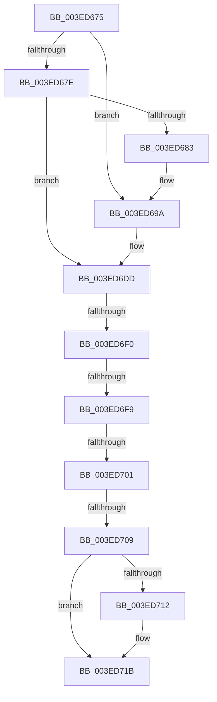

# sub_003ED675

- RVA: `0x003ED675`–`0x003ED730` (길이 `187` bytes)
- VA: `0x00000001403ED675`
- 실행 섹션: `.text`
- PDB 이름 있음: `아니요`; PDB Function 태그: `아니요`
- unwind 정보 RVA: `0x00096918`
- 디코드: `48`개 명령, `187/187` bytes 표시
- 미해석 바이트: `0` (있으면 어셈블리에 `.byte`로 보존)

> 이 문서는 커널 이미지의 기계어와 PDB 기호를 분석해 생성했습니다. 4번과 5번은 함수 원형과 자료형을 바이너리 사용 방식에서 추정한 C 해석이며 원본 소스 복구 결과는 아닙니다.

## 1. Dependencies

- 직접 호출 지점: **5**; 고유 호출 대상: **4**
- 직접 호출자로 확인된 함수: **0**
- RIP 상대 이미지 참조: **3**

### Outgoing calls
- `0x003ED694` → [KeBugCheckEx](../4F/KeBugCheckEx_function_004FD660.md) (function, `0x004FD660`)
- `0x003ED6D7` → [KeBugCheckEx](../4F/KeBugCheckEx_function_004FD660.md) (function, `0x004FD660`)
- `0x003ED6F0` → [KeAreInterruptsEnabled](../2F/KeAreInterruptsEnabled_function_002F8060.md) (function, `0x002F8060`)
- `0x003ED716` → [ObpDeregisterObject](../../page/9D/ObpDeregisterObject_function_009D7F78.md) (function, `0x009D7F78`)
- `0x003ED721` → [ObpRemoveObjectRoutine](../../page/86/ObpRemoveObjectRoutine_function_00864A60.md) (function, `0x00864A60`)

### Direct callers
- 이 함수 시작 RVA로 연결되는 직접 call은 확인되지 않았습니다. 간접 호출은 완전히 역산할 수 없습니다.

### Static image references
- `0x003ED6A5` → RVA `0x00000000` (`image boundary/outside`; read)
- `0x003ED6C5` → RVA `0x00FC6E4C` (`ALMOSTRO`; read)
- `0x003ED709` → RVA `0x00FC5010` (`ALMOSTRO`; read)

## 2. Other-region calls and transfers

- 다른 실행 섹션으로 향하는 call: **2**
  - `0x003ED716` → [ObpDeregisterObject](../../page/9D/ObpDeregisterObject_function_009D7F78.md) (`.text` → `PAGE`)
  - `0x003ED721` → [ObpRemoveObjectRoutine](../../page/86/ObpRemoveObjectRoutine_function_00864A60.md) (`.text` → `PAGE`)
- call이 아닌 외부 분기/꼬리 이동: **5**
  - `0x003ED6EE` → [sub_003ED730 + 0x2A](Unknown_function_003ED730.md) (`tail-transfer`)
  - `0x003ED6F7` → [sub_003ED730 + 0x2A](Unknown_function_003ED730.md) (`tail-transfer`)
  - `0x003ED6FF` → [sub_003ED730 + 0x2A](Unknown_function_003ED730.md) (`tail-transfer`)
  - `0x003ED707` → [sub_003ED730](Unknown_function_003ED730.md) (`tail-transfer`)
  - `0x003ED72B` → [ObFastDereferenceObject + 0x44](ObFastDereferenceObject_function_003ED5F0.md) (`tail-transfer`)

## 3. Assembly (complete function range)

```asm
003ED675  48 8B 4B D8                     mov rcx, qword ptr [rbx - 0x28]
003ED679  48 85 C9                        test rcx, rcx
003ED67C  75 1C                           jne 0x1403ed69a
003ED67E  48 85 C0                        test rax, rax
003ED681  79 5A                           jns 0x1403ed6dd
003ED683  33 D2                           xor edx, edx
003ED685  48 89 44 24 20                  mov qword ptr [rsp + 0x20], rax
003ED68A  44 8D 49 02                     lea r9d, [rcx + 2]
003ED68E  4C 8B C3                        mov r8, rbx
003ED691  8D 4A 18                        lea ecx, [rdx + 0x18]
003ED694  E8 C7 FF 10 00                  call 0x1404fd660
003ED699  CC                              int3
003ED69A  41 B9 01 00 00 00               mov r9d, 1
003ED6A0  48 89 4C 24 20                  mov qword ptr [rsp + 0x20], rcx
003ED6A5  4C 8D 15 54 29 C1 FF            lea r10, [rip - 0x3ed6ac]
003ED6AC  4C 8B C3                        mov r8, rbx
003ED6AF  48 8D 43 D0                     lea rax, [rbx - 0x30]
003ED6B3  48 C1 E8 08                     shr rax, 8
003ED6B7  0F B6 D0                        movzx edx, al
003ED6BA  41 8D 49 17                     lea ecx, [r9 + 0x17]
003ED6BE  0F B6 43 E8                     movzx eax, byte ptr [rbx - 0x18]
003ED6C2  48 33 D0                        xor rdx, rax
003ED6C5  0F B6 05 80 97 BD 00            movzx eax, byte ptr [rip + 0xbd9780]
003ED6CC  48 33 D0                        xor rdx, rax
003ED6CF  49 8B 94 D2 00 78 FC 00         mov rdx, qword ptr [r10 + rdx*8 + 0xfc7800]
003ED6D7  E8 84 FF 10 00                  call 0x1404fd660
003ED6DC  CC                              int3
003ED6DD  65 48 8B 04 25 88 01 00 00      mov rax, qword ptr gs:[0x188]
003ED6E6  66 83 B8 E6 01 00 00 00         cmp word ptr [rax + 0x1e6], 0
003ED6EE  75 6A                           jne 0x1403ed75a
003ED6F0  E8 6B A9 F0 FF                  call 0x1402f8060
003ED6F5  84 C0                           test al, al
003ED6F7  74 61                           je 0x1403ed75a
003ED6F9  44 0F 20 C0                     mov rax, cr8
003ED6FD  3C 01                           cmp al, 1
003ED6FF  73 59                           jae 0x1403ed75a
003ED701  0F B6 43 EA                     movzx eax, byte ptr [rbx - 0x16]
003ED705  A8 40                           test al, 0x40
003ED707  75 27                           jne 0x1403ed730
003ED709  83 3D 00 79 BD 00 00            cmp dword ptr [rip + 0xbd7900], 0
003ED710  74 09                           je 0x1403ed71b
003ED712  48 8D 4B D0                     lea rcx, [rbx - 0x30]
003ED716  E8 5D A8 5E 00                  call 0x1409d7f78
003ED71B  33 D2                           xor edx, edx
003ED71D  48 8D 4B D0                     lea rcx, [rbx - 0x30]
003ED721  E8 3A 73 47 00                  call 0x140864a60
003ED726  48 8B 7C 24 40                  mov rdi, qword ptr [rsp + 0x40]
003ED72B  E9 04 FF FF FF                  jmp 0x1403ed634
```

## 4. C-style interpretation (structured pseudocode)

```c
__int64 __fastcall sub_003ED675(__int64 a1, int a2, __int64 a3, __int64 a4, __int64 a5, __int64 a6, __int64 a7, __int64 a8)
{
    __int64 result;
    unsigned __int64 v_stack_p20;

    if (*(unsigned __int64 *)(v_rbx - 40) != 0) goto loc_003ED69A;
    if (!sign_flag) goto loc_003ED6DD;
    a2 = 0;
    v_stack_p20 = result;
    result = KeBugCheckEx(a2 + 24, a2, v_rbx, *(unsigned __int64 *)(v_rbx - 40) + 2);
loc_003ED69A:
    v_stack_p20 = a2 + 24;
    result = (v_rbx - 48) >> (8);
    a2 = ((unsigned __int8)(result)) ^ (*(unsigned __int8 *)(v_rbx - 24));
    a2 = (a2) ^ (*(unsigned __int8 *)(v_rip + 12425088));
    result = KeBugCheckEx(1 + 23, *(unsigned __int64 *)(v_rip - 4118188 + a2 * 8 + 16545792), v_rbx, 1);
loc_003ED6DD:
    result = KeAreInterruptsEnabled(1 + 23, *(unsigned __int64 *)(v_rip - 4118188 + a2 * 8 + 16545792), v_rbx, 1);
    result = *(unsigned __int8 *)(v_rbx - 22);
    if ((*(unsigned int *)(v_rip + 12417280)) != 0) {
        a1 = v_rbx - 48;
        result = ObpDeregisterObject(a1, *(unsigned __int64 *)(v_rip - 4118188 + a2 * 8 + 16545792), v_rbx, 1);
    }
    a2 = 0;
    result = ObpRemoveObjectRoutine(v_rbx - 48, a2, v_rbx, 1);
}
```

## 5. (Beta) C Style

```c
int64_t sub_003ED675(int64_t Arg1, int32_t Arg2, int64_t Arg3, int64_t Arg4, uint64_t Arg5, uint64_t Arg6, uint64_t Arg7, int64_t Arg8)
{
    int64_t result;
    uint64_t v_stack_p20;

    if (*(uint64_t *)(local_rbx - 0x28) != 0) goto loc_003ED69A;
    if (!sign_flag) goto loc_003ED6DD;
    Arg2 = 0;
    v_stack_p20 = result;
    result = KeBugCheckEx(Arg2 + 24, Arg2, local_rbx, *(uint64_t *)(local_rbx - 0x28) + 2);
loc_003ED69A:
    v_stack_p20 = Arg2 + 24;
    result = (local_rbx - 48) >> (8);
    Arg2 = ((uint8_t)(result)) ^ (*(uint8_t *)(local_rbx - 0x18));
    Arg2 = (Arg2) ^ (*(uint8_t *)(v_rip + 0xBD9780));
    result = KeBugCheckEx(1 + 23, *(uint64_t *)(v_rip - 0x3ED6AC + Arg2 * 8 + 0xFC7800), local_rbx, 1);
loc_003ED6DD:
    result = KeAreInterruptsEnabled(1 + 23, *(uint64_t *)(v_rip - 0x3ED6AC + Arg2 * 8 + 0xFC7800), local_rbx, 1);
    result = *(uint8_t *)(local_rbx - 0x16);
    if ((*(uint32_t *)(v_rip + 0xBD7900)) != 0) {
        Arg1 = local_rbx - 48;
        result = ObpDeregisterObject(Arg1, *(uint64_t *)(v_rip - 0x3ED6AC + Arg2 * 8 + 0xFC7800), local_rbx, 1);
    }
    Arg2 = 0;
    result = ObpRemoveObjectRoutine(local_rbx - 48, Arg2, local_rbx, 1);
}
```

## 6. Execution-region graph

[열기: 2D/3D 그래프와 함수 탐색 컨트롤 패널](../../../control-panel.html?section=text&rva=0x003ED675&view=graph)

- 2D 그래프는 위에서 아래로 흐르고, 3D 그래프는 빈 공간을 드래그해 회전합니다. Shift+드래그는 이동, 휠은 확대·축소, 함수 노드 선택은 대상 보고서 이동입니다.

### Static fallback


