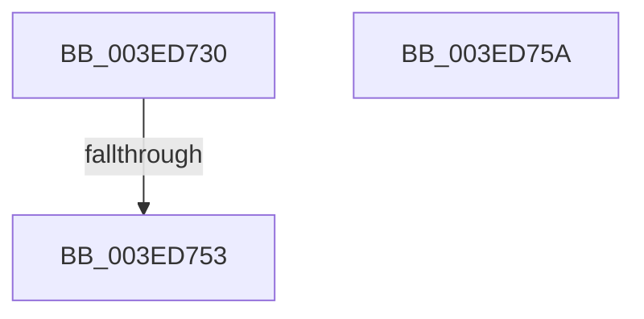

# sub_003ED730

- RVA: `0x003ED730`–`0x003ED768` (길이 `56` bytes)
- VA: `0x00000001403ED730`
- 실행 섹션: `.text`
- PDB 이름 있음: `아니요`; PDB Function 태그: `아니요`
- unwind 정보 RVA: `0x0009692C`
- 디코드: `13`개 명령, `56/56` bytes 표시
- 미해석 바이트: `0` (있으면 어셈블리에 `.byte`로 보존)

> 이 문서는 커널 이미지의 기계어와 PDB 기호를 분석해 생성했습니다. 4번과 5번은 함수 원형과 자료형을 바이너리 사용 방식에서 추정한 C 해석이며 원본 소스 복구 결과는 아닙니다.

## 1. Dependencies

- 직접 호출 지점: **2**; 고유 호출 대상: **2**
- 직접 호출자로 확인된 함수: **0**
- RIP 상대 이미지 참조: **1**

### Outgoing calls
- `0x003ED753` → [ObpHandleRevocationBlockRemoveObject](../../page/9D/ObpHandleRevocationBlockRemoveObject_function_009D7E30.md) (function, `0x009D7E30`)
- `0x003ED75E` → [ObpDeferObjectDeletion](../3A/ObpDeferObjectDeletion_function_003A2394.md) (function, `0x003A2394`)

### Direct callers
- 이 함수 시작 RVA로 연결되는 직접 call은 확인되지 않았습니다. 간접 호출은 완전히 역산할 수 없습니다.

### Static image references
- `0x003ED733` → RVA `0x00000000` (`image boundary/outside`; read)

## 2. Other-region calls and transfers

- 다른 실행 섹션으로 향하는 call: **1**
  - `0x003ED753` → [ObpHandleRevocationBlockRemoveObject](../../page/9D/ObpHandleRevocationBlockRemoveObject_function_009D7E30.md) (`.text` → `PAGE`)
- call이 아닌 외부 분기/꼬리 이동: **3**
  - `0x003ED751` → [sub_003ED675 + 0x94](Unknown_function_003ED675.md) (`tail-transfer`)
  - `0x003ED758` → [sub_003ED675 + 0x94](Unknown_function_003ED675.md) (`tail-transfer`)
  - `0x003ED763` → [sub_003ED642 + 0x2C](Unknown_function_003ED642.md) (`tail-transfer`)

## 3. Assembly (complete function range)

```asm
003ED730  83 E0 7F                        and eax, 0x7f
003ED733  4C 8D 15 C6 28 C1 FF            lea r10, [rip - 0x3ed73a]
003ED73A  48 8D 4B D0                     lea rcx, [rbx - 0x30]
003ED73E  42 0F B6 84 10 80 FF F0 00      movzx eax, byte ptr [rax + r10 + 0xf0ff80]
003ED747  48 2B C8                        sub rcx, rax
003ED74A  48 8B 09                        mov rcx, qword ptr [rcx]
003ED74D  80 79 18 00                     cmp byte ptr [rcx + 0x18], 0
003ED751  74 B6                           je 0x1403ed709
003ED753  E8 D8 A6 5E 00                  call 0x1409d7e30
003ED758  EB AF                           jmp 0x1403ed709
003ED75A  48 8D 4B D0                     lea rcx, [rbx - 0x30]
003ED75E  E8 31 4C FB FF                  call 0x1403a2394
003ED763  E9 06 FF FF FF                  jmp 0x1403ed66e
```

## 4. C-style interpretation (structured pseudocode)

```c
__int64 __fastcall sub_003ED730(void)
{
    __int64 result;

    result = (unsigned int)((result) & (127));
    a1 = (v_rbx - 48) - (*(unsigned __int8 *)(result + v_rip - 4118330 * 1 + 15794048));
    result = ObpHandleRevocationBlockRemoveObject(*(unsigned __int64 *)(a1), a2, a3, a4);
}
```

## 5. (Beta) C Style

```c
void sub_003ED730(void)
{
    int64_t result;

    result = (uint32_t)((result) & (127));
    a1 = (local_rbx - 48) - (*(uint8_t *)(result + v_rip - 0x3ED73A * 1 + 0xF0FF80));
    result = ObpHandleRevocationBlockRemoveObject(*(uint64_t *)(a1), a2, a3, a4);
}
```

## 6. Execution-region graph

[열기: 2D/3D 그래프와 함수 탐색 컨트롤 패널](../../../control-panel.html?section=text&rva=0x003ED730&view=graph)

- 2D 그래프는 위에서 아래로 흐르고, 3D 그래프는 빈 공간을 드래그해 회전합니다. Shift+드래그는 이동, 휠은 확대·축소, 함수 노드 선택은 대상 보고서 이동입니다.

### Static fallback


