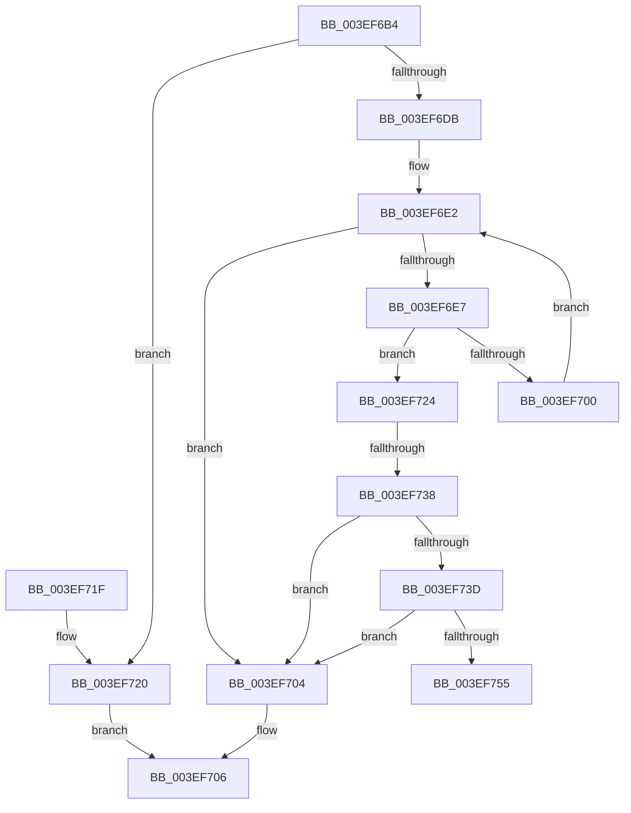

# VfAssignRuleClassIdToClassDriver

- RVA: `0x003EF6B4`–`0x003EF75A` (길이 `166` bytes)
- VA: `0x00000001403EF6B4`
- 실행 섹션: `.text`
- PDB 이름 있음: `예`; PDB Function 태그: `예`
- unwind 정보 RVA: `0x00087EEC`
- 디코드: `51`개 명령, `166/166` bytes 표시
- 미해석 바이트: `0` (있으면 어셈블리에 `.byte`로 보존)

> 이 문서는 커널 이미지의 기계어와 PDB 기호를 분석해 생성했습니다. 4번과 5번은 함수 원형과 자료형을 바이너리 사용 방식에서 추정한 C 해석이며 원본 소스 복구 결과는 아닙니다.

## 1. Dependencies

- 직접 호출 지점: **1**; 고유 호출 대상: **1**
- 직접 호출자로 확인된 함수: **1**
- RIP 상대 이미지 참조: **1**

### Outgoing calls
- `0x003EF6F7` → [wcsicmp](../50/wcsicmp_function_00500080.md) (function, `0x00500080`)

### Direct callers
- [VfTargetDriversAdd](VfTargetDriversAdd_function_003EE2F4.md) at `0x003EE363`

### Static image references
- `0x003EF6DB` → RVA `0x00000000` (`image boundary/outside`; read)

## 2. Other-region calls and transfers

- 다른 실행 섹션으로 향하는 call: **0**
- call이 아닌 외부 분기/꼬리 이동: **2**
  - `0x003EF732` → [sub_006EAE46](../6E/Unknown_function_006EAE46.md) (`tail-transfer`)
  - `0x003EF755` → [sub_006EAE46](../6E/Unknown_function_006EAE46.md) (`tail-transfer`)

## 3. Assembly (complete function range)

```asm
003EF6B4  48 89 5C 24 08                  mov qword ptr [rsp + 8], rbx
003EF6B9  48 89 6C 24 10                  mov qword ptr [rsp + 0x10], rbp
003EF6BE  48 89 74 24 18                  mov qword ptr [rsp + 0x18], rsi
003EF6C3  57                              push rdi
003EF6C4  41 56                           push r14
003EF6C6  41 57                           push r15
003EF6C8  48 83 EC 20                     sub rsp, 0x20
003EF6CC  33 DB                           xor ebx, ebx
003EF6CE  48 8B EA                        mov rbp, rdx
003EF6D1  4C 8B F1                        mov r14, rcx
003EF6D4  8B FB                           mov edi, ebx
003EF6D6  48 85 D2                        test rdx, rdx
003EF6D9  74 45                           je 0x1403ef720
003EF6DB  4C 8D 3D 1E 09 C1 FF            lea r15, [rip - 0x3ef6e2]
003EF6E2  83 FF 07                        cmp edi, 7
003EF6E5  73 1D                           jae 0x1403ef704
003EF6E7  8B F7                           mov esi, edi
003EF6E9  49 8B CE                        mov rcx, r14
003EF6EC  48 03 F6                        add rsi, rsi
003EF6EF  49 8B 94 F7 10 90 E0 00         mov rdx, qword ptr [r15 + rsi*8 + 0xe09010]
003EF6F7  E8 84 09 11 00                  call 0x140500080
003EF6FC  85 C0                           test eax, eax
003EF6FE  74 24                           je 0x1403ef724
003EF700  FF C7                           inc edi
003EF702  EB DE                           jmp 0x1403ef6e2
003EF704  8A C3                           mov al, bl
003EF706  48 8B 5C 24 40                  mov rbx, qword ptr [rsp + 0x40]
003EF70B  48 8B 6C 24 48                  mov rbp, qword ptr [rsp + 0x48]
003EF710  48 8B 74 24 50                  mov rsi, qword ptr [rsp + 0x50]
003EF715  48 83 C4 20                     add rsp, 0x20
003EF719  41 5F                           pop r15
003EF71B  41 5E                           pop r14
003EF71D  5F                              pop rdi
003EF71E  C3                              ret
003EF71F  CC                              int3
003EF720  32 C0                           xor al, al
003EF722  EB E2                           jmp 0x1403ef706
003EF724  0F AE E8                        lfence
003EF727  41 8B 84 F7 1C 90 E0 00         mov eax, dword ptr [r15 + rsi*8 + 0xe0901c]
003EF72F  83 F8 FF                        cmp eax, -1
003EF732  0F 84 0E B7 2F 00               je 0x1406eae46
003EF738  83 F8 40                        cmp eax, 0x40
003EF73B  73 C7                           jae 0x1403ef704
003EF73D  8B D0                           mov edx, eax
003EF73F  24 1F                           and al, 0x1f
003EF741  48 C1 EA 05                     shr rdx, 5
003EF745  0F B6 C8                        movzx ecx, al
003EF748  41 8B 84 97 A0 81 E6 00         mov eax, dword ptr [r15 + rdx*4 + 0xe681a0]
003EF750  0F A3 C8                        bt eax, ecx
003EF753  73 AF                           jae 0x1403ef704
003EF755  E9 EC B6 2F 00                  jmp 0x1406eae46
```

## 4. C-style interpretation (structured pseudocode)

```c
__int64 __fastcall VfAssignRuleClassIdToClassDriver(__int64 a1, __int64 a2)
{
    __int64 result;
    __int64 v_rbx;
    __int64 v_rdi;
    __int64 v_rsi;
    __int64 v_rsp;
    unsigned __int64 v_stack_p10;
    unsigned __int64 v_stack_p18;
    unsigned __int64 v_stack_p8;

    v_stack_p8 = v_rbx;
    v_stack_p10 = v_rbp;
    v_stack_p18 = v_rsi;
    v_rsp = (v_rsp) - (32);
    v_rbx = 0;
    if (a2 == 0) goto loc_003EF720;
loc_003EF6E2:
    if (0 >= 7) goto loc_003EF704;
    v_rsi = (0) + (0);
    result = wcsicmp(a1, *(unsigned __int64 *)(v_rip - 4126434 + v_rsi * 8 + 14716944), a3, a4);
    if ((unsigned int)(result) == 0) goto loc_003EF724;
    v_rdi = (unsigned int)((0) + 1);
    goto loc_003EF6E2;
loc_003EF704:
loc_003EF706:
    v_rsp = (v_rsp) + (32);
    return 0;
loc_003EF720:
    result = 0;
    goto loc_003EF706;
loc_003EF724:
    if (((unsigned int)((unsigned int)(*(unsigned int *)(v_rip - 4126434 + v_stack_p18 * 8 + 14716956)))) >= 64) goto loc_003EF704;
    result = (unsigned __int8)(((unsigned int)(*(unsigned int *)(v_rip - 4126434 + v_stack_p18 * 8 + 14716956))) & (31));
    a2 = ((unsigned int)((unsigned int)((unsigned int)(*(unsigned int *)(v_rip - 4126434 + v_stack_p18 * 8 + 14716956))))) >> (5);
    if (condition_is_above_or_equal) goto loc_003EF704;
}
```

## 5. (Beta) C Style

```c
int64_t VfAssignRuleClassIdToClassDriver(int64_t Arg1, int64_t Arg2)
{
    int64_t result;
    int64_t local_rbx;
    int64_t local_rdi;
    int64_t local_rsi;
    int64_t local_rsp;
    uint64_t v_stack_p10;
    uint64_t v_stack_p18;
    uint64_t v_stack_p8;

    v_stack_p8 = local_rbx;
    v_stack_p10 = local_rbp;
    v_stack_p18 = local_rsi;
    local_rsp = (local_rsp) - (32);
    local_rbx = 0;
    if (Arg2 == 0) goto loc_003EF720;
loc_003EF6E2:
    if (0 >= 7) goto loc_003EF704;
    local_rsi = (0) + (0);
    result = wcsicmp(Arg1, *(uint64_t *)(v_rip - 0x3EF6E2 + local_rsi * 8 + 0xE09010), a3, a4);
    if ((uint32_t)(result) == 0) goto loc_003EF724;
    local_rdi = (uint32_t)((0) + 1);
    goto loc_003EF6E2;
loc_003EF704:
loc_003EF706:
    local_rsp = (local_rsp) + (32);
    return 0;
loc_003EF720:
    result = 0;
    goto loc_003EF706;
loc_003EF724:
    if (((uint32_t)((uint32_t)(*(uint32_t *)(v_rip - 0x3EF6E2 + v_stack_p18 * 8 + 0xE0901C)))) >= 64) goto loc_003EF704;
    result = (uint8_t)(((uint32_t)(*(uint32_t *)(v_rip - 0x3EF6E2 + v_stack_p18 * 8 + 0xE0901C))) & (31));
    Arg2 = ((uint32_t)((uint32_t)((uint32_t)(*(uint32_t *)(v_rip - 0x3EF6E2 + v_stack_p18 * 8 + 0xE0901C))))) >> (5);
    if (condition_is_above_or_equal) goto loc_003EF704;
}
```

## 6. Execution-region graph

[열기: 2D/3D 그래프와 함수 탐색 컨트롤 패널](../../../control-panel.html?section=text&rva=0x003EF6B4&view=graph)

- 2D 그래프는 위에서 아래로 흐르고, 3D 그래프는 빈 공간을 드래그해 회전합니다. Shift+드래그는 이동, 휠은 확대·축소, 함수 노드 선택은 대상 보고서 이동입니다.

### Static fallback


