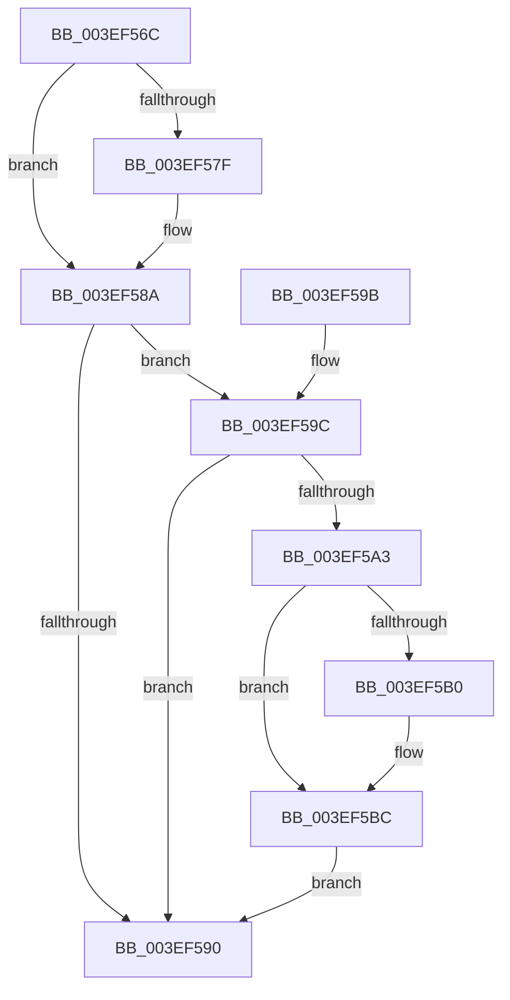

# VfAvlCleanupLockContext

- RVA: `0x003EF56C`–`0x003EF5CA` (길이 `94` bytes)
- VA: `0x00000001403EF56C`
- 실행 섹션: `.text`
- PDB 이름 있음: `예`; PDB Function 태그: `아니요`
- unwind 정보 RVA: `0x00096B0C`
- 디코드: `29`개 명령, `94/94` bytes 표시
- 미해석 바이트: `0` (있으면 어셈블리에 `.byte`로 보존)

> 이 문서는 커널 이미지의 기계어와 PDB 기호를 분석해 생성했습니다. 4번과 5번은 함수 원형과 자료형을 바이너리 사용 방식에서 추정한 C 해석이며 원본 소스 복구 결과는 아닙니다.

## 1. Dependencies

- 직접 호출 지점: **2**; 고유 호출 대상: **2**
- 직접 호출자로 확인된 함수: **46**
- RIP 상대 이미지 참조: **1**

### Outgoing calls
- `0x003EF585` → [ViAvlReleaseTableLockFromDpcLevel](ViAvlReleaseTableLockFromDpcLevel_function_003EF5D0.md) (function, `0x003EF5D0`)
- `0x003EF5B7` → [KiLowerIrqlProcessIrqlFlags](../4F/KiLowerIrqlProcessIrqlFlags_function_004F5698.md) (function, `0x004F5698`)

### Direct callers
- [VfTargetDriversGetNode](VfTargetDriversGetNode_function_003EE174.md) at `0x003EE1C7`
- [VfTargetDriversAdd](VfTargetDriversAdd_function_003EE2F4.md) at `0x003EE3B2`
- [VfTargetDriversRemove](VfTargetDriversRemove_function_003EEF9C.md) at `0x003EF104`
- [DifEnumeratePluginData](../61/DifEnumeratePluginData_function_00612590.md) at `0x0061269F`
- [VfTargetRecoverIoCallbacks](../61/VfTargetRecoverIoCallbacks_function_006131F0.md) at `0x0061324D`
- [VfTargetReplaceIoCallbacks](../61/VfTargetReplaceIoCallbacks_function_00613260.md) at `0x0061332F`
- [VfAvlDeleteAllTreeNodes](../../pagevrfy/B9/VfAvlDeleteAllTreeNodes_function_00B93B9C.md) at `0x00B93C02`
- [VfTargetDriversDisableVerifier](../../pagevrfy/B9/VfTargetDriversDisableVerifier_function_00B9B2CC.md) at `0x00B9B340`
- [VfTargetDriversEnableVerifier](../../pagevrfy/B9/VfTargetDriversEnableVerifier_function_00B9B354.md) at `0x00B9B3D6`
- [VfTargetEtwRegister](../../pagevrfy/B9/VfTargetEtwRegister_function_00B9B49C.md) at `0x00B9B557`
- [VfTargetEtwUnregister](../../pagevrfy/B9/VfTargetEtwUnregister_function_00B9B590.md) at `0x00B9B689`
- [VfTargetFreeContiguousMemory](../../pagevrfy/B9/VfTargetFreeContiguousMemory_function_00B9B6BC.md) at `0x00B9B738`
- [VfTargetWMIRegistrationControl](../../pagevrfy/B9/VfTargetWMIRegistrationControl_function_00B9B74C.md) at `0x00B9B7CF`
- [ViTargetAddToCounter](../../pagevrfy/B9/ViTargetAddToCounter_function_00B9B8E0.md) at `0x00B9B966`
- [ViTargetWMIDeregister](../../pagevrfy/B9/ViTargetWMIDeregister_function_00B9BC28.md) at `0x00B9BCA6`
- [IovpCallDriver1](../../pagevrfy/B9/IovpCallDriver1_function_00B9CCA4.md) at `0x00B9D13E`
- [VerifierKeAcquireQueuedSpinLock](../../pagevrfy/B9/VerifierKeAcquireQueuedSpinLock_function_00B9FBD0.md) at `0x00B9FC6B`
- [ViDevObjAdd](../../pagevrfy/BA/ViDevObjAdd_function_00BA23F4.md) at `0x00BA2465`
- [ViDevObjRemove](../../pagevrfy/BA/ViDevObjRemove_function_00BA248C.md) at `0x00BA2546`
- [VerifierIoInitializeRemoveLockEx](../../pagevrfy/BA/VerifierIoInitializeRemoveLockEx_function_00BA2610.md) at `0x00BA274B`
- [ViRemLockDeleteFirstTreeNode](../../pagevrfy/BA/ViRemLockDeleteFirstTreeNode_function_00BA28F4.md) at `0x00BA2959`
- [ViRemLockFindSurrogate](../../pagevrfy/BA/ViRemLockFindSurrogate_function_00BA2994.md) at `0x00BA29D6`
- [VerifierKeAcquireInStackQueuedSpinLockAtDpcLevel](../../pagevrfy/BA/VerifierKeAcquireInStackQueuedSpinLockAtDpcLevel_function_00BA4F20.md) at `0x00BA4FAE`
- [VerifierKeAcquireInStackQueuedSpinLockCommon](../../pagevrfy/BA/VerifierKeAcquireInStackQueuedSpinLockCommon_function_00BA4FD8.md) at `0x00BA507D`
- [VerifierKeAcquireInStackQueuedSpinLockForDpcCommon](../../pagevrfy/BA/VerifierKeAcquireInStackQueuedSpinLockForDpcCommon_function_00BA5100.md) at `0x00BA518C`
- [VerifierKeAcquireInStackQueuedSpinLockRaiseToSynch](../../pagevrfy/BA/VerifierKeAcquireInStackQueuedSpinLockRaiseToSynch_function_00BA51C0.md) at `0x00BA5267`
- [VerifierKeAcquireQueuedSpinLockRaiseToSynch](../../pagevrfy/BA/VerifierKeAcquireQueuedSpinLockRaiseToSynch_function_00BA52C0.md) at `0x00BA535F`
- [VerifierKeAcquireSpinLockAtDpcLevel](../../pagevrfy/BA/VerifierKeAcquireSpinLockAtDpcLevel_function_00BA53B0.md) at `0x00BA5437`
- [VerifierKeSynchronizeExecution](../../pagevrfy/BA/VerifierKeSynchronizeExecution_function_00BA59A0.md) at `0x00BA5A44`
- [VerifierKeTryToAcquireQueuedSpinLock](../../pagevrfy/BA/VerifierKeTryToAcquireQueuedSpinLock_function_00BA5A80.md) at `0x00BA5B27`
- [VerifierKeTryToAcquireQueuedSpinLockRaiseToSynch](../../pagevrfy/BA/VerifierKeTryToAcquireQueuedSpinLockRaiseToSynch_function_00BA5B80.md) at `0x00BA5C27`
- [VerifierKeTryToAcquireSpinLockAtDpcLevel](../../pagevrfy/BA/VerifierKeTryToAcquireSpinLockAtDpcLevel_function_00BA5C80.md) at `0x00BA5D07`
- [VerifierPortKeAcquireSpinLockNoXdv](../../pagevrfy/BA/VerifierPortKeAcquireSpinLockNoXdv_function_00BA5E80.md) at `0x00BA5F42`
- [ViKeAcquireSpinLockCommon](../../pagevrfy/BA/ViKeAcquireSpinLockCommon_function_00BA60B0.md) at `0x00BA6175`
- [ViFaultsInjectionNotification](../../pagevrfy/BA/ViFaultsInjectionNotification_function_00BA6BDC.md) at `0x00BA6C6A`
- [VfSuspectDriversGetVerifierInformation](../../pagevrfy/BA/VfSuspectDriversGetVerifierInformation_function_00BAA884.md) at `0x00BAAA56`
- [VfLookasideAdd](../../pagevrfy/BA/VfLookasideAdd_function_00BAFE34.md) at `0x00BAFF1E`
- [VfLookasideDelete](../../pagevrfy/BA/VfLookasideDelete_function_00BAFF58.md) at `0x00BB0013`
- [VerifierIoWMIRegistrationControl](../../pagevrfy/BB/VerifierIoWMIRegistrationControl_function_00BB1590.md) at `0x00BB160C`
- [VfDeleteResource](../../pagevrfy/BB/VfDeleteResource_function_00BB187C.md) at `0x00BB1941`
- [VfTrackResource](../../pagevrfy/BB/VfTrackResource_function_00BB19A0.md) at `0x00BB1A8F`
- [VfWmiVerifyIrpStackUpward](../../pagevrfy/BB/VfWmiVerifyIrpStackUpward_function_00BB6200.md) at `0x00BB629B`
- [VfCheckForResource](../../pagevrfy/BB/VfCheckForResource_function_00BB71C8.md) at `0x00BB7266`
- [VfCheckForResource](../../pagevrfy/BB/VfCheckForResource_function_00BB71C8.md) at `0x00BB72A2`
- [VfRemLockDeleteMemoryRange](../../pagevrfy/BB/VfRemLockDeleteMemoryRange_function_00BB7AEC.md) at `0x00BB7B6C`
- [VfCheckForLookaside](../../pagevrfy/BB/VfCheckForLookaside_function_00BB7C80.md) at `0x00BB7CEA`
- [VfHandlePoolAlloc](../../pagevrfy/BB/VfHandlePoolAlloc_function_00BB8A90.md) at `0x00BB8D9D`

### Static image references
- `0x003EF5A3` → RVA `0x00FC6D20` (`ALMOSTRO`; read)

## 2. Other-region calls and transfers

- 다른 실행 섹션으로 향하는 call: **0**
- 별도 외부 분기/꼬리 이동을 확인하지 못했습니다.

## 3. Assembly (complete function range)

```asm
003EF56C  48 89 5C 24 08                  mov qword ptr [rsp + 8], rbx
003EF571  57                              push rdi
003EF572  48 83 EC 20                     sub rsp, 0x20
003EF576  F6 41 0C 02                     test byte ptr [rcx + 0xc], 2
003EF57A  48 8B D9                        mov rbx, rcx
003EF57D  74 0B                           je 0x1403ef58a
003EF57F  48 8B D1                        mov rdx, rcx
003EF582  48 8B 09                        mov rcx, qword ptr [rcx]
003EF585  E8 46 00 00 00                  call 0x1403ef5d0
003EF58A  F6 43 0C 01                     test byte ptr [rbx + 0xc], 1
003EF58E  75 0C                           jne 0x1403ef59c
003EF590  48 8B 5C 24 30                  mov rbx, qword ptr [rsp + 0x30]
003EF595  48 83 C4 20                     add rsp, 0x20
003EF599  5F                              pop rdi
003EF59A  C3                              ret
003EF59B  CC                              int3
003EF59C  8B 43 10                        mov eax, dword ptr [rbx + 0x10]
003EF59F  A8 0F                           test al, 0xf
003EF5A1  75 ED                           jne 0x1403ef590
003EF5A3  83 3D 76 77 BD 00 00            cmp dword ptr [rip + 0xbd7776], 0
003EF5AA  0F B6 7B 08                     movzx edi, byte ptr [rbx + 8]
003EF5AE  74 0C                           je 0x1403ef5bc
003EF5B0  44 0F 20 C1                     mov rcx, cr8
003EF5B4  40 8A D7                        mov dl, dil
003EF5B7  E8 DC 60 10 00                  call 0x1404f5698
003EF5BC  44 0F 22 C7                     mov cr8, rdi
003EF5C0  80 63 0C FE                     and byte ptr [rbx + 0xc], 0xfe
003EF5C4  C6 43 08 00                     mov byte ptr [rbx + 8], 0
003EF5C8  EB C6                           jmp 0x1403ef590
```

## 4. C-style interpretation (structured pseudocode)

```c
__int64 __fastcall VfAvlCleanupLockContext(__int64 a1)
{
    __int64 result;
    __int64 v_rsp;
    unsigned __int64 v_stack_p8;

    v_stack_p8 = v_rbx;
    v_rsp = (v_rsp) - (32);
    if (((*(unsigned __int8 *)(a1 + 12)) & (2)) != 0) {
        a2 = a1;
        a1 = *(unsigned __int64 *)(a1);
        result = ViAvlReleaseTableLockFromDpcLevel(a1, a2, a3, a4);
    }
    if (((*(unsigned __int8 *)(a1 + 12)) & (1)) != 0) goto loc_003EF59C;
loc_003EF590:
    v_rsp = (v_rsp) + (32);
    return result;
loc_003EF59C:
    if ((((unsigned __int8)((unsigned int)(*(unsigned int *)(v_stack_p8 + 16)))) & (15)) != 0) goto loc_003EF590;
    result = (unsigned int)(*(unsigned int *)(v_stack_p8 + 16));
    if ((*(unsigned int *)(v_rip + 12416886)) != 0) {
        a1 = v_cr8;
        a2 = (unsigned __int8)(*(unsigned __int8 *)(v_stack_p8 + 8));
        result = KiLowerIrqlProcessIrqlFlags(a1, a2, a3, a4);
    }
    *(unsigned __int8 *)(v_stack_p8 + 8) = 0;
    goto loc_003EF590;
}
```

## 5. (Beta) C Style

```c
int64_t VfAvlCleanupLockContext(void *Arg1)
{
    uint8_t *arg1 = (uint8_t *)Arg1;

    int64_t result;
    int64_t local_rsp;
    uint64_t v_stack_p8;

    v_stack_p8 = local_rbx;
    local_rsp = (local_rsp) - (32);
    if (((*(uint8_t *)(arg1 + 0xC)) & (2)) != 0) {
        a2 = Arg1;
        Arg1 = *(uint64_t *)(arg1);
        result = ViAvlReleaseTableLockFromDpcLevel(Arg1, a2, a3, a4);
    }
    if (((*(uint8_t *)(arg1 + 0xC)) & (1)) != 0) goto loc_003EF59C;
loc_003EF590:
    local_rsp = (local_rsp) + (32);
    return result;
loc_003EF59C:
    if ((((uint8_t)((uint32_t)(*(uint32_t *)(v_stack_p8 + 0x10)))) & (15)) != 0) goto loc_003EF590;
    result = (uint32_t)(*(uint32_t *)(v_stack_p8 + 0x10));
    if ((*(uint32_t *)(v_rip + 0xBD7776)) != 0) {
        Arg1 = v_cr8;
        a2 = (uint8_t)(*(uint8_t *)(v_stack_p8 + 0x8));
        result = KiLowerIrqlProcessIrqlFlags(Arg1, a2, a3, a4);
    }
    *(uint8_t *)(v_stack_p8 + 0x8) = 0;
    goto loc_003EF590;
}
```

### 관측된 메모리 오프셋

구조체 형식이 확인되지 않은 접근은 인자 기준의 오프셋으로만 기록했습니다.

| 기준 인자 | 오프셋 표현 | 폭 (bit) | 접근 |
|---|---:|---:|---|
| `Arg1` | `+ 0x0` | `64` | `R` |
| `Arg1` | `+ 0x8` | `8` | `R` |
| `Arg1` | `+ 0x8` | `8` | `W` |
| `Arg1` | `+ 0xC` | `8` | `R` |
| `Arg1` | `+ 0xC` | `8` | `R/W` |
| `Arg1` | `+ 0x10` | `32` | `R` |

## 6. Execution-region graph

[열기: 2D/3D 그래프와 함수 탐색 컨트롤 패널](../../../control-panel.html?section=text&rva=0x003EF56C&view=graph)

- 2D 그래프는 위에서 아래로 흐르고, 3D 그래프는 빈 공간을 드래그해 회전합니다. Shift+드래그는 이동, 휠은 확대·축소, 함수 노드 선택은 대상 보고서 이동입니다.

### Static fallback


