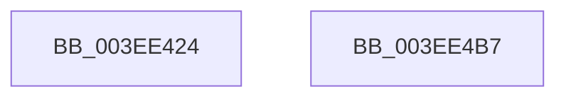

# VfAvlInsertReservedTreeNode

- RVA: `0x003EE424`–`0x003EE4B8` (길이 `148` bytes)
- VA: `0x00000001403EE424`
- 실행 섹션: `.text`
- PDB 이름 있음: `예`; PDB Function 태그: `아니요`
- unwind 정보 RVA: `0x0006C8E8`
- 디코드: `39`개 명령, `148/148` bytes 표시
- 미해석 바이트: `0` (있으면 어셈블리에 `.byte`로 보존)

> 이 문서는 커널 이미지의 기계어와 PDB 기호를 분석해 생성했습니다. 4번과 5번은 함수 원형과 자료형을 바이너리 사용 방식에서 추정한 C 해석이며 원본 소스 복구 결과는 아닙니다.

## 1. Dependencies

- 직접 호출 지점: **5**; 고유 호출 대상: **5**
- 직접 호출자로 확인된 함수: **5**
- RIP 상대 이미지 참조: **0**

### Outgoing calls
- `0x003EE444` → [ViAvlTableIndex](ViAvlTableIndex_function_003EF378.md) (function, `0x003EF378`)
- `0x003EE44F` → [ViAvlRaiseIrqlSafe](ViAvlRaiseIrqlSafe_function_003EF404.md) (function, `0x003EF404`)
- `0x003EE466` → [ViAvlAcquireTableLockAtDpcLevelSafe](ViAvlAcquireTableLockAtDpcLevelSafe_function_003EF3A0.md) (function, `0x003EF3A0`)
- `0x003EE489` → [RtlInsertElementGenericTableAvl](RtlInsertElementGenericTableAvl_function_003EE510.md) (function, `0x003EE510`)
- `0x003EE49D` → [ViAvlReleaseTableLockFromDpcLevel](ViAvlReleaseTableLockFromDpcLevel_function_003EF5D0.md) (function, `0x003EF5D0`)

### Direct callers
- [VfTargetDriversAdd](VfTargetDriversAdd_function_003EE2F4.md) at `0x003EE3A3`
- [ViDevObjAdd](../../pagevrfy/BA/ViDevObjAdd_function_00BA23F4.md) at `0x00BA245B`
- [VerifierIoInitializeRemoveLockEx](../../pagevrfy/BA/VerifierIoInitializeRemoveLockEx_function_00BA2610.md) at `0x00BA2741`
- [VfLookasideAdd](../../pagevrfy/BA/VfLookasideAdd_function_00BAFE34.md) at `0x00BAFF14`
- [VfTrackResource](../../pagevrfy/BB/VfTrackResource_function_00BB19A0.md) at `0x00BB1A85`

### Static image references
- 디코드된 RIP-relative 메모리 참조가 없습니다.

## 2. Other-region calls and transfers

- 다른 실행 섹션으로 향하는 call: **0**
- 별도 외부 분기/꼬리 이동을 확인하지 못했습니다.

## 3. Assembly (complete function range)

```asm
003EE424  48 89 5C 24 10                  mov qword ptr [rsp + 0x10], rbx
003EE429  48 89 6C 24 18                  mov qword ptr [rsp + 0x18], rbp
003EE42E  48 89 74 24 20                  mov qword ptr [rsp + 0x20], rsi
003EE433  57                              push rdi
003EE434  48 83 EC 20                     sub rsp, 0x20
003EE438  48 8B EA                        mov rbp, rdx
003EE43B  49 8B F8                        mov rdi, r8
003EE43E  49 8B 10                        mov rdx, qword ptr [r8]
003EE441  48 8B F1                        mov rsi, rcx
003EE444  E8 2F 0F 00 00                  call 0x1403ef378
003EE449  48 8B CD                        mov rcx, rbp
003EE44C  48 8B D8                        mov rbx, rax
003EE44F  E8 B0 0F 00 00                  call 0x1403ef404
003EE454  48 8B 4E 10                     mov rcx, qword ptr [rsi + 0x10]
003EE458  48 8D 1C 5B                     lea rbx, [rbx + rbx*2]
003EE45C  48 C1 E3 06                     shl rbx, 6
003EE460  48 8B D5                        mov rdx, rbp
003EE463  48 03 CB                        add rcx, rbx
003EE466  E8 35 0F 00 00                  call 0x1403ef3a0
003EE46B  48 8B 46 10                     mov rax, qword ptr [rsi + 0x10]
003EE46F  4C 8D 4C 24 30                  lea r9, [rsp + 0x30]
003EE474  41 B8 08 00 00 00               mov r8d, 8
003EE47A  48 8B D7                        mov rdx, rdi
003EE47D  48 89 7C 18 68                  mov qword ptr [rax + rbx + 0x68], rdi
003EE482  48 8B 4E 10                     mov rcx, qword ptr [rsi + 0x10]
003EE486  48 03 CB                        add rcx, rbx
003EE489  E8 82 00 00 00                  call 0x1403ee510
003EE48E  F0 48 FF 46 08                  lock inc qword ptr [rsi + 8]
003EE493  48 8B 4E 10                     mov rcx, qword ptr [rsi + 0x10]
003EE497  48 8B D5                        mov rdx, rbp
003EE49A  48 03 CB                        add rcx, rbx
003EE49D  E8 2E 11 00 00                  call 0x1403ef5d0
003EE4A2  48 8B 5C 24 38                  mov rbx, qword ptr [rsp + 0x38]
003EE4A7  48 8B 6C 24 40                  mov rbp, qword ptr [rsp + 0x40]
003EE4AC  48 8B 74 24 48                  mov rsi, qword ptr [rsp + 0x48]
003EE4B1  48 83 C4 20                     add rsp, 0x20
003EE4B5  5F                              pop rdi
003EE4B6  C3                              ret
003EE4B7  CC                              int3
```

## 4. C-style interpretation (structured pseudocode)

```c
__int64 __fastcall VfAvlInsertReservedTreeNode(__int64 a1, __int64 a2, __int64 a3)
{
    __int64 result;
    __int64 v_rbx;
    __int64 v_rsp;
    unsigned __int64 v_stack_p10;
    unsigned __int64 v_stack_p18;
    unsigned __int64 v_stack_p20;
    unsigned __int64 v_stack_p8;

    v_stack_p10 = v_rbx;
    v_stack_p18 = v_rbp;
    v_stack_p20 = v_rsi;
    v_rsp = (v_rsp) - (32);
    result = ViAvlTableIndex(a1, *(unsigned __int64 *)(a3), a3, a4);
    result = ViAvlRaiseIrqlSafe(a2, *(unsigned __int64 *)(a3), a3, a4);
    v_rbx = (result + result * 2) << (6);
    a1 = (*(unsigned __int64 *)(a1 + 16)) + (v_rbx);
    result = ViAvlAcquireTableLockAtDpcLevelSafe(a1, a2, a3, a4);
    *(unsigned __int64 *)(*(unsigned __int64 *)(a1 + 16) + v_rbx * 1 + 104) = a3;
    a1 = (*(unsigned __int64 *)(a1 + 16)) + (v_rbx);
    result = RtlInsertElementGenericTableAvl(a1, a3, 8, v_stack_p8);
    a1 = (*(unsigned __int64 *)(a1 + 16)) + (v_rbx);
    result = ViAvlReleaseTableLockFromDpcLevel(a1, a2, 8, v_stack_p8);
    v_rsp = (v_rsp) + (32);
    return result;
}
```

## 5. (Beta) C Style

```c
int64_t VfAvlInsertReservedTreeNode(void *Arg1, int64_t Arg2, void *Arg3)
{
    uint8_t *arg1 = (uint8_t *)Arg1;
    uint8_t *arg3 = (uint8_t *)Arg3;

    int64_t result;
    int64_t local_rbx;
    int64_t local_rsp;
    uint64_t v_stack_p10;
    uint64_t v_stack_p18;
    uint64_t v_stack_p20;
    uint64_t v_stack_p8;

    v_stack_p10 = local_rbx;
    v_stack_p18 = local_rbp;
    v_stack_p20 = local_rsi;
    local_rsp = (local_rsp) - (32);
    result = ViAvlTableIndex(Arg1, *(uint64_t *)(arg3), Arg3, a4);
    result = ViAvlRaiseIrqlSafe(Arg2, *(uint64_t *)(arg3), Arg3, a4);
    local_rbx = (result + result * 2) << (6);
    Arg1 = (*(uint64_t *)(arg1 + 0x10)) + (local_rbx);
    result = ViAvlAcquireTableLockAtDpcLevelSafe(Arg1, Arg2, Arg3, a4);
    *(void **)(*(uint64_t *)(arg1 + 0x10) + local_rbx * 1 + 0x68) = Arg3;
    Arg1 = (*(uint64_t *)(arg1 + 0x10)) + (local_rbx);
    result = RtlInsertElementGenericTableAvl(Arg1, Arg3, 8, v_stack_p8);
    Arg1 = (*(uint64_t *)(arg1 + 0x10)) + (local_rbx);
    result = ViAvlReleaseTableLockFromDpcLevel(Arg1, Arg2, 8, v_stack_p8);
    local_rsp = (local_rsp) + (32);
    return result;
}
```

### 관측된 메모리 오프셋

구조체 형식이 확인되지 않은 접근은 인자 기준의 오프셋으로만 기록했습니다.

| 기준 인자 | 오프셋 표현 | 폭 (bit) | 접근 |
|---|---:|---:|---|
| `Arg1` | `+ 0x8` | `64` | `R/W` |
| `Arg1` | `+ 0x10` | `64` | `R` |
| `Arg3` | `+ 0x0` | `64` | `R` |

## 6. Execution-region graph

[열기: 2D/3D 그래프와 함수 탐색 컨트롤 패널](../../../control-panel.html?section=text&rva=0x003EE424&view=graph)

- 2D 그래프는 위에서 아래로 흐르고, 3D 그래프는 빈 공간을 드래그해 회전합니다. Shift+드래그는 이동, 휠은 확대·축소, 함수 노드 선택은 대상 보고서 이동입니다.

### Static fallback


