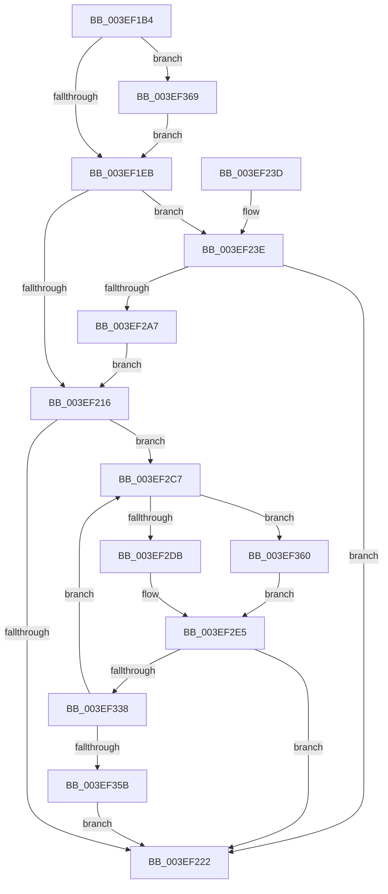

# VfAvlLookupTreeNode

- RVA: `0x003EF1B4`–`0x003EF371` (길이 `445` bytes)
- VA: `0x00000001403EF1B4`
- 실행 섹션: `.text`
- PDB 이름 있음: `예`; PDB Function 태그: `아니요`
- unwind 정보 RVA: `0x00096AD0`
- 디코드: `121`개 명령, `445/445` bytes 표시
- 미해석 바이트: `0` (있으면 어셈블리에 `.byte`로 보존)

> 이 문서는 커널 이미지의 기계어와 PDB 기호를 분석해 생성했습니다. 4번과 5번은 함수 원형과 자료형을 바이너리 사용 방식에서 추정한 C 해석이며 원본 소스 복구 결과는 아닙니다.

## 1. Dependencies

- 직접 호출 지점: **10**; 고유 호출 대상: **5**
- 직접 호출자로 확인된 함수: **40**
- RIP 상대 이미지 참조: **0**

### Outgoing calls
- `0x003EF257` → [ViAvlTableIndex](ViAvlTableIndex_function_003EF378.md) (function, `0x003EF378`)
- `0x003EF26F` → [ViAvlRaiseIrqlSafe](ViAvlRaiseIrqlSafe_function_003EF404.md) (function, `0x003EF404`)
- `0x003EF27A` → [ViAvlAcquireTableLockAtDpcLevelSafe](ViAvlAcquireTableLockAtDpcLevelSafe_function_003EF3A0.md) (function, `0x003EF3A0`)
- `0x003EF296` → [RtlLookupElementGenericTableFullAvl](RtlLookupElementGenericTableFullAvl_function_003EF460.md) (function, `0x003EF460`)
- `0x003EF2AE` → [ViAvlReleaseTableLockFromDpcLevel](ViAvlReleaseTableLockFromDpcLevel_function_003EF5D0.md) (function, `0x003EF5D0`)
- `0x003EF2EB` → [ViAvlTableIndex](ViAvlTableIndex_function_003EF378.md) (function, `0x003EF378`)
- `0x003EF2FF` → [ViAvlRaiseIrqlSafe](ViAvlRaiseIrqlSafe_function_003EF404.md) (function, `0x003EF404`)
- `0x003EF30A` → [ViAvlAcquireTableLockAtDpcLevelSafe](ViAvlAcquireTableLockAtDpcLevelSafe_function_003EF3A0.md) (function, `0x003EF3A0`)
- `0x003EF327` → [RtlLookupElementGenericTableFullAvl](RtlLookupElementGenericTableFullAvl_function_003EF460.md) (function, `0x003EF460`)
- `0x003EF33E` → [ViAvlReleaseTableLockFromDpcLevel](ViAvlReleaseTableLockFromDpcLevel_function_003EF5D0.md) (function, `0x003EF5D0`)

### Direct callers
- [VfTargetDriversGetNode](VfTargetDriversGetNode_function_003EE174.md) at `0x003EE1BA`
- [VfTargetDriversRemove](VfTargetDriversRemove_function_003EEF9C.md) at `0x003EF011`
- [VfTargetRecoverIoCallbacks](../61/VfTargetRecoverIoCallbacks_function_006131F0.md) at `0x0061322D`
- [VfTargetReplaceIoCallbacks](../61/VfTargetReplaceIoCallbacks_function_00613260.md) at `0x006132B1`
- [VfTargetDriversDisableVerifier](../../pagevrfy/B9/VfTargetDriversDisableVerifier_function_00B9B2CC.md) at `0x00B9B308`
- [VfTargetDriversEnableVerifier](../../pagevrfy/B9/VfTargetDriversEnableVerifier_function_00B9B354.md) at `0x00B9B3B8`
- [VfTargetEtwRegister](../../pagevrfy/B9/VfTargetEtwRegister_function_00B9B49C.md) at `0x00B9B505`
- [VfTargetEtwUnregister](../../pagevrfy/B9/VfTargetEtwUnregister_function_00B9B590.md) at `0x00B9B5E6`
- [VfTargetFreeContiguousMemory](../../pagevrfy/B9/VfTargetFreeContiguousMemory_function_00B9B6BC.md) at `0x00B9B706`
- [VfTargetWMIRegistrationControl](../../pagevrfy/B9/VfTargetWMIRegistrationControl_function_00B9B74C.md) at `0x00B9B7B3`
- [ViTargetAddToCounter](../../pagevrfy/B9/ViTargetAddToCounter_function_00B9B8E0.md) at `0x00B9B931`
- [ViTargetWMIDeregister](../../pagevrfy/B9/ViTargetWMIDeregister_function_00B9BC28.md) at `0x00B9BC5F`
- [IovpCallDriver1](../../pagevrfy/B9/IovpCallDriver1_function_00B9CCA4.md) at `0x00B9D127`
- [VerifierKeAcquireQueuedSpinLock](../../pagevrfy/B9/VerifierKeAcquireQueuedSpinLock_function_00B9FBD0.md) at `0x00B9FC4C`
- [ViDevObjRemove](../../pagevrfy/BA/ViDevObjRemove_function_00BA248C.md) at `0x00BA24F1`
- [ViRemLockDeleteFirstTreeNode](../../pagevrfy/BA/ViRemLockDeleteFirstTreeNode_function_00BA28F4.md) at `0x00BA292D`
- [ViRemLockFindSurrogate](../../pagevrfy/BA/ViRemLockFindSurrogate_function_00BA2994.md) at `0x00BA29C9`
- [VerifierKeAcquireInStackQueuedSpinLockAtDpcLevel](../../pagevrfy/BA/VerifierKeAcquireInStackQueuedSpinLockAtDpcLevel_function_00BA4F20.md) at `0x00BA4F8F`
- [VerifierKeAcquireInStackQueuedSpinLockCommon](../../pagevrfy/BA/VerifierKeAcquireInStackQueuedSpinLockCommon_function_00BA4FD8.md) at `0x00BA505E`
- [VerifierKeAcquireInStackQueuedSpinLockForDpcCommon](../../pagevrfy/BA/VerifierKeAcquireInStackQueuedSpinLockForDpcCommon_function_00BA5100.md) at `0x00BA516D`
- [VerifierKeAcquireInStackQueuedSpinLockRaiseToSynch](../../pagevrfy/BA/VerifierKeAcquireInStackQueuedSpinLockRaiseToSynch_function_00BA51C0.md) at `0x00BA5248`
- [VerifierKeAcquireQueuedSpinLockRaiseToSynch](../../pagevrfy/BA/VerifierKeAcquireQueuedSpinLockRaiseToSynch_function_00BA52C0.md) at `0x00BA5340`
- [VerifierKeAcquireSpinLockAtDpcLevel](../../pagevrfy/BA/VerifierKeAcquireSpinLockAtDpcLevel_function_00BA53B0.md) at `0x00BA5418`
- [VerifierKeSynchronizeExecution](../../pagevrfy/BA/VerifierKeSynchronizeExecution_function_00BA59A0.md) at `0x00BA5A25`
- [VerifierKeTryToAcquireQueuedSpinLock](../../pagevrfy/BA/VerifierKeTryToAcquireQueuedSpinLock_function_00BA5A80.md) at `0x00BA5B08`
- [VerifierKeTryToAcquireQueuedSpinLockRaiseToSynch](../../pagevrfy/BA/VerifierKeTryToAcquireQueuedSpinLockRaiseToSynch_function_00BA5B80.md) at `0x00BA5C08`
- [VerifierKeTryToAcquireSpinLockAtDpcLevel](../../pagevrfy/BA/VerifierKeTryToAcquireSpinLockAtDpcLevel_function_00BA5C80.md) at `0x00BA5CE8`
- [VerifierPortKeAcquireSpinLockNoXdv](../../pagevrfy/BA/VerifierPortKeAcquireSpinLockNoXdv_function_00BA5E80.md) at `0x00BA5F23`
- [ViKeAcquireSpinLockCommon](../../pagevrfy/BA/ViKeAcquireSpinLockCommon_function_00BA60B0.md) at `0x00BA6156`
- [ViFaultsInjectionNotification](../../pagevrfy/BA/ViFaultsInjectionNotification_function_00BA6BDC.md) at `0x00BA6C4B`
- [VfLookasideAdd](../../pagevrfy/BA/VfLookasideAdd_function_00BAFE34.md) at `0x00BAFEB4`
- [VfLookasideDelete](../../pagevrfy/BA/VfLookasideDelete_function_00BAFF58.md) at `0x00BAFFA7`
- [VerifierIoWMIRegistrationControl](../../pagevrfy/BB/VerifierIoWMIRegistrationControl_function_00BB1590.md) at `0x00BB15E7`
- [VfDeleteResource](../../pagevrfy/BB/VfDeleteResource_function_00BB187C.md) at `0x00BB18DD`
- [VfTrackResource](../../pagevrfy/BB/VfTrackResource_function_00BB19A0.md) at `0x00BB1A21`
- [VfWmiVerifyIrpStackUpward](../../pagevrfy/BB/VfWmiVerifyIrpStackUpward_function_00BB6200.md) at `0x00BB6280`
- [VfCheckForResource](../../pagevrfy/BB/VfCheckForResource_function_00BB71C8.md) at `0x00BB7255`
- [VfRemLockDeleteMemoryRange](../../pagevrfy/BB/VfRemLockDeleteMemoryRange_function_00BB7AEC.md) at `0x00BB7B5F`
- [VfCheckForLookaside](../../pagevrfy/BB/VfCheckForLookaside_function_00BB7C80.md) at `0x00BB7CDB`
- [VfHandlePoolAlloc](../../pagevrfy/BB/VfHandlePoolAlloc_function_00BB8A90.md) at `0x00BB8D7B`

### Static image references
- 디코드된 RIP-relative 메모리 참조가 없습니다.

## 2. Other-region calls and transfers

- 다른 실행 섹션으로 향하는 call: **0**
- 별도 외부 분기/꼬리 이동을 확인하지 못했습니다.

## 3. Assembly (complete function range)

```asm
003EF1B4  48 89 5C 24 10                  mov qword ptr [rsp + 0x10], rbx
003EF1B9  48 89 4C 24 08                  mov qword ptr [rsp + 8], rcx
003EF1BE  55                              push rbp
003EF1BF  56                              push rsi
003EF1C0  57                              push rdi
003EF1C1  41 54                           push r12
003EF1C3  41 55                           push r13
003EF1C5  41 56                           push r14
003EF1C7  41 57                           push r15
003EF1C9  48 8B EC                        mov rbp, rsp
003EF1CC  48 83 EC 40                     sub rsp, 0x40
003EF1D0  45 33 E4                        xor r12d, r12d
003EF1D3  45 33 ED                        xor r13d, r13d
003EF1D6  4D 8B F0                        mov r14, r8
003EF1D9  49 8B F1                        mov rsi, r9
003EF1DC  4C 8B FA                        mov r15, rdx
003EF1DF  4C 8B C1                        mov r8, rcx
003EF1E2  4D 85 C9                        test r9, r9
003EF1E5  0F 84 7E 01 00 00               je 0x1403ef369
003EF1EB  49 8B FE                        mov rdi, r14
003EF1EE  49 8B DE                        mov rbx, r14
003EF1F1  81 E7 FF 0F 00 00               and edi, 0xfff
003EF1F7  48 81 E3 00 F0 FF FF            and rbx, 0xfffffffffffff000
003EF1FE  48 81 C7 FF 0F 00 00            add rdi, 0xfff
003EF205  B9 00 10 00 00                  mov ecx, 0x1000
003EF20A  48 03 FE                        add rdi, rsi
003EF20D  48 C1 EF 0C                     shr rdi, 0xc
003EF211  49 3B DE                        cmp rbx, r14
003EF214  75 28                           jne 0x1403ef23e
003EF216  4C 03 F6                        add r14, rsi
003EF219  48 85 FF                        test rdi, rdi
003EF21C  0F 85 A5 00 00 00               jne 0x1403ef2c7
003EF222  48 8B 9C 24 88 00 00 00         mov rbx, qword ptr [rsp + 0x88]
003EF22A  49 8B C4                        mov rax, r12
003EF22D  48 83 C4 40                     add rsp, 0x40
003EF231  41 5F                           pop r15
003EF233  41 5E                           pop r14
003EF235  41 5D                           pop r13
003EF237  41 5C                           pop r12
003EF239  5F                              pop rdi
003EF23A  5E                              pop rsi
003EF23B  5D                              pop rbp
003EF23C  C3                              ret
003EF23D  CC                              int3
003EF23E  48 83 FF 01                     cmp rdi, 1
003EF242  4C 89 75 E8                     mov qword ptr [rbp - 0x18], r14
003EF246  48 8B C6                        mov rax, rsi
003EF249  49 8B D6                        mov rdx, r14
003EF24C  48 0F 47 C1                     cmova rax, rcx
003EF250  49 8B C8                        mov rcx, r8
003EF253  48 89 45 F0                     mov qword ptr [rbp - 0x10], rax
003EF257  E8 1C 01 00 00                  call 0x1403ef378
003EF25C  49 8B CF                        mov rcx, r15
003EF25F  4C 8D 24 40                     lea r12, [rax + rax*2]
003EF263  49 C1 E4 06                     shl r12, 6
003EF267  4D 03 60 10                     add r12, qword ptr [r8 + 0x10]
003EF26B  4C 89 65 E0                     mov qword ptr [rbp - 0x20], r12
003EF26F  E8 90 01 00 00                  call 0x1403ef404
003EF274  49 8B D7                        mov rdx, r15
003EF277  49 8B CC                        mov rcx, r12
003EF27A  E8 21 01 00 00                  call 0x1403ef3a0
003EF27F  4C 21 6D 58                     and qword ptr [rbp + 0x58], r13
003EF283  4C 8D 4D 50                     lea r9, [rbp + 0x50]
003EF287  44 21 6D 50                     and dword ptr [rbp + 0x50], r13d
003EF28B  4C 8D 45 58                     lea r8, [rbp + 0x58]
003EF28F  48 8D 55 E8                     lea rdx, [rbp - 0x18]
003EF293  49 8B CC                        mov rcx, r12
003EF296  E8 C5 01 00 00                  call 0x1403ef460
003EF29B  4C 8B E0                        mov r12, rax
003EF29E  48 85 C0                        test rax, rax
003EF2A1  0F 85 7B FF FF FF               jne 0x1403ef222
003EF2A7  48 8B 4D E0                     mov rcx, qword ptr [rbp - 0x20]
003EF2AB  49 8B D7                        mov rdx, r15
003EF2AE  E8 1D 03 00 00                  call 0x1403ef5d0
003EF2B3  4C 8B 45 40                     mov r8, qword ptr [rbp + 0x40]
003EF2B7  B9 00 10 00 00                  mov ecx, 0x1000
003EF2BC  48 FF CF                        dec rdi
003EF2BF  48 03 D9                        add rbx, rcx
003EF2C2  E9 4F FF FF FF                  jmp 0x1403ef216
003EF2C7  48 8D B3 00 10 00 00            lea rsi, [rbx + 0x1000]
003EF2CE  48 89 5D E8                     mov qword ptr [rbp - 0x18], rbx
003EF2D2  49 3B F6                        cmp rsi, r14
003EF2D5  0F 86 85 00 00 00               jbe 0x1403ef360
003EF2DB  49 8B C6                        mov rax, r14
003EF2DE  48 2B C3                        sub rax, rbx
003EF2E1  48 89 45 F0                     mov qword ptr [rbp - 0x10], rax
003EF2E5  48 8B D3                        mov rdx, rbx
003EF2E8  49 8B C8                        mov rcx, r8
003EF2EB  E8 88 00 00 00                  call 0x1403ef378
003EF2F0  49 8B CF                        mov rcx, r15
003EF2F3  48 8D 1C 40                     lea rbx, [rax + rax*2]
003EF2F7  48 C1 E3 06                     shl rbx, 6
003EF2FB  49 03 58 10                     add rbx, qword ptr [r8 + 0x10]
003EF2FF  E8 00 01 00 00                  call 0x1403ef404
003EF304  49 8B D7                        mov rdx, r15
003EF307  48 8B CB                        mov rcx, rbx
003EF30A  E8 91 00 00 00                  call 0x1403ef3a0
003EF30F  48 83 65 58 00                  and qword ptr [rbp + 0x58], 0
003EF314  4C 8D 4D 50                     lea r9, [rbp + 0x50]
003EF318  83 65 50 00                     and dword ptr [rbp + 0x50], 0
003EF31C  4C 8D 45 58                     lea r8, [rbp + 0x58]
003EF320  48 8D 55 E8                     lea rdx, [rbp - 0x18]
003EF324  48 8B CB                        mov rcx, rbx
003EF327  E8 34 01 00 00                  call 0x1403ef460
003EF32C  4C 8B E0                        mov r12, rax
003EF32F  48 85 C0                        test rax, rax
003EF332  0F 85 EA FE FF FF               jne 0x1403ef222
003EF338  49 8B D7                        mov rdx, r15
003EF33B  48 8B CB                        mov rcx, rbx
003EF33E  E8 8D 02 00 00                  call 0x1403ef5d0
003EF343  4C 8B 45 40                     mov r8, qword ptr [rbp + 0x40]
003EF347  49 FF C5                        inc r13
003EF34A  48 8B DE                        mov rbx, rsi
003EF34D  B9 00 10 00 00                  mov ecx, 0x1000
003EF352  4C 3B EF                        cmp r13, rdi
003EF355  0F 82 6C FF FF FF               jb 0x1403ef2c7
003EF35B  E9 C2 FE FF FF                  jmp 0x1403ef222
003EF360  48 89 4D F0                     mov qword ptr [rbp - 0x10], rcx
003EF364  E9 7C FF FF FF                  jmp 0x1403ef2e5
003EF369  48 8B 31                        mov rsi, qword ptr [rcx]
003EF36C  E9 7A FE FF FF                  jmp 0x1403ef1eb
```

## 4. C-style interpretation (structured pseudocode)

```c
__int64 __fastcall VfAvlLookupTreeNode(__int64 a1, __int64 a2, __int64 a3, __int64 a4)
{
    __int64 result;
    __int64 v_r12;
    __int64 v_r13;
    __int64 v_r14;
    __int64 v_rbx;
    __int64 v_rdi;
    __int64 v_rsp;
    unsigned __int64 v_stack_m48;
    unsigned __int64 v_stack_m50;
    unsigned __int64 v_stack_m58;
    unsigned __int64 v_stack_p10;
    unsigned __int64 v_stack_p18;
    unsigned __int64 v_stack_p20;
    unsigned __int64 v_stack_p8;

    v_stack_p10 = v_rbx;
    v_stack_p8 = a1;
    v_rsp = (v_rsp) - (64);
    v_r12 = 0;
    v_r13 = 0;
    if (a4 == 0) goto loc_003EF369;
loc_003EF1EB:
    v_rdi = (unsigned int)((a3) & (0xFFFULL));
    v_rbx = (a3) & (0xFFFFFFFFFFFFF000ULL);
    v_rdi = (v_rdi) + (0xFFFULL);
    v_rdi = (v_rdi) + (a4);
    v_rdi = (v_rdi) >> (12);
    if (v_rbx != a3) goto loc_003EF23E;
loc_003EF216:
    v_r14 = (a3) + (a4);
    if (v_rdi != 0) goto loc_003EF2C7;
loc_003EF222:
    v_rsp = (v_rsp) + (64);
    return 0;
loc_003EF23E:
    v_stack_m50 = v_r14;
    if (v_rdi > 1) { a4 = (unsigned int)(0x1000ULL); }
    v_stack_m48 = a4;
    result = ViAvlTableIndex(a1, v_r14, a1, a4);
    v_r12 = (result + result * 2) << (6);
    v_r12 = (v_r12) + (*(unsigned __int64 *)(a1 + 16));
    v_stack_m58 = v_r12;
    result = ViAvlRaiseIrqlSafe(a2, v_r14, a1, a4);
    result = ViAvlAcquireTableLockAtDpcLevelSafe(v_r12, a2, a1, a4);
    result = RtlLookupElementGenericTableFullAvl(v_r12, v_stack_m50, v_stack_p20, v_stack_p18);
    if (result != 0) goto loc_003EF222;
    result = ViAvlReleaseTableLockFromDpcLevel(v_stack_m58, a2, v_stack_p20, v_stack_p18);
    v_rdi = (v_rdi) - 1;
    v_rbx = (v_stack_p10) + ((unsigned int)(0x1000ULL));
    goto loc_003EF216;
loc_003EF2C7:
    v_stack_m50 = v_rbx;
    if ((v_rbx + 4096) <= v_r14) goto loc_003EF360;
    result = (v_r14) - (v_rbx);
    v_stack_m48 = result;
loc_003EF2E5:
    result = ViAvlTableIndex(v_stack_p8, v_rbx, v_stack_p8, v_stack_p18);
    v_rbx = (result + result * 2) << (6);
    v_rbx = (v_rbx) + (*(unsigned __int64 *)(v_stack_p8 + 16));
    result = ViAvlRaiseIrqlSafe(a2, v_rbx, v_stack_p8, v_stack_p18);
    result = ViAvlAcquireTableLockAtDpcLevelSafe(v_rbx, a2, v_stack_p8, v_stack_p18);
    result = RtlLookupElementGenericTableFullAvl(v_rbx, v_stack_m50, v_stack_p20, v_stack_p18);
    if (result != 0) goto loc_003EF222;
    result = ViAvlReleaseTableLockFromDpcLevel(v_rbx, a2, v_stack_p20, v_stack_p18);
    v_r13 = (v_r13) + 1;
    if (v_r13 < v_rdi) goto loc_003EF2C7;
    goto loc_003EF222;
loc_003EF360:
    v_stack_m48 = (unsigned int)(0x1000ULL);
    goto loc_003EF2E5;
loc_003EF369:
    goto loc_003EF1EB;
}
```

## 5. (Beta) C Style

```c
int64_t VfAvlLookupTreeNode(void *Arg1, int64_t Arg2, int64_t Arg3, int64_t Arg4)
{
    uint8_t *arg1 = (uint8_t *)Arg1;

    int64_t result;
    int64_t local_r12;
    int64_t local_r13;
    int64_t local_r14;
    int64_t local_rbx;
    int64_t local_rdi;
    int64_t local_rsp;
    uint64_t v_stack_m48;
    uint64_t v_stack_m50;
    uint64_t v_stack_m58;
    uint64_t v_stack_p10;
    uint64_t v_stack_p18;
    uint64_t v_stack_p20;
    uint64_t v_stack_p8;

    v_stack_p10 = local_rbx;
    v_stack_p8 = Arg1;
    local_rsp = (local_rsp) - (64);
    local_r12 = 0;
    local_r13 = 0;
    if (Arg4 == 0) goto loc_003EF369;
loc_003EF1EB:
    local_rdi = (uint32_t)((Arg3) & (0xFFFULL));
    local_rbx = (Arg3) & (0xFFFFFFFFFFFFF000ULL);
    local_rdi = (local_rdi) + (0xFFFULL);
    local_rdi = (local_rdi) + (Arg4);
    local_rdi = (local_rdi) >> (12);
    if (local_rbx != Arg3) goto loc_003EF23E;
loc_003EF216:
    local_r14 = (Arg3) + (Arg4);
    if (local_rdi != 0) goto loc_003EF2C7;
loc_003EF222:
    local_rsp = (local_rsp) + (64);
    return 0;
loc_003EF23E:
    v_stack_m50 = local_r14;
    if (local_rdi > 1) { Arg4 = (uint32_t)(0x1000ULL); }
    v_stack_m48 = Arg4;
    result = ViAvlTableIndex(Arg1, local_r14, Arg1, Arg4);
    local_r12 = (result + result * 2) << (6);
    local_r12 = (local_r12) + (*(uint64_t *)(arg1 + 0x10));
    v_stack_m58 = local_r12;
    result = ViAvlRaiseIrqlSafe(Arg2, local_r14, Arg1, Arg4);
    result = ViAvlAcquireTableLockAtDpcLevelSafe(local_r12, Arg2, Arg1, Arg4);
    result = RtlLookupElementGenericTableFullAvl(local_r12, v_stack_m50, v_stack_p20, v_stack_p18);
    if (result != 0) goto loc_003EF222;
    result = ViAvlReleaseTableLockFromDpcLevel(v_stack_m58, Arg2, v_stack_p20, v_stack_p18);
    local_rdi = (local_rdi) - 1;
    local_rbx = (v_stack_p10) + ((uint32_t)(0x1000ULL));
    goto loc_003EF216;
loc_003EF2C7:
    v_stack_m50 = local_rbx;
    if ((local_rbx + 4096) <= local_r14) goto loc_003EF360;
    result = (local_r14) - (local_rbx);
    v_stack_m48 = result;
loc_003EF2E5:
    result = ViAvlTableIndex(v_stack_p8, local_rbx, v_stack_p8, v_stack_p18);
    local_rbx = (result + result * 2) << (6);
    local_rbx = (local_rbx) + (*(uint64_t *)(v_stack_p8 + 0x10));
    result = ViAvlRaiseIrqlSafe(Arg2, local_rbx, v_stack_p8, v_stack_p18);
    result = ViAvlAcquireTableLockAtDpcLevelSafe(local_rbx, Arg2, v_stack_p8, v_stack_p18);
    result = RtlLookupElementGenericTableFullAvl(local_rbx, v_stack_m50, v_stack_p20, v_stack_p18);
    if (result != 0) goto loc_003EF222;
    result = ViAvlReleaseTableLockFromDpcLevel(local_rbx, Arg2, v_stack_p20, v_stack_p18);
    local_r13 = (local_r13) + 1;
    if (local_r13 < local_rdi) goto loc_003EF2C7;
    goto loc_003EF222;
loc_003EF360:
    v_stack_m48 = (uint32_t)(0x1000ULL);
    goto loc_003EF2E5;
loc_003EF369:
    goto loc_003EF1EB;
}
```

### 관측된 메모리 오프셋

구조체 형식이 확인되지 않은 접근은 인자 기준의 오프셋으로만 기록했습니다.

| 기준 인자 | 오프셋 표현 | 폭 (bit) | 접근 |
|---|---:|---:|---|
| `Arg1` | `+ 0x0` | `64` | `R` |

## 6. Execution-region graph

[열기: 2D/3D 그래프와 함수 탐색 컨트롤 패널](../../../control-panel.html?section=text&rva=0x003EF1B4&view=graph)

- 2D 그래프는 위에서 아래로 흐르고, 3D 그래프는 빈 공간을 드래그해 회전합니다. Shift+드래그는 이동, 휠은 확대·축소, 함수 노드 선택은 대상 보고서 이동입니다.

### Static fallback


