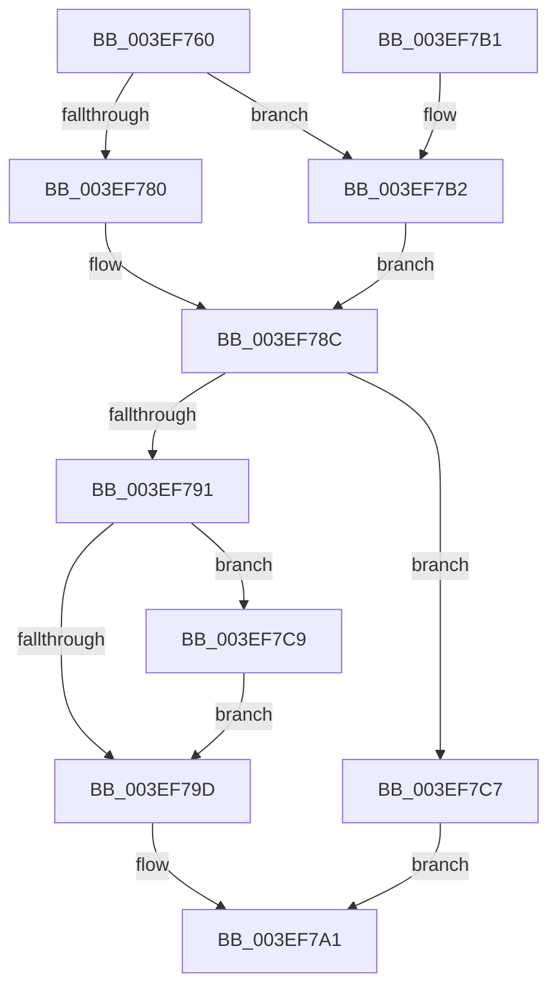

# VfAvlReserveNode

- RVA: `0x003EF760`–`0x003EF7CE` (길이 `110` bytes)
- VA: `0x00000001403EF760`
- 실행 섹션: `.text`
- PDB 이름 있음: `예`; PDB Function 태그: `아니요`
- unwind 정보 RVA: `0x0006F908`
- 디코드: `33`개 명령, `110/110` bytes 표시
- 미해석 바이트: `0` (있으면 어셈블리에 `.byte`로 보존)

> 이 문서는 커널 이미지의 기계어와 PDB 기호를 분석해 생성했습니다. 4번과 5번은 함수 원형과 자료형을 바이너리 사용 방식에서 추정한 C 해석이며 원본 소스 복구 결과는 아닙니다.

## 1. Dependencies

- 직접 호출 지점: **2**; 고유 호출 대상: **2**
- 직접 호출자로 확인된 함수: **5**
- RIP 상대 이미지 참조: **1**

### Outgoing calls
- `0x003EF787` → [ExAllocateFromNPagedLookasideList](../38/ExAllocateFromNPagedLookasideList_function_0038E6C0.md) (function, `0x0038E6C0`)
- `0x003EF7C0` → [ExAllocatePool2](../../poolcode/B8/ExAllocatePool2_function_00B820F0.md) (function, `0x00B820F0`)

### Direct callers
- [VfTargetDriversAdd](VfTargetDriversAdd_function_003EE2F4.md) at `0x003EE34B`
- [ViDevObjAdd](../../pagevrfy/BA/ViDevObjAdd_function_00BA23F4.md) at `0x00BA242A`
- [VerifierIoInitializeRemoveLockEx](../../pagevrfy/BA/VerifierIoInitializeRemoveLockEx_function_00BA2610.md) at `0x00BA26DC`
- [VfLookasideAdd](../../pagevrfy/BA/VfLookasideAdd_function_00BAFE34.md) at `0x00BAFE7D`
- [VfTrackResource](../../pagevrfy/BB/VfTrackResource_function_00BB19A0.md) at `0x00BB19ED`

### Static image references
- `0x003EF780` → RVA `0x00E28A00` (`.data`; read)

## 2. Other-region calls and transfers

- 다른 실행 섹션으로 향하는 call: **1**
  - `0x003EF7C0` → [ExAllocatePool2](../../poolcode/B8/ExAllocatePool2_function_00B820F0.md) (`.text` → `POOLCODE`)
- 별도 외부 분기/꼬리 이동을 확인하지 못했습니다.

## 3. Assembly (complete function range)

```asm
003EF760  48 89 5C 24 08                  mov qword ptr [rsp + 8], rbx
003EF765  48 89 74 24 10                  mov qword ptr [rsp + 0x10], rsi
003EF76A  57                              push rdi
003EF76B  48 83 EC 20                     sub rsp, 0x20
003EF76F  8B 41 1C                        mov eax, dword ptr [rcx + 0x1c]
003EF772  49 8B D8                        mov rbx, r8
003EF775  48 8B F2                        mov rsi, rdx
003EF778  48 8B F9                        mov rdi, rcx
003EF77B  83 F8 01                        cmp eax, 1
003EF77E  75 32                           jne 0x1403ef7b2
003EF780  48 8D 0D 79 92 A3 00            lea rcx, [rip + 0xa39279]
003EF787  E8 34 EF F9 FF                  call 0x14038e6c0
003EF78C  48 85 C0                        test rax, rax
003EF78F  74 36                           je 0x1403ef7c7
003EF791  48 83 C0 20                     add rax, 0x20
003EF795  48 89 30                        mov qword ptr [rax], rsi
003EF798  48 85 DB                        test rbx, rbx
003EF79B  74 2C                           je 0x1403ef7c9
003EF79D  48 89 58 08                     mov qword ptr [rax + 8], rbx
003EF7A1  48 8B 5C 24 30                  mov rbx, qword ptr [rsp + 0x30]
003EF7A6  48 8B 74 24 38                  mov rsi, qword ptr [rsp + 0x38]
003EF7AB  48 83 C4 20                     add rsp, 0x20
003EF7AF  5F                              pop rdi
003EF7B0  C3                              ret
003EF7B1  CC                              int3
003EF7B2  48 8B D0                        mov rdx, rax
003EF7B5  B9 40 00 00 00                  mov ecx, 0x40
003EF7BA  41 B8 56 66 41 54               mov r8d, 0x54416656
003EF7C0  E8 2B 29 79 00                  call 0x140b820f0
003EF7C5  EB C5                           jmp 0x1403ef78c
003EF7C7  EB D8                           jmp 0x1403ef7a1
003EF7C9  48 8B 1F                        mov rbx, qword ptr [rdi]
003EF7CC  EB CF                           jmp 0x1403ef79d
```

## 4. C-style interpretation (structured pseudocode)

```c
__int64 __fastcall VfAvlReserveNode(__int64 a1, __int64 a2, __int64 a3)
{
    __int64 result;
    __int64 v_rsp;
    unsigned __int64 v_stack_p10;
    unsigned __int64 v_stack_p8;

    v_stack_p8 = v_rbx;
    v_stack_p10 = v_rsi;
    v_rsp = (v_rsp) - (32);
    if (((unsigned int)((unsigned int)(*(unsigned int *)(a1 + 28)))) != 1) goto loc_003EF7B2;
    result = ExAllocateFromNPagedLookasideList(v_rip + 10719865, a2, a3, a4);
loc_003EF78C:
    if (result == 0) goto loc_003EF7C7;
    result = (result) + (32);
    *(unsigned __int64 *)(result) = a2;
    if (a3 == 0) goto loc_003EF7C9;
loc_003EF79D:
    *(unsigned __int64 *)(result + 8) = a3;
loc_003EF7A1:
    v_rsp = (v_rsp) + (32);
    return result;
loc_003EF7B2:
    result = ExAllocatePool2(64, result, (unsigned int)(0x54416656ULL), a4);
    goto loc_003EF78C;
loc_003EF7C7:
    goto loc_003EF7A1;
loc_003EF7C9:
    goto loc_003EF79D;
}
```

## 5. (Beta) C Style

```c
int64_t VfAvlReserveNode(void *Arg1, int64_t Arg2, int64_t Arg3)
{
    uint8_t *arg1 = (uint8_t *)Arg1;

    int64_t result;
    int64_t local_rsp;
    uint64_t v_stack_p10;
    uint64_t v_stack_p8;

    v_stack_p8 = local_rbx;
    v_stack_p10 = local_rsi;
    local_rsp = (local_rsp) - (32);
    if (((uint32_t)((uint32_t)(*(uint32_t *)(arg1 + 0x1C)))) != 1) goto loc_003EF7B2;
    result = ExAllocateFromNPagedLookasideList(v_rip + 10719865, Arg2, Arg3, a4);
loc_003EF78C:
    if (result == 0) goto loc_003EF7C7;
    result = (result) + (32);
    *(uint64_t *)(result) = Arg2;
    if (Arg3 == 0) goto loc_003EF7C9;
loc_003EF79D:
    *(uint64_t *)(result + 0x8) = Arg3;
loc_003EF7A1:
    local_rsp = (local_rsp) + (32);
    return result;
loc_003EF7B2:
    result = ExAllocatePool2(64, result, (uint32_t)(0x54416656ULL), a4);
    goto loc_003EF78C;
loc_003EF7C7:
    goto loc_003EF7A1;
loc_003EF7C9:
    goto loc_003EF79D;
}
```

### 관측된 메모리 오프셋

구조체 형식이 확인되지 않은 접근은 인자 기준의 오프셋으로만 기록했습니다.

| 기준 인자 | 오프셋 표현 | 폭 (bit) | 접근 |
|---|---:|---:|---|
| `Arg1` | `+ 0x0` | `64` | `R` |
| `Arg1` | `+ 0x1C` | `32` | `R` |

## 6. Execution-region graph

[열기: 2D/3D 그래프와 함수 탐색 컨트롤 패널](../../../control-panel.html?section=text&rva=0x003EF760&view=graph)

- 2D 그래프는 위에서 아래로 흐르고, 3D 그래프는 빈 공간을 드래그해 회전합니다. Shift+드래그는 이동, 휠은 확대·축소, 함수 노드 선택은 대상 보고서 이동입니다.

### Static fallback


