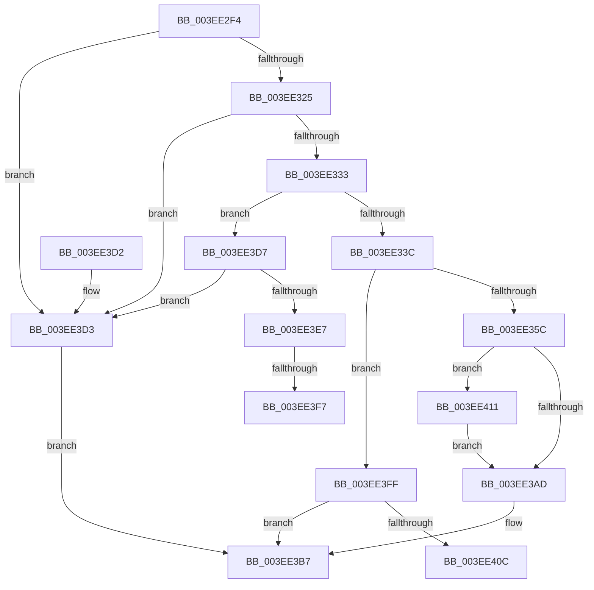

# VfTargetDriversAdd

- RVA: `0x003EE2F4`–`0x003EE41D` (길이 `297` bytes)
- VA: `0x00000001403EE2F4`
- 실행 섹션: `.text`
- PDB 이름 있음: `예`; PDB Function 태그: `예`
- unwind 정보 RVA: `0x000969F0`
- 디코드: `77`개 명령, `297/297` bytes 표시
- 미해석 바이트: `0` (있으면 어셈블리에 `.byte`로 보존)

> 이 문서는 커널 이미지의 기계어와 PDB 기호를 분석해 생성했습니다. 4번과 5번은 함수 원형과 자료형을 바이너리 사용 방식에서 추정한 C 해석이며 원본 소스 복구 결과는 아닙니다.

## 1. Dependencies

- 직접 호출 지점: **7**; 고유 호출 대상: **7**
- 직접 호출자로 확인된 함수: **2**
- RIP 상대 이미지 참조: **6**

### Outgoing calls
- `0x003EE34B` → [VfAvlReserveNode](VfAvlReserveNode_function_003EF760.md) (function, `0x003EF760`)
- `0x003EE363` → [VfAssignRuleClassIdToClassDriver](VfAssignRuleClassIdToClassDriver_function_003EF6B4.md) (function, `0x003EF6B4`)
- `0x003EE36F` → [VfUpdateWhitelist](VfUpdateWhitelist_function_003EF628.md) (function, `0x003EF628`)
- `0x003EE37B` → [VfThunkAddTargetNotify](../../pagevrfy/BB/VfThunkAddTargetNotify_function_00BB64E4.md) (function, `0x00BB64E4`)
- `0x003EE3A3` → [VfAvlInsertReservedTreeNode](VfAvlInsertReservedTreeNode_function_003EE424.md) (function, `0x003EE424`)
- `0x003EE3B2` → [VfAvlCleanupLockContext](VfAvlCleanupLockContext_function_003EF56C.md) (function, `0x003EF56C`)
- `0x003EE3DA` → [ViTargetDriversAllocateVerifiedData](../../pagevrfy/B9/ViTargetDriversAllocateVerifiedData_function_00B9B984.md) (function, `0x00B9B984`)

### Direct callers
- [VfSuspectDriversLoadCallback](../../pagevrfy/BA/VfSuspectDriversLoadCallback_function_00BAAB2C.md) at `0x00BAADEB`
- [VfDriverLoadImage](../../pagevrfy/BB/VfDriverLoadImage_function_00BB7DE4.md) at `0x00BB7E5E`

### Static image references
- `0x003EE311` → RVA `0x00F044C0` (`.data`; read)
- `0x003EE325` → RVA `0x00F04954` (`.data`; read)
- `0x003EE340` → RVA `0x00F049A0` (`.data`; read)
- `0x003EE3E7` → RVA `0x00FC41A0` (`.data`; read)
- `0x003EE3FF` → RVA `0x00F04958` (`.data`; read/write)
- `0x003EE411` → RVA `0x00F049C0` (`.data`; read/write)

## 2. Other-region calls and transfers

- 다른 실행 섹션으로 향하는 call: **2**
  - `0x003EE37B` → [VfThunkAddTargetNotify](../../pagevrfy/BB/VfThunkAddTargetNotify_function_00BB64E4.md) (`.text` → `PAGEVRFY`)
  - `0x003EE3DA` → [ViTargetDriversAllocateVerifiedData](../../pagevrfy/B9/ViTargetDriversAllocateVerifiedData_function_00B9B984.md) (`.text` → `PAGEVRFY`)
- call이 아닌 외부 분기/꼬리 이동: **3**
  - `0x003EE3F1` → [sub_006EAE08](../6E/Unknown_function_006EAE08.md) (`tail-transfer`)
  - `0x003EE3FA` → [sub_006EAE08 + 0x3](../6E/Unknown_function_006EAE08.md) (`tail-transfer`)
  - `0x003EE40C` → [sub_006EAE08 + 0x19](../6E/Unknown_function_006EAE08.md) (`tail-transfer`)

## 3. Assembly (complete function range)

```asm
003EE2F4  48 89 5C 24 08                  mov qword ptr [rsp + 8], rbx
003EE2F9  48 89 6C 24 10                  mov qword ptr [rsp + 0x10], rbp
003EE2FE  48 89 74 24 18                  mov qword ptr [rsp + 0x18], rsi
003EE303  57                              push rdi
003EE304  41 56                           push r14
003EE306  41 57                           push r15
003EE308  48 83 EC 40                     sub rsp, 0x40
003EE30C  33 FF                           xor edi, edi
003EE30E  44 8A FA                        mov r15b, dl
003EE311  39 3D A9 61 B1 00               cmp dword ptr [rip + 0xb161a9], edi
003EE317  4C 8B F1                        mov r14, rcx
003EE31A  BB 01 00 00 00                  mov ebx, 1
003EE31F  0F 85 AE 00 00 00               jne 0x1403ee3d3
003EE325  8B 05 29 66 B1 00               mov eax, dword ptr [rip + 0xb16629]
003EE32B  85 C0                           test eax, eax
003EE32D  0F 84 A0 00 00 00               je 0x1403ee3d3
003EE333  4D 85 C0                        test r8, r8
003EE336  0F 85 9B 00 00 00               jne 0x1403ee3d7
003EE33C  45 8B 46 40                     mov r8d, dword ptr [r14 + 0x40]
003EE340  48 8D 0D 59 66 B1 00            lea rcx, [rip + 0xb16659]
003EE347  49 8B 56 30                     mov rdx, qword ptr [r14 + 0x30]
003EE34B  E8 10 14 00 00                  call 0x1403ef760
003EE350  48 8B E8                        mov rbp, rax
003EE353  48 85 C0                        test rax, rax
003EE356  0F 84 A3 00 00 00               je 0x1403ee3ff
003EE35C  49 8B 4E 60                     mov rcx, qword ptr [r14 + 0x60]
003EE360  48 8B D0                        mov rdx, rax
003EE363  E8 4C 13 00 00                  call 0x1403ef6b4
003EE368  49 8B 4E 60                     mov rcx, qword ptr [r14 + 0x60]
003EE36C  48 8B D5                        mov rdx, rbp
003EE36F  E8 B4 12 00 00                  call 0x1403ef628
003EE374  48 8B CD                        mov rcx, rbp
003EE377  48 89 7D 40                     mov qword ptr [rbp + 0x40], rdi
003EE37B  E8 64 81 7C 00                  call 0x140bb64e4
003EE380  0F 57 C0                        xorps xmm0, xmm0
003EE383  48 8D 54 24 20                  lea rdx, [rsp + 0x20]
003EE388  33 C0                           xor eax, eax
003EE38A  48 8D 0D 0F 66 B1 00            lea rcx, [rip + 0xb1660f]
003EE391  0F 11 44 24 20                  movups xmmword ptr [rsp + 0x20], xmm0
003EE396  4C 8B C5                        mov r8, rbp
003EE399  C6 44 24 2C 04                  mov byte ptr [rsp + 0x2c], 4
003EE39E  48 89 44 24 30                  mov qword ptr [rsp + 0x30], rax
003EE3A3  E8 7C 00 00 00                  call 0x1403ee424
003EE3A8  48 85 FF                        test rdi, rdi
003EE3AB  75 64                           jne 0x1403ee411
003EE3AD  48 8D 4C 24 20                  lea rcx, [rsp + 0x20]
003EE3B2  E8 B5 11 00 00                  call 0x1403ef56c
003EE3B7  48 8B 6C 24 68                  mov rbp, qword ptr [rsp + 0x68]
003EE3BC  8B C3                           mov eax, ebx
003EE3BE  48 8B 5C 24 60                  mov rbx, qword ptr [rsp + 0x60]
003EE3C3  48 8B 74 24 70                  mov rsi, qword ptr [rsp + 0x70]
003EE3C8  48 83 C4 40                     add rsp, 0x40
003EE3CC  41 5F                           pop r15
003EE3CE  41 5E                           pop r14
003EE3D0  5F                              pop rdi
003EE3D1  C3                              ret
003EE3D2  CC                              int3
003EE3D3  33 DB                           xor ebx, ebx
003EE3D5  EB E0                           jmp 0x1403ee3b7
003EE3D7  49 8B C8                        mov rcx, r8
003EE3DA  E8 A5 D5 7A 00                  call 0x140b9b984
003EE3DF  48 8B F8                        mov rdi, rax
003EE3E2  48 85 C0                        test rax, rax
003EE3E5  74 EC                           je 0x1403ee3d3
003EE3E7  83 3D B2 5D BD 00 00            cmp dword ptr [rip + 0xbd5db2], 0
003EE3EE  8B 40 20                        mov eax, dword ptr [rax + 0x20]
003EE3F1  0F 85 11 CA 2F 00               jne 0x1406eae08
003EE3F7  83 C8 02                        or eax, 2
003EE3FA  E9 0C CA 2F 00                  jmp 0x1406eae0b
003EE3FF  87 1D 53 65 B1 00               xchg dword ptr [rip + 0xb16553], ebx
003EE405  33 DB                           xor ebx, ebx
003EE407  48 85 FF                        test rdi, rdi
003EE40A  74 AB                           je 0x1403ee3b7
003EE40C  E9 10 CA 2F 00                  jmp 0x1406eae21
003EE411  01 1D A9 65 B1 00               add dword ptr [rip + 0xb165a9], ebx
003EE417  44 88 7F 30                     mov byte ptr [rdi + 0x30], r15b
003EE41B  EB 90                           jmp 0x1403ee3ad
```

## 4. C-style interpretation (structured pseudocode)

```c
__int64 __fastcall VfTargetDriversAdd(__int64 a1, unsigned __int8 a2, __int64 a3)
{
    __int64 result;
    __int64 v_rbx;
    __int64 v_rdi;
    __int64 v_rsp;
    unsigned __int64 v_stack_m28;
    unsigned __int8 v_stack_m2C;
    unsigned __int64 v_stack_m38;
    unsigned __int64 v_stack_p10;
    unsigned __int64 v_stack_p18;
    unsigned __int64 v_stack_p8;

    v_stack_p8 = v_rbx;
    v_stack_p10 = v_rbp;
    v_stack_p18 = v_rsi;
    v_rsp = (v_rsp) - (64);
    v_rdi = 0;
    if ((*(unsigned int *)(v_rip + 11624873)) != 0) goto loc_003EE3D3;
    if ((unsigned int)((unsigned int)(*(unsigned int *)(v_rip + 11626025))) == 0) goto loc_003EE3D3;
    if (a3 != 0) goto loc_003EE3D7;
    result = VfAvlReserveNode(v_rip + 11626073, *(unsigned __int64 *)(a1 + 48), (unsigned int)(*(unsigned int *)(a1 + 64)), a4);
    if (result == 0) goto loc_003EE3FF;
    result = VfAssignRuleClassIdToClassDriver(*(unsigned __int64 *)(a1 + 96), result, (unsigned int)(*(unsigned int *)(a1 + 64)), a4);
    result = VfUpdateWhitelist(*(unsigned __int64 *)(a1 + 96), result, (unsigned int)(*(unsigned int *)(a1 + 64)), a4);
    *(unsigned __int64 *)(result + 64) = 0;
    result = VfThunkAddTargetNotify(result, result, (unsigned int)(*(unsigned int *)(a1 + 64)), a4);
    result = 0;
    v_stack_m38 = v_xmm0;
    v_stack_m2C = 4;
    v_stack_m28 = 0;
    result = VfAvlInsertReservedTreeNode(v_rip + 11625999, v_stack_m38, 0, a4);
    if (0 != 0) goto loc_003EE411;
loc_003EE3AD:
    result = VfAvlCleanupLockContext(v_stack_m38, v_stack_m38, 0, a4);
loc_003EE3B7:
    v_rsp = (v_rsp) + (64);
    return 1;
loc_003EE3D3:
    v_rbx = 0;
    goto loc_003EE3B7;
loc_003EE3D7:
    result = ViTargetDriversAllocateVerifiedData(0, v_stack_m38, 0, a4);
    if (result == 0) goto loc_003EE3D3;
    result = (unsigned int)(((unsigned int)(*(unsigned int *)(result + 32))) | (2));
loc_003EE3FF:
    v_rbx = 0;
    if (result == 0) goto loc_003EE3B7;
loc_003EE411:
    *(unsigned __int8 *)(result + 48) = a2;
    goto loc_003EE3AD;
}
```

## 5. (Beta) C Style

```c
int64_t VfTargetDriversAdd(void *Arg1, uint8_t Arg2, int64_t Arg3)
{
    uint8_t *arg1 = (uint8_t *)Arg1;

    int64_t result;
    int64_t local_rbx;
    int64_t local_rdi;
    int64_t local_rsp;
    uint64_t v_stack_m28;
    uint8_t v_stack_m2C;
    uint64_t v_stack_m38;
    uint64_t v_stack_p10;
    uint64_t v_stack_p18;
    uint64_t v_stack_p8;

    v_stack_p8 = local_rbx;
    v_stack_p10 = local_rbp;
    v_stack_p18 = local_rsi;
    local_rsp = (local_rsp) - (64);
    local_rdi = 0;
    if ((*(uint32_t *)(v_rip + 0xB161A9)) != 0) goto loc_003EE3D3;
    if ((uint32_t)((uint32_t)(*(uint32_t *)(v_rip + 0xB16629))) == 0) goto loc_003EE3D3;
    if (Arg3 != 0) goto loc_003EE3D7;
    result = VfAvlReserveNode(v_rip + 11626073, *(uint64_t *)(arg1 + 0x30), (uint32_t)(*(uint32_t *)(arg1 + 0x40)), a4);
    if (result == 0) goto loc_003EE3FF;
    result = VfAssignRuleClassIdToClassDriver(*(uint64_t *)(arg1 + 0x60), result, (uint32_t)(*(uint32_t *)(arg1 + 0x40)), a4);
    result = VfUpdateWhitelist(*(uint64_t *)(arg1 + 0x60), result, (uint32_t)(*(uint32_t *)(arg1 + 0x40)), a4);
    *(uint64_t *)(result + 0x40) = 0;
    result = VfThunkAddTargetNotify(result, result, (uint32_t)(*(uint32_t *)(arg1 + 0x40)), a4);
    result = 0;
    v_stack_m38 = v_xmm0;
    v_stack_m2C = 4;
    v_stack_m28 = 0;
    result = VfAvlInsertReservedTreeNode(v_rip + 11625999, v_stack_m38, 0, a4);
    if (0 != 0) goto loc_003EE411;
loc_003EE3AD:
    result = VfAvlCleanupLockContext(v_stack_m38, v_stack_m38, 0, a4);
loc_003EE3B7:
    local_rsp = (local_rsp) + (64);
    return 1;
loc_003EE3D3:
    local_rbx = 0;
    goto loc_003EE3B7;
loc_003EE3D7:
    result = ViTargetDriversAllocateVerifiedData(0, v_stack_m38, 0, a4);
    if (result == 0) goto loc_003EE3D3;
    result = (uint32_t)(((uint32_t)(*(uint32_t *)(result + 0x20))) | (2));
loc_003EE3FF:
    local_rbx = 0;
    if (result == 0) goto loc_003EE3B7;
loc_003EE411:
    *(uint8_t *)(result + 0x30) = Arg2;
    goto loc_003EE3AD;
}
```

### 관측된 메모리 오프셋

구조체 형식이 확인되지 않은 접근은 인자 기준의 오프셋으로만 기록했습니다.

| 기준 인자 | 오프셋 표현 | 폭 (bit) | 접근 |
|---|---:|---:|---|
| `Arg1` | `+ 0x30` | `64` | `R` |
| `Arg1` | `+ 0x40` | `32` | `R` |
| `Arg1` | `+ 0x60` | `64` | `R` |

## 6. Execution-region graph

[열기: 2D/3D 그래프와 함수 탐색 컨트롤 패널](../../../control-panel.html?section=text&rva=0x003EE2F4&view=graph)

- 2D 그래프는 위에서 아래로 흐르고, 3D 그래프는 빈 공간을 드래그해 회전합니다. Shift+드래그는 이동, 휠은 확대·축소, 함수 노드 선택은 대상 보고서 이동입니다.

### Static fallback


