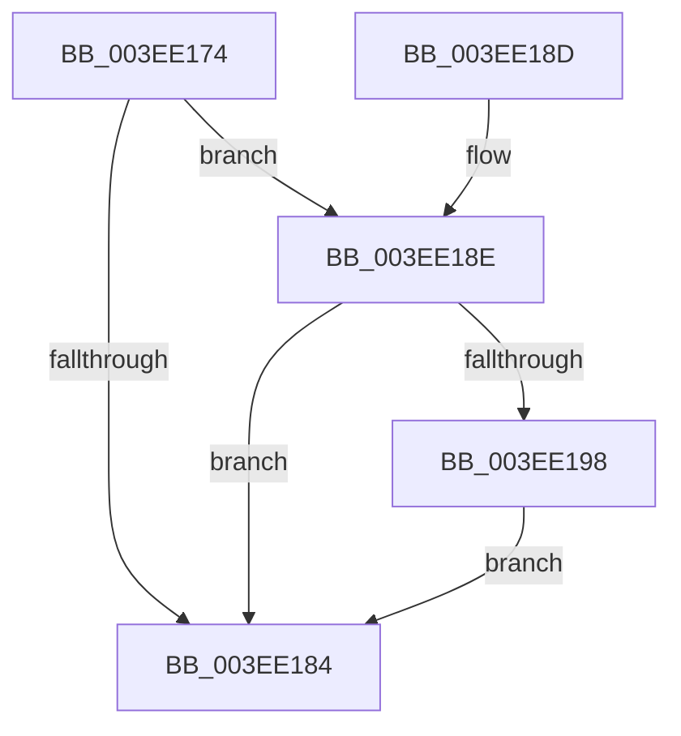

# VfTargetDriversGetNode

- RVA: `0x003EE174`–`0x003EE1CE` (길이 `90` bytes)
- VA: `0x00000001403EE174`
- 실행 섹션: `.text`
- PDB 이름 있음: `예`; PDB Function 태그: `아니요`
- unwind 정보 RVA: `0x000969CC`
- 디코드: `26`개 명령, `90/90` bytes 표시
- 미해석 바이트: `0` (있으면 어셈블리에 `.byte`로 보존)

> 이 문서는 커널 이미지의 기계어와 PDB 기호를 분석해 생성했습니다. 4번과 5번은 함수 원형과 자료형을 바이너리 사용 방식에서 추정한 C 해석이며 원본 소스 복구 결과는 아닙니다.

## 1. Dependencies

- 직접 호출 지점: **2**; 고유 호출 대상: **2**
- 직접 호출자로 확인된 함수: **8**
- RIP 상대 이미지 참조: **3**

### Outgoing calls
- `0x003EE1BA` → [VfAvlLookupTreeNode](VfAvlLookupTreeNode_function_003EF1B4.md) (function, `0x003EF1B4`)
- `0x003EE1C7` → [VfAvlCleanupLockContext](VfAvlCleanupLockContext_function_003EF56C.md) (function, `0x003EF56C`)

### Direct callers
- [DifRegisterClassDriverPlugin](../61/DifRegisterClassDriverPlugin_function_00611D00.md) at `0x00611D39`
- [sub_006F9C7C](../6F/Unknown_function_006F9C7C.md) at `0x006F9C7C`
- [sub_006F9C9A](../6F/Unknown_function_006F9C9A.md) at `0x006F9C9A`
- [VfUtilGetDriverBaseAddress](../../pagevrfy/B9/VfUtilGetDriverBaseAddress_function_00B93260.md) at `0x00B93264`
- [VfUtilGetDriverImageSize](../../pagevrfy/B9/VfUtilGetDriverImageSize_function_00B932B0.md) at `0x00B932B4`
- [VfThunkApplyThunksCurrentSession](../../pagevrfy/BA/VfThunkApplyThunksCurrentSession_function_00BA719C.md) at `0x00BA71BE`
- [ViThunkApplyWdmThunksCurrentSession](../../pagevrfy/BA/ViThunkApplyWdmThunksCurrentSession_function_00BA7414.md) at `0x00BA7431`
- [VfTargetDriversGetVerifierData](../../pagevrfy/BB/VfTargetDriversGetVerifierData_function_00BB7E6C.md) at `0x00BB7E9B`

### Static image references
- `0x003EE17C` → RVA `0x00F044C0` (`.data`; read)
- `0x003EE18E` → RVA `0x00F04954` (`.data`; read)
- `0x003EE1AA` → RVA `0x00F049A0` (`.data`; read)

## 2. Other-region calls and transfers

- 다른 실행 섹션으로 향하는 call: **0**
- 별도 외부 분기/꼬리 이동을 확인하지 못했습니다.

## 3. Assembly (complete function range)

```asm
003EE174  40 53                           push rbx
003EE176  48 83 EC 40                     sub rsp, 0x40
003EE17A  33 DB                           xor ebx, ebx
003EE17C  39 1D 3E 63 B1 00               cmp dword ptr [rip + 0xb1633e], ebx
003EE182  74 0A                           je 0x1403ee18e
003EE184  48 8B C3                        mov rax, rbx
003EE187  48 83 C4 40                     add rsp, 0x40
003EE18B  5B                              pop rbx
003EE18C  C3                              ret
003EE18D  CC                              int3
003EE18E  8B 05 C0 67 B1 00               mov eax, dword ptr [rip + 0xb167c0]
003EE194  85 C0                           test eax, eax
003EE196  74 EC                           je 0x1403ee184
003EE198  33 C0                           xor eax, eax
003EE19A  48 8D 54 24 20                  lea rdx, [rsp + 0x20]
003EE19F  0F 57 C0                        xorps xmm0, xmm0
003EE1A2  48 89 44 24 30                  mov qword ptr [rsp + 0x30], rax
003EE1A7  4C 8B C1                        mov r8, rcx
003EE1AA  48 8D 0D EF 67 B1 00            lea rcx, [rip + 0xb167ef]
003EE1B1  0F 11 44 24 20                  movups xmmword ptr [rsp + 0x20], xmm0
003EE1B6  44 8D 48 01                     lea r9d, [rax + 1]
003EE1BA  E8 F5 0F 00 00                  call 0x1403ef1b4
003EE1BF  48 8D 4C 24 20                  lea rcx, [rsp + 0x20]
003EE1C4  48 8B D8                        mov rbx, rax
003EE1C7  E8 A0 13 00 00                  call 0x1403ef56c
003EE1CC  EB B6                           jmp 0x1403ee184
```

## 4. C-style interpretation (structured pseudocode)

```c
__int64 __fastcall VfTargetDriversGetNode(__int64 a1)
{
    __int64 result;
    __int64 v_rbx;
    __int64 v_rsp;
    unsigned __int64 v_stack_p20;
    unsigned __int64 v_stack_p30;

    v_rsp = (v_rsp) - (64);
    v_rbx = 0;
    if ((*(unsigned int *)(v_rip + 11625278)) == 0) goto loc_003EE18E;
loc_003EE184:
    v_rsp = (v_rsp) + (64);
    return 0;
loc_003EE18E:
    if ((unsigned int)((unsigned int)(*(unsigned int *)(v_rip + 11626432))) == 0) goto loc_003EE184;
    result = 0;
    v_stack_p30 = 0;
    v_stack_p20 = v_xmm0;
    result = VfAvlLookupTreeNode(v_rip + 11626479, v_stack_p20, a1, result + 1);
    result = VfAvlCleanupLockContext(v_stack_p20, v_stack_p20, a1, result + 1);
    goto loc_003EE184;
}
```

## 5. (Beta) C Style

```c
int64_t VfTargetDriversGetNode(int64_t Arg1)
{
    int64_t result;
    int64_t local_rbx;
    int64_t local_rsp;
    uint64_t v_stack_p20;
    uint64_t v_stack_p30;

    local_rsp = (local_rsp) - (64);
    local_rbx = 0;
    if ((*(uint32_t *)(v_rip + 0xB1633E)) == 0) goto loc_003EE18E;
loc_003EE184:
    local_rsp = (local_rsp) + (64);
    return 0;
loc_003EE18E:
    if ((uint32_t)((uint32_t)(*(uint32_t *)(v_rip + 0xB167C0))) == 0) goto loc_003EE184;
    result = 0;
    v_stack_p30 = 0;
    v_stack_p20 = v_xmm0;
    result = VfAvlLookupTreeNode(v_rip + 11626479, v_stack_p20, Arg1, result + 1);
    result = VfAvlCleanupLockContext(v_stack_p20, v_stack_p20, Arg1, result + 1);
    goto loc_003EE184;
}
```

## 6. Execution-region graph

[열기: 2D/3D 그래프와 함수 탐색 컨트롤 패널](../../../control-panel.html?section=text&rva=0x003EE174&view=graph)

- 2D 그래프는 위에서 아래로 흐르고, 3D 그래프는 빈 공간을 드래그해 회전합니다. Shift+드래그는 이동, 휠은 확대·축소, 함수 노드 선택은 대상 보고서 이동입니다.

### Static fallback


