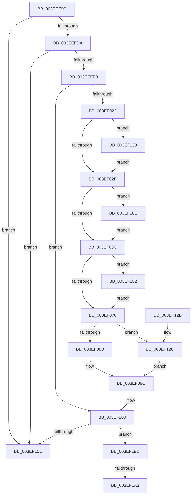

# VfTargetDriversRemove

- RVA: `0x003EEF9C`–`0x003EF1AE` (길이 `530` bytes)
- VA: `0x00000001403EEF9C`
- 실행 섹션: `.text`
- PDB 이름 있음: `예`; PDB Function 태그: `예`
- unwind 정보 RVA: `0x00096AA0`
- 디코드: `126`개 명령, `530/530` bytes 표시
- 미해석 바이트: `0` (있으면 어셈블리에 `.byte`로 보존)

> 이 문서는 커널 이미지의 기계어와 PDB 기호를 분석해 생성했습니다. 4번과 5번은 함수 원형과 자료형을 바이너리 사용 방식에서 추정한 C 해석이며 원본 소스 복구 결과는 아닙니다.

## 1. Dependencies

- 직접 호출 지점: **15**; 고유 호출 대상: **15**
- 직접 호출자로 확인된 함수: **1**
- RIP 상대 이미지 참조: **7**

### Outgoing calls
- `0x003EEFC8` → [memset](../6C/memset_function_006C6C40.md) (function, `0x006C6C40`)
- `0x003EF011` → [VfAvlLookupTreeNode](VfAvlLookupTreeNode_function_003EF1B4.md) (function, `0x003EF1B4`)
- `0x003EF0A0` → [ViAvlRaiseIrqlSafe](ViAvlRaiseIrqlSafe_function_003EF404.md) (function, `0x003EF404`)
- `0x003EF0BB` → [ViAvlAcquireTableLockAtDpcLevelSafe](ViAvlAcquireTableLockAtDpcLevelSafe_function_003EF3A0.md) (function, `0x003EF3A0`)
- `0x003EF0CE` → [RtlDeleteElementGenericTableAvl](RtlDeleteElementGenericTableAvl_function_003EE750.md) (function, `0x003EE750`)
- `0x003EF0FB` → [ViAvlReleaseTableLockFromDpcLevel](ViAvlReleaseTableLockFromDpcLevel_function_003EF5D0.md) (function, `0x003EF5D0`)
- `0x003EF104` → [VfAvlCleanupLockContext](VfAvlCleanupLockContext_function_003EF56C.md) (function, `0x003EF56C`)
- `0x003EF139` → [ViTargetRemovingCheckEtwWmi](../../pagevrfy/B9/ViTargetRemovingCheckEtwWmi_function_00B9BB34.md) (function, `0x00B9BB34`)
- `0x003EF144` → [VfPoolCheckForLeaks](../../pagevrfy/BA/VfPoolCheckForLeaks_function_00BAA340.md) (function, `0x00BAA340`)
- `0x003EF14F` → [ViTargetRemovingCheckContiguousMemory](../../pagevrfy/B9/ViTargetRemovingCheckContiguousMemory_function_00B9BAA8.md) (function, `0x00B9BAA8`)
- `0x003EF158` → [DifRemovePerDriverDataForPlugins](../61/DifRemovePerDriverDataForPlugins_function_00619AF0.md) (function, `0x00619AF0`)
- `0x003EF164` → [CarDeleteDriverRuleViolations](../61/CarDeleteDriverRuleViolations_function_0061B38C.md) (function, `0x0061B38C`)
- `0x003EF173` → [ExFreePoolWithTag](../../poolcode/B8/ExFreePoolWithTag_function_00B82870.md) (function, `0x00B82870`)
- `0x003EF191` → [VfThunkRemoveTargetNotify](../../pagevrfy/BA/VfThunkRemoveTargetNotify_function_00BA72AC.md) (function, `0x00BA72AC`)
- `0x003EF1A3` → [ViTargetDriversFreeVerifiedData](../61/ViTargetDriversFreeVerifiedData_function_00613354.md) (function, `0x00613354`)

### Direct callers
- [VfDriverUnloadImage](../../pagevrfy/B9/VfDriverUnloadImage_function_00B9A5B0.md) at `0x00B9A5EB`

### Static image references
- `0x003EEFCD` → RVA `0x00F044C0` (`.data`; read)
- `0x003EEFDA` → RVA `0x00F04954` (`.data`; read)
- `0x003EEFF3` → RVA `0x00F049A0` (`.data`; read)
- `0x003EF070` → RVA `0x00F049B8` (`.data`; read)
- `0x003EF0A5` → RVA `0x00F049B0` (`.data`; read)
- `0x003EF0D3` → RVA `0x00F049A8` (`.data`; read/write)
- `0x003EF182` → RVA `0x00F049C0` (`.data`; read/write)

## 2. Other-region calls and transfers

- 다른 실행 섹션으로 향하는 call: **5**
  - `0x003EF139` → [ViTargetRemovingCheckEtwWmi](../../pagevrfy/B9/ViTargetRemovingCheckEtwWmi_function_00B9BB34.md) (`.text` → `PAGEVRFY`)
  - `0x003EF144` → [VfPoolCheckForLeaks](../../pagevrfy/BA/VfPoolCheckForLeaks_function_00BAA340.md) (`.text` → `PAGEVRFY`)
  - `0x003EF14F` → [ViTargetRemovingCheckContiguousMemory](../../pagevrfy/B9/ViTargetRemovingCheckContiguousMemory_function_00B9BAA8.md) (`.text` → `PAGEVRFY`)
  - `0x003EF173` → [ExFreePoolWithTag](../../poolcode/B8/ExFreePoolWithTag_function_00B82870.md) (`.text` → `POOLCODE`)
  - `0x003EF191` → [VfThunkRemoveTargetNotify](../../pagevrfy/BA/VfThunkRemoveTargetNotify_function_00BA72AC.md) (`.text` → `PAGEVRFY`)
- call이 아닌 외부 분기/꼬리 이동: **2**
  - `0x003EF19D` → [sub_006EAE30](../6E/Unknown_function_006EAE30.md) (`tail-transfer`)
  - `0x003EF1A9` → [sub_006EAE30](../6E/Unknown_function_006EAE30.md) (`tail-transfer`)

## 3. Assembly (complete function range)

```asm
003EEF9C  48 8B C4                        mov rax, rsp
003EEF9F  48 89 58 08                     mov qword ptr [rax + 8], rbx
003EEFA3  48 89 70 10                     mov qword ptr [rax + 0x10], rsi
003EEFA7  48 89 78 18                     mov qword ptr [rax + 0x18], rdi
003EEFAB  4C 89 70 20                     mov qword ptr [rax + 0x20], r14
003EEFAF  55                              push rbp
003EEFB0  48 8D 68 A1                     lea rbp, [rax - 0x5f]
003EEFB4  48 81 EC A0 00 00 00            sub rsp, 0xa0
003EEFBB  33 D2                           xor edx, edx
003EEFBD  4C 8B F1                        mov r14, rcx
003EEFC0  48 8D 4D 07                     lea rcx, [rbp + 7]
003EEFC4  44 8D 42 48                     lea r8d, [rdx + 0x48]
003EEFC8  E8 73 7C 2D 00                  call 0x1406c6c40
003EEFCD  83 3D EC 54 B1 00 00            cmp dword ptr [rip + 0xb154ec], 0
003EEFD4  0F 85 34 01 00 00               jne 0x1403ef10e
003EEFDA  8B 05 74 59 B1 00               mov eax, dword ptr [rip + 0xb15974]
003EEFE0  85 C0                           test eax, eax
003EEFE2  0F 84 26 01 00 00               je 0x1403ef10e
003EEFE8  49 8B 7E 30                     mov rdi, qword ptr [r14 + 0x30]
003EEFEC  48 8D 55 E7                     lea rdx, [rbp - 0x19]
003EEFF0  0F 57 C0                        xorps xmm0, xmm0
003EEFF3  48 8D 0D A6 59 B1 00            lea rcx, [rip + 0xb159a6]
003EEFFA  33 C0                           xor eax, eax
003EEFFC  33 F6                           xor esi, esi
003EEFFE  0F 11 45 E7                     movups xmmword ptr [rbp - 0x19], xmm0
003EF002  4C 8B C7                        mov r8, rdi
003EF005  48 89 45 F7                     mov qword ptr [rbp - 9], rax
003EF009  C6 45 F3 04                     mov byte ptr [rbp - 0xd], 4
003EF00D  44 8D 4E 01                     lea r9d, [rsi + 1]
003EF011  E8 9E 01 00 00                  call 0x1403ef1b4
003EF016  48 8B D8                        mov rbx, rax
003EF019  48 85 C0                        test rax, rax
003EF01C  0F 84 DE 00 00 00               je 0x1403ef100
003EF022  48 8B 70 40                     mov rsi, qword ptr [rax + 0x40]
003EF026  48 85 F6                        test rsi, rsi
003EF029  0F 85 04 01 00 00               jne 0x1403ef133
003EF02F  48 8B 4B 30                     mov rcx, qword ptr [rbx + 0x30]
003EF033  48 85 C9                        test rcx, rcx
003EF036  0F 85 32 01 00 00               jne 0x1403ef16e
003EF03C  0F 10 03                        movups xmm0, xmmword ptr [rbx]
003EF03F  0F 10 4B 10                     movups xmm1, xmmword ptr [rbx + 0x10]
003EF043  0F 29 45 07                     movaps xmmword ptr [rbp + 7], xmm0
003EF047  0F 10 43 20                     movups xmm0, xmmword ptr [rbx + 0x20]
003EF04B  0F 29 4D 17                     movaps xmmword ptr [rbp + 0x17], xmm1
003EF04F  0F 10 4B 30                     movups xmm1, xmmword ptr [rbx + 0x30]
003EF053  0F 29 45 27                     movaps xmmword ptr [rbp + 0x27], xmm0
003EF057  F2 0F 10 43 40                  movsd xmm0, qword ptr [rbx + 0x40]
003EF05C  F2 0F 11 45 47                  movsd qword ptr [rbp + 0x47], xmm0
003EF061  48 83 7D 47 00                  cmp qword ptr [rbp + 0x47], 0
003EF066  0F 29 4D 37                     movaps xmmword ptr [rbp + 0x37], xmm1
003EF06A  0F 85 12 01 00 00               jne 0x1403ef182
003EF070  8B 05 42 59 B1 00               mov eax, dword ptr [rip + 0xb15942]
003EF076  48 89 7D D7                     mov qword ptr [rbp - 0x29], rdi
003EF07A  48 C7 45 DF 01 00 00 00         mov qword ptr [rbp - 0x21], 1
003EF082  83 F8 01                        cmp eax, 1
003EF085  0F 84 A1 00 00 00               je 0x1403ef12c
003EF08B  48 C1 EF 0C                     shr rdi, 0xc
003EF08F  8B C8                           mov ecx, eax
003EF091  48 8B C7                        mov rax, rdi
003EF094  33 D2                           xor edx, edx
003EF096  48 F7 F1                        div rcx
003EF099  48 8B DA                        mov rbx, rdx
003EF09C  48 8D 4D E7                     lea rcx, [rbp - 0x19]
003EF0A0  E8 5F 03 00 00                  call 0x1403ef404
003EF0A5  48 8B 0D 04 59 B1 00            mov rcx, qword ptr [rip + 0xb15904]
003EF0AC  48 8D 1C 5B                     lea rbx, [rbx + rbx*2]
003EF0B0  48 C1 E3 06                     shl rbx, 6
003EF0B4  48 8D 55 E7                     lea rdx, [rbp - 0x19]
003EF0B8  48 03 CB                        add rcx, rbx
003EF0BB  E8 E0 02 00 00                  call 0x1403ef3a0
003EF0C0  48 8B 0D E9 58 B1 00            mov rcx, qword ptr [rip + 0xb158e9]
003EF0C7  48 8D 55 D7                     lea rdx, [rbp - 0x29]
003EF0CB  48 03 CB                        add rcx, rbx
003EF0CE  E8 7D F6 FF FF                  call 0x1403ee750
003EF0D3  F0 48 FF 0D CD 58 B1 00         lock dec qword ptr [rip + 0xb158cd]
003EF0DB  48 8D 55 E7                     lea rdx, [rbp - 0x19]
003EF0DF  48 8B 05 CA 58 B1 00            mov rax, qword ptr [rip + 0xb158ca]
003EF0E6  48 8B 74 03 70                  mov rsi, qword ptr [rbx + rax + 0x70]
003EF0EB  48 83 64 03 70 00               and qword ptr [rbx + rax + 0x70], 0
003EF0F1  48 8B 0D B8 58 B1 00            mov rcx, qword ptr [rip + 0xb158b8]
003EF0F8  48 03 CB                        add rcx, rbx
003EF0FB  E8 D0 04 00 00                  call 0x1403ef5d0
003EF100  48 8D 4D E7                     lea rcx, [rbp - 0x19]
003EF104  E8 63 04 00 00                  call 0x1403ef56c
003EF109  48 85 F6                        test rsi, rsi
003EF10C  75 7F                           jne 0x1403ef18d
003EF10E  4C 8D 9C 24 A0 00 00 00         lea r11, [rsp + 0xa0]
003EF116  49 8B 5B 10                     mov rbx, qword ptr [r11 + 0x10]
003EF11A  49 8B 73 18                     mov rsi, qword ptr [r11 + 0x18]
003EF11E  49 8B 7B 20                     mov rdi, qword ptr [r11 + 0x20]
003EF122  4D 8B 73 28                     mov r14, qword ptr [r11 + 0x28]
003EF126  49 8B E3                        mov rsp, r11
003EF129  5D                              pop rbp
003EF12A  C3                              ret
003EF12B  CC                              int3
003EF12C  33 DB                           xor ebx, ebx
003EF12E  E9 69 FF FF FF                  jmp 0x1403ef09c
003EF133  48 8B D7                        mov rdx, rdi
003EF136  48 8B CE                        mov rcx, rsi
003EF139  E8 F6 C9 7A 00                  call 0x140b9bb34
003EF13E  49 8B D6                        mov rdx, r14
003EF141  48 8B CE                        mov rcx, rsi
003EF144  E8 F7 B1 7B 00                  call 0x140baa340
003EF149  49 8B D6                        mov rdx, r14
003EF14C  48 8B CE                        mov rcx, rsi
003EF14F  E8 54 C9 7A 00                  call 0x140b9baa8
003EF154  48 8D 4E 60                     lea rcx, [rsi + 0x60]
003EF158  E8 93 A9 22 00                  call 0x140619af0
003EF15D  48 8B 53 08                     mov rdx, qword ptr [rbx + 8]
003EF161  48 8B 0B                        mov rcx, qword ptr [rbx]
003EF164  E8 23 C2 22 00                  call 0x14061b38c
003EF169  E9 C1 FE FF FF                  jmp 0x1403ef02f
003EF16E  BA 56 66 43 62                  mov edx, 0x62436656
003EF173  E8 F8 36 79 00                  call 0x140b82870
003EF178  48 83 63 30 00                  and qword ptr [rbx + 0x30], 0
003EF17D  E9 BA FE FF FF                  jmp 0x1403ef03c
003EF182  FF 0D 38 58 B1 00               dec dword ptr [rip + 0xb15838]
003EF188  E9 E3 FE FF FF                  jmp 0x1403ef070
003EF18D  48 8D 4D 07                     lea rcx, [rbp + 7]
003EF191  E8 16 81 7B 00                  call 0x140ba72ac
003EF196  48 8B 4D 47                     mov rcx, qword ptr [rbp + 0x47]
003EF19A  48 85 C9                        test rcx, rcx
003EF19D  0F 84 8D BC 2F 00               je 0x1406eae30
003EF1A3  E8 AC 41 22 00                  call 0x140613354
003EF1A8  90                              nop
003EF1A9  E9 82 BC 2F 00                  jmp 0x1406eae30
```

## 4. C-style interpretation (structured pseudocode)

```c
__int64 __fastcall VfTargetDriversRemove(__int64 a1, int a2)
{
    __int64 result;
    __int64 v_rbx;
    __int64 v_rdi;
    __int64 v_rsi;
    __int64 v_rsp;
    unsigned __int64 v_stack_m8;

    *(unsigned __int64 *)(v_rsp + 8) = v_rbx;
    *(unsigned __int64 *)(v_rsp + 16) = v_rsi;
    *(unsigned __int64 *)(v_rsp + 24) = v_rdi;
    *(unsigned __int64 *)(v_rsp + 32) = v_r14;
    v_rsp = (v_rsp) - (160);
    a2 = 0;
    result = memset(v_rsp - 95 + 7, a2, a2 + 72, a4);
    if ((*(unsigned int *)(v_rip + 11621612)) != 0) goto loc_003EF10E;
    if ((unsigned int)((unsigned int)(*(unsigned int *)(v_rip + 11622772))) == 0) goto loc_003EF10E;
    result = 0;
    v_rsi = 0;
    *(unsigned __int64 *)(v_rsp - 95 - 25) = v_xmm0;
    *(unsigned __int64 *)(v_rsp - 95 - 9) = 0;
    *(unsigned __int8 *)(v_rsp - 95 - 13) = 4;
    result = VfAvlLookupTreeNode(v_rip + 11622822, v_rsp - 95 - 25, *(unsigned __int64 *)(a1 + 48), v_rsi + 1);
    if (result == 0) goto loc_003EF100;
    if (*(unsigned __int64 *)(result + 64) != 0) goto loc_003EF133;
loc_003EF02F:
    if (*(unsigned __int64 *)(result + 48) != 0) goto loc_003EF16E;
loc_003EF03C:
    *(unsigned __int64 *)(v_rsp - 95 + 7) = v_xmm0;
    *(unsigned __int64 *)(v_rsp - 95 + 23) = v_xmm1;
    *(unsigned __int64 *)(v_rsp - 95 + 39) = v_xmm0;
    *(unsigned __int64 *)(v_rsp - 95 + 71) = v_xmm0;
    *(unsigned __int64 *)(v_rsp - 95 + 55) = v_xmm1;
    if ((*(unsigned __int64 *)(v_rsp - 95 + 71)) != 0) goto loc_003EF182;
loc_003EF070:
    *(unsigned __int64 *)(v_rsp - 95 - 41) = *(unsigned __int64 *)(a1 + 48);
    *(unsigned __int64 *)(v_rsp - 95 - 33) = 1;
    if (((unsigned int)((unsigned int)(*(unsigned int *)(v_rip + 11622722)))) == 1) goto loc_003EF12C;
    v_rdi = (*(unsigned __int64 *)(a1 + 48)) >> (12);
    a2 = 0;
loc_003EF09C:
    result = ViAvlRaiseIrqlSafe(v_rsp - 95 - 25, a2, *(unsigned __int64 *)(a1 + 48), v_rsi + 1);
    v_rbx = (0 + 0 * 2) << (6);
    a1 = (*(unsigned __int64 *)(v_rip + 11622660)) + (v_rbx);
    result = ViAvlAcquireTableLockAtDpcLevelSafe(a1, v_rsp - 95 - 25, *(unsigned __int64 *)(a1 + 48), v_rsi + 1);
    a1 = (*(unsigned __int64 *)(v_rip + 11622633)) + (v_rbx);
    result = RtlDeleteElementGenericTableAvl(a1, v_rsp - 95 - 41, *(unsigned __int64 *)(a1 + 48), v_rsi + 1);
    a1 = (*(unsigned __int64 *)(v_rip + 11622584)) + (v_rbx);
    result = ViAvlReleaseTableLockFromDpcLevel(a1, v_rsp - 95 - 25, *(unsigned __int64 *)(a1 + 48), v_rsi + 1);
loc_003EF100:
    result = VfAvlCleanupLockContext(v_rsp - 95 - 25, v_rsp - 95 - 25, *(unsigned __int64 *)(a1 + 48), v_rsi + 1);
    if (*(unsigned __int64 *)(v_rbx + *(unsigned __int64 *)(v_rip + 11622602) * 1 + 112) != 0) goto loc_003EF18D;
loc_003EF10E:
    return result;
loc_003EF12C:
    v_rbx = 0;
    goto loc_003EF09C;
loc_003EF133:
    result = ViTargetRemovingCheckEtwWmi(*(unsigned __int64 *)(v_stack_m8 + 24), *(unsigned __int64 *)(v_stack_m8 + 32), *(unsigned __int64 *)(a1 + 48), v_rsi + 1);
    result = VfPoolCheckForLeaks(*(unsigned __int64 *)(v_stack_m8 + 24), *(unsigned __int64 *)(v_stack_m8 + 40), *(unsigned __int64 *)(a1 + 48), v_rsi + 1);
    result = ViTargetRemovingCheckContiguousMemory(*(unsigned __int64 *)(v_stack_m8 + 24), *(unsigned __int64 *)(v_stack_m8 + 40), *(unsigned __int64 *)(a1 + 48), v_rsi + 1);
    result = DifRemovePerDriverDataForPlugins(*(unsigned __int64 *)(v_stack_m8 + 24) + 96, *(unsigned __int64 *)(v_stack_m8 + 40), *(unsigned __int64 *)(a1 + 48), v_rsi + 1);
    result = CarDeleteDriverRuleViolations(*(unsigned __int64 *)(v_rbx), *(unsigned __int64 *)(v_rbx + 8), *(unsigned __int64 *)(a1 + 48), v_rsi + 1);
    goto loc_003EF02F;
loc_003EF16E:
    result = ExFreePoolWithTag(*(unsigned __int64 *)(v_rbx), (unsigned int)(0x62436656ULL), *(unsigned __int64 *)(a1 + 48), v_rsi + 1);
    goto loc_003EF03C;
loc_003EF182:
    goto loc_003EF070;
loc_003EF18D:
    result = VfThunkRemoveTargetNotify(v_rsp - 95 + 7, (unsigned int)(0x62436656ULL), *(unsigned __int64 *)(a1 + 48), v_rsi + 1);
    result = ViTargetDriversFreeVerifiedData(*(unsigned __int64 *)(v_rsp - 95 + 71), (unsigned int)(0x62436656ULL), *(unsigned __int64 *)(a1 + 48), v_rsi + 1);
}
```

## 5. (Beta) C Style

```c
int64_t VfTargetDriversRemove(void *Arg1, int32_t Arg2)
{
    uint8_t *arg1 = (uint8_t *)Arg1;

    int64_t result;
    int64_t local_rbx;
    int64_t local_rdi;
    int64_t local_rsi;
    int64_t local_rsp;
    uint64_t v_stack_m8;

    *(uint64_t *)(local_rsp + 0x8) = local_rbx;
    *(uint64_t *)(local_rsp + 0x10) = local_rsi;
    *(uint64_t *)(local_rsp + 0x18) = local_rdi;
    *(uint64_t *)(local_rsp + 0x20) = local_r14;
    local_rsp = (local_rsp) - (160);
    Arg2 = 0;
    result = memset(local_rsp - 95 + 7, Arg2, Arg2 + 72, a4);
    if ((*(uint32_t *)(v_rip + 0xB154EC)) != 0) goto loc_003EF10E;
    if ((uint32_t)((uint32_t)(*(uint32_t *)(v_rip + 0xB15974))) == 0) goto loc_003EF10E;
    result = 0;
    local_rsi = 0;
    *(uint64_t *)(local_rsp - 0x5F - 0x19) = v_xmm0;
    *(uint64_t *)(local_rsp - 0x5F - 0x9) = 0;
    *(uint8_t *)(local_rsp - 0x5F - 0xD) = 4;
    result = VfAvlLookupTreeNode(v_rip + 11622822, local_rsp - 95 - 25, *(uint64_t *)(arg1 + 0x30), local_rsi + 1);
    if (result == 0) goto loc_003EF100;
    if (*(uint64_t *)(result + 0x40) != 0) goto loc_003EF133;
loc_003EF02F:
    if (*(uint64_t *)(result + 0x30) != 0) goto loc_003EF16E;
loc_003EF03C:
    *(uint64_t *)(local_rsp - 0x5F + 0x7) = v_xmm0;
    *(uint64_t *)(local_rsp - 0x5F + 0x17) = v_xmm1;
    *(uint64_t *)(local_rsp - 0x5F + 0x27) = v_xmm0;
    *(uint64_t *)(local_rsp - 0x5F + 0x47) = v_xmm0;
    *(uint64_t *)(local_rsp - 0x5F + 0x37) = v_xmm1;
    if ((*(uint64_t *)(local_rsp - 0x5F + 0x47)) != 0) goto loc_003EF182;
loc_003EF070:
    *(uint64_t *)(local_rsp - 0x5F - 0x29) = *(uint64_t *)(arg1 + 0x30);
    *(uint64_t *)(local_rsp - 0x5F - 0x21) = 1;
    if (((uint32_t)((uint32_t)(*(uint32_t *)(v_rip + 0xB15942)))) == 1) goto loc_003EF12C;
    local_rdi = (*(uint64_t *)(arg1 + 0x30)) >> (12);
    Arg2 = 0;
loc_003EF09C:
    result = ViAvlRaiseIrqlSafe(local_rsp - 95 - 25, Arg2, *(uint64_t *)(arg1 + 0x30), local_rsi + 1);
    local_rbx = (0 + 0 * 2) << (6);
    Arg1 = (*(uint64_t *)(v_rip + 0xB15904)) + (local_rbx);
    result = ViAvlAcquireTableLockAtDpcLevelSafe(Arg1, local_rsp - 95 - 25, *(uint64_t *)(arg1 + 0x30), local_rsi + 1);
    Arg1 = (*(uint64_t *)(v_rip + 0xB158E9)) + (local_rbx);
    result = RtlDeleteElementGenericTableAvl(Arg1, local_rsp - 95 - 41, *(uint64_t *)(arg1 + 0x30), local_rsi + 1);
    Arg1 = (*(uint64_t *)(v_rip + 0xB158B8)) + (local_rbx);
    result = ViAvlReleaseTableLockFromDpcLevel(Arg1, local_rsp - 95 - 25, *(uint64_t *)(arg1 + 0x30), local_rsi + 1);
loc_003EF100:
    result = VfAvlCleanupLockContext(local_rsp - 95 - 25, local_rsp - 95 - 25, *(uint64_t *)(arg1 + 0x30), local_rsi + 1);
    if (*(uint64_t *)(local_rbx + *(uint64_t *)(v_rip + 0xB158CA) * 1 + 0x70) != 0) goto loc_003EF18D;
loc_003EF10E:
    return result;
loc_003EF12C:
    local_rbx = 0;
    goto loc_003EF09C;
loc_003EF133:
    result = ViTargetRemovingCheckEtwWmi(*(uint64_t *)(v_stack_m8 + 0x18), *(uint64_t *)(v_stack_m8 + 0x20), *(uint64_t *)(arg1 + 0x30), local_rsi + 1);
    result = VfPoolCheckForLeaks(*(uint64_t *)(v_stack_m8 + 0x18), *(uint64_t *)(v_stack_m8 + 0x28), *(uint64_t *)(arg1 + 0x30), local_rsi + 1);
    result = ViTargetRemovingCheckContiguousMemory(*(uint64_t *)(v_stack_m8 + 0x18), *(uint64_t *)(v_stack_m8 + 0x28), *(uint64_t *)(arg1 + 0x30), local_rsi + 1);
    result = DifRemovePerDriverDataForPlugins(*(uint64_t *)(v_stack_m8 + 0x18) + 96, *(uint64_t *)(v_stack_m8 + 0x28), *(uint64_t *)(arg1 + 0x30), local_rsi + 1);
    result = CarDeleteDriverRuleViolations(*(uint64_t *)(local_rbx), *(uint64_t *)(local_rbx + 0x8), *(uint64_t *)(arg1 + 0x30), local_rsi + 1);
    goto loc_003EF02F;
loc_003EF16E:
    result = ExFreePoolWithTag(*(uint64_t *)(local_rbx), (uint32_t)(0x62436656ULL), *(uint64_t *)(arg1 + 0x30), local_rsi + 1);
    goto loc_003EF03C;
loc_003EF182:
    goto loc_003EF070;
loc_003EF18D:
    result = VfThunkRemoveTargetNotify(local_rsp - 95 + 7, (uint32_t)(0x62436656ULL), *(uint64_t *)(arg1 + 0x30), local_rsi + 1);
    result = ViTargetDriversFreeVerifiedData(*(uint64_t *)(local_rsp - 0x5F + 0x47), (uint32_t)(0x62436656ULL), *(uint64_t *)(arg1 + 0x30), local_rsi + 1);
}
```

### 관측된 메모리 오프셋

구조체 형식이 확인되지 않은 접근은 인자 기준의 오프셋으로만 기록했습니다.

| 기준 인자 | 오프셋 표현 | 폭 (bit) | 접근 |
|---|---:|---:|---|
| `Arg1` | `+ 0x30` | `64` | `R` |

## 6. Execution-region graph

[열기: 2D/3D 그래프와 함수 탐색 컨트롤 패널](../../../control-panel.html?section=text&rva=0x003EEF9C&view=graph)

- 2D 그래프는 위에서 아래로 흐르고, 3D 그래프는 빈 공간을 드래그해 회전합니다. Shift+드래그는 이동, 휠은 확대·축소, 함수 노드 선택은 대상 보고서 이동입니다.

### Static fallback


