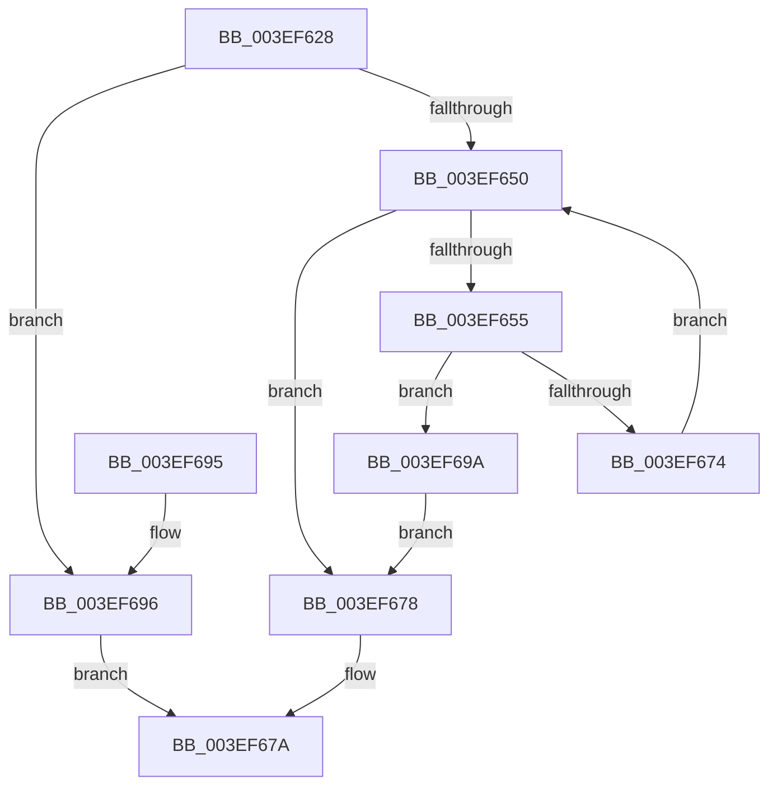

# VfUpdateWhitelist

- RVA: `0x003EF628`–`0x003EF6AD` (길이 `133` bytes)
- VA: `0x00000001403EF628`
- 실행 섹션: `.text`
- PDB 이름 있음: `예`; PDB Function 태그: `아니요`
- unwind 정보 RVA: `0x00096B1C`
- 디코드: `43`개 명령, `133/133` bytes 표시
- 미해석 바이트: `0` (있으면 어셈블리에 `.byte`로 보존)

> 이 문서는 커널 이미지의 기계어와 PDB 기호를 분석해 생성했습니다. 4번과 5번은 함수 원형과 자료형을 바이너리 사용 방식에서 추정한 C 해석이며 원본 소스 복구 결과는 아닙니다.

## 1. Dependencies

- 직접 호출 지점: **1**; 고유 호출 대상: **1**
- 직접 호출자로 확인된 함수: **1**
- RIP 상대 이미지 참조: **1**

### Outgoing calls
- `0x003EF66B` → [wcsicmp](../50/wcsicmp_function_00500080.md) (function, `0x00500080`)

### Direct callers
- [VfTargetDriversAdd](VfTargetDriversAdd_function_003EE2F4.md) at `0x003EE36F`

### Static image references
- `0x003EF655` → RVA `0x00E08F00` (`.data`; read)

## 2. Other-region calls and transfers

- 다른 실행 섹션으로 향하는 call: **0**
- 별도 외부 분기/꼬리 이동을 확인하지 못했습니다.

## 3. Assembly (complete function range)

```asm
003EF628  48 8B C4                        mov rax, rsp
003EF62B  48 89 58 08                     mov qword ptr [rax + 8], rbx
003EF62F  48 89 68 10                     mov qword ptr [rax + 0x10], rbp
003EF633  48 89 70 18                     mov qword ptr [rax + 0x18], rsi
003EF637  48 89 78 20                     mov qword ptr [rax + 0x20], rdi
003EF63B  41 56                           push r14
003EF63D  48 83 EC 20                     sub rsp, 0x20
003EF641  33 DB                           xor ebx, ebx
003EF643  4C 8B F2                        mov r14, rdx
003EF646  48 8B E9                        mov rbp, rcx
003EF649  8B FB                           mov edi, ebx
003EF64B  48 85 D2                        test rdx, rdx
003EF64E  74 46                           je 0x1403ef696
003EF650  83 FF 08                        cmp edi, 8
003EF653  73 23                           jae 0x1403ef678
003EF655  48 8D 05 A4 98 A1 00            lea rax, [rip + 0xa198a4]
003EF65C  8B F7                           mov esi, edi
003EF65E  48 C1 E6 05                     shl rsi, 5
003EF662  48 8B CD                        mov rcx, rbp
003EF665  48 03 F0                        add rsi, rax
003EF668  48 8B 16                        mov rdx, qword ptr [rsi]
003EF66B  E8 10 0A 11 00                  call 0x140500080
003EF670  85 C0                           test eax, eax
003EF672  74 26                           je 0x1403ef69a
003EF674  FF C7                           inc edi
003EF676  EB D8                           jmp 0x1403ef650
003EF678  8A C3                           mov al, bl
003EF67A  48 8B 5C 24 30                  mov rbx, qword ptr [rsp + 0x30]
003EF67F  48 8B 6C 24 38                  mov rbp, qword ptr [rsp + 0x38]
003EF684  48 8B 74 24 40                  mov rsi, qword ptr [rsp + 0x40]
003EF689  48 8B 7C 24 48                  mov rdi, qword ptr [rsp + 0x48]
003EF68E  48 83 C4 20                     add rsp, 0x20
003EF692  41 5E                           pop r14
003EF694  C3                              ret
003EF695  CC                              int3
003EF696  32 C0                           xor al, al
003EF698  EB E0                           jmp 0x1403ef67a
003EF69A  49 8B 06                        mov rax, qword ptr [r14]
003EF69D  B3 01                           mov bl, 1
003EF69F  48 89 46 08                     mov qword ptr [rsi + 8], rax
003EF6A3  49 8B 46 08                     mov rax, qword ptr [r14 + 8]
003EF6A7  48 89 46 10                     mov qword ptr [rsi + 0x10], rax
003EF6AB  EB CB                           jmp 0x1403ef678
```

## 4. C-style interpretation (structured pseudocode)

```c
__int64 __fastcall VfUpdateWhitelist(__int64 a1, __int64 a2)
{
    __int64 result;
    __int64 v_rbx;
    __int64 v_rdi;
    __int64 v_rsi;
    __int64 v_rsp;
    unsigned __int64 v_stack_p10;
    unsigned __int64 v_stack_p18;
    unsigned __int64 v_stack_p20;
    unsigned __int64 v_stack_p8;

    *(unsigned __int64 *)(v_rsp + 8) = v_rbx;
    *(unsigned __int64 *)(v_rsp + 16) = v_rbp;
    *(unsigned __int64 *)(v_rsp + 24) = v_rsi;
    *(unsigned __int64 *)(v_rsp + 32) = v_rdi;
    v_rsp = (v_rsp) - (32);
    v_rbx = 0;
    if (a2 == 0) goto loc_003EF696;
loc_003EF650:
    if (0 >= 8) goto loc_003EF678;
    v_rsi = (0) << (5);
    v_rsi = (v_rsi) + (v_rip + 10590372);
    result = wcsicmp(a1, *(unsigned __int64 *)(v_rsi), a3, a4);
    if ((unsigned int)(result) == 0) goto loc_003EF69A;
    v_rdi = (unsigned int)((0) + 1);
    goto loc_003EF650;
loc_003EF678:
loc_003EF67A:
    v_rsp = (v_rsp) + (32);
    return 0;
loc_003EF696:
    result = 0;
    goto loc_003EF67A;
loc_003EF69A:
    *(unsigned __int64 *)(v_stack_p18 + 8) = *(unsigned __int64 *)(a2);
    *(unsigned __int64 *)(v_stack_p18 + 16) = *(unsigned __int64 *)(a2 + 8);
    goto loc_003EF678;
}
```

## 5. (Beta) C Style

```c
int64_t VfUpdateWhitelist(int64_t Arg1, void *Arg2)
{
    uint8_t *arg2 = (uint8_t *)Arg2;

    int64_t result;
    int64_t local_rbx;
    int64_t local_rdi;
    int64_t local_rsi;
    int64_t local_rsp;
    uint64_t v_stack_p10;
    uint64_t v_stack_p18;
    uint64_t v_stack_p20;
    uint64_t v_stack_p8;

    *(uint64_t *)(local_rsp + 0x8) = local_rbx;
    *(uint64_t *)(local_rsp + 0x10) = local_rbp;
    *(uint64_t *)(local_rsp + 0x18) = local_rsi;
    *(uint64_t *)(local_rsp + 0x20) = local_rdi;
    local_rsp = (local_rsp) - (32);
    local_rbx = 0;
    if (Arg2 == NULL) goto loc_003EF696;
loc_003EF650:
    if (0 >= 8) goto loc_003EF678;
    local_rsi = (0) << (5);
    local_rsi = (local_rsi) + (v_rip + 10590372);
    result = wcsicmp(Arg1, *(uint64_t *)(local_rsi), a3, a4);
    if ((uint32_t)(result) == 0) goto loc_003EF69A;
    local_rdi = (uint32_t)((0) + 1);
    goto loc_003EF650;
loc_003EF678:
loc_003EF67A:
    local_rsp = (local_rsp) + (32);
    return 0;
loc_003EF696:
    result = 0;
    goto loc_003EF67A;
loc_003EF69A:
    *(uint64_t *)(v_stack_p18 + 0x8) = *(uint64_t *)(arg2);
    *(uint64_t *)(v_stack_p18 + 0x10) = *(uint64_t *)(arg2 + 0x8);
    goto loc_003EF678;
}
```

### 관측된 메모리 오프셋

구조체 형식이 확인되지 않은 접근은 인자 기준의 오프셋으로만 기록했습니다.

| 기준 인자 | 오프셋 표현 | 폭 (bit) | 접근 |
|---|---:|---:|---|
| `Arg2` | `+ 0x0` | `64` | `R` |
| `Arg2` | `+ 0x8` | `64` | `R` |

## 6. Execution-region graph

[열기: 2D/3D 그래프와 함수 탐색 컨트롤 패널](../../../control-panel.html?section=text&rva=0x003EF628&view=graph)

- 2D 그래프는 위에서 아래로 흐르고, 3D 그래프는 빈 공간을 드래그해 회전합니다. Shift+드래그는 이동, 휠은 확대·축소, 함수 노드 선택은 대상 보고서 이동입니다.

### Static fallback


