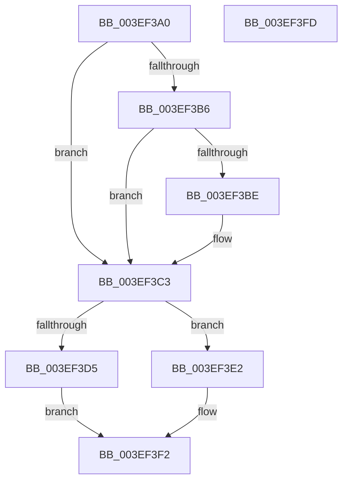

# ViAvlAcquireTableLockAtDpcLevelSafe

- RVA: `0x003EF3A0`–`0x003EF3FE` (길이 `94` bytes)
- VA: `0x00000001403EF3A0`
- 실행 섹션: `.text`
- PDB 이름 있음: `예`; PDB Function 태그: `아니요`
- unwind 정보 RVA: `0x0005CAAC`
- 디코드: `29`개 명령, `94/94` bytes 표시
- 미해석 바이트: `0` (있으면 어셈블리에 `.byte`로 보존)

> 이 문서는 커널 이미지의 기계어와 PDB 기호를 분석해 생성했습니다. 4번과 5번은 함수 원형과 자료형을 바이너리 사용 방식에서 추정한 C 해석이며 원본 소스 복구 결과는 아닙니다.

## 1. Dependencies

- 직접 호출 지점: **2**; 고유 호출 대상: **2**
- 직접 호출자로 확인된 함수: **7**
- RIP 상대 이미지 참조: **0**

### Outgoing calls
- `0x003EF3BE` → [ViAvlReleaseTableLockFromDpcLevel](ViAvlReleaseTableLockFromDpcLevel_function_003EF5D0.md) (function, `0x003EF5D0`)
- `0x003EF3DB` → [ViAvlAcquireTableLockAtDpcLevel](ViAvlAcquireTableLockAtDpcLevel_function_003EF7D4.md) (function, `0x003EF7D4`)

### Direct callers
- [VfAvlDeleteTreeNode](VfAvlDeleteTreeNode_function_003EE240.md) at `0x003EE28C`
- [VfAvlInsertReservedTreeNode](VfAvlInsertReservedTreeNode_function_003EE424.md) at `0x003EE466`
- [VfTargetDriversRemove](VfTargetDriversRemove_function_003EEF9C.md) at `0x003EF0BB`
- [VfAvlLookupTreeNode](VfAvlLookupTreeNode_function_003EF1B4.md) at `0x003EF27A`
- [VfAvlLookupTreeNode](VfAvlLookupTreeNode_function_003EF1B4.md) at `0x003EF30A`
- [DifEnumeratePluginData](../61/DifEnumeratePluginData_function_00612590.md) at `0x0061261A`
- [VfAvlDeleteAllTreeNodes](../../pagevrfy/B9/VfAvlDeleteAllTreeNodes_function_00B93B9C.md) at `0x00B93BD2`
- [VfAvlEnumerateNodes](../../pagevrfy/B9/VfAvlEnumerateNodes_function_00B93C14.md) at `0x00B93C5E`

### Static image references
- 디코드된 RIP-relative 메모리 참조가 없습니다.

## 2. Other-region calls and transfers

- 다른 실행 섹션으로 향하는 call: **0**
- 별도 외부 분기/꼬리 이동을 확인하지 못했습니다.

## 3. Assembly (complete function range)

```asm
003EF3A0  48 89 5C 24 08                  mov qword ptr [rsp + 8], rbx
003EF3A5  57                              push rdi
003EF3A6  48 83 EC 20                     sub rsp, 0x20
003EF3AA  F6 42 0C 02                     test byte ptr [rdx + 0xc], 2
003EF3AE  48 8B DA                        mov rbx, rdx
003EF3B1  48 8B F9                        mov rdi, rcx
003EF3B4  74 0D                           je 0x1403ef3c3
003EF3B6  48 8B 0A                        mov rcx, qword ptr [rdx]
003EF3B9  48 3B CF                        cmp rcx, rdi
003EF3BC  74 05                           je 0x1403ef3c3
003EF3BE  E8 0D 02 00 00                  call 0x1403ef5d0
003EF3C3  65 48 8B 04 25 88 01 00 00      mov rax, qword ptr gs:[0x188]
003EF3CC  48 39 87 88 00 00 00            cmp qword ptr [rdi + 0x88], rax
003EF3D3  74 0D                           je 0x1403ef3e2
003EF3D5  48 8B D3                        mov rdx, rbx
003EF3D8  48 8B CF                        mov rcx, rdi
003EF3DB  E8 F4 03 00 00                  call 0x1403ef7d4
003EF3E0  EB 10                           jmp 0x1403ef3f2
003EF3E2  8B 43 10                        mov eax, dword ptr [rbx + 0x10]
003EF3E5  8D 48 01                        lea ecx, [rax + 1]
003EF3E8  33 C8                           xor ecx, eax
003EF3EA  83 E1 0F                        and ecx, 0xf
003EF3ED  33 C8                           xor ecx, eax
003EF3EF  89 4B 10                        mov dword ptr [rbx + 0x10], ecx
003EF3F2  48 8B 5C 24 30                  mov rbx, qword ptr [rsp + 0x30]
003EF3F7  48 83 C4 20                     add rsp, 0x20
003EF3FB  5F                              pop rdi
003EF3FC  C3                              ret
003EF3FD  CC                              int3
```

## 4. C-style interpretation (structured pseudocode)

```c
__int64 __fastcall ViAvlAcquireTableLockAtDpcLevelSafe(__int64 a1, __int64 a2)
{
    __int64 result;
    __int64 v_rsp;
    unsigned __int64 v_stack_p8;

    v_stack_p8 = v_rbx;
    v_rsp = (v_rsp) - (32);
    if (((*(unsigned __int8 *)(a2 + 12)) & (2)) == 0) goto loc_003EF3C3;
    if ((*(unsigned __int64 *)(a2)) != a1) {
        result = ViAvlReleaseTableLockFromDpcLevel(*(unsigned __int64 *)(a2), a2, a3, a4);
    }
    if ((*(unsigned __int64 *)(a1 + 136)) == (*(unsigned __int64 *)(gs_base + (0 + 392)))) goto loc_003EF3E2;
    result = ViAvlAcquireTableLockAtDpcLevel(a1, a2, a3, a4);
    goto loc_003EF3F2;
loc_003EF3E2:
    a1 = (unsigned int)(((unsigned int)(*(unsigned int *)(a2 + 16)) + 1) ^ ((unsigned int)((unsigned int)(*(unsigned int *)(a2 + 16)))));
    a1 = (unsigned int)((a1) & (15));
    a1 = (unsigned int)((a1) ^ ((unsigned int)((unsigned int)(*(unsigned int *)(a2 + 16)))));
    *(unsigned int *)(a2 + 16) = (unsigned int)(a1);
loc_003EF3F2:
    v_rsp = (v_rsp) + (32);
    return (unsigned int)(*(unsigned int *)(a2 + 16));
}
```

## 5. (Beta) C Style

```c
int64_t ViAvlAcquireTableLockAtDpcLevelSafe(void *Arg1, void *Arg2)
{
    uint8_t *arg1 = (uint8_t *)Arg1;
    uint8_t *arg2 = (uint8_t *)Arg2;

    int64_t result;
    int64_t local_rsp;
    uint64_t v_stack_p8;

    v_stack_p8 = local_rbx;
    local_rsp = (local_rsp) - (32);
    if (((*(uint8_t *)(arg2 + 0xC)) & (2)) == 0) goto loc_003EF3C3;
    if ((*(uint64_t *)(arg2)) != Arg1) {
        result = ViAvlReleaseTableLockFromDpcLevel(*(uint64_t *)(arg2), Arg2, a3, a4);
    }
    if ((*(uint64_t *)(arg1 + 0x88)) == (*(uint64_t *)(gs_base + (0 + 0x188)))) goto loc_003EF3E2;
    result = ViAvlAcquireTableLockAtDpcLevel(Arg1, Arg2, a3, a4);
    goto loc_003EF3F2;
loc_003EF3E2:
    Arg1 = (uint32_t)(((uint32_t)(*(uint32_t *)(arg2 + 0x10)) + 1) ^ ((uint32_t)((uint32_t)(*(uint32_t *)(arg2 + 0x10)))));
    Arg1 = (uint32_t)((Arg1) & (15));
    Arg1 = (uint32_t)((Arg1) ^ ((uint32_t)((uint32_t)(*(uint32_t *)(arg2 + 0x10)))));
    *(uint32_t *)(arg2 + 0x10) = (uint32_t)(Arg1);
loc_003EF3F2:
    local_rsp = (local_rsp) + (32);
    return (uint32_t)(*(uint32_t *)(arg2 + 0x10));
}
```

### 관측된 메모리 오프셋

구조체 형식이 확인되지 않은 접근은 인자 기준의 오프셋으로만 기록했습니다.

| 기준 인자 | 오프셋 표현 | 폭 (bit) | 접근 |
|---|---:|---:|---|
| `Arg1` | `+ 0x88` | `64` | `R` |
| `Arg2` | `+ 0x0` | `64` | `R` |
| `Arg2` | `+ 0xC` | `8` | `R` |
| `Arg2` | `+ 0x10` | `32` | `R` |
| `Arg2` | `+ 0x10` | `32` | `W` |

## 6. Execution-region graph

[열기: 2D/3D 그래프와 함수 탐색 컨트롤 패널](../../../control-panel.html?section=text&rva=0x003EF3A0&view=graph)

- 2D 그래프는 위에서 아래로 흐르고, 3D 그래프는 빈 공간을 드래그해 회전합니다. Shift+드래그는 이동, 휠은 확대·축소, 함수 노드 선택은 대상 보고서 이동입니다.

### Static fallback


