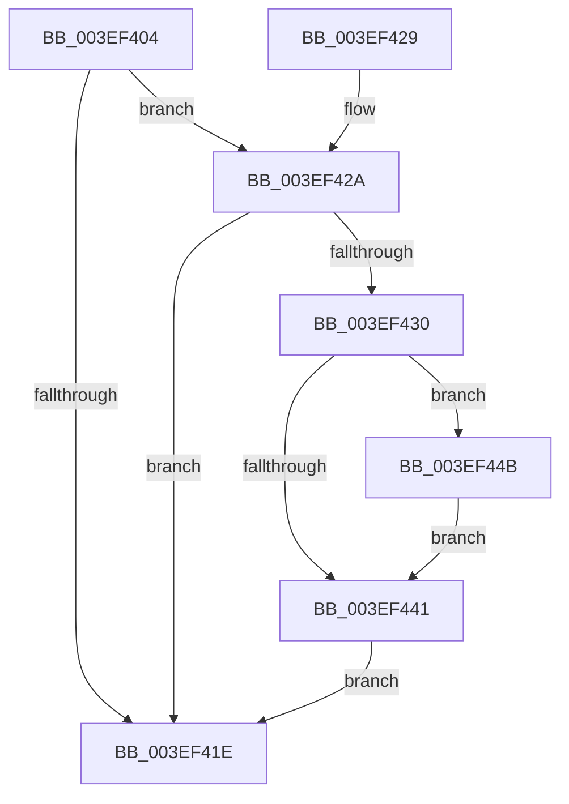

# ViAvlRaiseIrqlSafe

- RVA: `0x003EF404`–`0x003EF455` (길이 `81` bytes)
- VA: `0x00000001403EF404`
- 실행 섹션: `.text`
- PDB 이름 있음: `예`; PDB Function 태그: `아니요`
- unwind 정보 RVA: `0x0005D210`
- 디코드: `25`개 명령, `81/81` bytes 표시
- 미해석 바이트: `0` (있으면 어셈블리에 `.byte`로 보존)

> 이 문서는 커널 이미지의 기계어와 PDB 기호를 분석해 생성했습니다. 4번과 5번은 함수 원형과 자료형을 바이너리 사용 방식에서 추정한 C 해석이며 원본 소스 복구 결과는 아닙니다.

## 1. Dependencies

- 직접 호출 지점: **1**; 고유 호출 대상: **1**
- 직접 호출자로 확인된 함수: **7**
- RIP 상대 이미지 참조: **1**

### Outgoing calls
- `0x003EF44E` → [KiRaiseIrqlProcessIrqlFlags](../4F/KiRaiseIrqlProcessIrqlFlags_function_004F56FC.md) (function, `0x004F56FC`)

### Direct callers
- [VfAvlDeleteTreeNode](VfAvlDeleteTreeNode_function_003EE240.md) at `0x003EE275`
- [VfAvlInsertReservedTreeNode](VfAvlInsertReservedTreeNode_function_003EE424.md) at `0x003EE44F`
- [VfTargetDriversRemove](VfTargetDriversRemove_function_003EEF9C.md) at `0x003EF0A0`
- [VfAvlLookupTreeNode](VfAvlLookupTreeNode_function_003EF1B4.md) at `0x003EF26F`
- [VfAvlLookupTreeNode](VfAvlLookupTreeNode_function_003EF1B4.md) at `0x003EF2FF`
- [DifEnumeratePluginData](../61/DifEnumeratePluginData_function_00612590.md) at `0x006125F0`
- [VfAvlDeleteAllTreeNodes](../../pagevrfy/B9/VfAvlDeleteAllTreeNodes_function_00B93B9C.md) at `0x00B93BC5`
- [VfAvlEnumerateNodes](../../pagevrfy/B9/VfAvlEnumerateNodes_function_00B93C14.md) at `0x00B93C38`

### Static image references
- `0x003EF438` → RVA `0x00FC6D20` (`ALMOSTRO`; read)

## 2. Other-region calls and transfers

- 다른 실행 섹션으로 향하는 call: **0**
- 별도 외부 분기/꼬리 이동을 확인하지 못했습니다.

## 3. Assembly (complete function range)

```asm
003EF404  48 89 5C 24 08                  mov qword ptr [rsp + 8], rbx
003EF409  57                              push rdi
003EF40A  48 83 EC 20                     sub rsp, 0x20
003EF40E  48 8B D9                        mov rbx, rcx
003EF411  44 0F 20 C0                     mov rax, cr8
003EF415  BA 02 00 00 00                  mov edx, 2
003EF41A  3A C2                           cmp al, dl
003EF41C  72 0C                           jb 0x1403ef42a
003EF41E  48 8B 5C 24 30                  mov rbx, qword ptr [rsp + 0x30]
003EF423  48 83 C4 20                     add rsp, 0x20
003EF427  5F                              pop rdi
003EF428  C3                              ret
003EF429  CC                              int3
003EF42A  F6 41 0C 01                     test byte ptr [rcx + 0xc], 1
003EF42E  75 EE                           jne 0x1403ef41e
003EF430  44 0F 20 C7                     mov rdi, cr8
003EF434  44 0F 22 C2                     mov cr8, rdx
003EF438  83 3D E1 78 BD 00 00            cmp dword ptr [rip + 0xbd78e1], 0
003EF43F  75 0A                           jne 0x1403ef44b
003EF441  80 4B 0C 01                     or byte ptr [rbx + 0xc], 1
003EF445  40 88 7B 08                     mov byte ptr [rbx + 8], dil
003EF449  EB D3                           jmp 0x1403ef41e
003EF44B  40 8A CF                        mov cl, dil
003EF44E  E8 A9 62 10 00                  call 0x1404f56fc
003EF453  EB EC                           jmp 0x1403ef441
```

## 4. C-style interpretation (structured pseudocode)

```c
__int64 __fastcall ViAvlRaiseIrqlSafe(__int64 a1)
{
    __int64 result;
    __int64 v_rsp;
    unsigned __int64 v_stack_p8;

    v_stack_p8 = v_rbx;
    v_rsp = (v_rsp) - (32);
    if (((unsigned __int8)(v_cr8)) < 2) goto loc_003EF42A;
loc_003EF41E:
    v_rsp = (v_rsp) + (32);
    return v_cr8;
loc_003EF42A:
    if (((*(unsigned __int8 *)(a1 + 12)) & (1)) != 0) goto loc_003EF41E;
    if ((*(unsigned int *)(v_rip + 12417249)) != 0) goto loc_003EF44B;
loc_003EF441:
    *(unsigned __int8 *)(v_stack_p8 + 8) = (unsigned __int8)(v_cr8);
    goto loc_003EF41E;
loc_003EF44B:
    result = KiRaiseIrqlProcessIrqlFlags((unsigned __int8)(v_cr8), 2, a3, a4);
    goto loc_003EF441;
}
```

## 5. (Beta) C Style

```c
int64_t ViAvlRaiseIrqlSafe(void *Arg1)
{
    uint8_t *arg1 = (uint8_t *)Arg1;

    int64_t result;
    int64_t local_rsp;
    uint64_t v_stack_p8;

    v_stack_p8 = local_rbx;
    local_rsp = (local_rsp) - (32);
    if (((uint8_t)(v_cr8)) < 2) goto loc_003EF42A;
loc_003EF41E:
    local_rsp = (local_rsp) + (32);
    return v_cr8;
loc_003EF42A:
    if (((*(uint8_t *)(arg1 + 0xC)) & (1)) != 0) goto loc_003EF41E;
    if ((*(uint32_t *)(v_rip + 0xBD78E1)) != 0) goto loc_003EF44B;
loc_003EF441:
    *(uint8_t *)(v_stack_p8 + 0x8) = (uint8_t)(v_cr8);
    goto loc_003EF41E;
loc_003EF44B:
    result = KiRaiseIrqlProcessIrqlFlags((uint8_t)(v_cr8), 2, a3, a4);
    goto loc_003EF441;
}
```

### 관측된 메모리 오프셋

구조체 형식이 확인되지 않은 접근은 인자 기준의 오프셋으로만 기록했습니다.

| 기준 인자 | 오프셋 표현 | 폭 (bit) | 접근 |
|---|---:|---:|---|
| `Arg1` | `+ 0x8` | `8` | `W` |
| `Arg1` | `+ 0xC` | `8` | `R` |
| `Arg1` | `+ 0xC` | `8` | `R/W` |

## 6. Execution-region graph

[열기: 2D/3D 그래프와 함수 탐색 컨트롤 패널](../../../control-panel.html?section=text&rva=0x003EF404&view=graph)

- 2D 그래프는 위에서 아래로 흐르고, 3D 그래프는 빈 공간을 드래그해 회전합니다. Shift+드래그는 이동, 휠은 확대·축소, 함수 노드 선택은 대상 보고서 이동입니다.

### Static fallback


