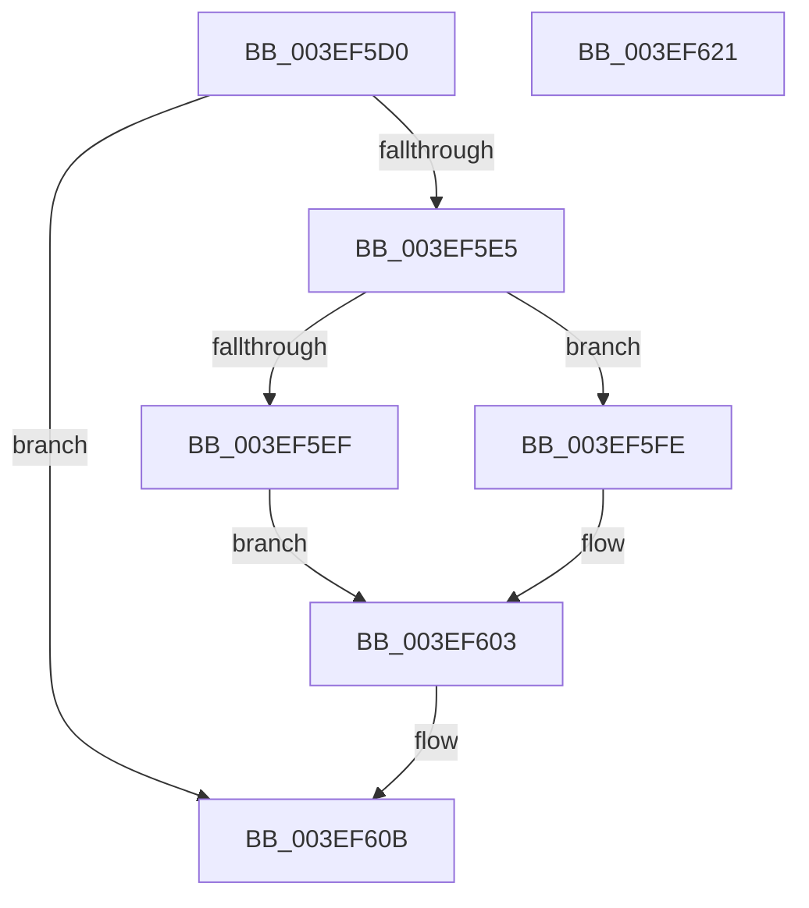

# ViAvlReleaseTableLockFromDpcLevel

- RVA: `0x003EF5D0`–`0x003EF622` (길이 `82` bytes)
- VA: `0x00000001403EF5D0`
- 실행 섹션: `.text`
- PDB 이름 있음: `예`; PDB Function 태그: `아니요`
- unwind 정보 RVA: `0x0005CF00`
- 디코드: `27`개 명령, `82/82` bytes 표시
- 미해석 바이트: `0` (있으면 어셈블리에 `.byte`로 보존)

> 이 문서는 커널 이미지의 기계어와 PDB 기호를 분석해 생성했습니다. 4번과 5번은 함수 원형과 자료형을 바이너리 사용 방식에서 추정한 C 해석이며 원본 소스 복구 결과는 아닙니다.

## 1. Dependencies

- 직접 호출 지점: **2**; 고유 호출 대상: **2**
- 직접 호출자로 확인된 함수: **9**
- RIP 상대 이미지 참조: **0**

### Outgoing calls
- `0x003EF5F7` → [ExReleaseSpinLockExclusiveFromDpcLevel](../24/ExReleaseSpinLockExclusiveFromDpcLevel_function_002497E0.md) (function, `0x002497E0`)
- `0x003EF5FE` → [ExReleaseSpinLockSharedFromDpcLevel](../24/ExReleaseSpinLockSharedFromDpcLevel_function_0024A590.md) (function, `0x0024A590`)

### Direct callers
- [VfAvlDeleteTreeNode](VfAvlDeleteTreeNode_function_003EE240.md) at `0x003EE2C0`
- [VfAvlInsertReservedTreeNode](VfAvlInsertReservedTreeNode_function_003EE424.md) at `0x003EE49D`
- [VfTargetDriversRemove](VfTargetDriversRemove_function_003EEF9C.md) at `0x003EF0FB`
- [VfAvlLookupTreeNode](VfAvlLookupTreeNode_function_003EF1B4.md) at `0x003EF2AE`
- [VfAvlLookupTreeNode](VfAvlLookupTreeNode_function_003EF1B4.md) at `0x003EF33E`
- [ViAvlAcquireTableLockAtDpcLevelSafe](ViAvlAcquireTableLockAtDpcLevelSafe_function_003EF3A0.md) at `0x003EF3BE`
- [VfAvlCleanupLockContext](VfAvlCleanupLockContext_function_003EF56C.md) at `0x003EF585`
- [DifEnumeratePluginData](../61/DifEnumeratePluginData_function_00612590.md) at `0x00612687`
- [VfAvlDeleteAllTreeNodes](../../pagevrfy/B9/VfAvlDeleteAllTreeNodes_function_00B93B9C.md) at `0x00B93BF8`
- [VfAvlEnumerateNodes](../../pagevrfy/B9/VfAvlEnumerateNodes_function_00B93C14.md) at `0x00B93C9C`

### Static image references
- 디코드된 RIP-relative 메모리 참조가 없습니다.

## 2. Other-region calls and transfers

- 다른 실행 섹션으로 향하는 call: **0**
- 별도 외부 분기/꼬리 이동을 확인하지 못했습니다.

## 3. Assembly (complete function range)

```asm
003EF5D0  40 53                           push rbx
003EF5D2  48 83 EC 20                     sub rsp, 0x20
003EF5D6  48 8B DA                        mov rbx, rdx
003EF5D9  48 8B D1                        mov rdx, rcx
003EF5DC  8B 43 10                        mov eax, dword ptr [rbx + 0x10]
003EF5DF  24 0F                           and al, 0xf
003EF5E1  3C 01                           cmp al, 1
003EF5E3  75 26                           jne 0x1403ef60b
003EF5E5  48 83 E9 80                     sub rcx, -0x80
003EF5E9  F6 43 0C 04                     test byte ptr [rbx + 0xc], 4
003EF5ED  74 0F                           je 0x1403ef5fe
003EF5EF  48 83 A2 88 00 00 00 00         and qword ptr [rdx + 0x88], 0
003EF5F7  E8 E4 A1 E5 FF                  call 0x1402497e0
003EF5FC  EB 05                           jmp 0x1403ef603
003EF5FE  E8 8D AF E5 FF                  call 0x14024a590
003EF603  80 63 0C FD                     and byte ptr [rbx + 0xc], 0xfd
003EF607  48 83 23 00                     and qword ptr [rbx], 0
003EF60B  8B 43 10                        mov eax, dword ptr [rbx + 0x10]
003EF60E  8D 48 FF                        lea ecx, [rax - 1]
003EF611  33 C8                           xor ecx, eax
003EF613  83 E1 0F                        and ecx, 0xf
003EF616  33 C8                           xor ecx, eax
003EF618  89 4B 10                        mov dword ptr [rbx + 0x10], ecx
003EF61B  48 83 C4 20                     add rsp, 0x20
003EF61F  5B                              pop rbx
003EF620  C3                              ret
003EF621  CC                              int3
```

## 4. C-style interpretation (structured pseudocode)

```c
__int64 __fastcall ViAvlReleaseTableLockFromDpcLevel(__int64 a1, __int64 a2)
{
    __int64 result;
    __int64 v_rsp;

    v_rsp = (v_rsp) - (32);
    result = (unsigned __int8)(((unsigned int)(*(unsigned int *)(a2 + 16))) & (15));
    if (((unsigned __int8)(result)) != 1) goto loc_003EF60B;
    a1 = (a1) - (-128);
    if (((*(unsigned __int8 *)(a2 + 12)) & (4)) == 0) goto loc_003EF5FE;
    result = ExReleaseSpinLockExclusiveFromDpcLevel(a1, a1, a3, a4);
    goto loc_003EF603;
loc_003EF5FE:
    result = ExReleaseSpinLockSharedFromDpcLevel(a1, a1, a3, a4);
loc_003EF603:
loc_003EF60B:
    a1 = (unsigned int)(((unsigned int)(*(unsigned int *)(a2 + 16)) - 1) ^ ((unsigned int)((unsigned int)(*(unsigned int *)(a2 + 16)))));
    a1 = (unsigned int)((a1) & (15));
    a1 = (unsigned int)((a1) ^ ((unsigned int)((unsigned int)(*(unsigned int *)(a2 + 16)))));
    *(unsigned int *)(a2 + 16) = (unsigned int)(a1);
    v_rsp = (v_rsp) + (32);
    return (unsigned int)(*(unsigned int *)(a2 + 16));
}
```

## 5. (Beta) C Style

```c
int64_t ViAvlReleaseTableLockFromDpcLevel(void *Arg1, void *Arg2)
{
    uint8_t *arg1 = (uint8_t *)Arg1;
    uint8_t *arg2 = (uint8_t *)Arg2;

    int64_t result;
    int64_t local_rsp;

    local_rsp = (local_rsp) - (32);
    result = (uint8_t)(((uint32_t)(*(uint32_t *)(arg2 + 0x10))) & (15));
    if (((uint8_t)(result)) != 1) goto loc_003EF60B;
    Arg1 = (Arg1) - (-128);
    if (((*(uint8_t *)(arg2 + 0xC)) & (4)) == 0) goto loc_003EF5FE;
    result = ExReleaseSpinLockExclusiveFromDpcLevel(Arg1, Arg1, a3, a4);
    goto loc_003EF603;
loc_003EF5FE:
    result = ExReleaseSpinLockSharedFromDpcLevel(Arg1, Arg1, a3, a4);
loc_003EF603:
loc_003EF60B:
    Arg1 = (uint32_t)(((uint32_t)(*(uint32_t *)(arg2 + 0x10)) - 1) ^ ((uint32_t)((uint32_t)(*(uint32_t *)(arg2 + 0x10)))));
    Arg1 = (uint32_t)((Arg1) & (15));
    Arg1 = (uint32_t)((Arg1) ^ ((uint32_t)((uint32_t)(*(uint32_t *)(arg2 + 0x10)))));
    *(uint32_t *)(arg2 + 0x10) = (uint32_t)(Arg1);
    local_rsp = (local_rsp) + (32);
    return (uint32_t)(*(uint32_t *)(arg2 + 0x10));
}
```

### 관측된 메모리 오프셋

구조체 형식이 확인되지 않은 접근은 인자 기준의 오프셋으로만 기록했습니다.

| 기준 인자 | 오프셋 표현 | 폭 (bit) | 접근 |
|---|---:|---:|---|
| `Arg1` | `+ 0x88` | `64` | `R/W` |
| `Arg2` | `+ 0x0` | `64` | `R/W` |
| `Arg2` | `+ 0xC` | `8` | `R` |
| `Arg2` | `+ 0xC` | `8` | `R/W` |
| `Arg2` | `+ 0x10` | `32` | `R` |
| `Arg2` | `+ 0x10` | `32` | `W` |

## 6. Execution-region graph

[열기: 2D/3D 그래프와 함수 탐색 컨트롤 패널](../../../control-panel.html?section=text&rva=0x003EF5D0&view=graph)

- 2D 그래프는 위에서 아래로 흐르고, 3D 그래프는 빈 공간을 드래그해 회전합니다. Shift+드래그는 이동, 휠은 확대·축소, 함수 노드 선택은 대상 보고서 이동입니다.

### Static fallback


