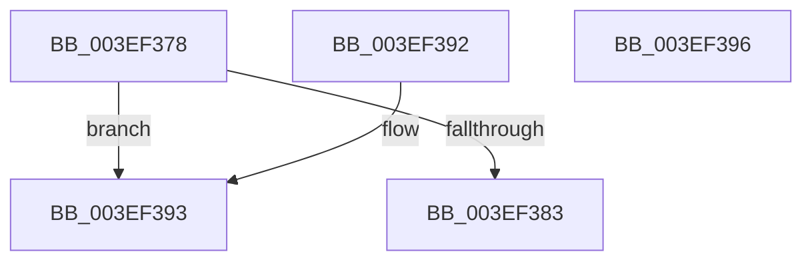

# ViAvlTableIndex

- RVA: `0x003EF378`–`0x003EF397` (길이 `31` bytes)
- VA: `0x00000001403EF378`
- 실행 섹션: `.text`
- PDB 이름 있음: `예`; PDB Function 태그: `아니요`
- unwind 정보 RVA: `0x000DB714`
- 디코드: `14`개 명령, `31/31` bytes 표시
- 미해석 바이트: `0` (있으면 어셈블리에 `.byte`로 보존)

> 이 문서는 커널 이미지의 기계어와 PDB 기호를 분석해 생성했습니다. 4번과 5번은 함수 원형과 자료형을 바이너리 사용 방식에서 추정한 C 해석이며 원본 소스 복구 결과는 아닙니다.

## 1. Dependencies

- 직접 호출 지점: **0**; 고유 호출 대상: **0**
- 직접 호출자로 확인된 함수: **3**
- RIP 상대 이미지 참조: **0**

### Outgoing calls
- 직접 디코드된 call 명령이 없습니다.

### Direct callers
- [VfAvlDeleteTreeNode](VfAvlDeleteTreeNode_function_003EE240.md) at `0x003EE26A`
- [VfAvlInsertReservedTreeNode](VfAvlInsertReservedTreeNode_function_003EE424.md) at `0x003EE444`
- [VfAvlLookupTreeNode](VfAvlLookupTreeNode_function_003EF1B4.md) at `0x003EF257`
- [VfAvlLookupTreeNode](VfAvlLookupTreeNode_function_003EF1B4.md) at `0x003EF2EB`

### Static image references
- 디코드된 RIP-relative 메모리 참조가 없습니다.

## 2. Other-region calls and transfers

- 다른 실행 섹션으로 향하는 call: **0**
- 별도 외부 분기/꼬리 이동을 확인하지 못했습니다.

## 3. Assembly (complete function range)

```asm
003EF378  48 8B C2                        mov rax, rdx
003EF37B  8B 51 18                        mov edx, dword ptr [rcx + 0x18]
003EF37E  83 FA 01                        cmp edx, 1
003EF381  74 10                           je 0x1403ef393
003EF383  8B CA                           mov ecx, edx
003EF385  48 C1 E8 0C                     shr rax, 0xc
003EF389  33 D2                           xor edx, edx
003EF38B  48 F7 F1                        div rcx
003EF38E  48 8B C2                        mov rax, rdx
003EF391  C3                              ret
003EF392  CC                              int3
003EF393  33 C0                           xor eax, eax
003EF395  C3                              ret
003EF396  CC                              int3
```

## 4. C-style interpretation (structured pseudocode)

```c
__int64 __fastcall ViAvlTableIndex(__int64 a1, __int64 a2)
{
    __int64 result;

    if (((unsigned int)((unsigned int)(*(unsigned int *)(a1 + 24)))) == 1) goto loc_003EF393;
    result = (a2) >> (12);
    a2 = 0;
    return 0;
loc_003EF393:
    result = 0;
    return result;
}
```

## 5. (Beta) C Style

```c
int64_t ViAvlTableIndex(void *Arg1, int64_t Arg2)
{
    uint8_t *arg1 = (uint8_t *)Arg1;

    int64_t result;

    if (((uint32_t)((uint32_t)(*(uint32_t *)(arg1 + 0x18)))) == 1) goto loc_003EF393;
    result = (Arg2) >> (12);
    Arg2 = 0;
    return 0;
loc_003EF393:
    result = 0;
    return result;
}
```

### 관측된 메모리 오프셋

구조체 형식이 확인되지 않은 접근은 인자 기준의 오프셋으로만 기록했습니다.

| 기준 인자 | 오프셋 표현 | 폭 (bit) | 접근 |
|---|---:|---:|---|
| `Arg1` | `+ 0x18` | `32` | `R` |

## 6. Execution-region graph

[열기: 2D/3D 그래프와 함수 탐색 컨트롤 패널](../../../control-panel.html?section=text&rva=0x003EF378&view=graph)

- 2D 그래프는 위에서 아래로 흐르고, 3D 그래프는 빈 공간을 드래그해 회전합니다. Shift+드래그는 이동, 휠은 확대·축소, 함수 노드 선택은 대상 보고서 이동입니다.

### Static fallback


